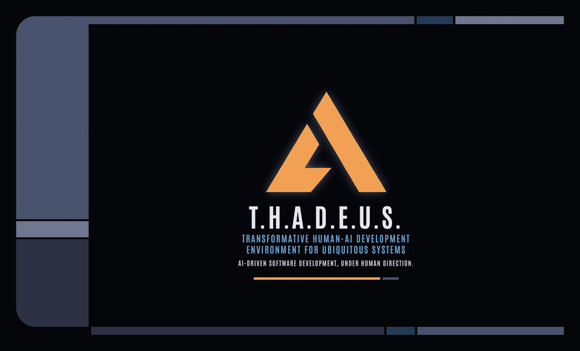
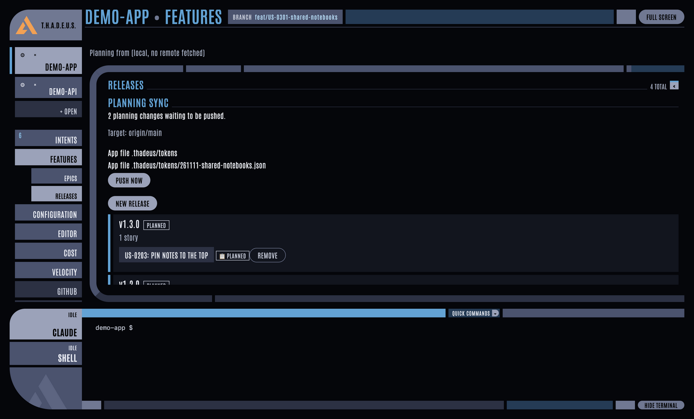
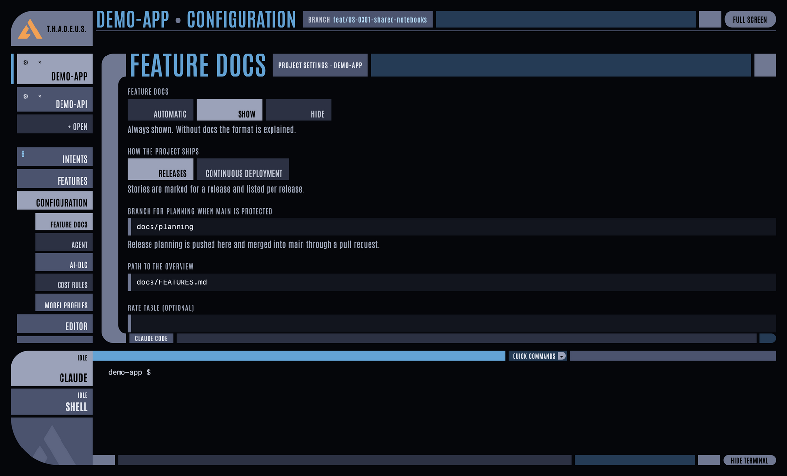

# T.H.A.D.E.U.S.



**Transformative Human-AI Development Environment for Ubiquitous Systems**

*AI-driven software development, under human direction.*

T.H.A.D.E.U.S. is a desktop bridge console for [AI-DLC](https://github.com/awslabs/aidlc-workflows) projects. It shows what the AI agents are doing as it happens: the work in progress, every stage and decision, cost, and the feature roadmap. An embedded agent terminal lets you steer the work from the same window. It also follows [Spec Kit](https://github.com/github/spec-kit) projects, as an alternative to AI-DLC. It is built by Auctum Solutions AB (repository: `aidlc-dash`).

**[Download the latest release →](https://github.com/tochman/ai-dlc-thadeus/releases/latest)** · [All releases](https://github.com/tochman/ai-dlc-thadeus/releases)

## Why I built this

I'm an agile practitioner. Long before AI came along I worked in epics and user stories, so when I started using AI in my development work I simply kept doing that. It still felt ad hoc, though. The sheer speed of AI coding agents lets you make massive progress, but it takes a good amount of self-discipline to keep that progress pointed in the right direction.

I needed a framework and a structure. I didn't want to just be *assisted* by AI. I wanted to *team up* with it. So I started building my own structure on top of my experience as a developer, trying out different skills and setups along the way.

Then I found [AI-DLC](https://github.com/awslabs/aidlc-workflows). I read up on it, tried it on two projects of quite different complexity, and it felt like coming home. It hit the spot.

There's a catch. AI-DLC produces a lot: documentation, approval gates, decisions, audit logs. I also combine it with my own way of splitting a domain into epics and user stories with acceptance criteria (in the Connexa format). I needed one place where all of that was visible and easy to reach. So I built it.

And yes, I'm a Trekkie. 🖖

## Why AI-DLC is worth it

**For the individual developer**, AI-DLC is the discipline you would otherwise have to supply yourself. It makes you say what you're building before anything gets built. It asks the questions you'd skip on a busy day. It stops at every step for your approval, and it writes down what was decided and why. You still go fast, but you go fast in a direction you chose, and you can come back a week later and see exactly where you left off and how you got there.

**For teams**, it turns AI work from something that happens inside one person's chat window into something everyone can follow. Requirements, designs, decisions and test results live in the repository next to the code. They're reviewed like code and handed over like code. A teammate, a reviewer or a product owner can see what the agents did without having been in the room. Shared practices are written down once and every agent follows them, whoever is at the keyboard.

T.H.A.D.E.U.S. is there to make all of that visible, so the structure helps you instead of burying you.

## On vibe coding

Let's be honest: vibe coding produces bad software. You prompt until something seems to work, ship it, and hope nobody looks too closely. The result is code nobody understands, nobody tested and nobody can maintain.

That isn't AI's fault. An AI coding agent is an incredibly capable tool, and like any tool it does what it's pointed at. Using it well is the operator's responsibility: knowing what you want, checking what you get, and owning the result. AI-DLC, and this console, exist to make doing it the right way the easy way.

## Features

### For you, the developer

**Follow the work as it happens**
- **Intents and pipeline:** every piece of AI-DLC work in a project, with its plan and where each stage stands, as LCARS cards. Open several projects side by side as tabs.
- **Timeline:** every stage, agent, approval, question and decision from AI-DLC's audit log, fast even for long histories, live as agents write.
- **Units and artifacts:** how Construction is split into units and batches, and every document a stage produced, read inside the app.
- **Fold the list away** (intents, epics, releases, files) to give a wide view, like the unit graph, the whole window.
- **Activity:** an intent's agents at work and its tokens over time, by stage, agent or model.

**Talk to the agents without living in the terminal**
- **Agent terminal:** Claude Code, opencode, Codex or Kiro, chosen per project, plus a shell. Claude Code and opencode can run side by side. The app finds the agent tools even when your login shell is slow to start.
- **Questions as dialogs:** when AI-DLC or the coding tool asks something, or wants permission, you answer in a pop-up, with a system notification.
- **Agent progress:** plain progress lines per running agent ("6 of 27 steps done").

**Steer AI-DLC from the console**
- **Resume** an intent where it stopped with one click, and **park** it; resuming a parked intent unparks it.
- **Set up AI-DLC** in a folder, for any of its harnesses, with a preview before anything changes, and update the framework later.
- **Configuration:** see and change a project's AI-DLC settings, make your own plans (Configuration → AI-DLC → Plans), and pick a model and effort per agent.
- **Editor:** edit project files, docs and code in the app.

**Or use Spec Kit instead**
- **One framework per project:** the app sees what a project has, asks you once, and shows only that framework's views. Switch later under **Configuration → Framework**; the other framework's files stay untouched.
- **Set up Spec Kit** in a folder from the app.
- **Specs:** the project's features, where each one stands, its tasks and its files, live as the agent writes, with what the agent waits on.
- **Commands:** the Spec Kit commands as buttons that type into the Claude Code or opencode tab.
- **Constitution, extensions and hooks** under **Configuration → Spec Kit**.
- **A token log per feature**, kept in the project.

**Know what it costs, and spend less**
- **Cost** per intent, stage, agent and model, live while a workflow runs, with token charts. These are estimates at API prices, not invoices; recorded tokens can be repriced with a current price table.
- **Spend less:** a cost rule pack on top of AI-DLC, a prompt to compact or start fresh when the context grows (it asks AI-DLC to park at its next safe point, then clears and resumes), and a stronger model profile only for the intents that need it.

### For your team

- **Shared records:** requirements, designs, decisions and test results live in the repository next to the code. **Refresh from GitHub** brings in what a teammate or another machine pushed, safely, even with local work in progress. Cost counts every machine that worked on an intent.
- **Feature docs:** the app offers `docs/FEATURES.md` and epic files at setup and shows your epics and user stories with their status. Every agent keeps them current through a rule in AI-DLC's memory.
- **Release planning:** plan stories into releases, or ship continuously. Planning changes are committed on their own branch, pushed when there is time and never lost. A story branch still shows `main`'s releases. The app's own files and hook settings stay in sync with `main`.
- **Pull requests and reviews:** a panel for GitHub, GitLab and Bitbucket shows who works on what and warns when a branch is behind `main` or overlaps another open pull request. Each intent's **Review** tab leads with what needs you (questions, NOT-READY findings, change requests, open threads), then the pull request's review threads.
- **Velocity:** metrics per intent, story and project, from the records AI-DLC already keeps.

### Everywhere

- **In-app updates** from the public GitHub releases, on macOS and Linux, in one update dialog (**Settings → Tools → Check for updates**).
- **An LCARS interface** with one set of rules: nested and diagonal frames, quiet colour, readouts that never look like controls, and a short entrance animation that respects reduced motion.
- **English and Swedish:** the interface language follows the operating system, or you choose it in Settings.

### Screenshots

| | |
|---|---|
|  |  |
| **Pipeline:** where every stage of an intent stands | **Timeline:** everything that happened, live from the audit log |
|  |  |
| **Cost:** estimated cost per model, agent and intent | **Features:** the project's epics and stories |
|  |  |
| **Releases:** stories planned per release | **Configuration:** the project's settings and AI-DLC |

The screenshots and the animation show an invented demo project. `npm run screenshots` takes them again from the current app.

## Prerequisites

- **[AI-DLC](https://github.com/awslabs/aidlc-workflows)** with its `aidlc` command on your login shell's `PATH`. The app reads AI-DLC projects and runs the `aidlc` CLI; it does not install it.
- **[Spec Kit](https://github.com/github/spec-kit)**, only for Spec Kit projects: its `specify` command on your login shell's `PATH`. The app is made for v1.4.x and warns about other versions.
- **An agent CLI** for the terminal: [Claude Code](https://docs.claude.com/en/docs/claude-code) (`claude`), [opencode](https://opencode.ai) (`opencode`), Codex or Kiro.
- **[GitHub CLI](https://cli.github.com)** (`gh`), signed in, for Refresh from GitHub and the pull request panel on GitHub. Updates do not need it.
- **To build from source:** macOS or Linux, Node.js in the version named in [`.nvmrc`](.nvmrc), npm and git.

## Installation

Download the build for your platform from the [releases page](https://github.com/tochman/ai-dlc-thadeus/releases):

- **macOS** (universal `.dmg`): open the disk image and drag `THADEUS.app` to Applications. The build is unsigned, so the first time, right-click the app and choose **Open**.
- **Linux** (`.deb`, x64, Ubuntu 22.04 or later): `sudo apt install ./thadeus_<version>_amd64.deb`.

The app expects the tools under [Prerequisites](#prerequisites) to be available in your login shell. It does not install them. **Settings → Tools** shows which ones it found, grouped by purpose, and what to do about a missing one.

## Usage

1. **Open a project** with **+ Open** in the left arm, or **File → Open project…** (`Cmd/Ctrl+O`). Any folder that contains `aidlc/spaces/` or `.specify/` works, and so does a folder where you want to set AI-DLC or Spec Kit up. The app asks which framework to follow.
2. **Set up AI-DLC** if the folder has none: choose the harness, look at the preview, and click **Apply**. The project's harness for the agent terminal is under **Configuration → Agent**.
3. **Start an intent** by describing what you want in the agent terminal (`/aidlc <what to build>`), or **Resume** one from the Intents view. Follow it in the pipeline and the timeline.
4. **Answer the agent** in the pop-up when it asks a question or waits for your approval.
5. **See the cost** under **Cost** in the left arm, per intent, stage, agent and model.
6. **Plan a release** under **Features → Releases**: create a release and add stories to it. The app commits and pushes the planning for you.

Open projects are restored on the next start. **Full screen:** `Ctrl+Cmd+F` on macOS, `F11` on Linux.

## Coming next

Plans can change; [docs/FEATURES.md](docs/FEATURES.md) and [docs/releases/](docs/releases/) always have the current state.

- **v0.3.1, steer the work and see what it costs:** rename an intent or change the plan of one that has started; see whether your tools are signed in and sign in from the app; a start-screen health check; cost per story, epic and release, with hints on where to save.
- **v0.3.2, what the work delivered:** delivery metrics (lead time, release frequency, failure rate, recovery time), quality next to cost, the AI's share of delivered code, insights per person and machine, any harness in the agent terminal, and more motion in the pipeline cards.
- **Later:** add your own language with a translation file.

## Development

Requires macOS or Linux, Node.js from [`.nvmrc`](.nvmrc) (`nvm use`) and npm.

```bash
git clone https://github.com/tochman/ai-dlc-thadeus.git && cd ai-dlc-thadeus
npm install            # install dependencies and rebuild node-pty for Electron
npm run dev            # run the app with hot reload
npm test               # run the test suite
npm run lint           # ESLint
npm run format:check   # Prettier
npm run build          # build an unsigned macOS app (.app and .dmg) in dist/
npm run build:linux    # build the Linux .deb in dist/
npm run icon           # regenerate the app icon from build/icon.svg
```

The builds also write `build/THIRD_PARTY_LICENSES.txt`, the licences of everything the app bundles, which the app shows from **About → Licenses**. Releases are built by GitHub Actions when a `vX.Y.Z` tag matching `package.json` is pushed. This project is developed with AI-DLC itself; its records are in `aidlc/spaces/default/intents/`, and the roadmap is in [docs/FEATURES.md](docs/FEATURES.md).

## Testing

The test suite uses [Vitest](https://vitest.dev/) and [Testing Library](https://testing-library.com/), and is split into three projects:

- **main** (`tests/main/`) covers the Electron main process (parsers for the AI-DLC records, file access, git, settings, the terminal and the harness setup) in a Node environment.
- **scripts** covers the timed hook scripts, run after the others.
- **renderer** (`tests/renderer/`) covers the React components in jsdom, rendered in Swedish so the translations are exercised too.

End-to-end tests (`tests/e2e/`) drive the built app with Playwright.

The unit tests run against small sample AI-DLC projects, audit logs and ledgers in `tests/fixtures/`, never against your real projects.

```bash
npm test                                  # run everything once
npx vitest                                # watch mode
npx vitest run --project main             # only the main-process tests
npx vitest run tests/renderer/Timeline.test.jsx   # a single file
```

Every pull request runs a secret scan (gitleaks), the full suite with an 80% line-coverage floor, ESLint, Prettier and end-to-end tests of the built app (Playwright) in GitHub Actions before the macOS and Linux builds, and a release is only built from a green run. The tests need the Node version in `.nvmrc`; on older versions some of them fail to start.

## Security

- **File access:** all file access goes through the main process and is limited to the project roots you have opened. Paths with `..`, absolute paths, and symlinks pointing out of the root are refused.
- **What the app writes:**
  - Its own settings: `~/Library/Application Support/aidlc-dash/settings.json` on macOS, `~/.config/aidlc-dash/settings.json` on Linux.
  - In a project, only what you ask for or turn on: files you save in the editor, the feature docs and release plans, its own files under `.thadeus/`, and its hook entries in the coding tool's settings, shown before they are installed. Planning and `.thadeus/` changes are committed from a separate worktree, so the branch you work on is never touched.
  - AI-DLC itself is changed through the official `aidlc` CLI, with fixed arguments and no shell, after a preview and your explicit **Apply**. The app edits only a few AI-DLC settings files directly, never the files the AI-DLC engine owns.
- **Renderer:** the renderer runs sandboxed with `contextIsolation` and without `nodeIntegration`. It reaches only a narrow preload API of named functions.
- **Artifacts:** Markdown is rendered without raw HTML, so no script in an artifact can run. "Open in editor" is limited to document files (`.md`, `.json`, `.txt`, `.yaml`, `.yml`).
- **Terminal:** the terminal tabs run with your normal environment and permissions, like a terminal you start yourself.

Found a vulnerability? Please report it privately as described in [SECURITY.md](SECURITY.md), not in a public issue.

## Open source

I'm open-sourcing T.H.A.D.E.U.S. because I think it's a good thing to do. If you find it useful and decide to use it, that will make me happy. Issues, ideas and pull requests are welcome.

## Contributing

Read [CONTRIBUTING.md](CONTRIBUTING.md) for how work is organised (stories in epics, test first, one pull request per story) and what CI checks. Everyone taking part follows the [Code of Conduct](CODE_OF_CONDUCT.md). Bugs and feature ideas go in [GitHub issues](https://github.com/tochman/ai-dlc-thadeus/issues/new/choose).

## License

[MIT](LICENSE) © 2026 Auctum Solutions AB
