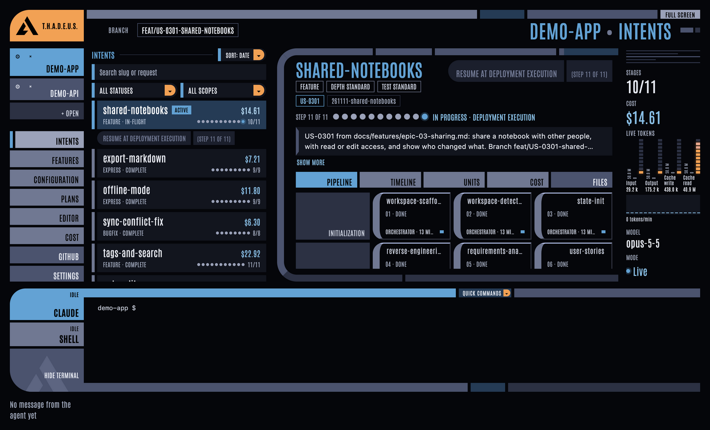
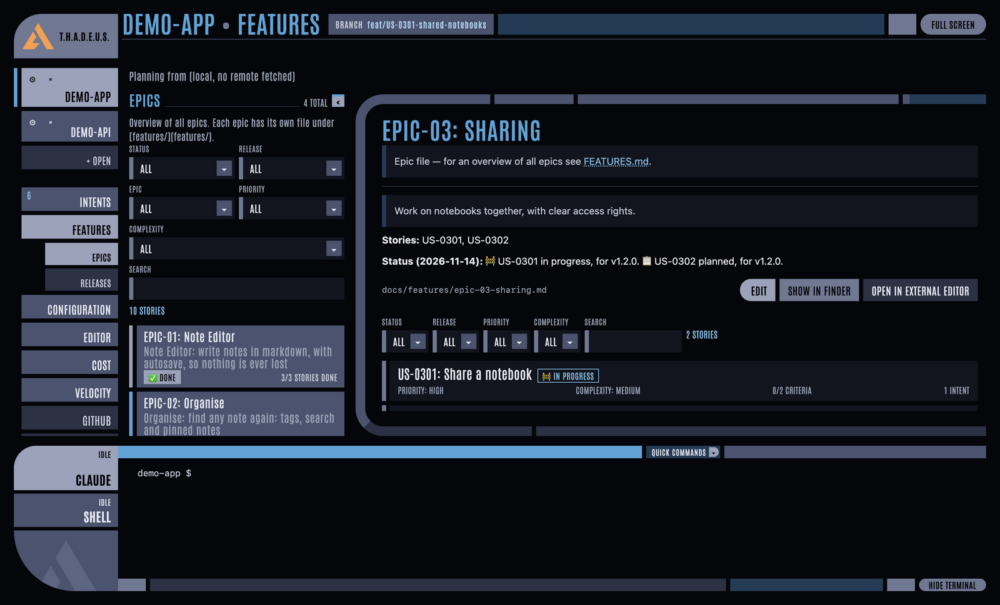

# T.H.A.D.E.U.S.

**Transformative Human-AI Development Environment for Ubiquitous Systems**

*AI-driven software development, under human direction.*

T.H.A.D.E.U.S. is a desktop bridge console for [AI-DLC](https://github.com/awslabs/aidlc-workflows) projects. It shows what the AI agents are doing as it happens: the work in progress, every stage and decision, cost, and the feature roadmap. An embedded agent terminal lets you steer the work from the same window. It is built by Auctum Solutions AB (repository: `aidlc-dash`).

**[Download the latest release →](https://github.com/tochman/aidlc-dash/releases/latest)** · [All releases](https://github.com/tochman/aidlc-dash/releases)



## Features

- **Intents and pipeline:** every piece of AI-DLC work in a project, with its plan, status and stage-by-stage progress. Custom plans are shown by their own name.
- **Live timeline:** stages, agent dispatches, approval gates, questions and decisions, streamed from the AI-DLC audit log.
- **Units and artifacts:** the unit/bolt graph, and every stage artifact rendered inline.
- **Cost:** estimated cost per model, agent and intent, from AI-DLC's usage ledger. These figures are estimates at API prices, not invoices.
- **Feature docs:** the project's epics and user stories from `docs/FEATURES.md` and `docs/features/`.
- **Agent terminal:** a terminal for the project's agent harness (Claude Code or opencode, chosen per project) and a shell. It also offers one-click resume and quick commands.
- **Questions as pop-ups:** when AI-DLC waits for an answer or an approval, you get a pop-up and a system notification.
- **AI-DLC setup:** set up AI-DLC in a project for any of its six harnesses (Claude Code, opencode, Codex, Kiro, Cursor, GitHub Copilot), or add a harness to an existing project. You see a preview before anything changes.
- **English and Swedish:** the interface language follows the operating system, or you choose it in Settings.

| | |
|---|---|
|  |  |
| **Timeline:** everything that happened in an intent, live from the audit log | **Cost:** estimated cost per model, agent and intent |
|  |  |
| **Features:** the project's epics and stories | **Start screen** |

## Installation

Download the build for your platform from the [releases page](https://github.com/tochman/aidlc-dash/releases):

- **macOS** (universal `.dmg`): open the disk image and drag `THADEUS.app` to Applications. The build is unsigned, so the first time, right-click the app and choose **Open**.
- **Linux** (`.deb`, x64, Ubuntu 22.04 or later): `sudo apt install ./thadeus_<version>_amd64.deb`.

The app expects `aidlc` and your agent CLI (`claude` or `opencode`) to be available in your login shell. It does not install them.

## Usage

1. Open a project with **+ Open** in the left arm, or **File → Open project…** (`Cmd/Ctrl+O`). Any folder that contains `aidlc/spaces/` works, and so does a folder where you want to set AI-DLC up.
2. Pick a view in the left arm (Intents, Features), and expand Cost and GitHub as needed.
3. Use the agent terminal at the bottom to run `/aidlc`, or click **Resume** on an intent.
4. Choose the project's agent harness under **Project settings → Agent terminal**.

Open projects are restored on the next start. **Full screen:** `Ctrl+Cmd+F` on macOS, `F11` on Linux.

## Development

Requires macOS or Linux, Node 22 and npm.

```bash
npm install            # install dependencies and rebuild node-pty for Electron
npm run dev            # run the app with hot reload
npx vitest run tests/  # run the test suite
npm run build          # build an unsigned macOS app (.app and .dmg) in dist/
npm run build:linux    # build the Linux .deb in dist/
npm run icon           # regenerate the app icon from build/icon.svg
```

Releases are built by GitHub Actions when a `vX.Y.Z` tag matching `package.json` is pushed. This project is developed with AI-DLC itself; its records are in `aidlc/spaces/default/intents/`, and the roadmap is in [docs/FEATURES.md](docs/FEATURES.md).

## Security

- **File access:** all file access goes through the main process and is limited to the project roots you have opened. Paths with `..`, absolute paths, and symlinks pointing out of the root are refused.
- **What the app writes:**
  - The app only writes its own settings: `~/Library/Application Support/aidlc-dash/settings.json` on macOS, `~/.config/aidlc-dash/settings.json` on Linux.
  - It never edits AI-DLC files directly. Setting up or adding a harness runs the official `aidlc` CLI with fixed arguments and no shell, only after a preview and your explicit **Apply**.
- **Renderer:** the renderer runs sandboxed with `contextIsolation` and without `nodeIntegration`. It reaches only a narrow preload API of named functions.
- **Artifacts:** Markdown is rendered without raw HTML, so no script in an artifact can run. "Open in editor" is limited to document files (`.md`, `.json`, `.txt`, `.yaml`, `.yml`).
- **Terminal:** the terminal tabs run with your normal environment and permissions, like a terminal you start yourself.

## Upgrading from Auctum AIDLC Control

The app was previously named Auctum AIDLC Control. Your settings and open projects carry over, because the settings folder is still named `aidlc-dash`.

- **macOS:** T.H.A.D.E.U.S. has a new app id, so it does not replace the old app. Quit the old app and remove it from Applications.
- **Linux:** the `thadeus` package replaces `aidlc-dash` automatically.

## License

[MIT](LICENSE) © 2026 Auctum Solutions AB
