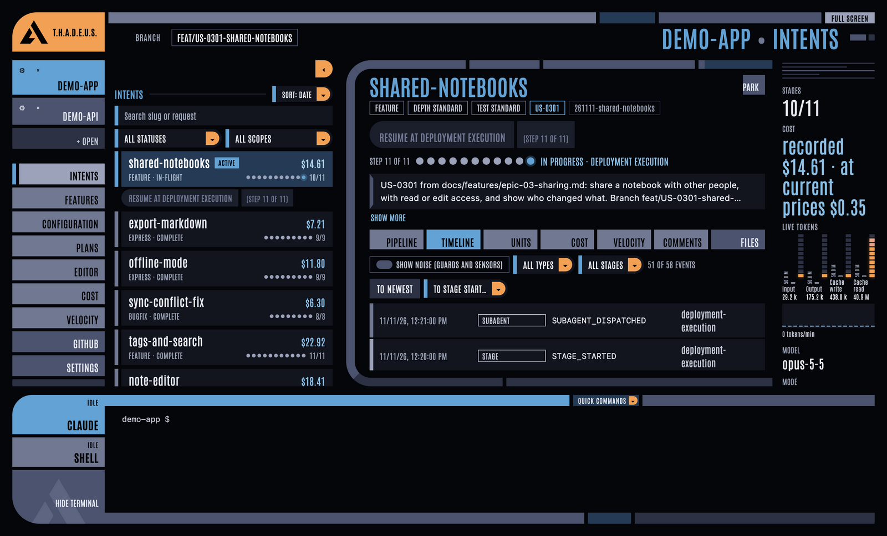

# T.H.A.D.E.U.S.

**Transformative Human-AI Development Environment for Ubiquitous Systems**

*AI-driven software development, under human direction.*

T.H.A.D.E.U.S. is a desktop bridge console for [AI-DLC](https://github.com/awslabs/aidlc-workflows) projects. It shows what the AI agents are doing as it happens: the work in progress, every stage and decision, cost, and the feature roadmap. An embedded agent terminal lets you steer the work from the same window. It is built by Auctum Solutions AB (repository: `aidlc-dash`).

**[Download the latest release →](https://github.com/tochman/aidlc-dash/releases/latest)** · [All releases](https://github.com/tochman/aidlc-dash/releases)


## Why I built this

I'm an agile practitioner. Long before AI came along I worked in epics and user stories, so when I started using AI in my development work I simply kept doing that. It still felt ad hoc, though. The sheer speed of AI coding agents lets you make massive progress, but it takes a good amount of self-discipline to keep that progress pointed in the right direction.

I needed a framework and a structure. I didn't want to just be *assisted* by AI. I wanted to *team up* with it. So I started building my own structure on top of my experience as a developer, trying out different skills and setups along the way.

Then I found [AI-DLC](https://github.com/awslabs/aidlc-workflows). I read up on it, tried it on two projects of quite different complexity, and it felt like coming home. It hit the spot.

There's a catch. AI-DLC produces a lot: documentation, approval gates, decisions, audit logs. I also combine it with my own way of splitting a domain into epics and user stories with acceptance criteria (in the Connexa format). I needed one place where all of that was visible and easy to reach. So I built it.

And yes, I'm a Trekkie. 🖖

## Why AI-DLC is worth it

**For the individual developer**, AI-DLC is the discipline you would otherwise have to supply yourself. It makes you say what you're building before anything gets built. It asks the questions you'd skip on a busy day. It stops at every step for your approval, and it writes down what was decided and why. You still go fast, but you go fast in a direction you chose, and you can come back a week later and see exactly where you left off and how you got there.

**For teams**, it turns AI work from something that happens inside one person's chat window into something everyone can follow. Requirements, designs, decisions and test results live in the repository next to the code. They're reviewed like code and handed over like code. A teammate, a reviewer or a product owner can see what the agents did without having been in the room. Shared practices are written down once and every agent follows them, whoever is at the keyboard.

T.H.A.D.E.U.S. is there to make all of that visible, so the structure helps you instead of burying you.

## On vibe coding

Let's be honest: vibe coding produces bad software. You prompt until something seems to work, ship it, and hope nobody looks too closely. The result is code nobody understands, nobody tested and nobody can maintain.

That isn't AI's fault. An AI coding agent is an incredibly capable tool, and like any tool it does what it's pointed at. Using it well is the operator's responsibility: knowing what you want, checking what you get, and owning the result. AI-DLC, and this console, exist to make doing it the right way the easy way.

## Features

- **Intents and pipeline:** every piece of AI-DLC work in a project, with its plan, status and stage-by-stage progress. Custom plans are shown by their own name.
- **Live timeline:** stages, agent dispatches, approval gates, questions and decisions, streamed from the AI-DLC audit log.
- **Units and artifacts:** the unit/bolt graph, and every stage artifact rendered inline.
- **Cost:** estimated cost per model, agent and intent, from AI-DLC's usage ledger. These figures are estimates at API prices, not invoices.
- **Feature docs:** the project's epics and user stories from `docs/FEATURES.md` and `docs/features/`.
- **Agent terminal:** a terminal for the project's agent harness (Claude Code or opencode, chosen per project) and a shell. It also offers one-click resume and quick commands.
- **Questions as pop-ups:** when AI-DLC waits for an answer or an approval, you get a pop-up and a system notification.
- **AI-DLC setup:** set up AI-DLC in a project for any of its six harnesses (Claude Code, opencode, Codex, Kiro, Cursor, GitHub Copilot), or add a harness to an existing project. You see a preview before anything changes.
- **English and Swedish:** the interface language follows the operating system, or you choose it in Settings.

| | |
|---|---|
|  |  |
| **Timeline:** everything that happened in an intent, live from the audit log | **Cost:** estimated cost per model, agent and intent |
|  |  |
| **Features:** the project's epics and stories | **Start screen** |

## Installation

Download the build for your platform from the [releases page](https://github.com/tochman/aidlc-dash/releases):

- **macOS** (universal `.dmg`): open the disk image and drag `THADEUS.app` to Applications. The build is unsigned, so the first time, right-click the app and choose **Open**.
- **Linux** (`.deb`, x64, Ubuntu 22.04 or later): `sudo apt install ./thadeus_<version>_amd64.deb`.

The app expects `aidlc` and your agent CLI (`claude` or `opencode`) to be available in your login shell. It does not install them.

## Usage

1. Open a project with **+ Open** in the left arm, or **File → Open project…** (`Cmd/Ctrl+O`). Any folder that contains `aidlc/spaces/` works, and so does a folder where you want to set AI-DLC up.
2. Pick a view in the left arm (Intents, Features), and expand Cost and GitHub as needed.
3. Use the agent terminal at the bottom to run `/aidlc`, or click **Resume** on an intent.
4. Choose the project's agent harness under **Project settings → Agent terminal**.

Open projects are restored on the next start. **Full screen:** `Ctrl+Cmd+F` on macOS, `F11` on Linux.

## Development

Requires macOS or Linux, Node 22 and npm.

```bash
npm install            # install dependencies and rebuild node-pty for Electron
npm run dev            # run the app with hot reload
npm test               # run the test suite
npm run build          # build an unsigned macOS app (.app and .dmg) in dist/
npm run build:linux    # build the Linux .deb in dist/
npm run icon           # regenerate the app icon from build/icon.svg
```

Releases are built by GitHub Actions when a `vX.Y.Z` tag matching `package.json` is pushed. This project is developed with AI-DLC itself; its records are in `aidlc/spaces/default/intents/`, and the roadmap is in [docs/FEATURES.md](docs/FEATURES.md).

## Testing

The test suite uses [Vitest](https://vitest.dev/) and [Testing Library](https://testing-library.com/), and is split into two projects:

- **main** (`tests/main/`) covers the Electron main process (parsers for the AI-DLC records, file access, git, settings, the terminal and the harness setup) in a Node environment.
- **renderer** (`tests/renderer/`) covers the React components in jsdom, rendered in Swedish so the translations are exercised too.

Both run against small sample AI-DLC projects, audit logs and ledgers in `tests/fixtures/`, never against your real projects.

```bash
npm test                                  # run everything once
npx vitest                                # watch mode
npx vitest run --project main             # only the main-process tests
npx vitest run tests/renderer/Timeline.test.jsx   # a single file
```

Every pull request runs the full suite in GitHub Actions before the macOS and Linux builds, and a release is only built from a green run. The tests need Node 22; on older versions some of them fail to start.

## Security

- **File access:** all file access goes through the main process and is limited to the project roots you have opened. Paths with `..`, absolute paths, and symlinks pointing out of the root are refused.
- **What the app writes:**
  - The app only writes its own settings: `~/Library/Application Support/aidlc-dash/settings.json` on macOS, `~/.config/aidlc-dash/settings.json` on Linux.
  - It never edits AI-DLC files directly. Setting up or adding a harness runs the official `aidlc` CLI with fixed arguments and no shell, only after a preview and your explicit **Apply**.
- **Renderer:** the renderer runs sandboxed with `contextIsolation` and without `nodeIntegration`. It reaches only a narrow preload API of named functions.
- **Artifacts:** Markdown is rendered without raw HTML, so no script in an artifact can run. "Open in editor" is limited to document files (`.md`, `.json`, `.txt`, `.yaml`, `.yml`).
- **Terminal:** the terminal tabs run with your normal environment and permissions, like a terminal you start yourself.

## Open source

I'm open-sourcing T.H.A.D.E.U.S. because I think it's a good thing to do. If you find it useful and decide to use it, that will make me happy. Issues, ideas and pull requests are welcome.

## License

[MIT](LICENSE) © 2026 Auctum Solutions AB
