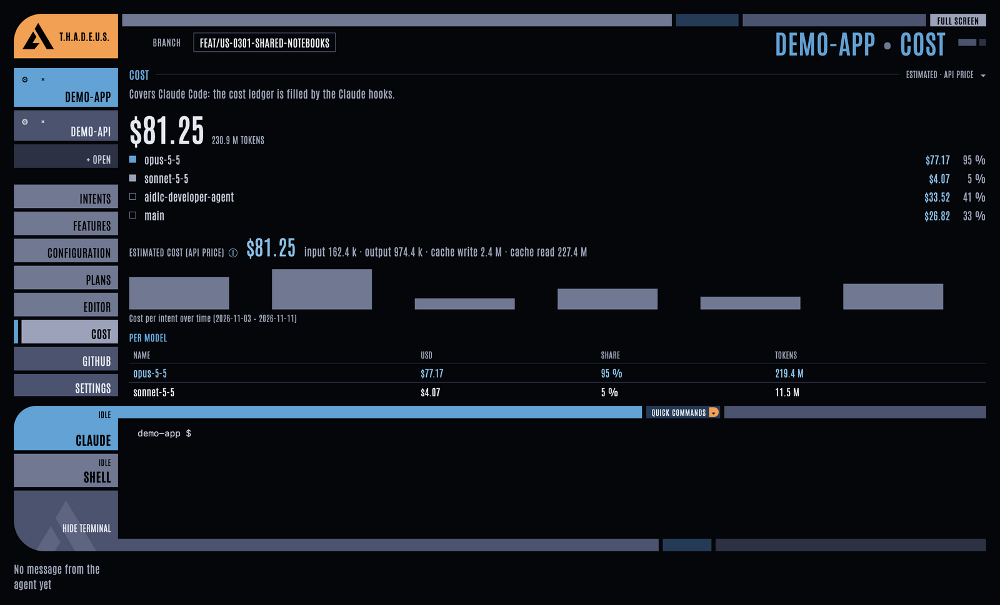
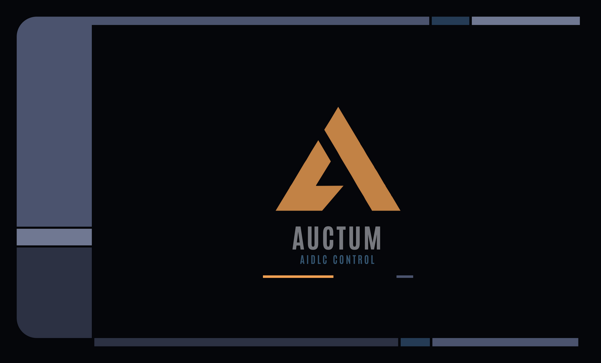

# T.H.A.D.E.U.S.

**Transformative Human-AI Development Environment for Ubiquitous Systems**

*AI-driven software development, under human direction.*

T.H.A.D.E.U.S. (repo: `aidlc-dash`) är en Electron-"bridge console" för AI-DLC-projekt: en sci-fi-vy (LCARS-inspirerad, men återhållsam) av vad agenterna gör. Appen är gjord av Auctum, och Auctums symbol står på startskärmen, i sidhuvudet och som appikon.


## Skärmbilder

| | |
|---|---|
|  |  |
| **Tidslinje:** allt som hänt i en intent, live från audit-loggen | **Kostnad:** uppskattad kostnad per modell, agent och intent |
|  |  |
| **Features:** projektets epics och stories från `docs/features/` | **Startskärm** med Auctum-symbolen |

## Vision

- Open any project folder that contains `aidlc/spaces/<space>/intents/`
- Browse intents (`intents.json`), their scope, status and stage progress (`runtime-graph.json`, `aidlc-state.md`)
- Live timeline from the audit log (`audit/*.md`): stages, subagent dispatches, gates, questions, decisions
- Bolt / unit DAG view (`bolt_dag` in `runtime-graph.json`)
- Read stage artifacts (markdown) inline
- Watch files and update live while agents work
- Interactive: send commands to Claude (e.g. `/aidlc ...`, answer gate questions) from the console

Built with AI-DLC itself, see `aidlc/spaces/default/intents/`.

## Kom igång

Kräver macOS eller Linux, Node 22 och npm. `claude` och `aidlc` ska finnas i ditt inloggningsskal. Appen installerar dem inte.

```bash
npm install          # installerar beroenden och bygger om node-pty för Electron
npm run dev          # startar appen med hot reload
npm run build        # bygger en osignerad macOS-app (.app och .dmg) i dist/
npx vitest run tests/  # kör enhetstesterna
```

Linux-paketet (`.deb`) kräver Ubuntu 22.04 eller nyare. Appikonen genererar du om från `build/icon.svg` med `npm run icon`.

Den osignerade appen öppnar du första gången med högerklick och sedan **Öppna**, eftersom Gatekeeper annars blockerar den.

## Uppgradera från Auctum AIDLC Control

Appen hette tidigare Auctum AIDLC Control. Dina inställningar och öppna projekt följer med, eftersom inställningsmappen fortfarande heter `aidlc-dash`.

- **macOS:** T.H.A.D.E.U.S. är en ny app för macOS (nytt app-id, `THADEUS.app`), så den ersätter inte den gamla.
  1. Avsluta den gamla appen och ta bort "Auctum AIDLC Control" från Program.
  2. Öppna `THADEUS.app` första gången med högerklick och sedan **Öppna**, eftersom appen inte är signerad.
  3. Fäst den nya appen i Dock igen och ge den behörighet för notiser när macOS frågar.
- **Linux:** det nya paketet `thadeus` ersätter det gamla `aidlc-dash` automatiskt när du installerar det (`sudo apt install ./thadeus_<version>_amd64.deb`).

I appen öppnar du ett projekt med **+ Öppna** i vänsterarmen eller med **Arkiv → Öppna projekt…** (`Cmd/Ctrl+O`). Varje projekt hamnar i vänsterarmen. Där väljer du också vy (Intents, Features), fäller ut Kostnad och Github, och öppnar Inställningar.

Projektvyn har en intent-lista och en detaljvy (Pipeline, Tidslinje, Units, Kostnad, Filer). I den nedre armen finns en terminalpanel med två flikar, Claude och Shell. Båda startar i projektroten. Panelens höjd ändrar du genom att dra i kanten. Projekten öppnas igen nästa gång appen startar.

- **Helskärm:** knappen längst upp till höger, **Visa → Helskärm**, `Ctrl+Cmd+F` på macOS eller `F11` på Linux. Appen kommer ihåg läget.
- **Menyn** innehåller bara det appen kan göra, på svenska. **Stäng projekt** är `Cmd/Ctrl+W`. På Linux är menyraden dold och visas med `Alt`.
- **Animationer** (Full / Dämpad / Av) ställer du in under Inställningar.

## Säkerhet

- Appen är skrivskyddad mot AI-DLC-filer och skriver aldrig till dem. Den enda fil appen skriver är sina egna inställningar i `~/Library/Application Support/aidlc-dash/settings.json` (på Linux `~/.config/aidlc-dash/settings.json`).
- All filåtkomst går via huvudprocessen och begränsas till de projektrötter du har öppnat. Sökvägar med `..`, absoluta sökvägar och symlänkar som pekar ut ur roten avvisas.
- Renderaren körs med `contextIsolation`, utan `nodeIntegration` och i sandbox. Den når bara ett smalt preload-API med namngivna funktioner.
- Markdown från artefakter renderas utan rå HTML, så inget skript i en artefakt körs. "Öppna i editor" fungerar bara för dokumentfiler (`.md`, `.json`, `.txt`, `.yaml`, `.yml`).
- Terminalflikarna kör med din vanliga miljö och dina vanliga rättigheter, precis som en terminal du startar själv.
