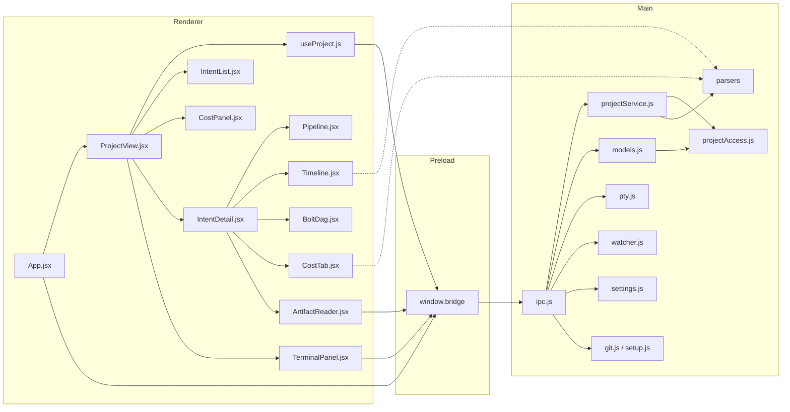
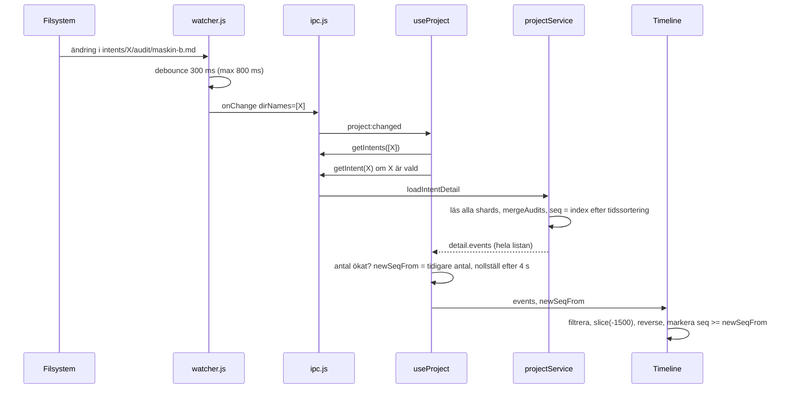
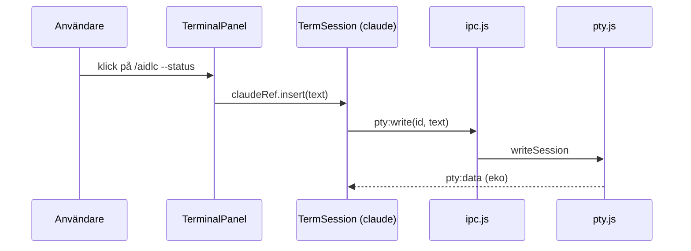

# Architecture — aidlc-dash

## Architecture Analysis

### System Overview

En Electron-app med tre processlager: **huvudprocess** (Node, all fil- och processåtkomst), **preload** (smal namngiven brygga `window.bridge`) och **renderare** (React 19 i sandbox). Huvudprocessen läser AI-DLC:s filer i öppnade projektrötter, tolkar dem med rena parserfunktioner, bevakar ändringar med chokidar och kör pseudoterminaler med node-pty. Renderaren hämtar data via IPC och prenumererar på push-händelser.

Sedan EPIC-05 finns också `exec.js` (externa kommandon utan skal), `git.js` och `setup.js` i huvudprocessen samt `TerminalContext.jsx`/`terminalControl.js` i renderaren, så att andra vyer kan skriva i terminalen. Dessa delar är bara ytligt skannade i den här körningen.

### Architectural Style

**Monolitisk skrivbordsapp med lagrad processisolering.** Belägg: ett enda npm-paket; `electron.vite.config.mjs` bygger tre ingångar (main/preload/renderer); `index.js` sätter `contextIsolation: true`, `nodeIntegration: false`, `sandbox: true`; `preload/index.js` exponerar bara namngivna funktioner (ingen generisk invoke).

Inom huvudprocessen: IPC-adapter (`ipc.js`) → tjänst (`projectService.js`, `models.js`, `pty.js`, `watcher.js`, `settings.js`, `git.js`, `setup.js`) → säker åtkomst (`projectAccess.js`, `exec.js`) och rena parsers (`parsers/*`).

### Component Relationships

Textalternativ: App, useProject, TerminalPanel och ArtifactReader anropar `window.bridge`, som skickar till `ipc.js`. `ipc.js` delegerar till projectService (data), models (konfigurerade modeller), pty (terminaler), watcher (filbevakning), settings (appens inställningar) och git/setup (EPIC-05, ytligt skannat). projectService och models läser filer bara via projectAccess; projectService tolkar med parsers. Streckade pilar: Timeline och CostTab importerar rena parsermoduler direkt vid bundling (ingen IPC). EPIC-05-vyerna (RefreshPanel, ResumeButton, SetupAidlc) och TerminalContext är utelämnade i diagrammet.

### Data Flow

1. **Öppna projekt**: mappväljare → `project:open` → `openRoot` (realpath) → `detectProject` → watcher startas för den aktiva spacen (AI-DLC) eller `watchForAidlc` väntar på en första space (icke-AI-DLC, push `project:detected`).
2. **Läsa**: `project:intents` → `loadIntentList` (intents.json + mappar + active-intent + per-intent state) med cache; `project:intent` → `loadIntentDetail` (state, runtime-graph, alla audit-shards, active-directive, artefaktlista); `project:cost` → `loadCost` + `summarizeLedger`.
3. **Audit-händelser**: `loadAuditEvents` läser varje `audit/*.md` helt → `mergeAudits` tolkar block, sorterar på tidsstämpelsträng och numrerar `seq` efter sorteringen → `categoryOf` sätter kategori. Hela listan skickas till renderaren vid varje detaljladdning.
4. **Live**: chokidar → debounce (300 ms, max 800 ms) → `project:changed {dirNames, indexChanged, costChanged}` → `useProject` laddar om bara berörda delar. Om vald intents händelseantal ökat sätts `newSeqFrom = tidigare antal` i 4 s, och `Timeline` markerar rader med `seq >= newSeqFrom`.
5. **Terminal**: `pty:spawn` → node-pty kör `$SHELL -l -i -c claude` eller `$SHELL -l` i roten → `pty:data`/`pty:exit` till renderaren; tangenttryck → `pty:write`.
6. **Skriva**: endast `settings:set` → `settings.json` i userData.

### Key Design Decisions

- **Skrivskydd och rotinneslutning**: `projectAccess.js` saknar skrivanrop; `resolveInRoot` avvisar absoluta sökvägar, `..` och symlänkar ut ur roten. Konsekvens: säkert att peka på godtyckliga projekt; funktioner som ändrar något går via terminalen (EPIC-05:s princip).
- **Smal IPC-yta**: namngivna kanaler i både `ipc.js` och `preload/index.js`; varje handler slår upp `projectId`. Nya funktioner kräver ändring i båda filerna.
- **Tålighet mot halvskrivna filer**: `readJsonSafe` kastar aldrig; cacher behåller senaste giltiga värde (`stale`-flagga). Ett läsfel i en audit-shard ger hela föregående detalj med `stale: true`.
- **Hela loggen i minnet**: audit-händelser läses om och skickas i sin helhet vid varje uppdatering; renderaren filtrerar och klipper. Enkelt, men kostnaden växer linjärt med loggen.
- **Händelseidentitet = sorteringsposition**: `seq` är index i den sammanslagna, tidssorterade listan och används både som React-nyckel och för ny-markering. Det håller bara så länge nya händelser alltid sorteras sist.
- **Lazy node-pty**: laddas vid första spawn så att en trasig native-binär bara slår ut terminalen.
- **Externa kommandon utan skal**: `models.js` och (sedan EPIC-05) `exec.js` använder `execFile` med fasta argument och PATH från inloggningsskalet.
- **Allt hålls monterat**: projektflikar och terminalsessioner döljs i stället för att avmonteras, så pty-sessioner överlever flikbyten.

### Improvement Opportunities

- **EPIC-03**: ge varje audit-händelse en stabil identitet (t.ex. `source` + position i sin shard) och jämför identiteter i stället för antal; fönstra tidslinjen i stället för att klippa vid 1 500 rader. Se [code-quality-assessment.md](code-quality-assessment.md) § Intent-relevanta luckor.
- Inkrementell läsning av audit-shards (bara tillagda byte) om full omläsning blir för dyr för stora loggar.
- Tidsstämplar sorteras som strängar; normalisering till epoch-tid skulle göra blandade zonformat kronologiska.
- Projektdetektering vid öppning; sedan EPIC-05 finns `watchForAidlc` för mappar utan AI-DLC (ytligt skannat).

## Interaction Diagrams

### Öppna projekt och ladda en intent

Textalternativ: användaren väljer mapp; huvudprocessen validerar roten, detekterar AI-DLC och startar bevakning; renderaren hämtar sedan lista, detalj och kostnad som projectService läser via projectAccess.

### Liveuppdatering och ny-markering i tidslinjen

Textalternativ: en skrivning i en shard samlas i watchern och blir `project:changed` med intentens mappnamn. useProject laddar om listan och, om intenten är vald, hela detaljen. projectService läser om alla shards och numrerar händelserna efter tidsordning. useProject jämför bara antalet händelser och sätter `newSeqFrom`; Timeline markerar de rader vars `seq` är minst det värdet. En ny händelse med äldre tidsstämpel hamnar därför mitt i listan medan de senaste raderna markeras.

### Snabbkommando i terminalen

Textalternativ: snabbknappen anropar claude-sessionens `insert`, som skriver texten utan Enter till pty:n; utdata kommer tillbaka som `pty:data`. Sedan EPIC-05 går andra vyers terminalskrivningar via `TerminalContext` (ytligt skannat, inte omverifierat här).
