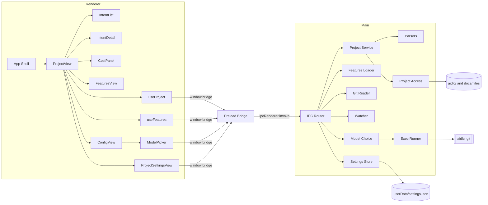
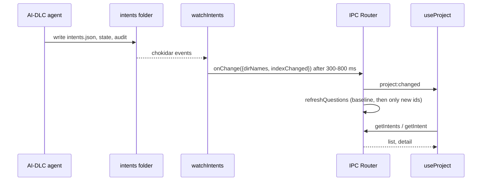
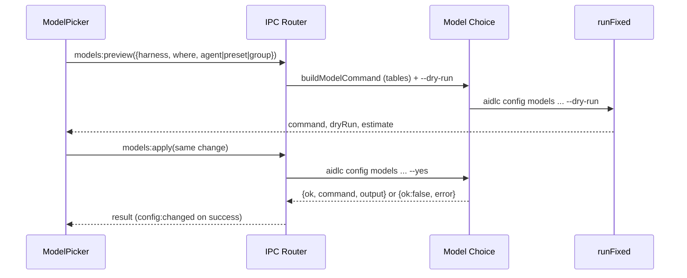
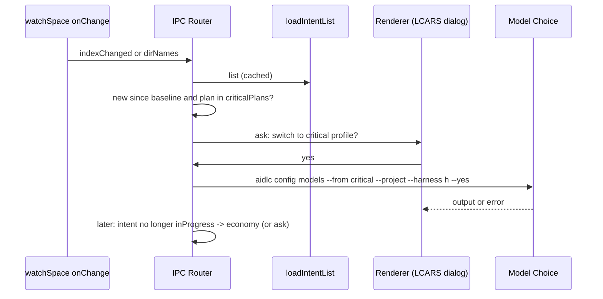

# Architecture

## Architecture Analysis

### System Overview

The app is a single Electron app with three processes:
- **main** (Node): file reads, watchers, ptys, CLI calls, the agent hook channel;
- **preload**: `window.bridge`, a named, narrow API;
- **renderer**: React 19 in a sandboxed window with contextIsolation and a CSP.

Pure modules in `src/shared/` and some parsers in `src/main/parsers/` (`features`, `releases`, `ledger`, `velocity`) are bundled into both sides. The data sources are the project's AI-DLC files, its git history and the `aidlc` CLI's JSON output. There is no database and no server. The app's own settings live in `userData/settings.json`.

### Architectural Style

A modular monolith on the desktop, split along Electron process lines. Main is organised as service modules behind one IPC router (`ipc.js`, 1070 lines at `2b5d6a4`). The renderer is a tree of view components with two data hooks (`useProject`, `useFeatures`) and a per-project terminal context. The evidence:
- `ipc.js` imports almost every main module and keeps per-project state in a `projects` map (root, space, watchers, sender, caches, pending previews);
- `preload/index.js` exposes one `invoke` wrapper per channel and no generic invoke.

### Component Relationships

Text fallback: the views get their data through `useProject` (intents, detail, cost, models) and `useFeatures`. The model picker and the project settings call the bridge directly. Every call goes through the preload bridge to the IPC Router. The router uses:
- the Project Service, with the parsers and Project Access;
- the Features Loader and the Git Reader;
- the Watcher;
- Model Choice, which runs `aidlc config models` through the Exec Runner;
- the Settings Store, which keeps per-root project settings in userData.

The PTY Manager and the agent channel are left out (see `dependencies.md`).

### Data Flow

1. **Opening a project**: `project:open` resolves the root, runs `detectProject`, starts harness detection in the background (`p.harnesses`), then starts the space watcher (`watchSpace` → `watchIntents`), the feature-docs, config and `.git/HEAD` watchers.
2. **Intent list and detail**: `loadIntentList` merges `intents.json` with the folders on disk, plus cached summaries from each state file (`stateScope`, `plan`, `stateStatus`, `done`, `executed`, `activityAt`). `scope` is `intents.json`'s, else the state file's. `loadIntentDetail` reads state, graph, directive, audit and artifacts.
3. **Live updates**: chokidar → `watchIntents` (debounced 300 ms, max 800 ms) → `{dirNames, indexChanged, costChanged}`. `watchSpace` then sends `project:changed` to the renderer and calls `refreshQuestions` in main. A top-level change under `intents/` (`intents.json`, `active-intent`, a new intent folder) sets `indexChanged`.
4. **Main-side reactions to intents**: `refreshQuestions` recomputes the waiting questions and takes the first computation as a baseline (`startedWith`). Only ids that are new after it give a popup or a notification. This is the one place today where main reacts to intent changes without the renderer.
5. **Model changes**: `models:options` runs `aidlc config models --show --json --harness <h>` and caches the result per project. `models:preview` runs the `--dry-run` form and adds a ledger cost estimate. `models:apply` runs the `--yes` form; on success it clears `p.models` and `p.modelOptions` and sends `config:changed`.
6. **Project settings**: `projectSettings:get|set` read and write `settings.json` → `projectSettings[root]`. Writes are queued so that concurrent changes both survive.
7. **Writes**: the app writes its own settings, token readings and usage snapshots (`.thadeus/`), editor saves (hash-checked), feature-doc release markers, the Guard Policy lock and the cost rule block (both after a diff).

### US-0210 building blocks

| Need | What exists | Gap |
|---|---|---|
| Run the switch | `runFixed` (no shell, timeout, login PATH); `modelChoice.run()` returns `{ok, command, output}` or `{ok: false, command, error}` | `buildModelCommand` accepts only `agent \| preset \| group`; `from` is not in `MODEL_FIELDS` |
| Profile names | AI-DLC `--from <preset\|profile>`, `--save-as <name>` (name `^[a-z0-9][a-z0-9-]*$`) | No list of saved profiles in the app; `parse.models` reads only `data.effective` |
| What a profile changes | AI-DLC `ModelProfile = { groups }`: effort for deciding, reviewing, writing-up | Not models. Per-agent pins (`--agent … --model`) stay as they are |
| Settings | `sanitizeProject`, `setProjectSettings`, `projectSettings:set` | Each new field must be added in all three places |
| A new intent appears | `watchSpace` → `indexChanged`; `loadIntentList` gives `scope`, `plan`, `status` | No "new intent" event; follow the `startedWith` baseline pattern so that intents existing at open give no question |
| Intent ends | `inProgress(intent)`: false for `complete`, `archived`, a `Complete…` state status, or all stages done | No per-intent memory of "we switched for this one" |
| Which harness | `p.harnesses` (detection) and `settings.harness`; `resolveHarness` in the renderer | Main has no resolved harness; only `claude` and `opencode` have rule tables |
| Ask the person | `AgentDialog` (LCARS modal pager), questions popup, `notify.js` | `window.confirm` (used by `confirmHarnessSwitch`) is not LCARS |
| Show the active profile | `config:changed` reloads ConfigView | AI-DLC does not record which profile was loaded, so the app must remember it |

### US-0303 data sources (kept from the previous scan, not re-verified)

| Metric | Where it is | Note |
|---|---|---|
| Intent start and end | audit `WORKFLOW_STARTED`/`WORKFLOW_COMPLETED`; state `Start Date`, `Status`; `intents.json` `status` | the audit is the portable source |
| Time per phase and stage | audit `PHASE_*`, `STAGE_*`; `runtime-graph.json` `durationMs` | the graph is git-ignored |
| Waiting at approvals, review rounds | `STAGE_AWAITING_APPROVAL` → `GATE_*`; `REVIEW_REQUESTED`/`REVIEW_COMPLETED` | pair by `Stage` |
| Story 🚧/✅/released | epic head line markers; `git log` of the epic files; `listReleaseTags` | squash merges often put 🚧 and ✅ in one commit |

### Key Design Decisions

- **Read-only, root-confined access** (`projectAccess.js` holds no write calls).
- **The last good value on broken input** (list, detail, graph, directive, ledger caches).
- **Debounced folder watching with a max wait.**
- **Fixed commands only**: every `aidlc` and `git` argument comes from tables or a strict pattern (NFR4 in EPIC-09). An invalid change throws before anything runs; a failed run comes back as a value.
- **Preview, then apply**: model and config changes show the exact command and its `--dry-run`. File writes (guard lock, cost rules, plan edits) keep the previewed text in main and apply only if the file is unchanged.
- **Pure parsers, shared with the renderer.**
- **Styling through classes only**: LCARS tokens on `:root` in `theme.css`; tooltips only through `Tooltip.jsx`.

### Improvement Opportunities

- `ipc.js` (1070 lines) and `agentHooks.js` (864) are the largest modules and are candidates for splitting.
- The project-settings field list is repeated in three places (`settings.js` twice, `ipc.js` once).
- `parsers/agentProgress.js` imports `projectService.js`; moving `workingAgents` into a parser would keep the parsers free of Node imports.

## Interaction Diagrams

### Live intent update (today)

Text fallback: the agent writes the files. The watcher debounces and calls the router. The router pushes `project:changed` and recomputes the waiting questions in main, alerting only on ids that are new since the baseline. `useProject` reloads the list and the detail.

### Model change from the Configuration view (today)

Text fallback: the picker sends only a change object. Main checks it against the tables and the harness's model list, shows the exact command and its dry run, and runs the `--yes` form on Apply. The output or the error comes back as a value.

### Where a US-0210 switch would hook in (sketch, not built)

Text fallback: the same watcher callback that drives `refreshQuestions` can compare the intent list with a baseline taken when the project opened. An intent that is new and on a critical plan (`plan ?? scope`) gets one question. Yes runs the `--from` command through Model Choice. When `inProgress` turns false for an intent the app switched for, the app switches to economy, or asks first.
