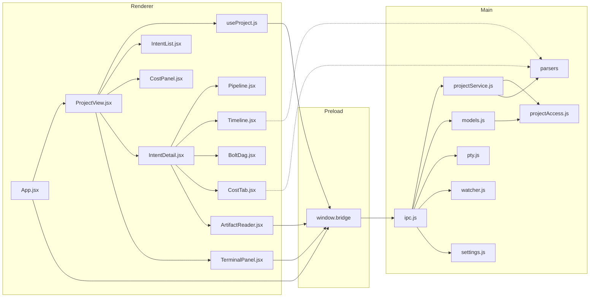
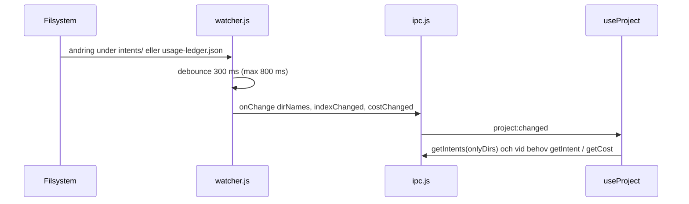
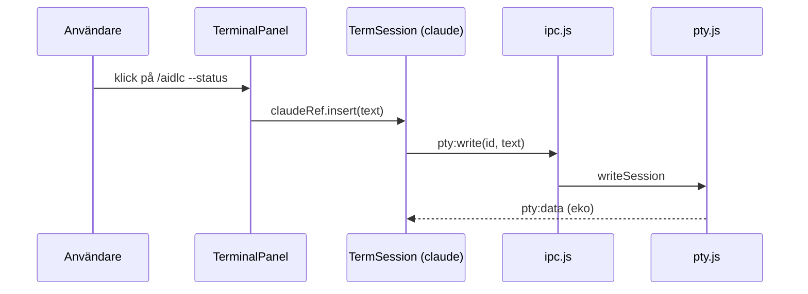

# Architecture — aidlc-dash

## Architecture Analysis

### System Overview

En Electron-app med tre processlager: **huvudprocess** (Node, all fil- och processåtkomst), **preload** (smal namngiven brygga `window.bridge`) och **renderare** (React 19 i sandbox). Huvudprocessen läser AI-DLC:s filer i öppnade projektrötter, tolkar dem med rena parserfunktioner, bevakar ändringar med chokidar och kör pseudoterminaler med node-pty. Renderaren hämtar data via IPC och prenumererar på push-händelser.

### Architectural Style

**Monolitisk skrivbordsapp med lagrad processisolering.** Belägg: ett enda npm-paket; `electron.vite.config.mjs` bygger tre ingångar (main/preload/renderer); `index.js` sätter `contextIsolation: true`, `nodeIntegration: false`, `sandbox: true`; `preload/index.js` exponerar bara namngivna funktioner (ingen generisk invoke).

Inom huvudprocessen: IPC-adapter (`ipc.js`) → tjänst (`projectService.js`, `models.js`, `pty.js`, `watcher.js`, `settings.js`) → säker åtkomst (`projectAccess.js`) och rena parsers (`parsers/*`).

### Component Relationships

Textalternativ: App, useProject, TerminalPanel och ArtifactReader anropar `window.bridge`, som skickar till `ipc.js`. `ipc.js` delegerar till projectService (data), models (konfigurerade modeller), pty (terminaler), watcher (filbevakning) och settings (appens inställningar). projectService och models läser filer bara via projectAccess; projectService tolkar med parsers. Streckade pilar: Timeline och CostTab importerar rena parsermoduler direkt vid bundling (ingen IPC).

### Data Flow

1. **Öppna projekt**: mappväljare → `project:open` → `openRoot` (realpath) → `detectProject` → watcher startas för den aktiva spacen (bara om AI-DLC).
2. **Läsa**: `project:intents` → `loadIntentList` (intents.json + mappar + active-intent + per-intent state) med cache; `project:intent` → `loadIntentDetail` (state, runtime-graph, audit-shards, active-directive, artefaktlista); `project:cost` → `loadCost` + `summarizeLedger`.
3. **Live**: chokidar → debounce (300 ms, max 800 ms) → `project:changed {dirNames, indexChanged, costChanged}` → `useProject` laddar om bara berörda delar och markerar nya audit-händelser.
4. **Terminal**: `pty:spawn` → node-pty kör `$SHELL -l -i -c claude` eller `$SHELL -l` i roten → `pty:data`/`pty:exit` till renderaren; tangenttryck → `pty:write`.
5. **Skriva**: endast `settings:set` → `settings.json` i userData.

### Key Design Decisions

- **Skrivskydd och rotinneslutning**: `projectAccess.js` saknar skrivanrop; `resolveInRoot` avvisar absoluta sökvägar, `..` och symlänkar ut ur roten. Konsekvens: säkert att peka på godtyckliga projekt; nya funktioner som ska ändra något måste gå via terminalen (EPIC-05:s princip).
- **Smal IPC-yta**: namngivna kanaler i både `ipc.js` och `preload/index.js`; varje handler slår upp `projectId`. Nya funktioner kräver ändring i båda filerna.
- **Tålighet mot halvskrivna filer**: `readJsonSafe` kastar aldrig; cacher behåller senaste giltiga värde (`stale`-flagga).
- **Lazy node-pty**: laddas vid första spawn så att en trasig native-binär bara slår ut terminalen.
- **Externa kommandon utan skal**: `models.js` använder `execFile` med fasta argument och PATH från inloggningsskalet.
- **Allt hålls monterat**: projektflikar och terminalsessioner döljs i stället för att avmonteras, så pty-sessioner överlever flikbyten.

### Improvement Opportunities

- Ingen delad tillståndskanal mellan intentvyer och terminal (behövs för EPIC-05); se [code-quality-assessment.md](code-quality-assessment.md).
- Projektdetektering görs bara vid öppning; ingen omdetektering.
- Gemensam modul för extern processkörning (skal/PATH) saknas; logiken finns i `models.js` och delvis `pty.js`.

## Interaction Diagrams

### Öppna projekt och ladda en intent

Textalternativ: användaren väljer mapp; huvudprocessen validerar roten, detekterar AI-DLC och startar bevakning; renderaren hämtar sedan lista, detalj och kostnad som projectService läser via projectAccess.

### Liveuppdatering

Textalternativ: en filändring samlas i watchern, skickas som `project:changed`, och useProject laddar om bara de intents som nämns, detaljen om den vald intent berörs, och kostnaden vid ledger- eller indexändring.

### Snabbkommando i terminalen (grunden för EPIC-05 Fortsätt)

Textalternativ: snabbknappen anropar claude-sessionens `insert`, som skriver texten utan Enter till pty:n; utdata kommer tillbaka som `pty:data`.
