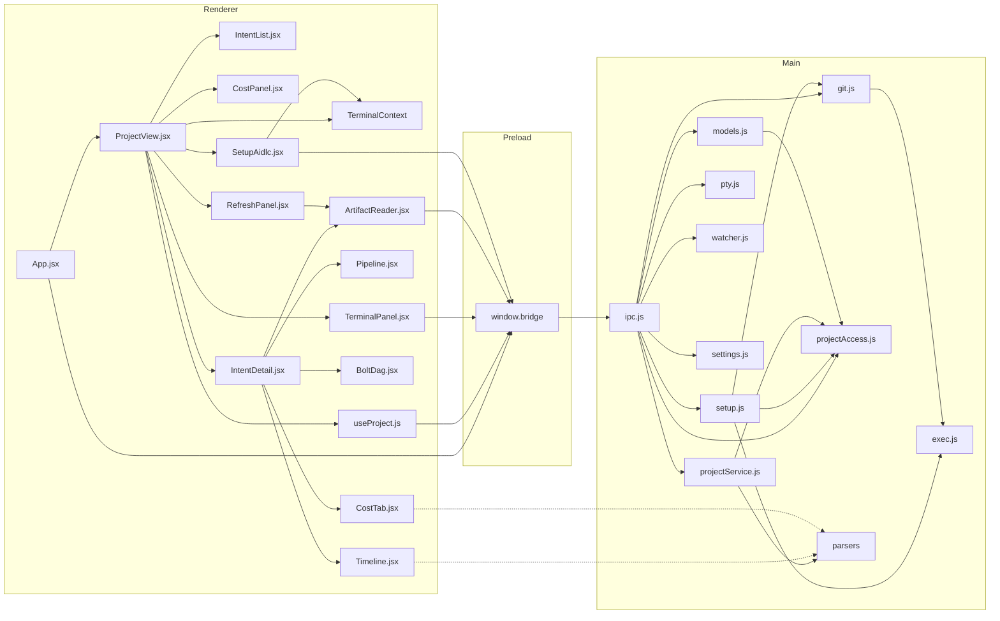
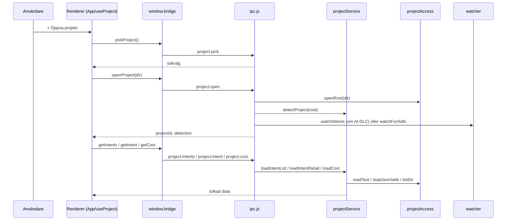
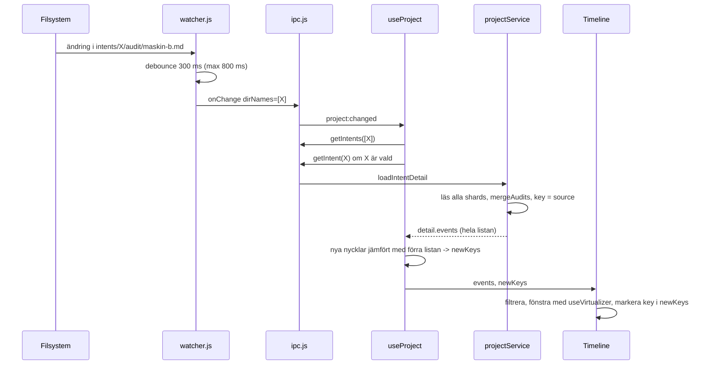
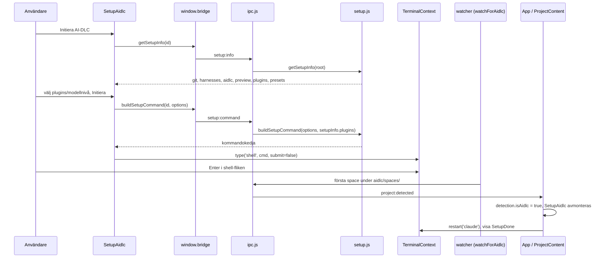
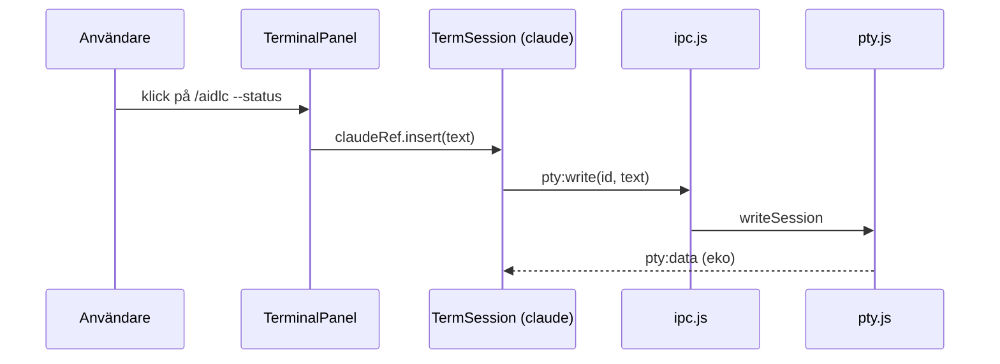

# Architecture — aidlc-dash

## Architecture Analysis

### System Overview

En Electron-app med tre processlager: **huvudprocess** (Node, all fil- och processåtkomst), **preload** (smal namngiven brygga `window.bridge`) och **renderare** (React 19 i sandbox). Huvudprocessen läser AI-DLC:s filer i öppnade projektrötter, tolkar dem med rena parserfunktioner, bevakar ändringar med chokidar och kör pseudoterminaler med node-pty. Renderaren hämtar data via IPC och prenumererar på push-händelser.

Sedan EPIC-05 finns också `exec.js` (externa kommandon utan skal), `git.js` och `setup.js` i huvudprocessen samt `TerminalContext.jsx`/`terminalControl.js` i renderaren, så att andra vyer kan skriva i terminalen. `setup.js` och `SetupAidlc.jsx` är djuplästa i denna körning; `exec.js`, `git.js` och terminalstyrningen är bara ytligt skannade.

### Architectural Style

**Monolitisk skrivbordsapp med lagrad processisolering.** Belägg: ett enda npm-paket; `electron.vite.config.mjs` bygger tre ingångar (main/preload/renderer); `index.js` sätter `contextIsolation: true`, `nodeIntegration: false`, `sandbox: true`; `preload/index.js` exponerar bara namngivna funktioner (ingen generisk invoke).

Inom huvudprocessen: IPC-adapter (`ipc.js`) → tjänst (`projectService.js`, `models.js`, `pty.js`, `watcher.js`, `settings.js`, `git.js`, `setup.js`) → säker åtkomst (`projectAccess.js`, `exec.js`) och rena parsers (`parsers/*`).

### Component Relationships

Textalternativ: App, useProject, TerminalPanel, ArtifactReader och SetupAidlc anropar `window.bridge`, som skickar till `ipc.js`. ProjectView omsluter projektet i `TerminalProvider` och visar antingen AI-DLC-vyn (useProject, IntentList, CostPanel, RefreshPanel, IntentDetail) eller SetupAidlc, plus alltid TerminalPanel. `ipc.js` delegerar till projectService (data), models (konfigurerade modeller), pty (terminaler), watcher (filbevakning), settings (appens inställningar), git och setup, och använder projectAccess direkt för `project:file` och skalanropen. setup använder exec, git och projectAccess. Streckade pilar: Timeline och CostTab importerar rena parsermoduler direkt vid bundling (ingen IPC). ResumeButton är utelämnad i diagrammet.

### Data Flow

1. **Öppna projekt**: mappväljare → `project:open` → `openRoot` (realpath) → `detectProject` → watcher startas för den aktiva spacen (AI-DLC) eller `watchForSetup`/`watchForAidlc` väntar på en första space (icke-AI-DLC). När den dyker upp detekteras projektet igen, intents-bevakningen startas och `project:detected` skickas; `App.jsx` byter `detection` i fliken och `ProjectView` växlar till AI-DLC-vyn.
2. **Läsa**: `project:intents` → `loadIntentList` (intents.json + mappar + active-intent + per-intent state) med cache; `project:intent` → `loadIntentDetail` (state, runtime-graph, alla audit-shards, active-directive, artefaktlista); `project:cost` → `loadCost` + `summarizeLedger`; `project:file` → `readText` för valfri rotrelativ fil.
3. **Audit-händelser**: `loadAuditEvents` läser varje `audit/*.md` helt → `mergeAudits` tolkar block, ger varje block `index` och `key = <source>#<index>` (EPIC-03, ytligt), sorterar på tidsstämpelsträng och numrerar `seq` efter sorteringen → `categoryOf` sätter kategori. Hela listan skickas till renderaren vid varje detaljladdning.
4. **Live**: chokidar → debounce (300 ms, max 800 ms) → `project:changed {dirNames, indexChanged, costChanged}` → `useProject` laddar om bara berörda delar. Sedan EPIC-03 *(ytligt)* räknar `useProject` ut vilka nycklar som är nya och exponerar dem som `newKeys`; `Timeline` markerar rader vars `key` finns i mängden. Bara intents-mappen och ledgern bevakas; ändringar under t.ex. `docs/` ger ingen händelse.
5. **Terminal**: `pty:spawn` → node-pty kör `$SHELL -l -i -c claude` eller `$SHELL -l` i roten → `pty:data`/`pty:exit` till renderaren; tangenttryck → `pty:write`. Andra vyer skriver via `useTerminal().type(kind, text, {submit})` och `restart(kind)`.
6. **Uppsättning (US-0503)**: `setup:info` → förkontroller (git, andra harnesses, `aidlc --version`, `--dry-run`-förhandsvisning, plugins) → val i dialogen → `setup:command` bygger kedjan → `SetupAidlc` skriver den i shell-fliken utan Enter → personen trycker Enter → AI-DLC dyker upp (flöde 1) → `SetupDone` startar om claude och erbjuder `/aidlc --doctor` och "Starta första arbetet".
7. **Skriva**: endast `settings:set` → `settings.json` i userData.

### Key Design Decisions

- **Skrivskydd och rotinneslutning**: `projectAccess.js` saknar skrivanrop; `resolveInRoot` avvisar absoluta sökvägar, `..` och symlänkar ut ur roten. Konsekvens: säkert att peka på godtyckliga projekt; funktioner som ändrar något går via terminalen (EPIC-05:s princip, även EPIC-06:s krav).
- **Smal IPC-yta**: namngivna kanaler i både `ipc.js` och `preload/index.js`; varje handler slår upp `projectId`. Nya funktioner kräver ändring i båda filerna.
- **Kommandon byggs, körs aldrig**: `buildSetupCommand` validerar plugins mot listan som `setup:info` läste och modellnivå mot `PRESETS`, och returnerar text. Personen kör den själv i den synliga terminalen.
- **Inställningar som hel fil**: `setSettings` läser, slår ihop, sanerar mot en fast nyckellista och skriver om hela filen. Enkelt, men ny data kräver att `sanitize` utökas, och samtidiga skrivningar serialiseras inte.
- **Tålighet mot halvskrivna filer**: `readJsonSafe` kastar aldrig; cacher behåller senaste giltiga värde (`stale`-flagga). Ett läsfel i en audit-shard ger hela föregående detalj med `stale: true`.
- **Hela loggen i minnet**: audit-händelser läses om och skickas i sin helhet vid varje uppdatering; renderaren filtrerar och fönstrar. Enkelt, men kostnaden växer linjärt med loggen.
- **Händelseidentitet**: före EPIC-03 var `seq` (sorteringsposition) både React-nyckel och grund för ny-markering. Sedan EPIC-03 *(ytligt)* är `key = <source>#<index>` identiteten, vilket håller så länge shards bara växer i slutet.
- **Lazy node-pty**: laddas vid första spawn så att en trasig native-binär bara slår ut terminalen.
- **Externa kommandon utan skal**: `models.js` och `exec.js` använder `execFile` med fasta argument och PATH från inloggningsskalet.
- **Allt hålls monterat**: projektflikar och terminalsessioner döljs i stället för att avmonteras, så pty-sessioner överlever flikbyten. Inom en flik avmonteras däremot `SetupAidlc` när projektet blir AI-DLC.

### Improvement Opportunities

- Inkrementell läsning av audit-shards (bara tillagda byte) om full omläsning blir för dyr för stora loggar.
- Tidsstämplar sorteras som strängar; normalisering till epoch-tid skulle göra blandade zonformat kronologiska.
- Serialisera `setSettings` (en kö eller ett löfte i taget) innan fler vyer skriver inställningar.
- **EPIC-06**: bevakning utanför intents-mappen och en vy utanför IntentDetail behövs; se [component-inventory.md](component-inventory.md) § Intent-relevans och [code-quality-assessment.md](code-quality-assessment.md) § Intent-relevanta luckor.

## Interaction Diagrams

### Öppna projekt och ladda en intent

Textalternativ: användaren väljer mapp; huvudprocessen validerar roten, detekterar AI-DLC och startar bevakning; renderaren hämtar sedan lista, detalj och kostnad som projectService läser via projectAccess.

### Liveuppdatering och ny-markering i tidslinjen (efter EPIC-03, ytligt)

Textalternativ: en skrivning i en shard samlas i watchern och blir `project:changed` med intentens mappnamn. useProject laddar om listan och, om intenten är vald, hela detaljen. projectService läser om alla shards och ger varje händelse en stabil nyckel. useProject jämför nycklarna mot förra listan och exponerar de nya som `newKeys`; Timeline fönstrar listan och markerar raderna på identitet, så en äldre händelse från en annan maskins shard markeras rätt. Detaljerna är ytligt skannade i denna körning.

### Initiera AI-DLC (US-0503) och första stegen

Textalternativ: dialogen hämtar förkontroller, personen väljer och trycker Initiera, huvudprocessen bygger och validerar kommandokedjan, och dialogen skriver den i shell-fliken utan Enter. När personen kört den och `aidlc/spaces/` dyker upp skickar huvudprocessen `project:detected`; fliken byter till AI-DLC-vyn, startar om claude och visar `SetupDone`. Dialogens lokala val försvinner när den avmonteras.

### Snabbkommando i terminalen

Textalternativ: snabbknappen anropar claude-sessionens `insert`, som skriver texten utan Enter till pty:n; utdata kommer tillbaka som `pty:data`. Sedan EPIC-05 går andra vyers terminalskrivningar via `TerminalContext` (ytligt skannat, inte omverifierat här).
