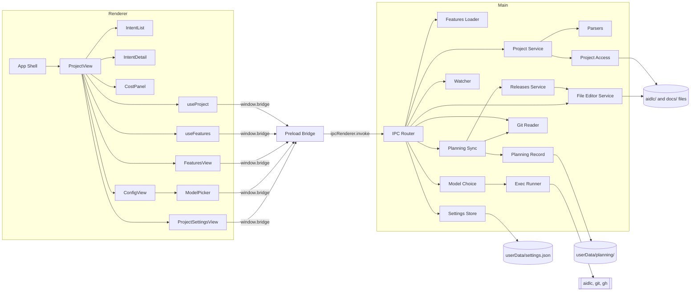
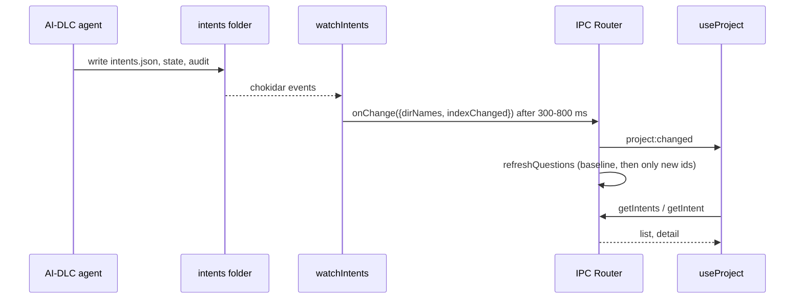
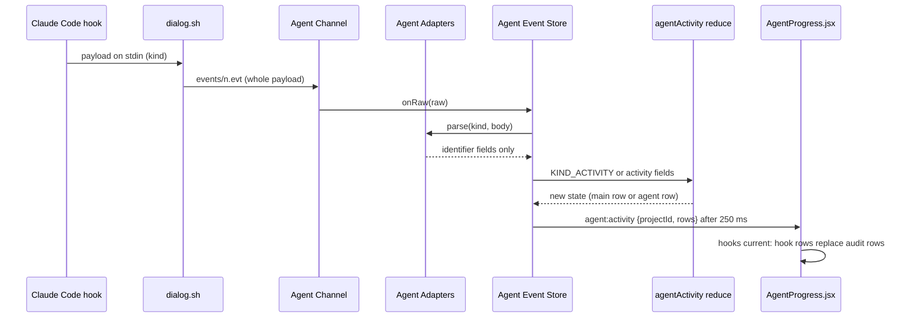
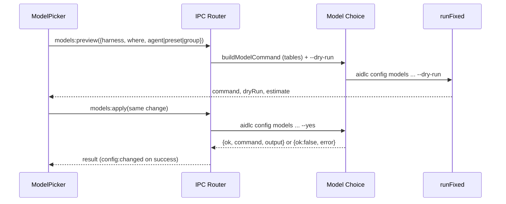

# Architecture

## Architecture Analysis

### System Overview

The app is a single Electron app with three processes:
- **main** (Node): file reads, watchers, ptys, CLI calls, the agent hook channel;
- **preload**: `window.bridge`, a named, narrow API;
- **renderer**: React 19 in a sandboxed window with contextIsolation and a CSP.

Pure modules in `src/shared/` and some parsers in `src/main/parsers/` (`features`, `releases`, `ledger`, `velocity`) are bundled into both sides. The data sources are the project's AI-DLC files, its git history, the `aidlc` CLI's JSON output, and the agent hook events. There is no database and no server. The app's own data lives in `userData/`: `settings.json`, and since US-0607 the planning record `planning/<sha1(root)>.json`.

### Architectural Style

A modular monolith on the desktop, split along Electron process lines. Main is organised as service modules behind one IPC router (`ipc.js`, 1300 lines at `39a3dbf`). The renderer is a tree of view components with two data hooks (`useProject`, `useFeatures`) and a per-project terminal context. The evidence:
- `ipc.js` imports almost every main module and keeps per-project state in a `projects` map (root, space, watchers, sender, caches, pending previews);
- `preload/index.js` exposes one `invoke` wrapper per channel and no generic invoke.

### Component Relationships



Text fallback: the views get their data through `useProject` (intents, detail, cost, models) and `useFeatures`. The Features view, the model picker and the project settings call the bridge directly. Every call goes through the preload bridge to the IPC Router. The router uses:
- the Project Service, with the parsers and Project Access;
- the Features Loader and the Git Reader;
- Planning Sync, which records each release-list action in the Planning Record, runs it through the Releases Service (which writes with the File Editor Service) and commits and pushes with git and gh;
- the File Editor Service for the editor's saves;
- the Watcher;
- Model Choice, which runs `aidlc config models` through the Exec Runner;
- the Settings Store, which keeps per-root project settings in userData.

The PTY Manager and the agent channel are left out here (see `dependencies.md`). The agent progress and release planning paths are drawn under "Interaction Diagrams".

### Data Flow

1. **Opening a project**: `project:open` resolves the root, runs `detectProject`, starts harness detection in the background (`p.harnesses`), then starts the space watcher (`watchSpace` → `watchIntents`), the feature-docs, config and `.git/HEAD` watchers.
2. **Intent list and detail**: `loadIntentList` merges `intents.json` with the folders on disk, plus cached summaries from each state file (`stateScope`, `plan`, `stateStatus`, `done`, `executed`, `activityAt`). `scope` is `intents.json`'s, else the state file's. `loadIntentDetail` reads state, graph, directive, audit and artifacts.
3. **Live updates**: chokidar → `watchIntents` (debounced 300 ms, max 800 ms) → `{dirNames, indexChanged, costChanged}`. `watchSpace` then sends `project:changed` to the renderer and calls `refreshQuestions` in main. It also sets `p.intentChangedAt`, which makes the planning push wait (US-0607 FR3.1). A top-level change under `intents/` (`intents.json`, `active-intent`, a new intent folder) sets `indexChanged`.
4. **Main-side reactions to intents**: `refreshQuestions` recomputes the waiting questions and takes the first computation as a baseline (`startedWith`). Only ids that are new after it give a popup or a notification.
5. **Model changes**: `models:options` runs `aidlc config models --show --json --harness <h>` and caches the result per project. `models:preview` runs the `--dry-run` form and adds a ledger cost estimate. `models:apply` runs the `--yes` form; on success it clears `p.models` and `p.modelOptions` and sends `config:changed`.
6. **Project settings**: `projectSettings:get|set` read and write `settings.json` → `projectSettings[root]`. Writes are queued so that concurrent changes both survive.
7. **Writes**: the app writes its own settings, token readings and usage snapshots (`.thadeus/`), editor saves (hash-checked), release-list actions (markers, plan files; recorded, then committed), the Guard Policy lock and the cost rule block (both after a diff).
8. **Feature docs watch**: `syncFeaturesWatch` (`ipc.js:308`) watches the overview, each epic folder and `docs/releases/` with `watchFiles` (300 ms, max 800 ms). It only sends `features:changed`; nothing is recorded.
9. **Agent progress** (US-0507, US-0214): see "Agent progress today".

### Release planning today (US-0606, US-0607; read at `39a3dbf`)

- **Record** (`planningRecord.js`): `<userData>/planning/<sha1(root)>.json` = `{protectedMain?, actions: [{id, kind, storyIds, version, at, state: pending|committed}]}`. `KINDS` is only `setRelease`, `createRelease` and `deleteRelease`. An action holds the operation, not file text. All projects share one write queue in the process.
- **Target**: `main`, or `planningBranch` (default `docs/planning`) once `protectedMain` is known. It is learned from `gh api …/branches/main/protection`, or from a push refused as "protected branch".
- **Action** (`planAction`, serialised per root in this process):
  - `addAction`, then `commitActions`.
  - If the checkout is on the target, the operation runs in place with the renderer's hashes for the first story. `commitIn` then commits every changed file under the overview, `features/` and `releases/`, agent edits included.
  - Otherwise the operation runs in a temporary worktree `<userData>/planning/wt-<sha1[:12]>` on `dash/planning`, made from `origin/<target>` (else `origin/main`, the local target, or `main`), with fresh hashes. The checkout is never changed, so on a story branch the release list keeps showing the old markers.
  - A conflict or a throw removes the action again. A refused commit keeps it.
- **Cycle** (`runCycle`, per tick, kick or Push now):
  1. Re-apply every recorded action (skipping failures).
  2. Fetch.
  3. For each source that is ahead of origin (`dash/planning`, or the checked-out target in a detached worktree): rebase onto origin, then push `HEAD:<target>`.
  4. Fast-forward a checked-out target.
  5. Remove the committed actions and delete `dash/planning`.
  6. When the target is the docs branch: `gh pr create` and `gh pr merge --squash`.
- **Scheduler** (`ipc.js:568`):
  - `kick` runs right after an action, but only when idle (online, no waiting question, no AI-DLC write in the last 5 min).
  - `tick` runs every minute for a project that is due (the push interval).
  - `status` keeps the last result in memory only.
- **Waiting count**: `features:planningStatus` returns `{pending: actions.length, reapplied, noRemote, prOffer, error}`. It is read only by `PlanningSync` in the Releases tab, on mount and on each `features` reload.

### Key Design Decisions

- **Read-only, root-confined access** (`projectAccess.js` holds no write calls).
- **The last good value on broken input** (list, detail, graph, directive, ledger caches).
- **Debounced folder watching with a max wait.**
- **Fixed commands only**: every `aidlc`, `git` and `gh` argument comes from tables or a strict pattern (NFR4 in EPIC-09, NFR3 in US-0607). An invalid change throws before anything runs; a failed run comes back as a value.
- **Preview, then apply**: model and config changes show the exact command and its `--dry-run`. File writes (guard lock, cost rules, plan edits) keep the previewed text in main and apply only if the file is unchanged.
- **Hash-checked writes**: the editor and the release list send the hash they read; `writeFileSafe` refuses a changed file. Writes are atomic (temp file and rename).
- **Record first, then write** (US-0607): a release-list action is in the record before any file changes, and leaves it only once it is on the remote target.
- **Pure parsers, shared with the renderer.** `agentActivity.js` and `parsers/releases.js` are pure.
- **The hook script never parses**: `dialog.sh` copies stdin with `cat`; all reading is in the pure adapters.
- **Styling through classes only**: LCARS tokens on `:root` in `theme.css`; tooltips only through `Tooltip.jsx`.

### Improvement Opportunities

- `ipc.js` (1300 lines) and `agentHooks.js` (864) are the largest modules and are candidates for splitting. The planning scheduler and context (`ipc.js:540-603`) could move into `planningSync.js`.
- The project-settings field list is repeated in three places (`settings.js` twice, `ipc.js` once).
- `parsers/agentProgress.js` imports `projectService.js`; moving `workingAgents` into a parser would keep the parsers free of Node imports.
- The planning scheduler's results never reach the renderer except through `features:changed` on `reapplied || pushed`. A `planning:status` push would make the waiting count live (US-0608).

## Interaction Diagrams

### Assigning a story to a release (today, US-0606/US-0607)

```mermaid
sequenceDiagram
  participant RV as ReleasesView / ReleasePicker
  participant IPC as IPC Router
  participant PS as planningSync serial(root)
  participant REC as planningRecord
  participant RS as releases.js
  participant FW as writeFileSafe
  participant G as git / gh
  RV->>IPC: features:setRelease {storyId, version, epicHash, overviewHash}
  IPC->>PS: planAction(ctx, action, hashes)
  PS->>REC: addAction (pending)
  alt checkout on target
    PS->>RS: setStoryRelease in root, renderer hashes
  else other branch
    PS->>G: worktree add dash/planning
    PS->>RS: setStoryRelease in worktree, fresh hashes
  end
  RS->>FW: epic, then overview, then plan rows (hash-checked)
  FW-->>RS: ok or conflict
  PS->>G: status, add, commit (doc paths only)
  PS->>REC: markCommitted, or removeActions on conflict/throw
  IPC-->>RV: {ok} or {conflict} or {error}
  IPC->>RV: features:changed (reload)
  IPC->>PS: kick (only when idle): runCycle
  PS->>G: fetch, rebase, push; gh pr on docs branch
  PS->>REC: removeActions (committed)
  IPC->>RV: features:changed if reapplied or pushed
```

Text fallback: the view sends the story, version and the hashes it read. Planning Sync, one call at a time per project, records the action. It then runs it in place (with the view's hashes) or in a worktree on `dash/planning` (with fresh hashes). The Releases Service writes the epic, the overview and the plan rows with hash checks. Planning Sync commits only the doc paths, marks the action committed (or removes it on a conflict or a throw), and answers. Main then sends `features:changed`. When the app is idle, it kicks a cycle that fetches, rebases and pushes (or opens and merges a pull request on the docs branch), then removes the committed actions. The docs watcher sends further `features:changed` 300-800 ms after the writes.

### Live intent update (today)



Text fallback: the agent writes the files. The watcher debounces and calls the router. The router pushes `project:changed` and recomputes the waiting questions in main, alerting only on ids that are new since the baseline. `useProject` reloads the list and the detail.

### Agent dialog: which page shows (US-0031 area, read at `6ec3546`)

```mermaid
sequenceDiagram
  participant SH as sessionHandoff / onRaw
  participant ES as Agent Event Store
  participant APP as App.jsx
  participant AD as AgentDialog
  SH->>ES: addEvent / replies.add / addHandoff
  ES->>ES: move(state); delete only on ended
  ES->>APP: agentEvents onChanged {projectId, events (every state, byPager)}
  APP->>APP: receiveAgentEvents: fresh shown/timedOut + alertPlan open
  APP->>AD: open=true, events=popupEvents (no page named)
  AD->>AD: page = pageId, else lastIndex (kept from the last close)
  APP->>APP: hasNewQuestion = any non-early page left
  APP->>AD: open=false only when none is left
```

Text fallback: every store change pushes the project's whole list, settled pages included, in `byPager` order (handoff last). The app opens the dialog when a fresh open event arrives, but names no page. The dialog, mounted all along, shows the page it was closed on if that page is still listed, else the same index. The app closes the dialog only when no non-early page is left. Details: `code-quality-assessment.md`, US-0031 notes.

### Agent progress from hook events (US-0214; kept from `0ebb196`, not re-verified)



Text fallback: each hook runs `dialog.sh`, which writes the payload as an event file. The channel hands it to the event store, which asks the harness adapter to parse it. The adapter keeps only identifier-shaped fields. The store maps the dialog kinds through `KIND_ACTIVITY` (always the main row) and the activity kind through its own fields (the main row or the agent row by `agent_id`). It reduces the state and pushes the project's rows within 250 ms. The view shows those rows in place of the audit rows when every used harness's hooks are current.

### Agent progress today (US-0030 area, read at `0ebb196`, not re-verified)

| Source | Built by | Carries | Refreshed |
|---|---|---|---|
| Audit rows | `loadAgentProgress` over `progressRows` | kind `build`/`review`/`agent`, stage, agent, minutes, plan `steps`, last commit, review findings | `agents:progress` on open, on `refreshKey`, and on a 60 s recheck |
| Hook rows | `createAgentEventStore().activity` over `reduceActivity`/`activityRows` | kind `main`/`agent`, harness, `agentType`, one `state`, `tool`, `reason`, `error`, `sinceMs` | `agentActivity:list` on mount, then `agent:activity` |

`AgentProgress.jsx:183-189` shows hook rows in place of audit rows when the intent is live and every used harness's hooks are current.

### Model change from the Configuration view (kept, not re-verified)



Text fallback: the picker sends only a change object. Main checks it against the tables and the harness's model list, shows the exact command and its dry run, and runs the `--yes` form on Apply. The output or the error comes back as a value.

### US-0210 building blocks (kept, not re-verified)

| Need | What exists | Gap |
|---|---|---|
| Run the switch | `runFixed`; `modelChoice.run()` returns `{ok, command, output}` or `{ok: false, command, error}` | `buildModelCommand` accepts only `agent \| preset \| group` |
| A new intent appears | `watchSpace` → `indexChanged`; `loadIntentList` gives `scope`, `plan`, `status` | Follow the `startedWith` baseline pattern |
| Ask the person | `AgentDialog`, questions popup, `notify.js` | `window.confirm` is not LCARS |

The US-0303 data sources are listed in `api-documentation.md` section 4.
