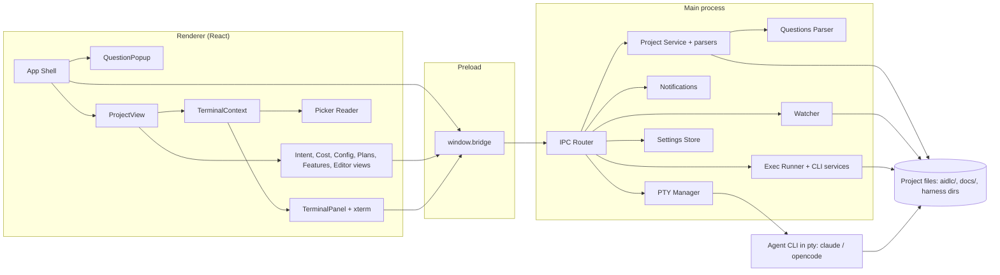
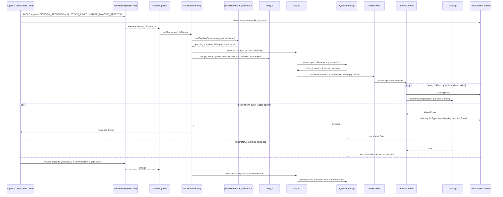
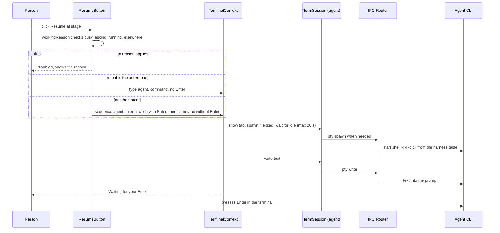
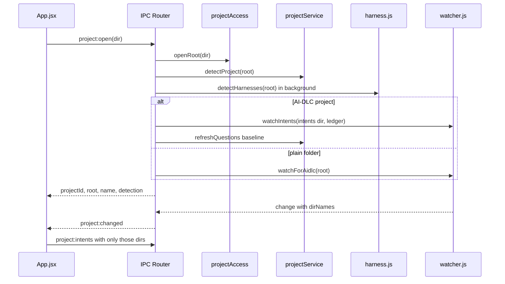

# Architecture

## Architecture Analysis

### System Overview

T.H.A.D.E.U.S. is a single Electron 45 application with the usual three processes:

- **Main process** (`src/main/`, Node ESM): owns every file read and write, the pty sessions, file watchers, external CLI runs (`aidlc`, `git`, `gh`, harness CLIs), system notifications, the app menu and the updater. It keeps a per-project record in a `projects` map in `src/main/ipc.js`.
- **Preload** (`src/preload/index.js`): exposes `window.bridge`, 87 named members, each bound to one IPC channel. No generic `invoke`/`send`.
- **Renderer** (`src/renderer/`, React 19): the LCARS UI, xterm terminals, the question popup and Monaco. Sandboxed (`sandbox: true`, `contextIsolation: true`, `nodeIntegration: false`), CSP `default-src 'self'`, `connect-src 'self' ws:`.
- **Shared** (`src/shared/`): pure modules bundled into both sides (harness table, i18n and locales, config tables, names).

The app talks to the agents only through their pty: bytes out of the pty are rendered by xterm and drive an activity signal; bytes into the pty are what the person types or what the app types for them. It learns AI-DLC's state only from files on disk (`aidlc/spaces/<space>/intents/...`, the usage ledger, the inflight file) and from the `aidlc` CLI.

### Architectural Style

Desktop monolith with a thin IPC boundary (layered: renderer UI → preload bridge → main services → filesystem/CLIs). Evidence: one `package.json`, one IPC router (`registerIpc()` over a `handlers` object, `ipc.js:692`), no server, no database. State is files (AI-DLC records, the app's `settings.json`) plus in-memory caches in main.

### Component Relationships

Text fallback: the App Shell holds the QuestionPopup and one ProjectView per open project. Each ProjectView has its own TerminalContext, which owns the agent and shell TerminalPanels (xterm) and uses the Picker Reader to read Claude Code's picker off the screen. Every view and terminal calls main through `window.bridge`. Main's IPC Router uses the Project Service (and its parsers, including the Questions Parser), Notifications, the PTY Manager, the Watcher, the CLI services and the Settings Store. The agent CLI runs inside a pty started by main and writes AI-DLC's files, which the Watcher and Project Service read.

### Data Flow

1. **Project open**: `project:open` resolves the real root (`projectAccess.openRoot`), detects AI-DLC (`aidlc/spaces/` present), starts harness detection in the background, starts `watchIntents` for the active space, the feature-docs watcher and the config watcher.
2. **Live updates**: chokidar events under `intents/` are debounced (300 ms, max 800 ms) into `{dirNames, indexChanged, costChanged}` and pushed as `project:changed`; the renderer (`useProject`) reloads only the named intents. The same event recomputes waiting questions for those intents.
3. **Questions**: `loadPendingQuestions` reads the audit shards of in-progress intents, merges them in time order (`mergeAudits`) and runs `pendingQuestions`. `ipc.js` marks ids seen in a project's first computation as `early`, pushes the whole list as `questions:changed` to every window, and hands fresh ones to `notifyQuestions`.
4. **Terminal**: `pty:spawn` starts `$SHELL -l -i -c <cli>` (agent, CLI from the fixed harness table) or `$SHELL -l` (shell). Output streams as `pty:data`; the renderer's `createActivity` turns output timing into `busy`/`idle`/`exited`.
5. **Steering**: Resume, quick commands, Plans requests and the feature-docs prompt type text into the agent tab (usually without Enter); Refresh types git commands into the shell tab; Setup, Configuration and Models run `aidlc` in main after a preview.
6. **Cost**: `project:cost` reads `aidlc/.aidlc-sessions/usage-ledger.json` and summarises it per intent, stage, agent, model and scope (`summarizeLedger`).

### Key Design Decisions

| Decision | Where | Implication |
|---|---|---|
| Read-only towards AI-DLC; changes go through the visible terminal or the `aidlc` CLI | `projectAccess.js` (no writes), `aidlcWrite.js`, `plans.js`, `setup.js` | AI-DLC's checks and audit trail stay in charge; the app needs no knowledge of AI-DLC's internal write rules |
| Fixed tables for every value that reaches a command | `shared/harnesses.js`, `shared/configTables.js`, `modelChoice.js` | The renderer only names ids/keys; main refuses anything else (NFR4 pattern) |
| Agent questions derived from the audit log | `questions.js` | Only AI-DLC's questions are seen; closing depends on later audit events |
| Answers sent as the picker's own key after reading the screen | `picker.js`, `TerminalContext.answer()` | Works only with Claude Code's picker layout and exact label match |
| Activity from output timing | `terminalControl.js` | No structured "waiting for input" state |
| node-pty loaded lazily | `pty.js` | A broken native binary breaks the terminal tab, not the app |
| Every project tab stays mounted | `App.jsx` | Terminals and watchers survive tab switches; memory grows with open projects |
| Harness folders and engine files read-only in the editor | `fileWrite.js` `isEngineOwned` | Writing harness settings (hooks, plugins) would be a new, deliberate exception |
| Distribution through GitHub Releases of the own repo, built by CI on a tag; the app updates itself from them via `gh` | `release.yml`, `electron-builder.yml` (`publish: null`), `updater.js` | Download and update depend on access to `tochman/aidlc-dash`; a public repo opens downloads, the in-app update still needs `gh` until US-0413 |

### Improvement Opportunities

- A structured event source per harness (Claude Code hooks, opencode events/plugin) would replace both the audit-only question source and the screen-scraped answer path; the picker reader could remain the fallback.
- A main-side "answer" IPC that names a question id and an option index, checked against the session that asked, would close the gap that `pty:write` accepts any string for any session.
- `ipc.js` could split per area (questions, projects, config, updater) without changing the bridge.
- Coverage, ESLint and Prettier now gate CI (added since `2d111d6`).
- For a public release: package a generated third-party licence notice with the app, and drop the "private repo / internal build" wording from `release.yml` and `electron-builder.yml` (see `code-quality-assessment.md`, "Public-readiness review").

## Interaction Diagrams

### Question popup: from the audit log to an answer in the terminal (current flow)

Text fallback: AI-DLC writes the question to its audit shard and Claude Code draws its picker. The watcher sees the shard change; main recomputes the intent's waiting questions and pushes the list to the renderer, notifying the OS when the window is not in front. The popup shows the newest question. When the person picks an option, App passes it through ProjectView to TerminalContext, which reads each agent tab's screen for up to 3 s. Only if the picker on screen lists every logged option does it write the picker's key into that tab's pty; otherwise the popup says why and offers the terminal. The question leaves the popup only when AI-DLC later logs `QUESTION_ANSWERED` (or a closer) and the watcher pushes the shorter list.

### Resume an in-flight intent

Text fallback: Resume first checks why it must wait (an agent tab busy, a question waiting, a live agent session on the in-flight active intent, or an audit write in the last 10 minutes from an agent outside the app). If none applies, it types the harness's AI-DLC command into the agent tab without Enter; for a non-active intent it first submits `<command> intent <dirName>` and waits for that command to finish before typing the command. TerminalContext starts the agent tab if it has exited and waits for its first quiet period. The person presses Enter.

### Project open and live refresh

Text fallback: opening a project validates the root, detects AI-DLC and starts harness detection without waiting. An AI-DLC project gets an intents/ledger watcher and a question baseline; a plain folder gets a small watcher that re-detects once `aidlc/spaces/<space>` appears. Later changes reach the renderer as `project:changed`, which reloads only the changed intents.
