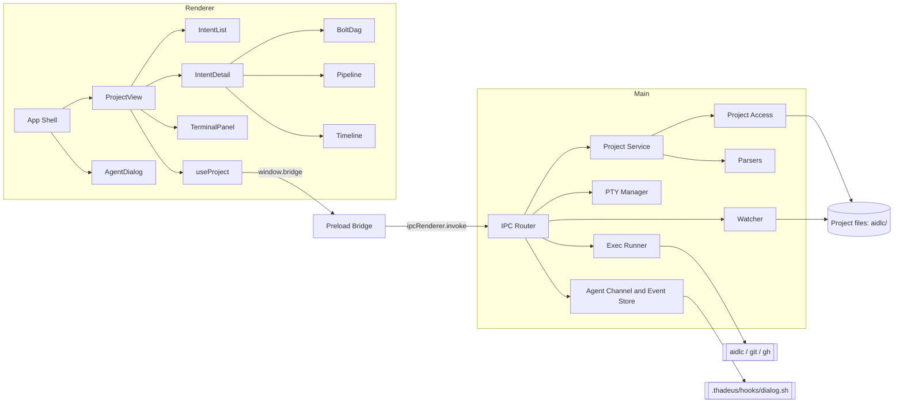
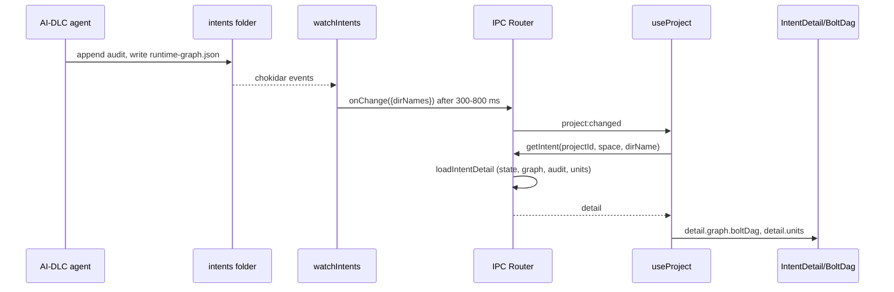
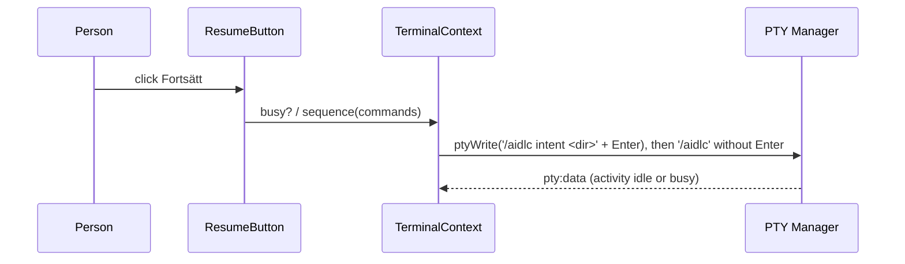

# Architecture

## Architecture Analysis

### System Overview

The app is a single Electron app with three processes:
- **main** (Node: file reads, watchers, ptys, CLI calls, the agent hook channel);
- **preload** (`window.bridge`, a named, narrow API);
- **renderer** (React 19 in a sandboxed window with contextIsolation and a CSP).

Pure modules in `src/shared/` and some parsers in `src/main/parsers/` are bundled into both sides. The project's AI-DLC files are the data source. There is no database and no server.

### Architectural Style

A modular monolith on the desktop, split along Electron process lines. Main is organised as service modules behind one IPC router (`ipc.js`). The renderer is a tree of view components with two data hooks (`useProject`, `useFeatures`) and a per-project terminal context. The evidence:
- `ipc.js` imports almost every main module;
- `preload/index.js` exposes one `invoke` wrapper per channel and no generic invoke.

### Component Relationships

Text fallback: the renderer views call `window.bridge`. The bridge invokes the IPC Router. The router uses the Project Service (which reads through Project Access and the parsers), the Watcher, the PTY Manager, the Exec Runner (for the `aidlc`, `git` and `gh` CLIs) and the agent channel, which talks to the hook script.

### Data Flow

1. **Opening a project**: `project:open` resolves the root (`openRoot`), runs `detectProject`, then starts the space watcher (`watchIntents`), the config watcher (with the inflight file), the feature-docs watcher and the `.git/HEAD` watcher.
2. **Intent list and detail**: `loadIntentList` merges `intents.json` with the folders on disk, plus summaries from each intent's state file. `loadIntentDetail` → `buildDetail` reads `aidlc-state.md`, `runtime-graph.json`, `.aidlc-engine/active-directive.json`, the audit shards and the artifact tree. It returns `{state, graph, pipeline, events, units, directive, files, warnings}`.
3. **Live updates**: chokidar sends a change to `watchIntents`, which debounces it (300 ms, max 800 ms). The router then sends `project:changed {dirNames, indexChanged, costChanged}`. `useProject` reloads the list for those dirs and the detail when the selected intent changed. Under `.aidlc-engine/`, only `active-directive.json` counts as a change.
4. **Working agents**: the `aidlc/.aidlc-subagent-inflight` entry count limits `workingAgents()`. That function pairs `SUBAGENT_DISPATCHED` with `SUBAGENT_COMPLETED` by `Agent Type`. The Configuration view uses it ("Arbetar nu").
5. **Agent dialogs**: the hooks write event files into the per-session channel folder. `agentChannel` validates them, `agentEvents` drives the state machine, and the answer goes back through the waiting hook or as picker keys.
6. **Writes**: the app writes only its own settings, token readings (`.thadeus/tokens/`), editor saves (hash-checked) and feature-doc release markers. It writes AI-DLC config only through the `aidlc` CLI or the tier-2 Guard Policy edit.

### US-0507 data sources

| Need | Where it is today | Read by the app now? |
|---|---|---|
| A Unit running and its stage | `runtime-graph.json` `stages[].instances[]` (`bolt`, `worktree`, `started_at`, `completed_at`, `outcome`); audit `BOLT_STARTED`, `WORKTREE_CREATED`, `SWARM_STARTED` (`Stage`) | Counts only (`runtimeGraph.js`); the audit events go to the timeline only |
| Plan steps done and total | `<worktree>/…/construction/<unit>/code-generation/code-generation-plan.md`, `- [x]` and `- [ ]` lines | No; `.aidlc/worktrees/` is neither watched nor read |
| Last commit subject | the worktree's git branch `bolt-<id8>_<unit>` | No; `git.js` has no log call |
| Review requested and its verdict | audit `REVIEW_REQUESTED` and `REVIEW_COMPLETED` (`Stage`, `Reviewer`, `Unit`, `Verdict`, `Review Record`) | Timeline only |
| Findings by severity | `<intent>/.aidlc-engine/reviews/<stage>/…/<n>.json` `findings[].severity` | No; the watcher ignores it |
| Agent work with no Unit | `SUBAGENT_DISPATCHED` `Agent Type` plus the inflight count | Yes, `workingAgents()` |

### Key Design Decisions

- **Read-only, root-confined access** (`projectAccess.js` holds no write calls). This keeps the app from corrupting AI-DLC state. The cost is that every new source needs a root-relative path.
- **The last good value on broken input** (detail, graph, directive, ledger caches). Agents write files mid-stream, so the UI never blanks.
- **Debounced folder watching with a max-wait**. The UI stays live during continuous agent writes without reload storms.
- **Workflow actions typed into the visible terminal**. AI-DLC's own guards and audit apply. The app never submits on the person's behalf, except the intent switch.
- **Agent dialogs through a file channel and hooks** (US-0506), with every byte validated in main before the renderer sees it.

### Improvement Opportunities

- Unit status should come from the runtime graph instances and the `BOLT_*` events, not only `UNIT_STARTED`, which AI-DLC does not log for builds.
- A small read model of the running work per intent (Units, reviews, agents) in main would let `BoltDag` stay a view.
- `ipc.js` (891 lines) and `agentHooks.js` (864) are the largest modules and are candidates for splitting.

## Interaction Diagrams

### Live intent update (today)

Text fallback: the agent writes the files; the watcher debounces and notifies the router; the router pushes `project:changed`; `useProject` calls `getIntent`; main rebuilds the detail; the Units tab re-renders.

### Resume an intent

Text fallback: Resume checks that the agent tab is idle, submits the intent switch, then types `/aidlc` for the person to confirm.
