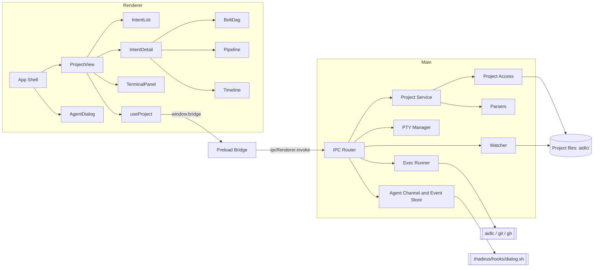
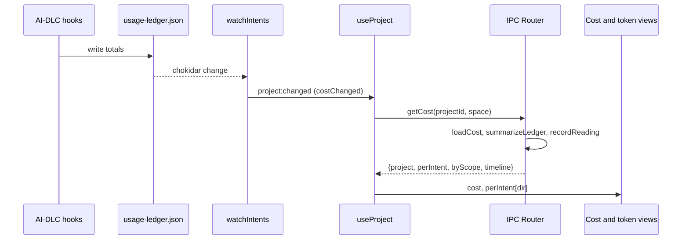
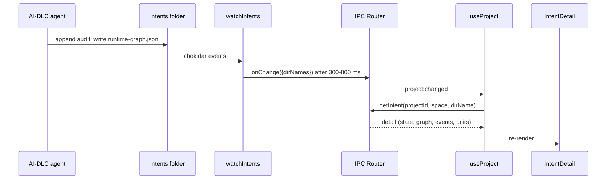
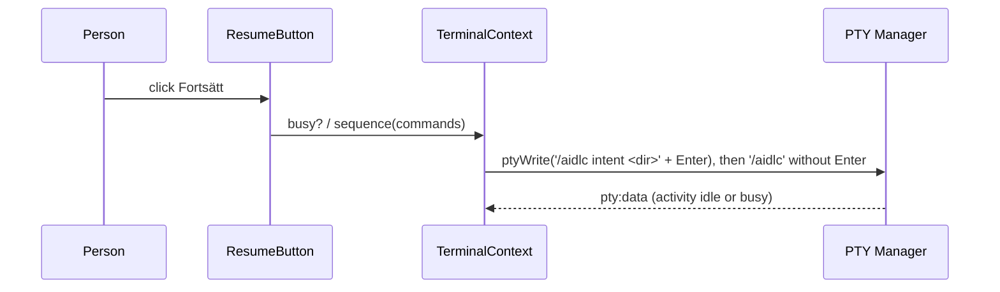

# Architecture

## Architecture Analysis

### System Overview

The app is a single Electron app with three processes:
- **main** (Node: file reads, watchers, ptys, CLI calls, the agent hook channel);
- **preload** (`window.bridge`, a named, narrow API);
- **renderer** (React 19 in a sandboxed window with contextIsolation and a CSP).

Pure modules in `src/shared/` and some parsers in `src/main/parsers/` are bundled into both sides. The project's AI-DLC files are the data source. There is no database and no server.

### Architectural Style

A modular monolith on the desktop, split along Electron process lines. Main is organised as service modules behind one IPC router (`ipc.js`). The renderer is a tree of view components with two data hooks (`useProject`, `useFeatures`) and a per-project terminal context. The evidence:
- `ipc.js` imports almost every main module;
- `preload/index.js` exposes one `invoke` wrapper per channel and no generic invoke.

### Component Relationships

Text fallback: the renderer views call `window.bridge`. The bridge invokes the IPC Router. The router uses the Project Service (which reads through Project Access and the parsers), the Watcher, the PTY Manager, the Exec Runner (for the `aidlc`, `git` and `gh` CLIs) and the agent channel, which talks to the hook script.

### Data Flow

1. **Opening a project**: `project:open` resolves the root (`openRoot`), runs `detectProject`, then starts the space watcher (`watchIntents`), the config watcher (with the inflight file), the feature-docs watcher and the `.git/HEAD` watcher.
2. **Intent list and detail**: `loadIntentList` merges `intents.json` with the folders on disk, plus summaries from each intent's state file. `loadIntentDetail` → `buildDetail` reads `aidlc-state.md`, `runtime-graph.json`, `.aidlc-engine/active-directive.json`, every audit shard and the artifact tree.
3. **Live updates**: chokidar sends a change to `watchIntents`, which debounces it (300 ms, max 800 ms). The router then sends `project:changed {dirNames, indexChanged, costChanged}`. `useProject` reloads the list for those dirs, the detail when the selected intent changed, and the cost only on `costChanged || indexChanged`.
4. **Cost** (today): `project:cost` → `loadCost` reads `aidlc/.aidlc-sessions/usage-ledger.json` → `summarizeLedger(ledger, intents)` matches `workflows["intent:<uuid>"]` to each intent's `uuid` → `{project, perIntent, byScope, timeline}`. The same call records a token reading for each in-flight intent (`.thadeus/tokens/`). With no ledger it returns `{available: false}` and every cost view hides.
5. **Working agents**: the `aidlc/.aidlc-subagent-inflight` entry count limits `workingAgents()`, which pairs `SUBAGENT_DISPATCHED` with `SUBAGENT_COMPLETED` by `Agent Type`.
6. **Agent dialogs**: the hooks write event files into the per-session channel folder; `agentChannel` validates them, `agentEvents` drives the state machine, and the answer goes back through the waiting hook or as picker keys.
7. **Writes**: the app writes only its own settings, token readings (`.thadeus/tokens/`), editor saves (hash-checked) and feature-doc release markers. It writes AI-DLC config only through the `aidlc` CLI or the tier-2 Guard Policy edit.

### US-0507 data sources (prior intent)

Unit progress comes from `runtime-graph.json` instances, the audit `WORKTREE_CREATED`/`BOLT_*`/`REVIEW_*` events, the worktree's `code-generation-plan.md` ticks, its last commit subject and the review record JSON (`findings[].severity`). US-0507 is delivered (#55); its brownfield notes are kept in `code-quality-assessment.md`.

### US-0209 cost sources

| Source | Where | Per | Read for cost now? |
|---|---|---|---|
| Usage ledger | `aidlc/.aidlc-sessions/usage-ledger.json`, gitignored, this machine only | project, intent (`intent:<uuid>`), stage, agent, model; exact tokens with cache write 5 m / 1 h | Yes, the only source |
| Audit rollups | `<intent>/audit/<host>-<clone-id>.md`, committed, one shard per clone | `STAGE_COMPLETED` (per stage) and `WORKFLOW_COMPLETED` (whole intent) | No; the blocks reach the timeline only |
| Local clone id | `aidlc/.aidlc-clone-id`, gitignored | the suffix of this machine's shard name | No |

The local shard and the ledger describe the same work, so a merge takes the ledger for the local clone and the audit rollups for every other shard.

### Key Design Decisions

- **Read-only, root-confined access** (`projectAccess.js` holds no write calls). The cost is that every new source needs a root-relative path.
- **The last good value on broken input** (detail, graph, directive, ledger caches). Agents write files mid-stream, so the UI never blanks.
- **Debounced folder watching with a max-wait**. The UI stays live during continuous agent writes without reload storms.
- **Workflow actions typed into the visible terminal**. AI-DLC's own guards and audit apply.
- **Agent dialogs through a file channel and hooks** (US-0506), with every byte validated in main.
- **One cost summary shape** (`perIntent[dir]` = `{total, tokens, byStage, byAgent, byModel, stageModels, agentModels, complete}`) feeds every cost and token view, so a second source can be merged in main without view changes beyond the machine and partial marks.

### Improvement Opportunities

- A per-intent cost read model in main that combines ledger and audit rollups, so the views stay unchanged.
- `ipc.js` (891 lines) and `agentHooks.js` (864) are the largest modules and are candidates for splitting.

## Interaction Diagrams

### Cost refresh (today)

Text fallback: the hooks write the ledger; the watcher sets `costChanged`; `useProject` calls `getCost`; main reads and summarises the ledger and stores token readings; the views re-render from `perIntent`. A shard pulled from another machine sends `project:changed` with its dir name but no `costChanged`, so the cost is not reloaded.

### Live intent update

Text fallback: the agent writes the files; the watcher debounces and notifies the router; the router pushes `project:changed`; `useProject` calls `getIntent`; main rebuilds the detail; the intent view re-renders.

### Resume an intent

Text fallback: Resume checks that the agent tab is idle, submits the intent switch, then types `/aidlc` for the person to confirm.
