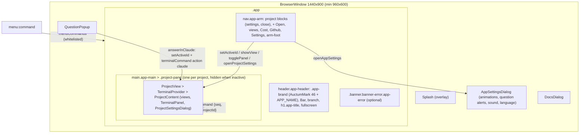
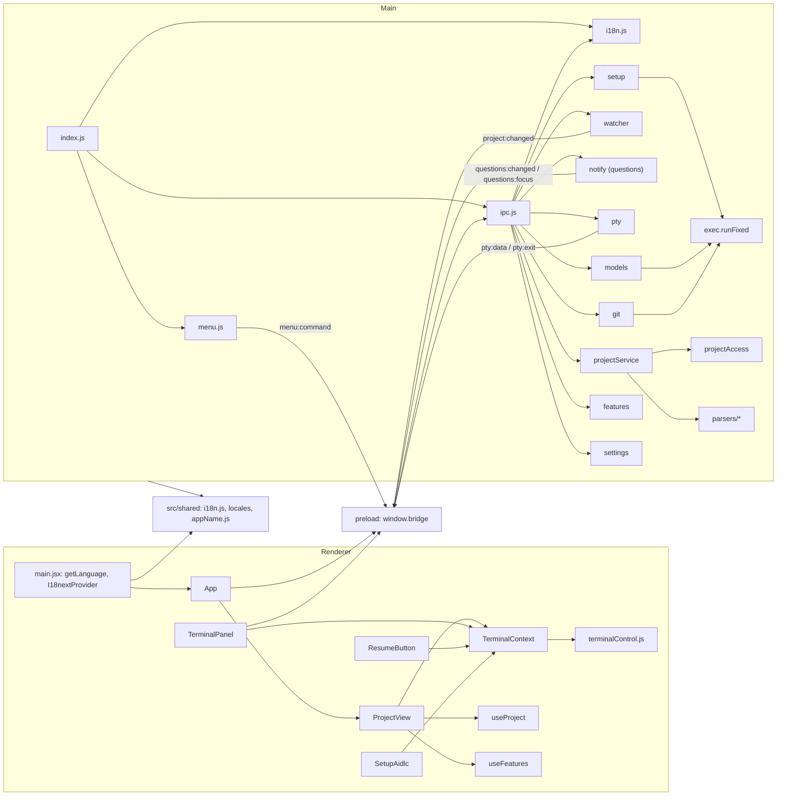
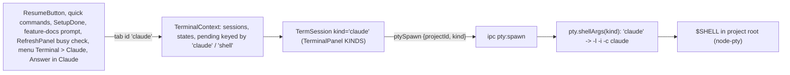
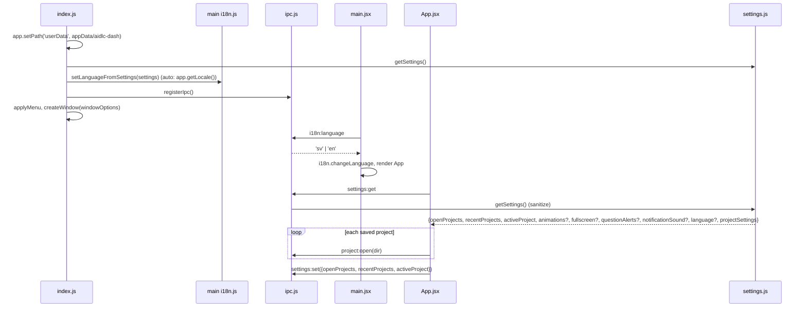
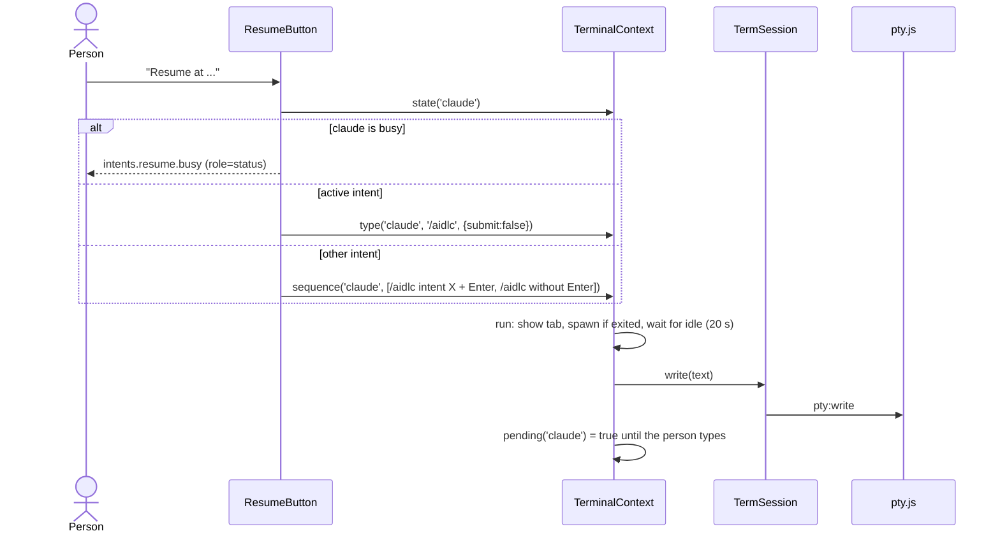
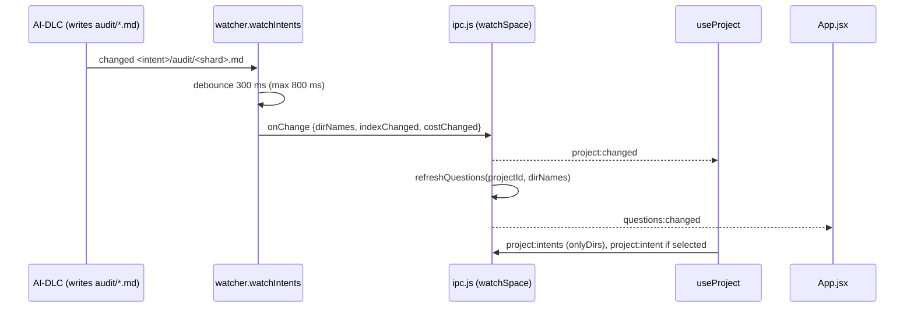

# Architecture: aidlc-dash

## Architecture Analysis

### System Overview

An Electron app with three process parts, built by electron-vite into `out/` and packaged by electron-builder into `dist/`:

- **Main process** (`src/main/`): pins userData to the folder `aidlc-dash`, sets the language from the settings before the first menu and window (`i18n.js`, `index.js:70`), creates the window, sets its own app menu, reads AI-DLC files inside opened project roots, watches them with chokidar, derives waiting questions and shows system notifications, runs `git` and `aidlc` with fixed arguments (`exec.js`), owns the pseudo-terminals (`pty.js`, node-pty) and writes the app's `settings.json`.
- **Preload** (`src/preload/index.js`): exposes a narrow, named `window.bridge` API through `contextBridge`. No generic `invoke` or `send`.
- **Renderer** (`src/renderer/`): a React 19 SPA in a sandboxed window (`contextIsolation`, no `nodeIntegration`, `sandbox`, CSP in `index.html`). `main.jsx` asks main for the language in effect, switches i18n to it, and only then renders `App` inside `I18nextProvider`.
- **Shared modules** (`src/shared/`, new with US-0406 and US-0701): `appName.js` (the name in every form) and `i18n.js` with `locales/sv.json` and `locales/en.json`. Each process bundles its own copy, so each has its own i18next instance. Both read the same files.
- **Packaging** (`package.json`, `electron-builder.yml`, `.github/workflows/release.yml`): not re-read in this scan. `package.json` now has `name: thadeus` and `productName: THADEUS`.

### Architectural Style

A monolithic desktop app with a strict process boundary. The renderer makes no file or process calls itself. Everything goes through IPC (`ipcMain.handle` / `ipcRenderer.invoke`) and push events (`webContents.send` / `ipcRenderer.on`). State lives in React (App-shell state per project, hooks, one terminal context per project) and in per-project caches in main (`ipc.js` `projects` Map, `projectService` caches). No external services or network APIs. Shell access for the person is the only way the app changes a project, through a visible pty.

### Component Relationships

App-shell layout (from `App.jsx`, read in full in this scan):



Text: the window holds the splash overlay, the app shell and three modal dialogs. The shell has a header (brand block with the Auctum mark and `APP_NAME`, decorative bar, branch, title, fullscreen button), a left arm of LCARS blocks, and the main area with one mounted `ProjectView` per project. Each `ProjectView` wraps its content in its own `TerminalProvider`. App reaches a project's terminal only through the `terminalCommand` prop.

Processes and modules:



Text: the renderer bootstraps i18n from main, then App, hooks and the terminal panel call `window.bridge`, which goes to `ipc.js`. `ipc.js` delegates to projectService (through projectAccess and the parsers), watcher, notifications, pty, git, setup, models, features, settings and the main-process i18n. `setup`, `models` and `git` run external tools only through `exec.runFixed`. Both processes import `src/shared/`. Watcher, questions, pty and menu push events back.

Agent-terminal chain (the area US-0801 changes):



Text: every caller names the tab `'claude'`. The context keys its sessions, states and pending flags by that id. `TerminalPanel` mounts one `TermSession` per kind in `KINDS = ['claude', 'shell']`, and the session asks main to spawn that kind. Main maps the kind to fixed shell arguments, so the tab id is also the CLI command.

### Data Flow

1. At module load main pins userData to `<appData>/aidlc-dash` (`index.js:10`). On `whenReady` it sets the language from the saved settings (`setLanguageFromSettings`, auto follows `app.getLocale()`), registers IPC, sets the menu and opens the window. The renderer reads `i18n:language`, switches its own i18next instance, and renders. App then reads the settings, sets the motion mode, the language choice and the alert choices, and reopens the saved projects. The splash shows until that finishes.
2. The person opens a folder (`project:pick`, `project:open`). Main validates the root (`openRoot`, realpath), detects AI-DLC (`detectProject`: `aidlc/spaces/` with at least one space) and starts watching the active space (`watchSpace`). A folder without AI-DLC is watched until a space appears (`watchForSetup`), then `project:detected` switches the tab.
3. `useProject` loads the intent list, the selected intent's detail, cost and models. Cost: `project:cost` reads `aidlc/.aidlc-sessions/usage-ledger.json` (`loadCost`, never throws, keeps the last good value) and summarises it per intent, scope, model and agent (`summarizeLedger`). Models: `aidlc config models --show --json --harness claude`, with the `.claude/agents/*.md` frontmatter as fallback, cached per opened project.
4. chokidar changes under `intents/` are debounced (300 ms, max 800 ms) and sent as `project:changed` to the `webContents` that opened the project. Main also recomputes waiting questions and pushes `questions:changed`, with a system notification for new ones.
5. Terminal input and output go through `pty:write` and `pty:data`. The activity signal (`idle | busy | exited`) is computed in the renderer from output alone (`terminalControl.createActivity`, 1.5 s quiet = idle).
6. Settings writes run one at a time through `settings.js` (`update`, a serial queue, `sanitize()` on every read and write). A changed `language` switches main's i18n and rebuilds the menu (`ipc.js:252-257`).

### Key Design Decisions

- **Read-only towards AI-DLC**: the only file the app writes is `settings.json` in userData.
- **userData pinned to `aidlc-dash`** (`index.js:10`), so settings survive renames (US-0406 FR4.1).
- **Root-confined file access**: `resolveInRoot` rejects absolute paths, `..` and symlinks out of the root. The renderer never names a root, only a `projectId`.
- **Fixed external commands**: `runFixed` uses `execFile` without a shell, string-only arguments, a timeout (10 s) and the login shell's PATH, probed once per process with a marker (`exec.js:7-35`). Rejected alternative: `exec` with a shell string, which could be injected.
- **The pty runs a fixed command per kind**: `shellArgs(kind)` (`pty.js:22-27`) is a whitelist, and the renderer sends only the kind. Rejected alternative: letting the renderer send a command line. Consequence for US-0801: a new harness means a new fixed entry in main, chosen from a validated id.
- **node-pty loads lazily** on the first spawn (`pty.js:10-20`), so a native module that cannot load breaks the terminal tab, not the app (v0.1.0 Linux regression).
- **One terminal context per project**: `TerminalProvider` lives in each `ProjectView`. App reaches it through the prop `terminalCommand {seq, action, projectId}`. "Answer in Claude" sets `projectId` directly.
- **Everything mounted**: hidden projects and terminals stay mounted (`hidden`), so sessions survive tab and view switches (FR8.4).
- **Translation through one shared module**: `src/shared/i18n.js` with ICU MessageFormat, bundled resources (`initAsync: false`, so `t()` works at import), fallback to English then to the key, missing keys logged once in development. Main and renderer each switch their own instance; main tells the renderer the resolved language (`i18n:language`). Rejected alternative: a single instance through IPC, which would make every `t()` asynchronous.
- **Per-project settings in the app, keyed by root**: `projectSettings[root]` in `settings.json` (`settings.js:80-102`), never in the project. Rejected alternative: a file in the project, which would break the read-only rule.
- **Narrow preload API**: every channel is a named function (`call(channel)` or `subscribe(channel)`).
- **Commands are typed, not run**: setup chains, Resume and quick commands are written into a pty without Enter unless the step is a safe intent switch (`ResumeButton.jsx:32-37`, `SAFE_DIR_NAME`).

Security: CSP allows `style-src 'self' 'unsafe-inline'` and `font-src 'self' data:`. The window blocks navigation and new windows, and `http(s)` links open in the OS browser. `shell:openInEditor` is limited to document types. The pty inherits `process.env`, and the CLI it starts runs with the person's rights in the project root. That is intended: it is the person's own terminal. The app is unsigned (`identity: null`), so Gatekeeper needs right-click and Open the first time.

### Improvement Opportunities

- Introduce one harness table in main (id → CLI, `--version` arguments, folder markers, tab label key, command forms). `pty.shellArgs`, setup, models and the renderer's command callers would all read it, through IPC for the renderer. This is the change US-0801 needs; see `code-quality-assessment.md`.
- Decouple the tab id from the CLI name: a neutral id such as `agent` beside `shell`, with the harness as data. Otherwise keep `'claude'` as the internal id and change only label and command (smaller diff, misleading name).
- Share `errorText()` instead of 10+ copies in the renderer.
- Merge the two debounce implementations in `watcher.js` (from an earlier scan, not re-read).

## Interaction Diagrams

Start the app and restore saved projects:



Text: main pins userData, resolves the language before the first menu and window, and registers IPC. The renderer asks for the resolved language before its first render, so it never flashes in the other language. App then reads the sanitised settings, reopens the projects and saves the tab state.

Spawn the agent tab when a project opens:

```mermaid
sequenceDiagram
  participant PV as ProjectView
  participant TS as TermSession (kind 'claude')
  participant TC as TerminalContext
  participant Bridge as window.bridge
  participant IPC as ipc.js
  participant PTY as pty.js
  PV->>TS: mount (TerminalPanel KINDS)
  TS->>TC: register('claude', {activity, spawn, write, focus, restart})
  TS->>Bridge: ptySpawn({projectId, kind:'claude', cols, rows})
  Bridge->>IPC: pty:spawn
  IPC->>PTY: spawnSession({root: project root, kind})
  PTY->>PTY: shellArgs('claude') = ['-l','-i','-c','claude']; loadPty()
  PTY-->>TS: session id
  PTY-->>TS: pty:data -> term.write, activity.onData (busy, idle after 1.5 s)
  PTY-->>TS: pty:exit -> activity.onExit(code) (exited, Restart button)
```

Text: each project mounts two sessions. The agent session registers with the context, then asks main to spawn its kind in the project root. Main validates the kind first, then loads node-pty and starts `$SHELL -l -i -c claude`. Output drives the busy and idle state. An exit shows the code and a Restart button.

Resume an intent from the console:



Text: Resume refuses while the agent tab is busy. For the active intent it types `/aidlc` without Enter. For another intent it submits the switch first, waits for the output to settle, then types `/aidlc` without Enter. The footer shows "Waiting for your Enter" until the person types in that tab.

Set up AI-DLC in a plain folder (US-0503):

```mermaid
sequenceDiagram
  actor Person
  participant SA as SetupAidlc
  participant IPC as ipc.js
  participant Setup as setup.js
  participant Exec as exec.runFixed
  participant TC as TerminalContext
  participant W as watcher.watchForAidlc
  Person->>SA: Set up AI-DLC
  SA->>IPC: setup:info
  IPC->>Setup: getSetupInfo(root)
  Setup->>Setup: listDir root: .kiro .codex .cursor .aidlc
  Setup->>Exec: git rev-parse, aidlc --version, aidlc --project-dir root config --harness claude --dry-run, aidlc config project --show --json
  Setup-->>SA: {aidlc, git, harnesses, preview, plugins, presets}
  Person->>SA: Set up
  SA->>IPC: setup:command {needsGit, plugins, preset}
  IPC-->>SA: "git init -b main && aidlc --project-dir . config --harness claude --yes && ..."
  SA->>TC: type('shell', cmd, {submit:false})
  Person->>TC: Enter
  W-->>IPC: aidlc/spaces/ appeared -> project:detected
  IPC-->>SA: tab switches; SetupDone restarts 'claude'
```

Text: the setup view reads the prerequisites through fixed commands, shows the dry-run preview, and types the command chain into the shell tab for the person to confirm. Once `aidlc/spaces/` appears, the tab switches to the project view and the agent tab restarts so the harness loads AI-DLC.

New audit event in an open project (from an earlier scan, flow unchanged by US-0701):



Text: when AI-DLC writes an audit shard, the watcher sends `project:changed`, main recomputes that project's waiting questions and pushes them to App, and the hook re-reads only the changed intents. The flow reads only the shared `aidlc/` records, so it does not depend on the harness that wrote them.
