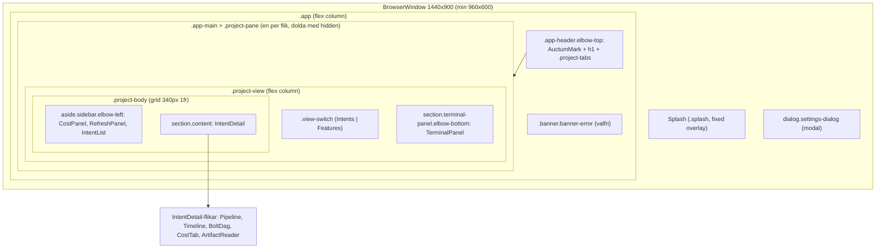
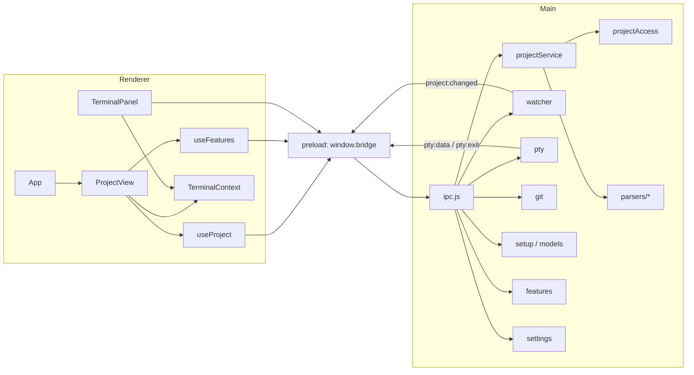
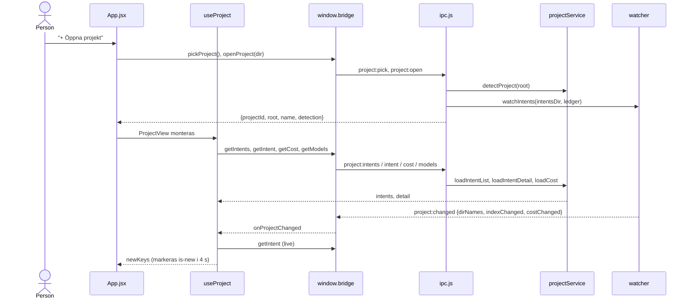
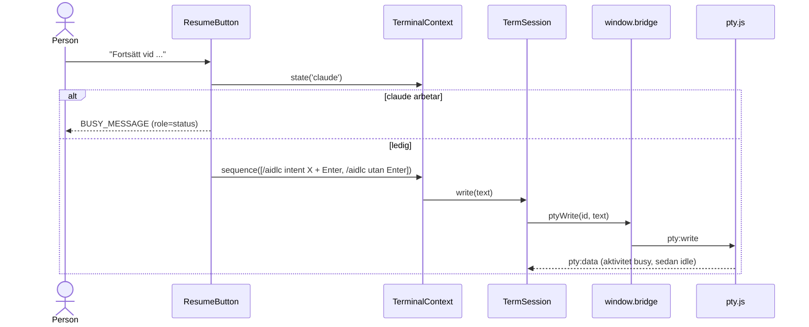

# Arkitektur: aidlc-dash

## Architecture Analysis

### System Overview

En Electron-app med tre processdelar som electron-vite bygger till `out/`:

- **Huvudprocessen** (`src/main/`): läser AI-DLC-filer inom öppnade projektrötter, bevakar dem med chokidar, kör `git` och `aidlc` med fasta argument, och äger pseudoterminalerna (node-pty).
- **Preload** (`src/preload/index.js`): exponerar ett smalt, namngivet `window.bridge`-API via `contextBridge`. Inget generiskt `invoke`.
- **Renderaren** (`src/renderer/`): en React 19-SPA i ett sandboxat fönster (`contextIsolation`, ingen `nodeIntegration`, CSP i `index.html`). Hela utseendet styrs av en global stilmall, `theme.css`.

### Architectural Style

Monolitisk skrivbordsapp med strikt processgräns: renderaren gör inga fil- eller processanrop själv, allt går via IPC (`ipcMain.handle` / `ipcRenderer.invoke`) och push-händelser. Tillstånd hålls i React (hooks, en context för terminalen) och i main-processens cacher per projekt. Inga externa tjänster eller nätverks-API:er.

### Component Relationships

App-skalets layout (det en omdesign rör):

Text: fönstret innehåller splash-overlayn, app-skalet och en modal inställningsdialog. Skalet är en kolumn: sidhuvud med övre elbow (märke, titel, projektflikar), valfri felbanner och huvudytan. Varje projektflik är en `.project-view` med vyväxlare, ett tvåkolumnsrutnät (sidofält med vänster elbow, innehåll) och terminalpanelen med nedre elbow längst ner. Innehållet visar IntentDetail med fem flikar.

Processer och moduler:

Text: renderarens hooks och terminalpanelen anropar `window.bridge`, som går till `ipc.js`. IPC delegerar till projectService (via projectAccess och parsers), watcher, pty, git, setup/models, features och settings. Watcher och pty skickar händelser tillbaka till renderaren.

### Data Flow

1. Personen öppnar en mapp (`project:pick`, `project:open`). Main validerar roten (`openRoot`, realpath), detekterar AI-DLC och startar bevakning.
2. `useProject` hämtar intent-lista, vald intents detalj, kostnad och modeller. Detaljen slår ihop `aidlc-state.md` (vinner), `runtime-graph.json`, audit-shards och artefaktfiler.
3. chokidar-ändringar debouncas (300 ms, max 800 ms) och skickas som `project:changed` med vilka intents som ändrats. Renderaren läser bara om dem och markerar nya audit-händelser i 4 s (`newKeys`, klassen `is-new`).
4. Terminalens in- och utdata går via `pty:write` och `pty:data`. Aktivitetssignalen (`idle | busy | exited`) räknas i renderaren (`terminalControl.js`).

### Key Design Decisions

- **Skrivskyddad mot AI-DLC**; den enda fil appen skriver är `settings.json` i userData.
- **Rotbegränsad filåtkomst** (`resolveInRoot` avvisar absoluta sökvägar, `..` och symlänkar ut ur roten).
- **Allt utseende i en global CSS-fil** med tokens på `:root`. Alternativ som inte valts: CSS-moduler eller CSS-in-JS. Följd: en omdesign är i huvudsak en ändring av `theme.css`, men klassnamn är globala och delas mellan vyer (t.ex. `.intent-row` i både intentlistan och Features).
- **LCARS-ramar som CSS-kanter**: `.elbow-top/-left/-bottom` är `border` + `border-radius` på befintliga element, inte egna komponenter eller SVG. Alternativ: SVG-ramar eller ramkomponenter. Följd: enkelt, men nästlade ramar och "bars med mellanrum" (US-0403) kräver nya primitiver.
- **Alla flikar monterade**: dolda projekt och terminaler ligger kvar (`hidden`) så sessioner överlever flikbyten. Övergångsanimationer måste fungera med `hidden` (som sätter `display: none !important`).
- **Rörelse styrs globalt**: en `prefers-reduced-motion`-regel stänger av all animation och transition.

Säkerhet: CSP tillåter `style-src 'self' 'unsafe-inline'` och `font-src 'self' data:`, så nya typsnitt måste bundlas lokalt (som Antonio via `@fontsource`), inte laddas från CDN.

### Improvement Opportunities

- Flytta xterm-temat (`TerminalPanel.jsx:17-22`) och fönsterbakgrunden (`src/main/index.js:18`) till samma palett som `theme.css` (t.ex. läsa CSS-variabler med `getComputedStyle` för xterm).
- Ersätt hårdkodade bakgrunder i `.banner-*`, `@keyframes flash` och `::backdrop` med tokens.
- Inför layout- och elbow-tokens (bredder, radier, mellanrum) i stället för upprepade magiska tal.
- Animationsnivå (Full/Dämpad/Av) passar som ett attribut på `.app` (t.ex. `data-motion`) som CSS-regler läser, bredvid den befintliga reduced-motion-regeln.

## Interaction Diagrams

Öppna projekt och visa liveuppdatering:

Text: personen öppnar ett projekt, main detekterar det och startar bevakning, renderaren laddar listan och detaljen. Vid filändringar skickar watchern `project:changed`, och hooken läser om den valda intenten och markerar nya händelser.

Fortsätt en intent från konsolen:

Text: Fortsätt-knappen kontrollerar att claude-fliken inte arbetar, skriver sedan in intentbytet (med Enter) och `/aidlc` (utan Enter) i claude-terminalen via TerminalContext, preload och pty.
