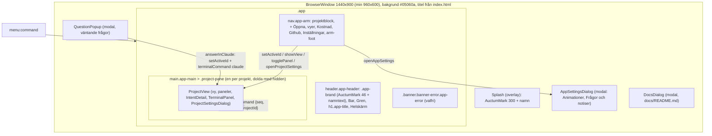
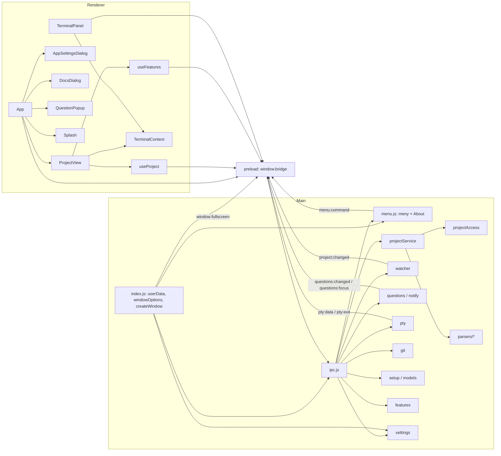
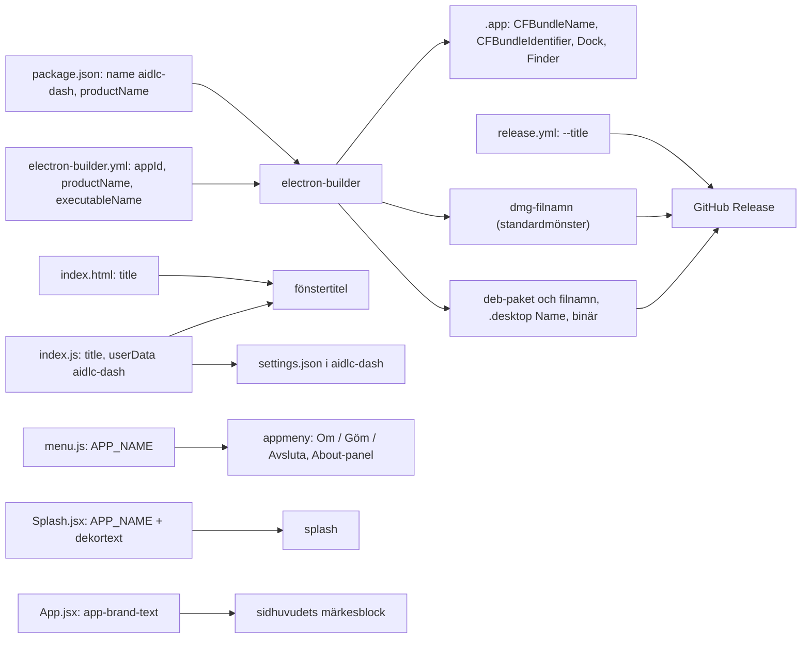
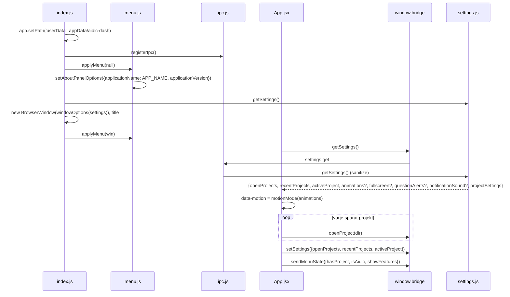
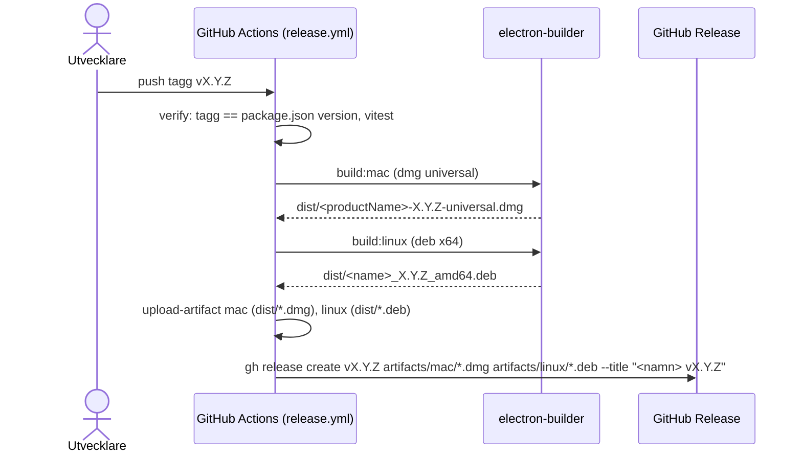
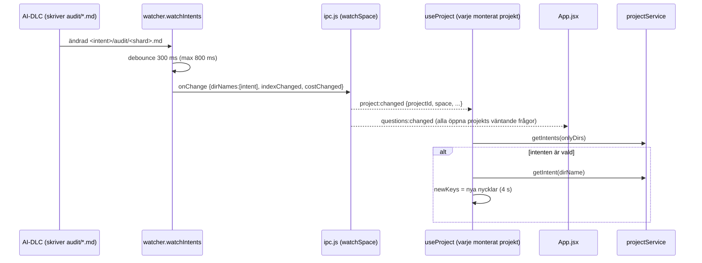
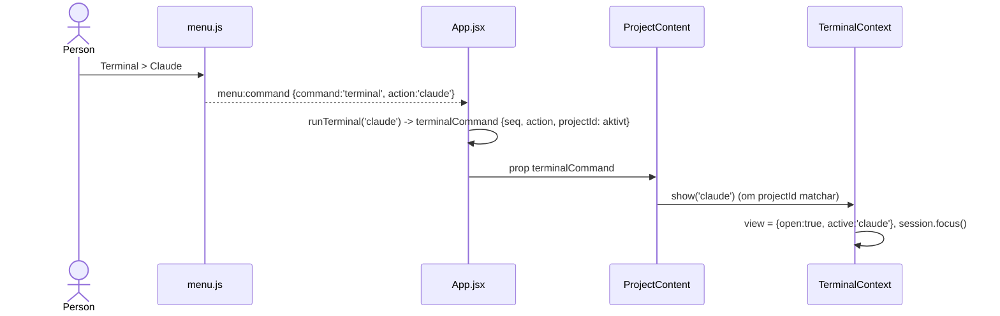
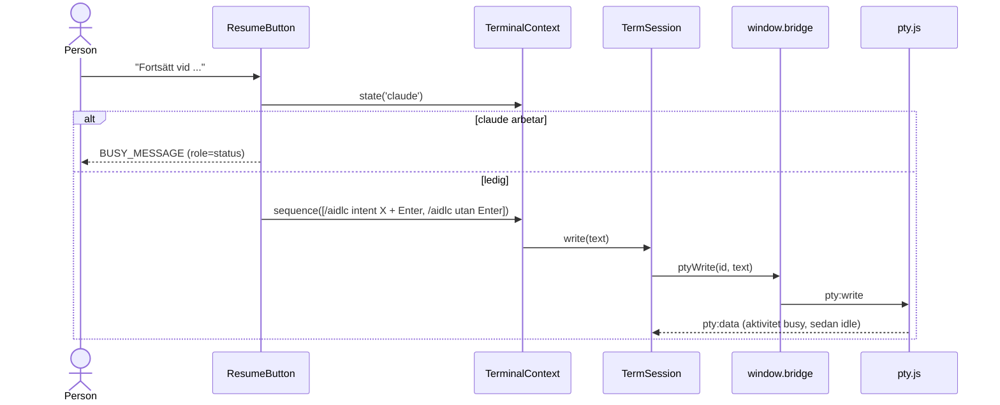

# Arkitektur: aidlc-dash

## Architecture Analysis

### System Overview

En Electron-app med tre processdelar som electron-vite bygger till `out/`, paketerad av electron-builder till `dist/`:

- **Huvudprocessen** (`src/main/`): låser userData till mappen `aidlc-dash`, skapar fönstret (`windowOptions()`), sätter en egen appmeny och About-panel (`menu.js`), läser AI-DLC-filer inom öppnade projektrötter, bevakar dem med chokidar, härleder väntande frågor och visar systemnotiser (`questions.js`, `notify.js`, US-0505), kör `git` och `aidlc` med fasta argument, äger pseudoterminalerna (node-pty) och skriver appens `settings.json`.
- **Preload** (`src/preload/index.js`): exponerar ett smalt, namngivet `window.bridge`-API via `contextBridge`. Inget generiskt `invoke` eller `send`.
- **Renderaren** (`src/renderer/`): en React 19-SPA i ett sandboxat fönster (`contextIsolation`, ingen `nodeIntegration`, `sandbox`, CSP i `index.html`). Utseendet styrs av den globala stilmallen `theme.css` med tokens, LCARS-primitiver i `Lcars.jsx` och ett rörelseläge som `App.jsx` sätter som `data-motion` på `<html>`.
- **Paketering** (`package.json`, `electron-builder.yml`, `.github/workflows/release.yml`): ger appens identitet i operativsystemet (`appId`, `productName`, `executableName`, artefaktnamn) och publicerar `.dmg` och `.deb` på tagg.

### Architectural Style

Monolitisk skrivbordsapp med strikt processgräns: renderaren gör inga fil- eller processanrop själv, allt går via IPC (`ipcMain.handle` / `ipcRenderer.invoke`) och push-händelser (`webContents.send` / `ipcRenderer.on`). Tillstånd hålls i React (App-skalets state per projekt, hooks, en terminal-context per projekt) och i main-processens cacher per projekt. Inga externa tjänster eller nätverks-API:er.

### Component Relationships

App-skalets layout (verifierad i `App.jsx`; innehållet i `.project-pane` är från tidigare skanning):

Text: fönstret har splash-overlayn, app-skalet och tre modala dialoger. Skalet har ett sidhuvud (märkesblocket med Auctum-märket och appnamnet, dekorstapel, gren, titel, helskärmsknapp), en vänsterarm av LCARS-block och huvudytan med en monterad `ProjectView` per projekt. Armen och menykommandon kör samma namngivna funktioner; terminalkommandon och "Svara i Claude" når rätt projekt via `terminalCommand`.

Processer och moduler:

Text: App, hooks och terminalpanelen anropar `window.bridge`, som går till `ipc.js`. `index.js` låser userData, skapar fönstret, registrerar IPC och sätter menyn. IPC delegerar till projectService (via projectAccess och parsers), watcher, frågor och notiser, pty, git, setup/models, features, settings och menu. Watcher, frågorna, pty, menyn och fönstrets helskärmshändelser skickar push-händelser tillbaka till renderaren. `ipc.js` importerar `notifyQuestions` från `notify.js` (skummat); `index.js` gör det inte.

Var appens namn och identitet kommer ifrån (US-0406):

Text: paketidentiteten (bundle, Dock, filnamn, deb-paket, Linux-startpost) kommer från `package.json` och `electron-builder.yml` via electron-builder. Releasetiteln kommer från `release.yml`. Fönstertiteln sätts i `index.js` och skrivs över av `<title>` i `index.html`. Menyn och About-panelen tar namnet från `APP_NAME` i `menu.js`; splashen och sidhuvudet har egna strängar. userData är fastlåst i `index.js` och påverkas inte av något av namnen.

### Data Flow

1. Vid modulladdning låser main userData till `<appData>/aidlc-dash` (`index.js:8`), före `whenReady`. Vid start sätter main menyn (`applyMenu(null)`, som också sätter About-panelens namn och version), läser inställningarna och skapar fönstret med `windowOptions(settings)`. App läser inställningarna (`settings:get`), sätter rörelseläget och notisvalen och öppnar sparade projekt igen (FR1.5). Splash visas tills återställningen är klar (minst 900 ms, högst 4 s).
2. Personen öppnar en mapp (`project:pick`, `project:open`). Main validerar roten (`openRoot`, realpath), detekterar AI-DLC och startar bevakning av projektets aktiva space (`watchSpace`). Varje öppet projekt bevakas, inte bara det aktiva.
3. `useProject` hämtar intent-lista, vald intents detalj, kostnad och modeller. Listan bygger på `intents.json`, mappar på disk, `active-intent` och varje intents `aidlc-state.md`; detaljen slår ihop `aidlc-state.md`, `runtime-graph.json`, alla audit-shards och artefaktfiler.
4. chokidar-ändringar under `intents/` debouncas (300 ms, max 800 ms) och skickas som `project:changed` till det `webContents` som öppnade projektet. Main uppdaterar också väntande frågor för alla öppna projekt och skickar `questions:changed`; nya frågor öppnar popupen och, enligt `questionAlerts` och vilket projekt som visas (`questions:activeProject`), en systemnotis. Klick på notisen skickar `questions:focus`.
5. Terminalens in- och utdata går via `pty:write` och `pty:data`. Aktivitetssignalen (`idle | busy | exited`) räknas i renderaren (`terminalControl.js`).
6. Efter varje flikändring sparar App `openProjects`, `recentProjects` och `activeProject`; animationsläget sparas som `animations`, notisvalen som `questionAlerts` och `notificationSound`; main sparar `fullscreen` vid `enter-/leave-full-screen`. Allt går genom `settings.js` seriella skrivkö och `sanitize()`.

### Key Design Decisions

- **Skrivskyddad mot AI-DLC**; den enda fil appen skriver är `settings.json` i userData.
- **userData fastlåst till `aidlc-dash`** (`index.js:7-8`): sedan förra namnbytet följer mappen inte `productName`, så inställningar överlever namnbyten. Alternativ som inte valts: Electrons standard (en mapp per `productName`), som skulle tömma inställningarna vid varje namnbyte. Följd för US-0406: inget migreringssteg behövs så länge raden står kvar.
- **Namnet har ingen gemensam källa**: `productName` finns i `package.json` och `electron-builder.yml`, visningsnamnet i `menu.js` (`APP_NAME`), `Splash.jsx` (`APP_NAME`), `index.js` (fönstertitel) och `index.html` (`<title>`), och den synliga märkestexten är egna strängar i `Splash.jsx` och `App.jsx`. Följd: ett namnbyte rör sex kodfiler, två konfigfiler, CI, README och tre tester.
- **Inga uttryckliga artefaktnamn**: `electron-builder.yml` saknar `artifactName`, så `.dmg` heter `${productName}-${version}-${arch}.dmg` och `.deb` `${name}_${version}_${arch}.deb` (electron-builders standard). CI-globbarna (`dist/*.dmg`, `dist/*.deb`) beror bara på filändelsen.
- **Rotbegränsad filåtkomst** (`resolveInRoot` avvisar absoluta sökvägar, `..` och symlänkar ut ur roten).
- **Smalt preload-API**: varje kanal är en namngiven funktion (`call(channel)` eller `subscribe(channel)`). Alternativ som inte valts: ett generiskt `invoke(channel, ...)`.
- **Generisk auditparser**: varje `**Nyckel**: värde`-rad sparas ordagrant i `fields`; bara `Timestamp` och `Event` lyfts ut.
- **App-skalet äger UI-tillståndet per projekt** (`ui[projectId] = {view, cost, github}`) och skickar det som props till `ProjectView`. Menykommandon och armens knappar delar namngivna funktioner (`openProject`, `closeActiveProject`, `showView`, `togglePanel`, `openAppSettings`, `openProjectSettings`, `runTerminal`, `openDocs`).
- **Terminalen styrs per projekt**: `TerminalProvider` ligger i varje `ProjectView`; App når den via propen `terminalCommand {seq, action, projectId}`. "Svara i Claude" (`answerInClaude`) sätter `projectId` direkt.
- **Allt utseende i en global CSS-fil** med tokens på `:root`, kompletterad av `tokens.js` och `Lcars.jsx`. Alternativ som inte valts: CSS-moduler eller CSS-in-JS. Märkesblocket och splashen har fasta mått (150 px respektive 180 px arm), så längre text måste få plats inom dem.
- **Alla flikar monterade**: dolda projekt och terminaler ligger kvar (`hidden`) så sessioner överlever flikbyten (FR8.4).
- **Rörelse styrs globalt**: `data-motion` (`full | reduced | off`) på `<html>`, satt i `useLayoutEffect` före första målning.
- **Egen meny och helskärm** (US-0404): `menu.js` bygger mallen olika för paketerat och dev (ren `buildMenuTemplate`, testad), tar emot `menu:state` och skickar `menu:command` till fokuserat fönster. macOS-appmenyn och About-panelen tar namnet från `APP_NAME`; Linux har ingen About-post.
- **Ingen fönsterreferens på modulnivå**: main slår upp fönstret per anrop.

Säkerhet: CSP tillåter `style-src 'self' 'unsafe-inline'` och `font-src 'self' data:`, så nya typsnitt måste bundlas lokalt. Fönstret blockerar navigering och nya fönster; `http(s)`-länkar öppnas i OS-webbläsaren. Appen är osignerad (`identity: null`) och notariseras inte, så Gatekeeper kräver högerklick och Öppna första gången. Ett nytt `appId` gör appen till en ny app för macOS (notisbehörighet, Dock-fästning). Namnbytet ändrar inga säkerhetskontroller.

### Improvement Opportunities

- Samla visningsnamnet, det utskrivna namnet och taglinen på ett ställe som både main (`menu.js`, `index.js`) och renderaren (`Splash.jsx`, `App.jsx`) kan importera (som `parsers/` redan delas), eller åtminstone låt main och renderaren ha var sin konstant och kontrollera med grep att det gamla namnet är borta.
- Sätt `artifactName` för `dmg` och `deb` uttryckligen i `electron-builder.yml`, så att filnamnen (`THADEUS-<version>-universal.dmg`, `thadeus_<version>_amd64.deb`) inte beror på `productName` och `name`.
- Ge `.app-brand-text` en kapning (`white-space: nowrap`, `overflow: hidden`, `text-overflow: ellipsis`, som `.lcars-label`) så att ett för långt namn kortas i stället för att flöda ut ur märkesblocket.
- Slå ihop de två debounce-implementationerna i `watcher.js` (från tidigare skanning).
- Ersätt hårdkodade bakgrunder i `.banner-*`, `@keyframes flash` och `::backdrop` med tokens (från tidigare skanning; `::backdrop` använder nu `--backdrop`).

## Interaction Diagrams

Starta appen och återställ sparade projekt:

Text: main låser userData, registrerar IPC, sätter menyn och About-panelen, läser inställningarna och skapar fönstret. App läser de sanerade inställningarna ur samma `aidlc-dash`-mapp, sätter rörelseläget, öppnar de sparade projekten, sparar flikläget och rapporterar menyläget. Ett namnbyte ändrar namnen i det här flödet men inte var inställningarna läses.

Bygga och släppa en version:

Text: en tagg kör testerna, bygger `.dmg` och `.deb` vars filnamn kommer från `productName` respektive `name`, laddar upp dem med globbar på filändelsen och skapar releasen med en titel som har namnet i klartext.

Ny audit-händelse i ett öppet projekt:

Text: när AI-DLC skriver i en audit-shard skickar watchern `project:changed`, och main skickar de väntande frågorna till App. Varje projekts hook läser om listan; bara om intenten är vald läses detaljen och nya händelser markeras.

Menykommando till ett projekts terminal:

Text: menyn skickar ett kommando, App omvandlar det till `terminalCommand` för det aktiva projektet, och det projektets `ProjectContent` öppnar och fokuserar Claude-fliken. "Svara i Claude" går samma väg efter `setActiveId`.

Fortsätt en intent från konsolen:

Text: Fortsätt-knappen kontrollerar att claude-fliken inte arbetar, skriver sedan in intentbytet (med Enter) och `/aidlc` (utan Enter) i claude-terminalen via TerminalContext, preload och pty.
