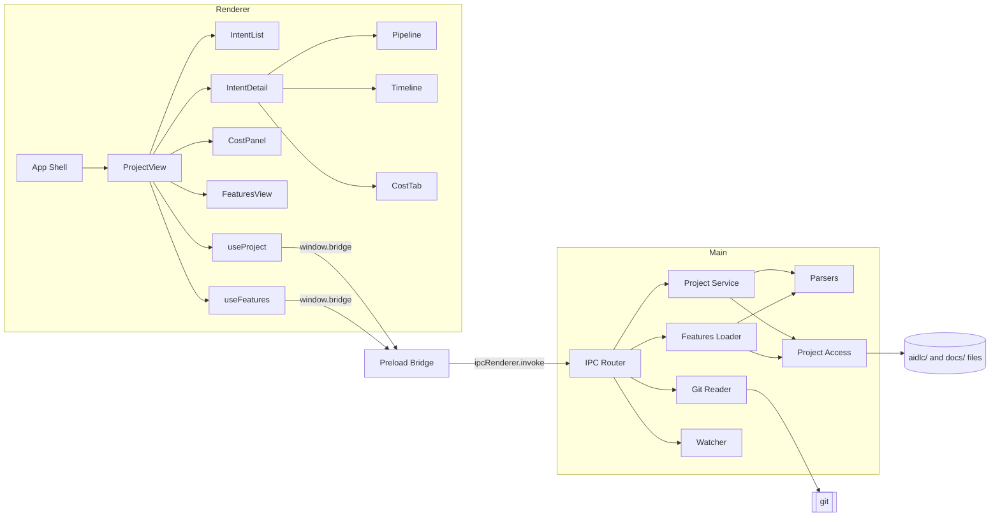
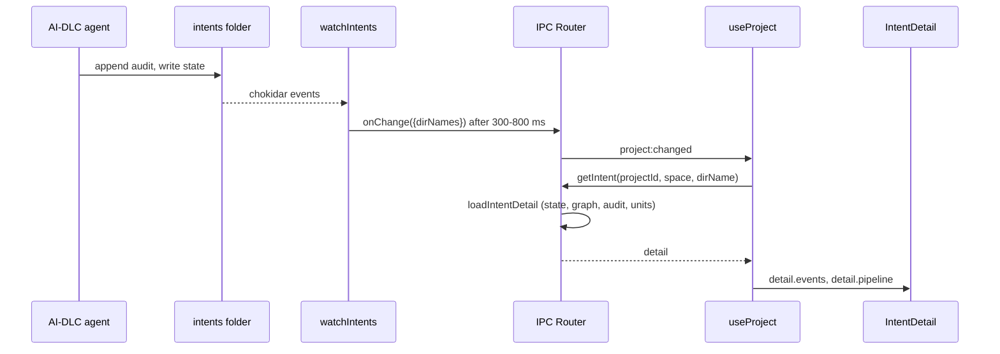
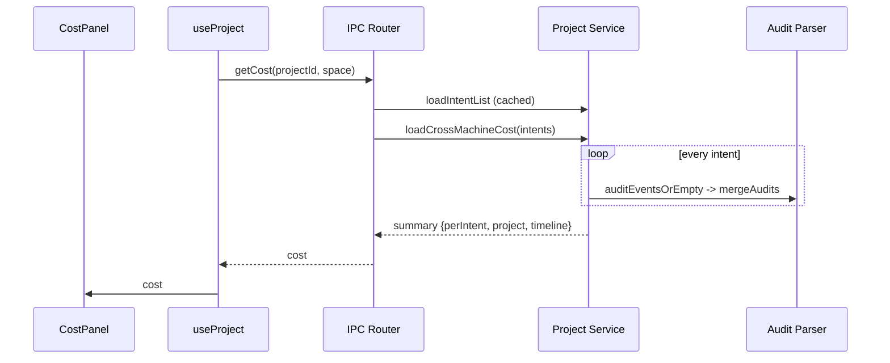
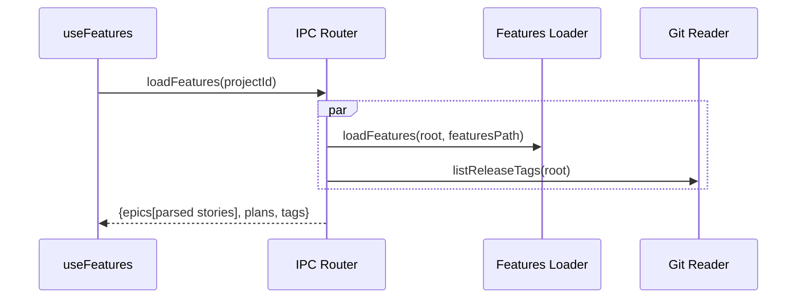

# Architecture

## Architecture Analysis

### System Overview

The app is a single Electron app with three processes:
- **main** (Node: file reads, watchers, ptys, CLI calls, the agent hook channel);
- **preload** (`window.bridge`, a named, narrow API);
- **renderer** (React 19 in a sandboxed window with contextIsolation and a CSP).

Pure modules in `src/shared/` and some parsers in `src/main/parsers/` (`features`, `releases`, `ledger`) are bundled into both sides. The project's AI-DLC files and its git history are the data sources. There is no database and no server.

### Architectural Style

A modular monolith on the desktop, split along Electron process lines. Main is organised as service modules behind one IPC router (`ipc.js`, 87 handlers in one table at `bbfb4c0`). The renderer is a tree of view components with two data hooks (`useProject`, `useFeatures`) and a per-project terminal context. The evidence:
- `ipc.js` imports almost every main module;
- `preload/index.js` exposes one `invoke` wrapper per channel and no generic invoke.

### Component Relationships

Text fallback: the views get their data through `useProject` (intents, detail, cost) and `useFeatures` (feature docs, story links). Both call `window.bridge`, which invokes the IPC Router. The router uses the Project Service (state, audit and graph through the parsers and Project Access), the Features Loader (the feature docs through the same parsers) and the Git Reader (fixed `git` commands). The PTY Manager, Exec Runner and agent channel are unchanged and are left out of this diagram (see `dependencies.md`).

### Data Flow

1. **Opening a project**: `project:open` resolves the root (`openRoot`), runs `detectProject`, then starts the space watcher (`watchIntents`), the config watcher, the feature-docs watcher and the `.git/HEAD` watcher.
2. **Intent list and detail**: `loadIntentList` merges `intents.json` with the folders on disk, plus summaries from each intent's state file (no audit read). `loadIntentDetail` → `buildDetail` reads `aidlc-state.md`, `runtime-graph.json`, `.aidlc-engine/active-directive.json`, the audit shards and the artifact tree. It returns `{state, graph, pipeline, events, units, directive, files, warnings}`.
3. **All intents at once**: only `loadCrossMachineCost` (`project:cost`) reads every intent's audit shards (through `auditEventsOrEmpty`). It is the one loop over all intents' events today.
4. **Feature docs**: `features:load` returns `loadFeatures` (the overview, the parsed epics with hashes, and the release plans) plus `listReleaseTags` (`v*` tags with their creator date).
5. **Live updates**: chokidar → `watchIntents` (debounced 300 ms, max 800 ms) → `project:changed {dirNames, indexChanged, costChanged}` → `useProject` reloads what changed. A feature-doc change sends `features:changed` → `useFeatures` reloads.
6. **Writes**: the app writes only its own settings, token readings and usage snapshots (`.thadeus/`), editor saves (hash-checked) and feature-doc release markers.

### US-0303 data sources

| Metric | Where it is | Parsed today? | Gap |
|---|---|---|---|
| Intent start and end | audit `WORKFLOW_STARTED`/`WORKFLOW_COMPLETED`; state `Start Date`, `Status`; `intents.json` `status` | events yes (`mergeAudits`); state yes (`parseState`) | no duration is computed |
| Time per phase | audit `PHASE_STARTED`/`PHASE_COMPLETED`/`PHASE_SKIPPED` (`Phase` field) | events only | pairing not written |
| Time per stage | audit `STAGE_STARTED`/`STAGE_COMPLETED`/`STAGE_SKIPPED` (`Stage`); `runtime-graph.json` `durationMs` | graph yes (`parseRuntimeGraph`) | the graph is git-ignored, so another clone has none; the audit is the portable source |
| Waiting at approvals | audit `STAGE_AWAITING_APPROVAL` → `GATE_APPROVED`/`GATE_REJECTED` (`Stage`); `PLAN_APPROVAL_*` | events only | pairing not written |
| Review rounds | audit `REVIEW_REQUESTED`/`REVIEW_COMPLETED` (`Stage`, `Request Id`, `Verdict`); `STAGE_REVISING`, `GATE_REJECTED` | paired only for running rows (`parsers/agentProgress.js`) | counting per stage not written |
| Parked time | audit `WORKFLOW_PARKED`/`WORKFLOW_UNPARKED` | events only | whether parked time counts is a requirements choice |
| Story 🚧/✅/released | epic head line markers (`parseEpic`, `statusOf`); `releaseOf` | current state only | no history: `git.js` has no `git log` over a file |
| Release dates, stories per release | `listReleaseTags` (`creatordate:short`), `buildReleases` | yes | none |
| Per week/month, average, trend | all of the above over every intent and story | no | an all-intents loader like `loadCrossMachineCost` |

### Key Design Decisions

- **Read-only, root-confined access** (`projectAccess.js` holds no write calls). This keeps the app from corrupting AI-DLC state. The cost is that every new source needs a root-relative path.
- **The last good value on broken input** (detail, graph, directive, ledger caches). Agents write files mid-stream, so the UI never blanks.
- **Debounced folder watching with a max-wait**. The UI stays live during continuous agent writes without reload storms.
- **Fixed git commands only** (`git.js` header). Any new history call (for US-0303, `git log` over the epic files) must take fixed arguments and `safeArg` for values.
- **Pure parsers, shared with the renderer.** Metrics written as pure functions over events and stories can be tested in plain node and reused on either side.
- **Styling through classes only**: LCARS tokens on `:root` in `theme.css`; tooltips only through `Tooltip.jsx`.

### Improvement Opportunities

- Stage times should come from the audit, not only `runtime-graph.json`, so that every clone shows them.
- `ipc.js` (1038 lines) and `agentHooks.js` are the largest modules and are candidates for splitting.
- `parsers/agentProgress.js` imports `projectService.js`. Moving `workingAgents` into a parser would keep the parsers Node-free.

## Interaction Diagrams

### Live intent update (today)

Text fallback: the agent writes the files; the watcher debounces and notifies the router; the router pushes `project:changed`; `useProject` calls `getIntent`; main rebuilds the detail; the views re-render.

### Project cost over all intents (the pattern a velocity load can follow)

Text fallback: the cost load takes the cached intent list, reads and merges every intent's audit shards, sums them per intent and for the project, and returns one summary that `CostPanel` draws. A velocity load would read the same events and return durations instead.

### Feature docs with tags

Text fallback: one call returns the parsed epics and release plans together with the `v*` tags and their dates. There is no history of when a marker changed; that needs a new git call.
