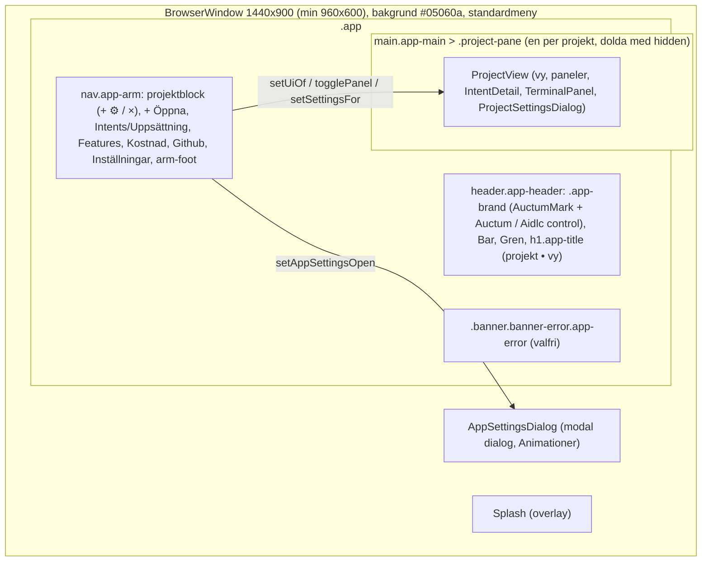
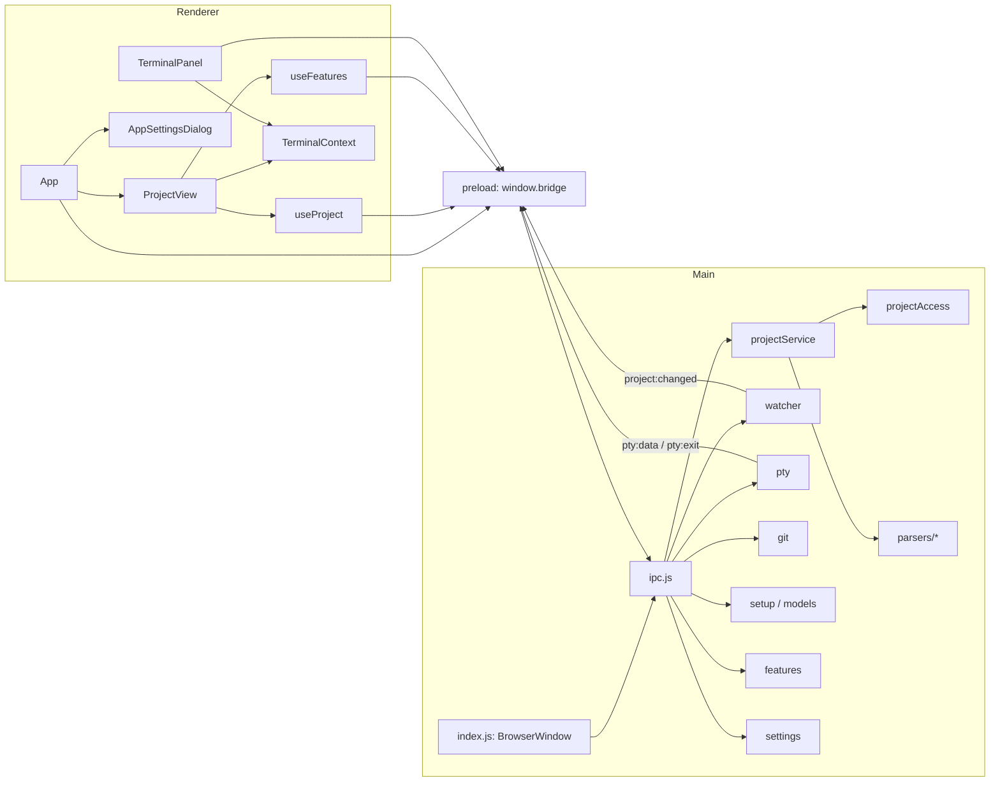
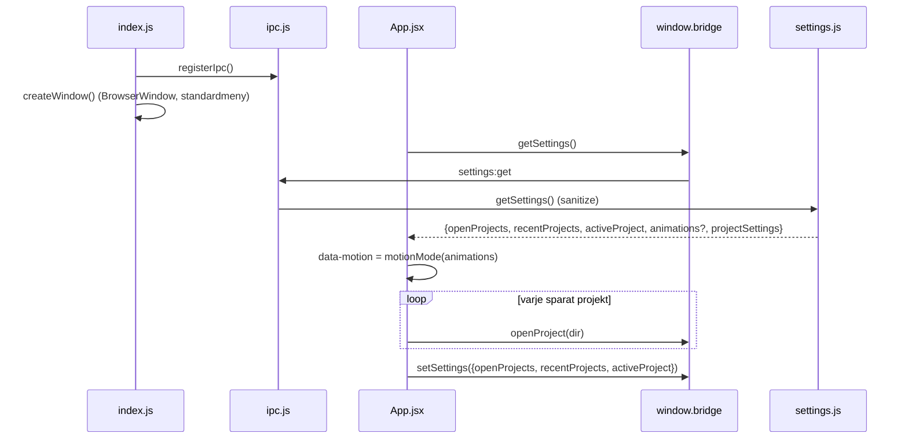
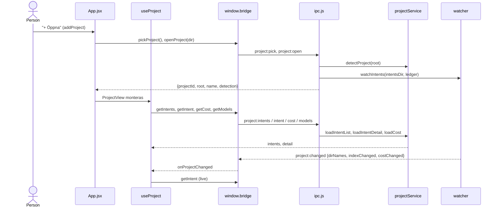
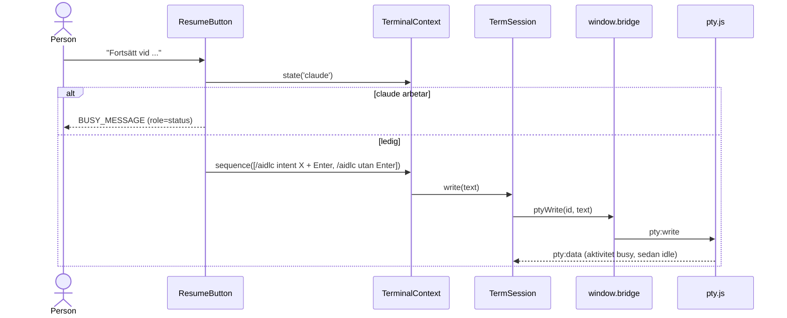

# Arkitektur: aidlc-dash

## Architecture Analysis

### System Overview

En Electron-app med tre processdelar som electron-vite bygger till `out/`:

- **Huvudprocessen** (`src/main/`): skapar fönstret, läser AI-DLC-filer inom öppnade projektrötter, bevakar dem med chokidar, kör `git` och `aidlc` med fasta argument, äger pseudoterminalerna (node-pty) och skriver appens `settings.json`. Den sätter i dag ingen egen meny, så Electrons standardmeny visas (US-0404 ska ersätta den).
- **Preload** (`src/preload/index.js`): exponerar ett smalt, namngivet `window.bridge`-API via `contextBridge`. Inget generiskt `invoke` eller `send`.
- **Renderaren** (`src/renderer/`): en React 19-SPA i ett sandboxat fönster (`contextIsolation`, ingen `nodeIntegration`, `sandbox`, CSP i `index.html`). Utseendet styrs av den globala stilmallen `theme.css` med tokens, LCARS-primitiver i `Lcars.jsx` och ett rörelseläge som `App.jsx` sätter som `data-motion` på `<html>`.

### Architectural Style

Monolitisk skrivbordsapp med strikt processgräns: renderaren gör inga fil- eller processanrop själv, allt går via IPC (`ipcMain.handle` / `ipcRenderer.invoke`) och push-händelser (`webContents.send` / `ipcRenderer.on`). Tillstånd hålls i React (App-skalets state per projekt, hooks, en terminal-context per projekt) och i main-processens cacher per projekt. Inga externa tjänster eller nätverks-API:er.

### Component Relationships

App-skalets layout efter designlyftet (verifierad i `App.jsx`; innehållet i `.project-pane` är från tidigare skanning):

Text: fönstret har splash-overlayn, app-skalet och en modal app-inställningsdialog. Skalet har ett sidhuvud (märke, dekorstapel, gren, titel med projektnamn och vy), en vänsterarm av LCARS-block och huvudytan med en monterad `ProjectView` per projekt. Armen styr vy och paneler i det aktiva projektet och öppnar inställningarna.

Processer och moduler:

Text: App, hooks och terminalpanelen anropar `window.bridge`, som går till `ipc.js`. `index.js` skapar fönstret och registrerar IPC. IPC delegerar till projectService (via projectAccess och parsers), watcher, pty, git, setup/models, features och settings. Watcher och pty skickar händelser tillbaka till renderaren.

### Data Flow

1. Vid start läser App inställningarna (`settings:get`), sätter rörelseläget och öppnar sparade projekt igen (FR1.5). Splash visas tills återställningen är klar.
2. Personen öppnar en mapp (`project:pick`, `project:open`). Main validerar roten (`openRoot`, realpath), detekterar AI-DLC och startar bevakning.
3. `useProject` hämtar intent-lista, vald intents detalj, kostnad och modeller. Detaljen slår ihop `aidlc-state.md` (vinner), `runtime-graph.json`, audit-shards och artefaktfiler.
4. chokidar-ändringar debouncas (300 ms, max 800 ms) och skickas som `project:changed` med vilka intents som ändrats. Renderaren läser bara om dem och markerar nya audit-händelser i 4 s.
5. Terminalens in- och utdata går via `pty:write` och `pty:data`. Aktivitetssignalen (`idle | busy | exited`) räknas i renderaren (`terminalControl.js`).
6. Efter varje flikändring sparar App `openProjects`, `recentProjects` och `activeProject`; valt animationsläge sparas som `animations`. Allt går genom `settings.js` seriella skrivkö och `sanitize()`.

### Key Design Decisions

- **Skrivskyddad mot AI-DLC**; den enda fil appen skriver är `settings.json` i userData (fastlåst till mappen `aidlc-dash`, oberoende av productName).
- **Rotbegränsad filåtkomst** (`resolveInRoot` avvisar absoluta sökvägar, `..` och symlänkar ut ur roten).
- **Smalt preload-API**: varje kanal är en namngiven funktion (`call(channel)` eller `subscribe(channel)`). Alternativ som inte valts: ett generiskt `invoke(channel, ...)`. Följd: varje ny kanal (t.ex. menykommandon eller helskärm i US-0404) kräver en rad i preload och en handler i `ipc.js`, men renderaren kan aldrig nå andra kanaler.
- **App-skalet äger UI-tillståndet per projekt** (`ui[projectId] = {view, cost, github}`) och skickar det som props till `ProjectView`. Följd: menykommandon för vyer och paneler kan landa i App och återanvända samma setters som armen.
- **Allt utseende i en global CSS-fil** med tokens på `:root`, kompletterad av `tokens.js` (läser tokens för t.ex. xterm) och `Lcars.jsx` (`Bar`, `Frame`, `Hairlines`, `Dots`, `Readout`). Alternativ som inte valts: CSS-moduler eller CSS-in-JS.
- **Alla flikar monterade**: dolda projekt och terminaler ligger kvar (`hidden`) så sessioner överlever flikbyten (FR8.4).
- **Rörelse styrs globalt**: `data-motion` (`full | reduced | off`) på `<html>`, satt i `useLayoutEffect` före första målning; utan sparat val blir det `reduced` under `prefers-reduced-motion`.
- **Ingen egen meny och inget helskärmsstöd** (nuläge): `index.js` importerar inte `Menu`, sätter inte `autoHideMenuBar` och lyssnar inte på helskärmshändelser.

Säkerhet: CSP tillåter `style-src 'self' 'unsafe-inline'` och `font-src 'self' data:`, så nya typsnitt måste bundlas lokalt. Fönstret blockerar navigering och nya fönster; `http(s)`-länkar öppnas i OS-webbläsaren. Standardmenyns Reload och DevTools är i dag nåbara i den paketerade appen (risken US-0404 tar bort).

### Improvement Opportunities

- En egen meny (`Menu.setApplicationMenu`) i main, byggd olika för paketerat (`app.isPackaged`) och dev, med en push-kanal (t.ex. `menu:command`) till renderaren enligt det befintliga `subscribe`-mönstret.
- Lyft ut armens inline-åtgärder i `App.jsx` till namngivna funktioner så att menykommandon och knappar delar en kodväg.
- Spara helskärmsläget från main (fönsterhändelser) och läs det före `createWindow()`.
- Ersätt hårdkodade bakgrunder i `.banner-*`, `@keyframes flash` och `::backdrop` med tokens (från tidigare skanning; ej omverifierat efter designlyftet).

## Interaction Diagrams

Starta appen och återställ sparade projekt:

Text: main registrerar IPC och skapar fönstret. App läser de sanerade inställningarna, sätter rörelseläget, öppnar de sparade projekten och sparar sedan flikläget vid varje ändring.

Öppna projekt och visa liveuppdatering:

Text: personen öppnar ett projekt från armen, main detekterar det och startar bevakning, renderaren laddar listan och detaljen. Vid filändringar skickar watchern `project:changed`, och hooken läser om den valda intenten.

Fortsätt en intent från konsolen:

Text: Fortsätt-knappen kontrollerar att claude-fliken inte arbetar, skriver sedan in intentbytet (med Enter) och `/aidlc` (utan Enter) i claude-terminalen via TerminalContext, preload och pty.
