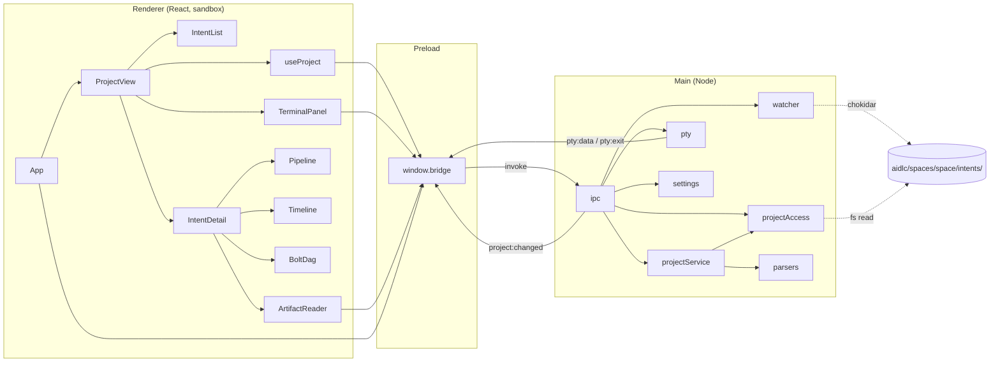
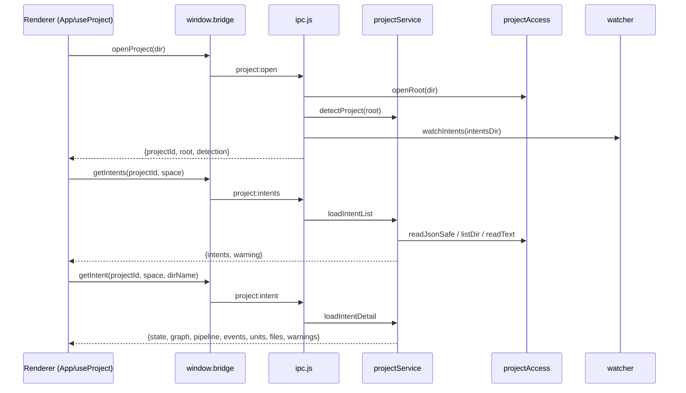
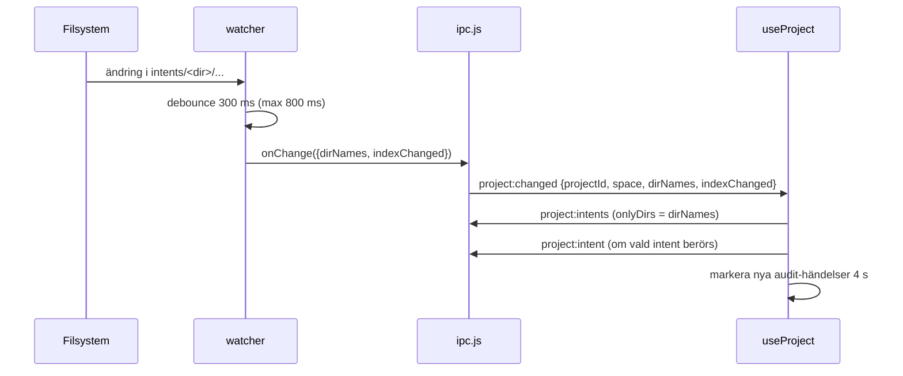
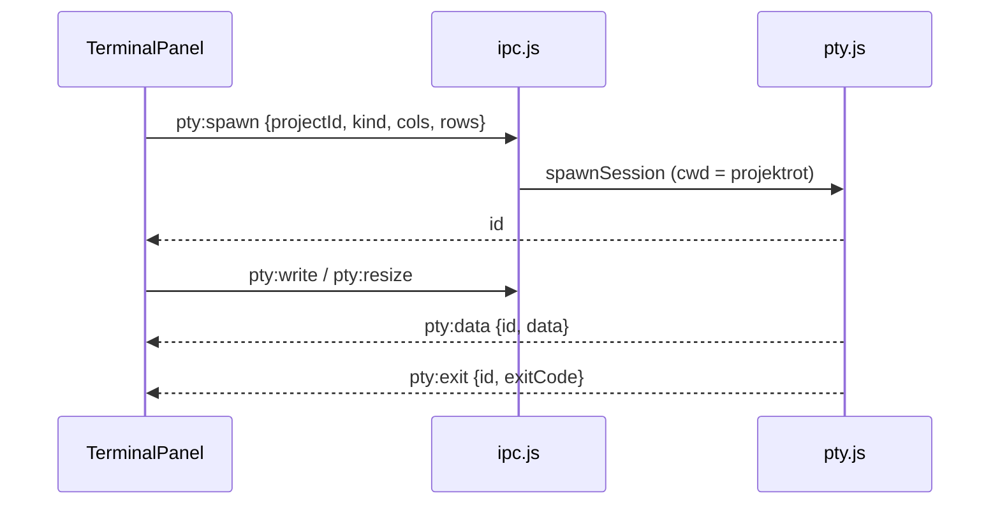

# Arkitektur: aidlc-dash

## Architecture Analysis

### System Overview

En Electron-app i tre lager: huvudprocessen (Node) läser och tolkar AI-DLC-filer och kör terminaler, preload exponerar ett smalt namngivet API, och en sandboxad React-renderer visar data. Ingen server, inget nätverk, ingen databas. Komponenterna listas i `component-inventory.md`.

### Architectural Style

Monolitisk skrivbordsapp med Electrons process-isolering (`contextIsolation: true`, `nodeIntegration: false`, `sandbox: true`, `src/main/index.js:16-21`). Main-sidan är lagerindelad: IPC-yta → tjänst → rena parsers → root-begränsad filåtkomst.

### Component Relationships

Textalternativ: Renderern (App, ProjectView, useProject, IntentList, IntentDetail med Pipeline/Timeline/BoltDag/ArtifactReader, TerminalPanel) anropar bara `window.bridge`. Preload översätter till `ipcRenderer.invoke` mot `ipc` i main. `ipc` delegerar till `projectService` (som använder `parsers` och `projectAccess`), `watcher`, `pty` och `settings`. Händelser går tillbaka som `project:changed`, `project:watchError`, `pty:data` och `pty:exit`. Endast `watcher` och `projectAccess` rör projektets filer.

### Data Flow

1. Användaren väljer mapp (`project:pick`) → `project:open` realpath-validerar roten, kör `detectProject` och startar bevakning av aktiv space.
2. `useProject` hämtar `project:intents` (lista) och `project:intent` (detalj). `projectService` läser filer via `projectAccess`, tolkar dem med `parsers` och cachar resultatet per root/space/intent.
3. Vid filändring skickar `watcher` (debounce 300 ms, max 800 ms) `{dirNames, indexChanged}`; `useProject` laddar om bara de namngivna intenterna och detaljen om den berörs.
4. Trasig eller halvskriven JSON ger `{ok:false}` från `readJsonSafe`; tjänsten returnerar då senaste giltiga värde.

### Key Design Decisions

- **Skrivskydd och rotbegränsning**: `projectAccess.js` innehåller inga skrivanrop; `resolveInRoot` avvisar absoluta sökvägar, `..` och symlänkar ut ur roten. Alternativet att låta renderern läsa filer direkt valdes bort av säkerhetsskäl.
- **state-filen vinner över runtime-graph** (`parsers/pipeline.js`): `runtime-graph.json` är git-ignorerad och kan saknas; avvikelser flaggas i stället för att döljas.
- **Inkrementell omladdning**: watcher rapporterar intent-mappar, så bara dessa läses om (FR7.2).
- **Delade rena moduler**: renderern importerar `NOISY_EVENTS` direkt från `main/parsers/audit.js` (ren modul, säker att bunta).
- **Inget diagrambibliotek**: `BoltDag` ritar SVG för hand.

### Improvement Opportunities

- **EPIC-02-anslutning**: `usage-ledger.json` ligger i `aidlc/.aidlc-sessions/`, utanför bevakad mapp (`ipc.js:33-34`). Behöver en andra bevakning (eller en bredare med filter), en ledger-parser bredvid övriga parsers, en ny `project:*`-kanal och en ny flagga i `project:changed`. Detaljer i `code-quality-assessment.md`.
- Ingen kapabilitet för att köra icke-interaktiva kommandon (`aidlc config models`) finns; bara node-pty.
- CSV-export bryter löftet om en enda skrivning; kräver ett medvetet beslut och en dialog (`dialog.showSaveDialog`).

## Interaction Diagrams

### Öppna projekt och visa intent

Textalternativ: Renderern öppnar ett projekt via `project:open`, som validerar roten, identifierar projektet och startar bevakning. Därefter hämtas listan (`project:intents`) och vald intents detalj (`project:intent`); båda läses via `projectAccess` och tolkas av parsers.

### Liveuppdatering

Textalternativ: En filändring under `intents/` samlas av watcher, skickas som `project:changed`, och `useProject` laddar om bara de berörda intenterna samt detaljen om den vald intent ändrats. Nya audit-händelser markeras i fyra sekunder.

### Terminalsession

Textalternativ: TerminalPanel startar en `claude`- eller `shell`-session via `pty:spawn`, skriver och ändrar storlek via `pty:write`/`pty:resize`, och tar emot utdata och avslut som `pty:data`/`pty:exit`.
