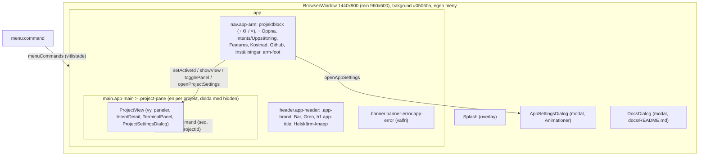
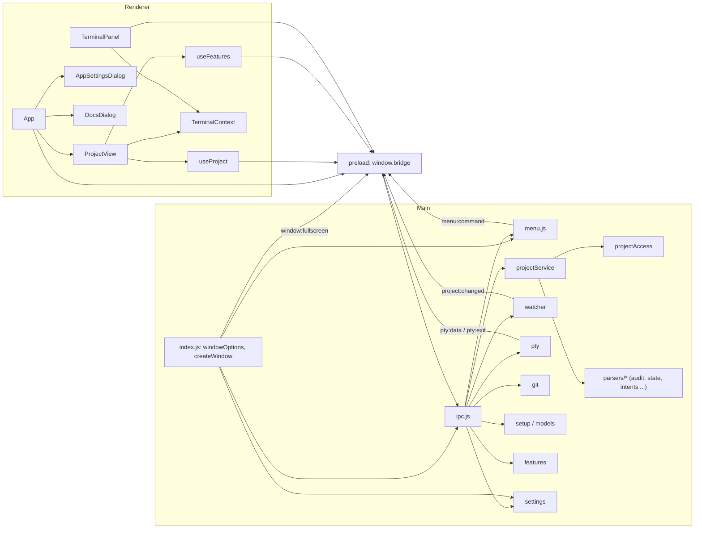
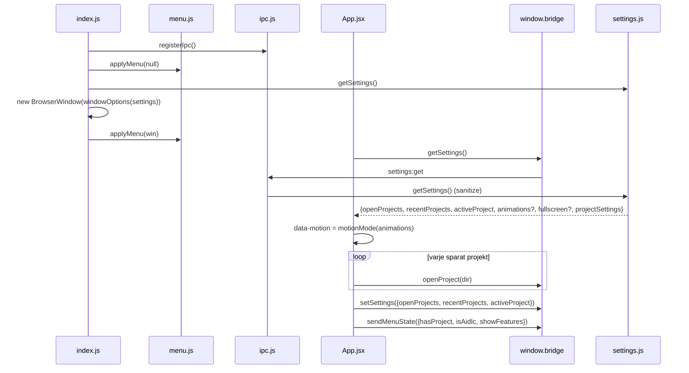
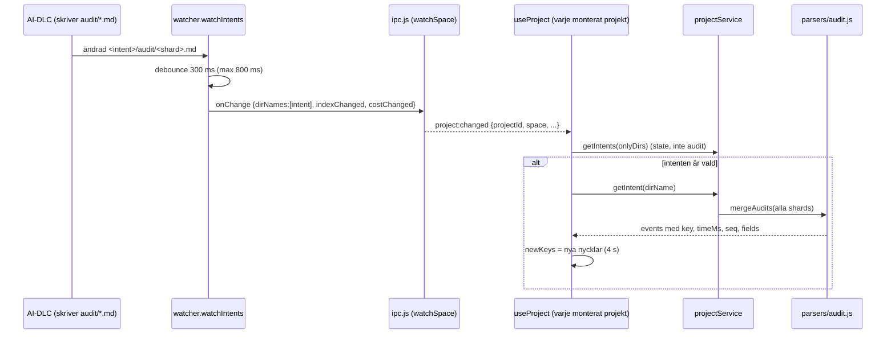
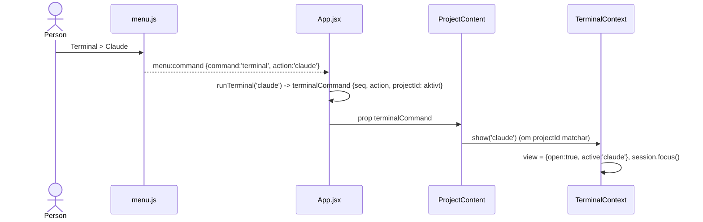
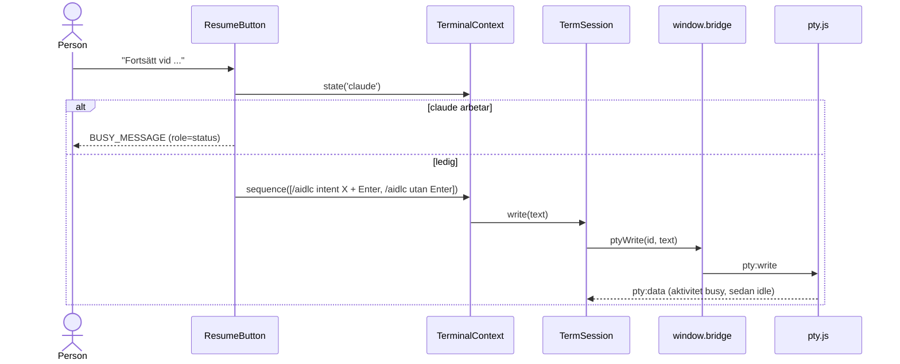

# Arkitektur: aidlc-dash

## Architecture Analysis

### System Overview

En Electron-app med tre processdelar som electron-vite bygger till `out/`:

- **Huvudprocessen** (`src/main/`): skapar fönstret (`windowOptions()`), sätter en egen appmeny (`menu.js`), läser AI-DLC-filer inom öppnade projektrötter, bevakar dem med chokidar, kör `git` och `aidlc` med fasta argument, äger pseudoterminalerna (node-pty) och skriver appens `settings.json`.
- **Preload** (`src/preload/index.js`): exponerar ett smalt, namngivet `window.bridge`-API via `contextBridge`. Inget generiskt `invoke` eller `send`.
- **Renderaren** (`src/renderer/`): en React 19-SPA i ett sandboxat fönster (`contextIsolation`, ingen `nodeIntegration`, `sandbox`, CSP i `index.html`). Utseendet styrs av den globala stilmallen `theme.css` med tokens, LCARS-primitiver i `Lcars.jsx` och ett rörelseläge som `App.jsx` sätter som `data-motion` på `<html>`.

### Architectural Style

Monolitisk skrivbordsapp med strikt processgräns: renderaren gör inga fil- eller processanrop själv, allt går via IPC (`ipcMain.handle` / `ipcRenderer.invoke`) och push-händelser (`webContents.send` / `ipcRenderer.on`). Tillstånd hålls i React (App-skalets state per projekt, hooks, en terminal-context per projekt) och i main-processens cacher per projekt. Inga externa tjänster eller nätverks-API:er.

### Component Relationships

App-skalets layout (verifierad i `App.jsx`; innehållet i `.project-pane` är från tidigare skanning):

Text: fönstret har splash-overlayn, app-skalet och två modala dialoger. Skalet har ett sidhuvud (märke, dekorstapel, gren, titel, helskärmsknapp), en vänsterarm av LCARS-block och huvudytan med en monterad `ProjectView` per projekt. Armen och menykommandon kör samma namngivna funktioner; terminalkommandon når rätt projekt via `terminalCommand`.

Processer och moduler:

Text: App, hooks och terminalpanelen anropar `window.bridge`, som går till `ipc.js`. `index.js` skapar fönstret, registrerar IPC och sätter menyn. IPC delegerar till projectService (via projectAccess och parsers), watcher, pty, git, setup/models, features, settings och menu. Watcher, pty, menyn och fönstrets helskärmshändelser skickar push-händelser tillbaka till renderaren.

### Data Flow

1. Vid start sätter main menyn (`applyMenu(null)`), läser inställningarna och skapar fönstret med `windowOptions(settings)` (helskärm om `fullscreen: true` sparats). App läser inställningarna (`settings:get`), sätter rörelseläget och öppnar sparade projekt igen (FR1.5). Splash visas tills återställningen är klar.
2. Personen öppnar en mapp (`project:pick`, `project:open`). Main validerar roten (`openRoot`, realpath), detekterar AI-DLC och startar bevakning av projektets aktiva space (`watchSpace`). **Varje öppet projekt bevakas**, inte bara det aktiva.
3. `useProject` hämtar intent-lista, vald intents detalj, kostnad och modeller. Listan bygger på `intents.json`, mappar på disk, `active-intent` och varje intents `aidlc-state.md` (`currentStage`, `stateStatus`, `done`, `executed`); den läser **inte** audit. Detaljen slår ihop `aidlc-state.md` (vinner), `runtime-graph.json`, alla audit-shards i `<intent>/audit/*.md` och artefaktfiler.
4. chokidar-ändringar under `intents/` debouncas (300 ms, max 800 ms) och skickas som `project:changed {projectId, space, dirNames, indexChanged, costChanged}` till det `webContents` som öppnade projektet, utan händelseinnehåll. Renderaren läser om listan och, om den valda intenten är bland `dirNames`, dess detalj; nya audit-nycklar markeras i 4 s (`newKeys`). Ändringar i icke-valda intents ger bara en listomläsning.
5. Terminalens in- och utdata går via `pty:write` och `pty:data`. Aktivitetssignalen (`idle | busy | exited`) räknas i renderaren (`terminalControl.js`).
6. Efter varje flikändring sparar App `openProjects`, `recentProjects` och `activeProject`; valt animationsläge sparas som `animations`; main sparar `fullscreen` vid `enter-/leave-full-screen`. Allt går genom `settings.js` seriella skrivkö och `sanitize()`.

### Key Design Decisions

- **Skrivskyddad mot AI-DLC**; den enda fil appen skriver är `settings.json` i userData (fastlåst till mappen `aidlc-dash`, oberoende av productName).
- **Rotbegränsad filåtkomst** (`resolveInRoot` avvisar absoluta sökvägar, `..` och symlänkar ut ur roten).
- **Smalt preload-API**: varje kanal är en namngiven funktion (`call(channel)` eller `subscribe(channel)`). Alternativ som inte valts: ett generiskt `invoke(channel, ...)`. Följd: varje ny kanal (t.ex. öppna frågor eller notisklick i US-0505) kräver en rad i preload och en handler eller ett `send` i main, men renderaren kan aldrig nå andra kanaler.
- **Generisk auditparser**: varje `**Nyckel**: värde`-rad sparas ordagrant i `fields`; bara `Timestamp` och `Event` lyfts ut. Följd: nya händelsefält (t.ex. `Question Id`, `Options`) kräver ingen parserändring, men tolkning (JSON i `Options`, matchning fråga-svar) måste göras av den som använder dem.
- **App-skalet äger UI-tillståndet per projekt** (`ui[projectId] = {view, cost, github}`) och skickar det som props till `ProjectView`. Menykommandon och armens knappar delar namngivna funktioner (`openProject`, `closeActiveProject`, `showView`, `togglePanel`, `openAppSettings`, `openProjectSettings`, `runTerminal`, `openDocs`).
- **Terminalen styrs per projekt**: `TerminalProvider` ligger i varje `ProjectView`; App når den bara indirekt via propen `terminalCommand {seq, action, projectId}`, som det matchande projektet tar emot och kör (`show(tab)` eller `restart`).
- **Allt utseende i en global CSS-fil** med tokens på `:root`, kompletterad av `tokens.js` och `Lcars.jsx`. Alternativ som inte valts: CSS-moduler eller CSS-in-JS.
- **Alla flikar monterade**: dolda projekt och terminaler ligger kvar (`hidden`) så sessioner överlever flikbyten (FR8.4).
- **Rörelse styrs globalt**: `data-motion` (`full | reduced | off`) på `<html>`, satt i `useLayoutEffect` före första målning.
- **Egen meny och helskärm** (US-0404): `menu.js` bygger mallen olika för paketerat och dev, tar emot `menu:state {hasProject, isAidlc, showFeatures}` från renderaren och skickar `menu:command` till fokuserat fönster. Helskärm växlas med `window:toggleFullscreen`; alla vägar in och ut passerar `enter-/leave-full-screen` i `index.js`, som sparar läget, skickar `window:fullscreen` och bygger om menyn.
- **Ingen fönsterreferens på modulnivå**: main slår upp fönstret per anrop (`BrowserWindow.fromWebContents(event.sender)`, `getFocusedWindow()`).
- **Inga systemnotiser och ingen fokusdetektering** (nuläge): Electron `Notification` används inte; inga `focus`/`blur`-lyssnare i main eller renderare.

Säkerhet: CSP tillåter `style-src 'self' 'unsafe-inline'` och `font-src 'self' data:`, så nya typsnitt måste bundlas lokalt. Fönstret blockerar navigering och nya fönster; `http(s)`-länkar öppnas i OS-webbläsaren. Menykommandon vitlistas i renderaren och `menu:state` tar bara tre booleans (`parseMenuState`). Hjälp-länken är en fast adress i main.

### Improvement Opportunities

- Härled öppna frågor (fråga/gate utan senare svar) i main, per intent, när `project:changed` nämner den, och skicka dem med en ny push-kanal enligt `subscribe`-mönstret; då fungerar både popup och notis oavsett vilket projekt eller vilken intent som visas.
- Lägg notislogiken i main (Electron `Notification`, fokus via `BrowserWindow.isFocused()` och renderarens aktiva projekt) och låt klick visa/fokusera fönstret och skicka ett vitlistat kommando, likt `menu:command`.
- Lyft "Svara i Claude" till en namngiven App-funktion som tar `projectId` (`setActiveId` + `terminalCommand` med `action: 'claude'`), så att den inte beror på `active` ur closure.
- Slå ihop de två debounce-implementationerna i `watcher.js`.
- Ersätt hårdkodade bakgrunder i `.banner-*`, `@keyframes flash` och `::backdrop` med tokens (från tidigare skanning; ej omverifierat).

## Interaction Diagrams

Starta appen och återställ sparade projekt:

Text: main registrerar IPC, sätter menyn, läser inställningarna och skapar fönstret. App läser de sanerade inställningarna, sätter rörelseläget, öppnar de sparade projekten, sparar flikläget och rapporterar menyläget.

Ny audit-händelse i ett öppet projekt:

Text: när AI-DLC skriver i en audit-shard skickar watchern `project:changed` med intentens namn. Varje projekts hook läser om listan; bara om intenten är vald läses audit och nya händelser markeras. Det är här US-0505 behöver en väg som även täcker icke-valda intents och dolda projekt.

Menykommando till ett projekts terminal:

Text: menyn skickar ett kommando, App omvandlar det till `terminalCommand` för det aktiva projektet, och det projektets `ProjectContent` öppnar och fokuserar Claude-fliken. "Svara i Claude" kan använda samma väg efter `setActiveId`.

Fortsätt en intent från konsolen:

Text: Fortsätt-knappen kontrollerar att claude-fliken inte arbetar, skriver sedan in intentbytet (med Enter) och `/aidlc` (utan Enter) i claude-terminalen via TerminalContext, preload och pty.
