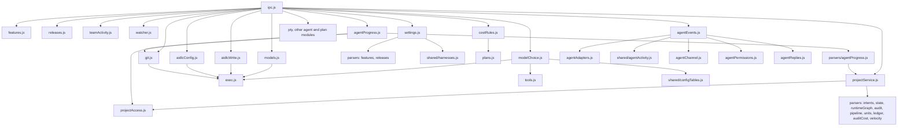

# Dependencies

The external package versions are in `technology-stack.md`. This file covers how the parts depend on each other.

## Internal Dependencies (main process)

Text fallback:
- `ipc.js` depends on every service:
  - the Project Service, Features Loader, Releases Service, Git Reader, Team Activity and Watcher;
  - the Settings Store;
  - Model Choice and the Model Config Reader;
  - the AI-DLC config reader and writer;
  - the cost rules;
  - the Agent Progress Loader and the Agent Event Store;
  - the other modules.
- Model Choice, the Model Config Reader, the config reader and writer, and the Git Reader all run commands through `exec.js`, with the binary from `tools.js`.
- Model Choice and the config writer take every argument from `shared/configTables.js`.
- `settings.js` validates against the features and releases parsers and the harness table.
- `agentProgress.js` (the Agent Progress Loader) uses the progress parser, Project Access and `lastCommitSubject` from the Git Reader. `parsers/agentProgress.js` imports `workingAgents` from `projectService.js`. There is no cycle.
- `agentEvents.js` uses the adapters, the channel, permissions, replies and the pure `shared/agentActivity.js`.

## Internal Dependencies (renderer)

- `App.jsx` → `ProjectView`, `AgentDialog`, `LatestMessageStrip`, `SettingsView`, the dialogs; `PROJECT_SECTIONS` from `ProjectSettingsView`.
- `ProjectView` → `useProject`, `useFeatures`, `IntentList`, `IntentDetail`, `TerminalPanel`, `FeaturesView`, `ConfigView`, `ProjectSettingsView`, `CostRulesSection`, `PlansView`, `CostPanel`, `VelocityView`, `RefreshPanel`, `MachinesView`, `EditorPanel`.
- `ProjectSettingsView` → `SettingsView` (`Section`, `RadioBlocks`), `AgentHooksSection`, `TerminalContext`, `shared/harnesses.js`, `parsers/features.js`, `parsers/releases.js`.
- `ConfigView` → `ConfigEdit` (`ModelPicker`, `ChangePanel` and the editors).
- `CostRulesSection` → `ConfigEdit` (`ChangePanel`), `SettingsView`.
- `IntentDetail` → `Pipeline`, `Timeline`, `BoltDag`, `ArtifactReader`, `CostTab`, `VelocityView` (the intent tab), `StoryComments`, `ResumeButton`, `TokenView`, `TokenDetail`.
- `TokenDetail` → `AgentProgress` → `format.js` (`stageTitle`), `parsers/ledger.js` (`agentName`), `AgentHooksPreview` (`harnessLabel`), `AgentHooksSection` (`useAgentHooks`).
- `Lcars.jsx` → `Tooltip.jsx` → `tooltipPlacement.js`.

## External Integrations

| Integration | Direction | Module |
|---|---|---|
| AI-DLC project files (`aidlc/…`) | read; watched | Project Service, Watcher, Agent Progress Loader |
| AI-DLC memory files | marked-block and Guard Policy writes after a diff | Cost Rules Service, AI-DLC Config Writer |
| Feature docs | read; marker and plan writes | Features Loader, Releases Service |
| `aidlc` CLI | run with fixed arguments | Model Choice, Model Config Reader, config reader and writer, Setup Helper, Plans Service, AI-DLC Update Check |
| git | read-only commands, plus `init` in setup | Git Reader, File Editor Service |
| GitHub, GitLab, Bitbucket | read pull requests and comments | Team Activity, `platforms/` |
| GitHub releases API / `gh` | read and download | Updater |
| Agent harness hooks | a file channel in userData | Agent Channel, Dialog Hook Script, Agent Adapters, Agent Event Store |
| App settings | read and write `userData/settings.json` | Settings Store |

## US-0030 Blast Radius

| File | Likely change | Dependents and tests |
|---|---|---|
| `src/shared/agentActivity.js` | clear waits from agent events and answers; expose last-seen time; carry task and description | `tests/main/agentActivity.test.js`; `agentEvents.js` is the only producer |
| `src/main/agentEvents.js` | route a dialog kind's wait to its agent; feed activity when a permission is answered in the app | `agentEvents*.test.js`, `agentPermissions.test.js`, `agentAlertsFlow.test.js` |
| `src/main/agentAdapters.js` | read `tool_input.description` (and the Agent tool's task) as bounded, sanitised text | the adapter tests; NFR2 assertions in them must change on purpose |
| `src/renderer/AgentProgress.jsx` | join hook rows with audit build rows for steps; show task, description and last seen | `tests/renderer/AgentProgress.test.jsx`, `TokenDetail.test.jsx` |
| `src/shared/locales/{sv,en}.json` | new `tokenDetail.progress` keys | `tests/main/i18nKeys.test.js` |
| `.thadeus/hooks/dialog.sh`, `src/main/agentHooks.js` | likely none: the payload is already copied whole | the timed hook-script tests |
| `src/main/agentProgress.js`, `parsers/agentProgress.js` | likely none: the zero-Unit plan read works | `agentProgressLoad.test.js:101-115` |

Impact: medium. Main and renderer change, and so does the NFR2 rule. Every piece has a pure test seam, and no new dependency is needed.

## US-0210 Blast Radius (kept from the previous scan, not re-verified)

`modelChoice.js`, `settings.js`, `ipc.js`, `preload/index.js`, `ProjectSettingsView.jsx` (+ `App.jsx`), a new LCARS dialog, `ConfigView.jsx` and both locale files. Impact: medium.

## Licences

All runtime dependencies are permissively licensed. `scripts/third-party-licenses.mjs` generates `build/THIRD_PARTY_LICENSES.txt` at build time (US-1101).
