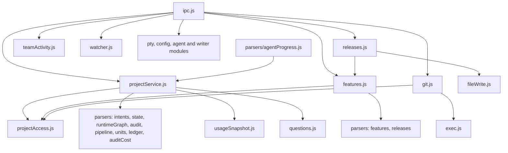

# Dependencies

The external package versions are in `technology-stack.md`; this file covers how the parts depend on each other.

## Internal Dependencies (main process)

Text fallback:
- `ipc.js` depends on the Project Service, the Features Loader, the Releases Service, the Git Reader, Team Activity, the Watcher and the other modules.
- `projectService.js` depends on Project Access, most parsers, Usage Snapshot and the Questions Parser.
- `features.js` reads through Project Access and parses with the features and releases parsers; `releases.js` builds on `features.js` and writes through `fileWrite.js`.
- `git.js` runs commands through `exec.js`.
- `parsers/agentProgress.js` imports `workingAgents` from `projectService.js`. It is the only parser that reaches back into a service. There is no cycle, because `projectService.js` does not import it.

## Internal Dependencies (renderer)

- `App.jsx` → `ProjectView`, `AgentDialog`, `LatestMessageStrip`, `SettingsView`, the dialogs.
- `ProjectView` → `useProject`, `useFeatures`, `IntentList`, `IntentDetail`, `TerminalPanel`, `FeaturesView`, `ConfigView`, `PlansView`, `CostPanel`, `RefreshPanel`, `MachinesView`, `EditorPanel`.
- `IntentDetail` → `Pipeline`, `Timeline`, `BoltDag`, `ArtifactReader`, `CostTab`, `StoryComments`, `ResumeButton`, `TokenView`, `TokenDetail`, `Lcars`, `format.js`.
- `CostPanel` → `CostTab` (`CostLabel`, `CostTable`, `MachinesLine`, `ModelTable`), `Lcars` (`Readout`), `Tooltip`, `format.js`.
- `FeaturesView` → `ArtifactReader` (`FileContent`), `editor/EditorContext`, `Lcars` (`Frame`), `Tooltip`, `../main/parsers/releases.js`, `../main/parsers/features.js`, `storyFilter.js`.
- `Lcars.jsx` → `Tooltip.jsx` → `tooltipPlacement.js`.
- The main modules the renderer bundles directly: the parsers `features`, `releases`, `ledger`, plus `src/shared/*`.

## External Integrations

| Integration | Direction | Module |
|---|---|---|
| AI-DLC project files (`aidlc/…`) | read; watched | Project Service, Watcher |
| Feature docs (`docs/FEATURES.md`, `docs/features/`, `docs/releases/`) | read; marker and plan writes | Features Loader, Releases Service |
| `aidlc` CLI | run with fixed arguments | config modules, Setup Helper, AI-DLC Update Check |
| git | read-only commands, plus `init` in setup | Git Reader, File Editor Service |
| GitHub, GitLab, Bitbucket | read pull requests and comments | Team Activity, `platforms/` |
| GitHub releases API / `gh` | read and download | Updater |
| Agent harness hooks | file channel in userData | Agent Channel, Dialog Hook Script |

## US-0303 Blast Radius

| File | Change likely | Dependents and tests |
|---|---|---|
| a new pure parser (`src/main/parsers/velocity.js` or similar) | intent, story and project metrics from events, state and stories | new `tests/main` test |
| `src/main/projectService.js` | an all-intents velocity loader (like `loadCrossMachineCost`) that names missing or unreadable records | `projectService.test.js` |
| `src/main/git.js` | a fixed `git log` over the epic files for marker history | `git.test.js` |
| `src/main/ipc.js`, `src/preload/index.js` | one handler and one bridge member | the IPC wrapper is generic |
| `App.jsx`, `ProjectView.jsx` (and maybe `IntentDetail.jsx` `TABS`) | the new view or tab | `AppShell.test.jsx`, `ProjectView.test.jsx`, `IntentDetail.test.jsx` |
| a new view component | LCARS frame, tables or SVG chart, `Tooltip` | new `tests/renderer` test; `noNativeTitle.test.jsx` |
| `src/shared/locales/{sv,en}.json` | new keys | `tests/main/i18nKeys.test.js` |

Impact: medium. Mostly new files; small additions to `git.js`, `projectService.js`, `ipc.js`, the preload and the view switch. No new dependency is needed.

## Licences

All runtime dependencies are permissively licensed. `scripts/third-party-licenses.mjs` generates `build/THIRD_PARTY_LICENSES.txt` at build time, which ships and opens from About (US-1101).
