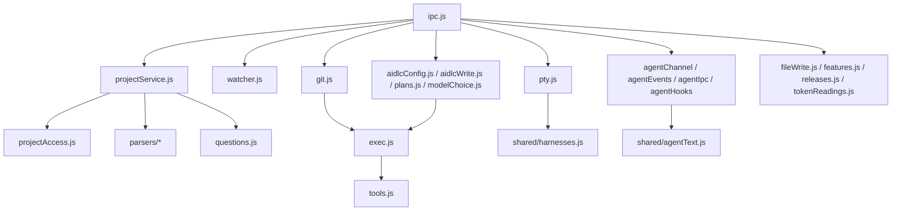

# Dependencies

The external package versions are in `technology-stack.md`; this file covers how the parts depend on each other.

## Internal Dependencies (main process)

Text fallback:
- `ipc.js` depends on the Project Service, the Watcher, the PTY Manager, the Git Reader, the config modules, the agent modules and the writers.
- `projectService.js` depends on Project Access, the parsers and the Questions Parser.
- The git and config modules run commands through `exec.js`, which takes paths from `tools.js`.
- The agent modules use the shared sanitizer.

There are no circular imports among the main modules. The parsers import nothing from Node.

## Internal Dependencies (renderer)

- `App.jsx` → `ProjectView`, `AgentDialog`, `LatestMessageStrip`, `SettingsView`, the dialogs.
- `ProjectView` → `useProject`, `IntentList`, `IntentDetail`, `TerminalPanel` (with `TerminalContext`), `FeaturesView`, `ConfigView`, `PlansView`, `RefreshPanel`, `EditorPanel`.
- `IntentDetail` → `Pipeline`, `Timeline`, `BoltDag`, `ArtifactReader`, `CostTab`, `ResumeButton`, `TokenView`, `TokenDetail`, `Lcars`, `format.js`.
- `BoltDag` → `format.js` (`unitStatusLabel`), react-i18next.
- The shared modules the renderer bundles directly: the parsers `audit`, `ledger`, `features`, `releases`, plus `src/shared/*`.

## External Integrations

| Integration | Direction | Module |
|---|---|---|
| AI-DLC project files (`aidlc/…`) | read; watched | Project Service, Watcher |
| `aidlc` CLI | run with fixed arguments | config modules, Setup Helper, AI-DLC Update Check |
| git | read-only commands, plus `init` in setup | Git Reader, File Editor Service (`ls-files`) |
| GitHub releases API / `gh` | read and download | Updater |
| Agent harness hooks | file channel in userData | Agent Channel, Dialog Hook Script |
| OS notifications, dialogs, shell | Electron APIs | Notifications, IPC Router |

## US-0507 Blast Radius

| File | Change likely | Dependents |
|---|---|---|
| `src/main/parsers/runtimeGraph.js` | keep the instance `bolt`, `worktree`, `started_at`, `outcome` | Project Service, Pipeline Merger, `tests/main/parsers.test.js` |
| `src/main/parsers/units.js` (or a new pure parser) | running work from `BOLT_*`/`WORKTREE_*`/`REVIEW_*` events | Project Service, `parsers.test.js` |
| `src/main/projectService.js` `buildDetail` | add progress (plan ticks, last commit, review records) | IPC `project:intent`, `useProject`, `projectService.test.js` |
| `src/main/watcher.js` | make worktree plans and review records live (today `.aidlc-engine/` is ignored, `.aidlc/worktrees/` is outside the watch) | IPC `watchSpace`, `watcher.test.js` |
| `src/main/git.js` | a read-only `log -1 --format=%s` in a worktree | Git Reader tests |
| `src/renderer/BoltDag.jsx`, `IntentDetail.jsx` | node lines and the summary line | `IntentDetail.test.jsx`; BoltDag has no test yet |
| `src/shared/locales/{sv,en}.json` | `intents.units.*` texts | `i18nKeys.test.js` |
| `src/renderer/theme.css` | node layout for more lines | `theme.test.js` |

Impact: medium. Main and renderer change together, the IPC shape stays the same channel with a richer detail, and nothing writes.

## Licences

All runtime dependencies are permissively licensed. `scripts/third-party-licenses.mjs` generates `build/THIRD_PARTY_LICENSES.txt` at build time (git-ignored), which ships as an extra resource and opens from About (US-1101). `tests/main/thirdPartyLicenses.test.js` checks the generator.
