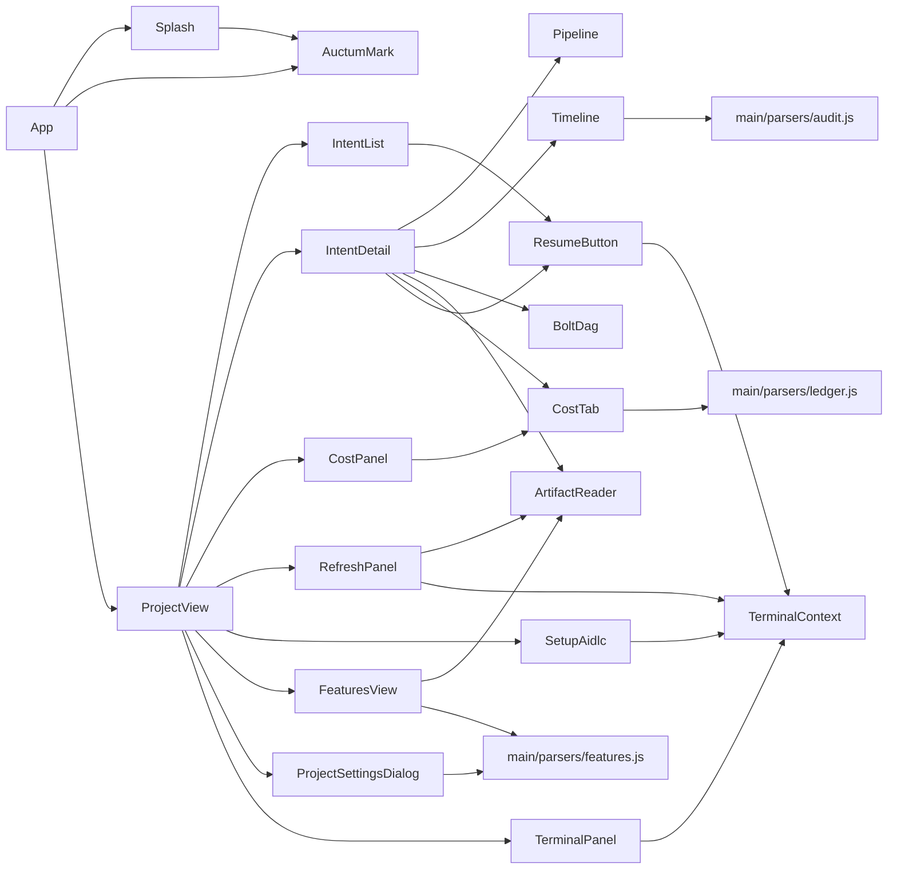

# Beroenden: aidlc-dash

## Externa paket

Versioner finns i `technology-stack.md`. Här listas vem som använder vad.

| Paket | Används i | Anmärkning |
|-------|-----------|------------|
| electron | `src/main/*`, `src/preload/index.js`, `scripts/make-icon.cjs` | – |
| node-pty | `src/main/pty.js` (dynamisk import) | native; `fix-pty-perms.cjs` sätter körbit på `spawn-helper`; `check-glibc.mjs` kontrollerar Linux-paketet |
| chokidar | `src/main/watcher.js` | v4 missar mappar som saknas vid start; därför bevakas föräldramappar |
| react, react-dom | alla `src/renderer/*.jsx` | – |
| @xterm/xterm, @xterm/addon-fit | `TerminalPanel.jsx` | `xterm.css` importeras där |
| react-markdown, remark-gfm | `ArtifactReader.jsx` (`FileContent`) | återanvänds av RefreshPanel och FeaturesView |
| @tanstack/react-virtual | `Timeline.jsx` | styr radplacering med inline `transform` |
| @fontsource/antonio | `main.jsx` | – |

## Externa program (körs av main)

- `git` (`src/main/git.js`): endast `rev-parse`, `rev-list`, `diff`, `status`, `show`, `fetch`.
- `aidlc` (`src/main/setup.js`, `models.js`): `--version`, `config --dry-run`, `config project --show --json`, `config models --show --json`.
- `$SHELL` (`pty.js`, `exec.js`): terminalsessioner och PATH-probe.

## Interna beroenden

Text: App använder Splash, AuctumMark och ProjectView. ProjectView sätter ihop alla vyer. ResumeButton, RefreshPanel, SetupAidlc och TerminalPanel går via TerminalContext. Timeline, CostTab, FeaturesView och ProjectSettingsDialog importerar rena parsers från main. Alla vyer delar `theme.css` och `format.js`.

Main: `ipc.js` beror på `projectService`, `projectAccess`, `watcher`, `pty`, `git`, `setup`, `models`, `features`, `settings` och `parsers/ledger.js`. `git.js`, `setup.js` och `models.js` går via `exec.js`. Inga cirkulära importer hittades.

## Delade globala klasser (beroende via CSS)

Eftersom stilen är global finns beroenden som inte syns i importer:
- `.intent-row`, `.intent-row-top`, `.intent-slug`, `.intent-row-meta`, `.intent-rows`: IntentList och FeaturesView.
- `.detail-tab`: IntentDetail-flikar, vyväxlaren i ProjectView och terminalflikarna.
- `.cost-panel-toggle`: CostPanel och RefreshPanel.
- `.refresh-error`, `.refresh-list`: RefreshPanel, SetupAidlc, FeaturesView, ProjectSettingsDialog.
- `.elbow-left`: sidofältet, pipelinefaser, filträdet och Features-sidofältet. `.elbow-top`: app-sidhuvudet, intent-sidhuvudet och epic-sidhuvudet.
