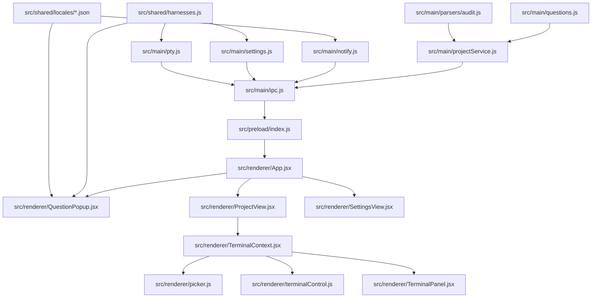

# Dependencies

Package versions are listed once in `technology-stack.md`; this file records who depends on what.

## External runtime dependencies (`dependencies`)

| Package | Imported by | Process | Notes |
|---|---|---|---|
| `electron` | `src/main/*`, `src/preload/index.js` | main, preload | Notification, BrowserWindow, dialog, shell, Menu, ipcMain/ipcRenderer, contextBridge, webUtils |
| `node-pty` | `src/main/pty.js` (dynamic `import()`) | main | native; `asarUnpack`; `scripts/fix-pty-perms.cjs` fixes `spawn-helper` mode; Linux build checked by `scripts/check-glibc.mjs` |
| `chokidar` | `src/main/watcher.js` | main | v4: misses paths whose folder does not exist yet, worked around by watching a parent with an `ignored` filter |
| `react`, `react-dom` | all `src/renderer/*.jsx` | renderer | |
| `@xterm/xterm`, `@xterm/addon-fit` | `src/renderer/TerminalPanel.jsx` | renderer | buffer API (`baseY`, `getLine`, `isWrapped`, `translateToString`) used by `screenLines()` |
| `i18next`, `i18next-icu`, `intl-messageformat` | `src/shared/i18n.js` | both | bundled into each process |
| `react-i18next` | renderer components | renderer | |
| `react-markdown`, `remark-gfm` | `src/renderer/ArtifactReader.jsx` | renderer | `skipHtml`; custom `a` and `img` |
| `@tanstack/react-virtual` | `src/renderer/Timeline.jsx` | renderer | |
| `@fontsource/antonio` | `src/renderer/main.jsx` | renderer | |

## External build/test dependencies (`devDependencies`)

| Package | Used by |
|---|---|
| `monaco-editor`, `@monaco-editor/react` | `src/renderer/editor/monacoSetup.js`, `MonacoPane.jsx` (bundled at build time, lazy at run time) |
| `electron-vite`, `vite`, `@vitejs/plugin-react` | `electron.vite.config.mjs`, `vitest.config.mjs` |
| `electron-builder` | `npm run build*`, `postinstall` |
| `vitest`, `jsdom`, `@testing-library/react` | `tests/` |

## External system dependencies

| Tool | Needed for | Failure behaviour |
|---|---|---|
| login shell (`$SHELL`) | PATH probe, every terminal tab | PATH falls back to the app's own; spawn error shown in the tab |
| `aidlc` | setup, configuration, plans, models | readers return the error as a value; views show one sentence |
| `claude`, `opencode` | agent tabs | `harnessProblem` message and "Choose harness" |
| `git` | Refresh, setup (`git init`), file tree | panel error; file tree falls back to a walk |
| `gh` (logged in, access to `tochman/aidlc-dash`) | update check and download | `update:check` returns `unavailable` with a reason |

## Internal cross-module dependencies

Main process imports are listed in `code-structure.md` ("Internal dependency graph"). The cross-process ones:

| From (renderer) | To | Why |
|---|---|---|
| `Timeline.jsx` | `src/main/parsers/audit.js` (`NOISY_EVENTS`) | shared noise list |
| `CostTab.jsx`, `ConfigEdit.jsx` | `src/main/parsers/ledger.js` (`compareModels`) | configured vs actual model |
| `FeaturesView.jsx`, `ProjectSettingsDialog.jsx` | `src/main/parsers/features.js` | status markers, path validation |
| many | `src/shared/harnesses.js`, `configTables.js`, `i18n.js`, `appName.js`, `planName.js` | same rules on both sides |

Main and renderer never import each other's process-specific modules; the parsers above are pure (no Node imports).

## Dependencies of the intent area (US-0506 blast radius)

Text fallback: `questions.js` and the audit parser feed `projectService.js`, which `ipc.js` uses together with `notify.js`, `settings.js` and `pty.js` (which reads the harness table). The preload bridge carries the result to `App.jsx`, which renders `QuestionPopup.jsx` and passes answers through `ProjectView.jsx` to `TerminalContext.jsx`, which uses `picker.js`, `terminalControl.js` and `TerminalPanel.jsx`. The harness table, the locales and `SettingsView.jsx` (question alert settings) are shared inputs.

Tests touching this area: `tests/main/questions.test.js`, `notify.test.js`, `pty.test.js`, `harness.test.js`, `settings.test.js`, `i18nKeys.test.js`; `tests/renderer/QuestionPopup.test.jsx`, `picker.test.jsx`, `pickerSmoke.test.jsx`, `TerminalPanel.test.jsx`, `terminalControl.test.jsx`, `ResumeButton.test.jsx`, `AppShell.test.jsx`, `SettingsView.test.jsx`; fixtures `tests/fixtures/picker/`.
