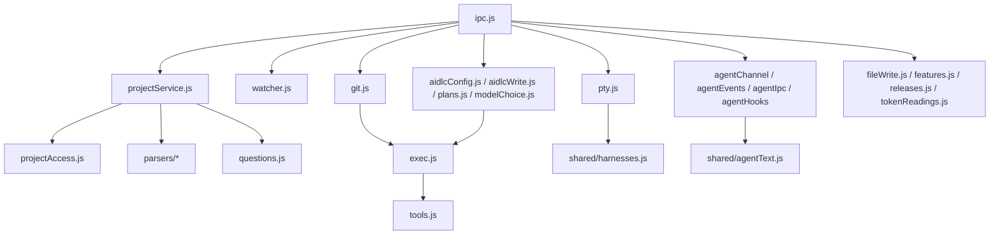

# Dependencies

The external package versions are in `technology-stack.md`; this file covers how the parts depend on each other.

## Internal Dependencies (main process)

Text fallback:
- `ipc.js` depends on the Project Service, the Watcher, the PTY Manager, the Git Reader, the config modules, the agent modules and the writers.
- `projectService.js` depends on Project Access, the parsers and the Questions Parser.
- The git and config modules run commands through `exec.js`, which takes paths from `tools.js`.
- The agent modules use the shared sanitizer.

There are no circular imports among the main modules. The parsers import nothing from Node. (From the full scan at `721e051`; main was not re-read in this run.)

## Internal Dependencies (renderer)

- `App.jsx` → `ProjectView`, `AgentDialog`, `LatestMessageStrip`, `SettingsView`, the dialogs.
- `ProjectView` → `useProject`, `IntentList`, `IntentDetail`, `TerminalPanel` (with `TerminalContext`), `FeaturesView`, `ConfigView`, `PlansView`, `RefreshPanel`, `EditorPanel`.
- `IntentDetail` → `Pipeline`, `Timeline`, `BoltDag`, `ArtifactReader`, `CostTab`, `ResumeButton`, `TokenView`, `TokenDetail`, `Lcars`, `format.js`.
- `TokenDetail` → `Lcars` (`Bar`, `Frame`), `AgentProgress`, `format.js`, `tokenChart.js`, `../main/parsers/ledger.js` (`agentName`), `@visx/*`.
- `CostPanel` → `CostTab` (`CostLabel`, `CostTable`, `ModelTable`), `Lcars` (`Readout`).
- `ProjectSettingsView` → `SettingsView` (`Section`, `RadioBlocks`).
- `BoltDag` → `format.js` (`unitStatusLabel`), react-i18next.
- The shared modules the renderer bundles directly: the parsers `audit`, `ledger`, `features`, `releases`, plus `src/shared/*`.

## External Integrations

| Integration | Direction | Module |
|---|---|---|
| AI-DLC project files (`aidlc/…`) | read; watched | Project Service, Watcher |
| `aidlc` CLI | run with fixed arguments | config modules, Setup Helper, AI-DLC Update Check |
| git | read-only commands, plus `init` in setup | Git Reader, File Editor Service (`ls-files`) |
| GitHub releases API / `gh` | read and download | Updater |
| Agent harness hooks | file channel in userData | Agent Channel, Dialog Hook Script |
| OS notifications, dialogs, shell | Electron APIs | Notifications, IPC Router |

## US-0414 Blast Radius

| File | Change likely | Dependents and tests |
|---|---|---|
| `src/renderer/Lcars.jsx` (or a new small module) | the shared tooltip | every view below; a new renderer test |
| `src/renderer/theme.css` | one tooltip class built from l.709-710; l.679-684 and 709-710 folded in | `tests/main/theme.test.js` |
| `src/renderer/TokenDetail.jsx` | the row tip and the visx tooltip take the shared style | `TokenDetail.test.jsx` l.191-205 |
| `App.jsx`, `IntentList.jsx`, `IntentDetail.jsx`, `Pipeline.jsx`, `ResumeButton.jsx`, `TerminalPanel.jsx`, `editor/EditorPanel.jsx` | interactive `title=` replaced, names kept | `ResumeButton.test.jsx`, `IntentList.test.jsx`, `TerminalPanel.test.jsx`, `AppShell.test.jsx` |
| `CostPanel.jsx`, `CostTab.jsx`, `ConfigEdit.jsx`, `FeaturesView.jsx`, `ArtifactReader.jsx`, `Lcars.jsx` `Readout` | `title=` on plain text: moved to the shared tooltip, or left, as Requirements decides | `CostPanel.test.jsx` l.32 |
| `src/shared/locales/{sv,en}.json` | new keys only where a tooltip text is new | `tests/main/i18nKeys.test.js` |

Impact: medium in breadth (13 files) and low in depth. The change is renderer-only, with no main, preload or IPC change and no new dependency.

## Licences

All runtime dependencies are permissively licensed. `scripts/third-party-licenses.mjs` generates `build/THIRD_PARTY_LICENSES.txt` at build time (git-ignored), which ships as an extra resource and opens from About (US-1101). `tests/main/thirdPartyLicenses.test.js` checks the generator.
