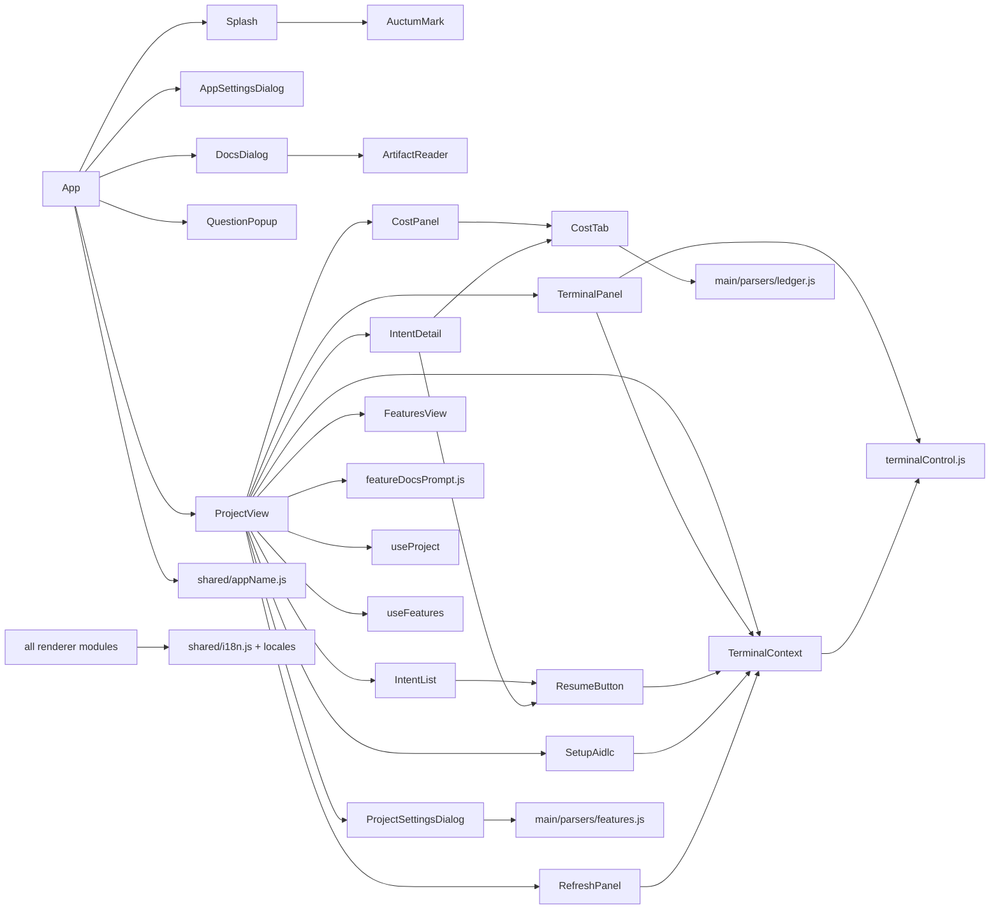

# Dependencies: aidlc-dash

## External packages

Versions are in `technology-stack.md`. This lists who uses what.

| Package | Used in | Note |
|---------|---------|------|
| electron | `src/main/*`, `src/preload/index.js` | `index.js` `app, BrowserWindow, shell`; `ipc.js` `BrowserWindow, dialog, ipcMain, shell`; `menu.js` `app, BrowserWindow, Menu, shell`; `notify.js` `Notification`; `settings.js` and `main/i18n.js` `app` (`getPath`, `getLocale`); preload `contextBridge, ipcRenderer` |
| i18next, i18next-icu | `src/shared/i18n.js` | one instance per process bundle |
| react-i18next | renderer components (`useTranslation`), `main.jsx` (`I18nextProvider`), `tests/renderer/setup-i18n.js` (`setI18n`) | – |
| intl-messageformat | `tests/main/i18nKeys.test.js` | placeholder comparison |
| node-pty | `src/main/pty.js` (dynamic import on first spawn) | native; `fix-pty-perms.cjs` sets the exec bit on `spawn-helper` |
| chokidar | `src/main/watcher.js` | – |
| react, react-dom | all `src/renderer/*.jsx` | – |
| @xterm/xterm, @xterm/addon-fit | `TerminalPanel.jsx` | theme through `tokens.js` |
| react-markdown, remark-gfm | `ArtifactReader.jsx` (`FileContent`) | reused by RefreshPanel, FeaturesView, DocsDialog |
| @tanstack/react-virtual | `Timeline.jsx` | – |
| @fontsource/antonio | `main.jsx` | – |

## External programs (run by main)

- `$SHELL` (`pty.js`): `-l -i -c claude` (agent tab), `-l` (shell tab), `cwd` = project root. `exec.loginPath`: `-l -i -c "printf <marker>$PATH"` once per process.
- `claude` (`pty.js:24`): started through the shell, so the login PATH applies.
- `aidlc` (`setup.js`, `models.js`, via `runFixed`): `--version`; `--project-dir <root> config --harness claude --dry-run`; `config project --show --json`; `config models --show --json --harness claude`.
- `git` (`git.js`, `setup.js`, via `runFixed`): `rev-parse`, `rev-list`, `diff`, `status`, `show`, `fetch`.

## Files outside the app that it reads (all root-confined, read-only)

| Path in the project | Reader | Harness-specific? |
|---------------------|--------|-------------------|
| `aidlc/spaces/`, `aidlc/active-space` | `projectService.detectProject`, `listSpaces` | no |
| `aidlc/spaces/<space>/intents/**` (`intents.json`, `active-intent`, `aidlc-state.md`, `project-description.json`, `runtime-graph.json`, `audit/*.md`, `.aidlc-engine/active-directive.json`, phase folders) | `projectService`, `watcher` | no |
| `aidlc/.aidlc-sessions/usage-ledger.json` | `projectService.loadCost`, `watcher` | the shared path is harness-neutral; the content is filled by the Claude hooks today (EPIC-08) |
| `.claude/agents/aidlc-*-agent.md` | `models.readAgentFiles` (fallback) | yes, Claude |
| `.kiro/`, `.codex/`, `.cursor/`, `.aidlc/` (presence only) | `setup.getSetupInfo` | yes, used as markers |
| feature docs (`docs/FEATURES.md`, epic files) | `features.js` | no |

## Internal dependencies

Text: App uses the splash, the dialogs, ProjectView and the shared app name. ProjectView puts the views together, owns one terminal context per project, and mounts TerminalPanel, SetupAidlc and ProjectSettingsDialog. ResumeButton, SetupAidlc, RefreshPanel and TerminalPanel reach the terminals only through the context. CostTab and ProjectSettingsDialog import pure parsers from main. Every renderer module that shows text imports the shared i18n.

Main: `index.js` → `ipc.js`, `menu.js`, `settings.js`, `main/i18n.js`, `shared/appName.js`. `ipc.js` → `projectAccess`, `projectService`, `notify`, `parsers/ledger`, `models`, `git`, `setup`, `settings`, `watcher`, `features`, `pty`, `menu`, `main/i18n`, `shared/i18n`. `projectService` → `projectAccess`, parsers, `questions`. `setup` → `exec`, `git`, `projectAccess`. `models` → `exec`, `projectAccess`, `parsers/ledger`. `settings` → `parsers/features`, `shared/i18n`. `pty` → `shared/i18n` only. No circular imports were found.

## Coupling to Claude (for US-0801)

These parts depend on Claude through strings, not through imports, so they only hold together because they say the same thing:

| Source | Depends on |
|--------|------------|
| `pty.js:24` `'claude'` → `-c claude` | `TerminalPanel.jsx:15` `KINDS`, `TerminalContext.jsx:12-16`, `ipc.js` `pty:spawn` passthrough |
| tab id `'claude'` | `ResumeButton.jsx:29-37`, `TerminalPanel.jsx:208`, `:255`, `ProjectView.jsx:105`, `:108`, `:144`, `:159`, `RefreshPanel.jsx:97`, `App.jsx:223`, `:316`, `menu.js:105` |
| `terminal-panel-*-claude` test ids, `.term-tab--claude` | `TerminalPanel.test.jsx`, `theme.css:687` |
| `--harness claude` | `setup.js:12`, `:62`, `models.js:8`; `setup.test.js`, `SetupAidlc.test.jsx`, `configuredModels.test.js` |
| `.claude/agents` | `models.js:10` |
| "Claude" in texts | 11+ keys in `en.json`/`sv.json` (see `component-inventory.md`, Locale Files) |
| `claude-` model prefix | `ledger.js:149`, `format.js:31` |

## Shared global classes (dependency through CSS)

*Earlier scan.* `.lcars-block*` (arm, fullscreen button, terminal tabs, radios), `.settings-dialog`, `.settings-group`, `.setup-actions`, `.refresh-error` (all dialogs), `.sr-only`, `.intent-row*`, `.detail-tab`, `.cost-panel-toggle`.
