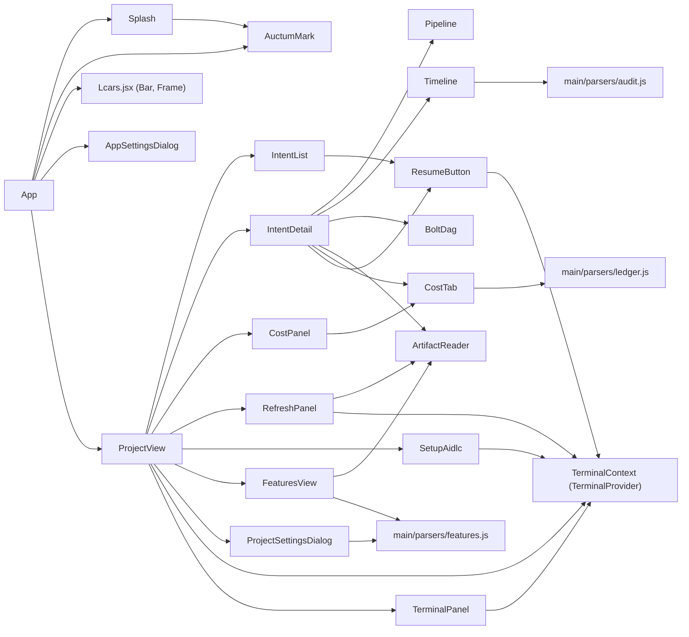

# Beroenden: aidlc-dash

## Externa paket

Versioner finns i `technology-stack.md`. Här listas vem som använder vad.

| Paket | Används i | Anmärkning |
|-------|-----------|------------|
| electron | `src/main/*`, `src/preload/index.js`, `scripts/make-icon.cjs` | `index.js` använder `app, BrowserWindow, shell`; `ipc.js` `BrowserWindow, dialog, ipcMain, shell`; preload `contextBridge, ipcRenderer`; `settings.js` `app`. `Menu` används inte någonstans |
| node-pty | `src/main/pty.js` (dynamisk import) | native; `fix-pty-perms.cjs` sätter körbit på `spawn-helper`; `check-glibc.mjs` kontrollerar Linux-paketet |
| chokidar | `src/main/watcher.js` | v4 missar mappar som saknas vid start; därför bevakas föräldramappar |
| react, react-dom | alla `src/renderer/*.jsx` | – |
| @xterm/xterm, @xterm/addon-fit | `TerminalPanel.jsx` | tema via `tokens.js` (`xtermTheme()`) |
| react-markdown, remark-gfm | `ArtifactReader.jsx` (`FileContent`) | återanvänds av RefreshPanel och FeaturesView |
| @tanstack/react-virtual | `Timeline.jsx` | styr radplacering med inline `transform` |
| @fontsource/antonio | `main.jsx` | – |

## Externa program (körs av main)

- `git` (`src/main/git.js`): endast `rev-parse`, `rev-list`, `diff`, `status`, `show`, `fetch`.
- `aidlc` (`src/main/setup.js`, `models.js`): `--version`, `config --dry-run`, `config project --show --json`, `config models --show --json`.
- `$SHELL` (`pty.js`, `exec.js`): terminalsessioner och PATH-probe.

## Interna beroenden

Text: App använder Splash, AuctumMark, LCARS-primitiverna, AppSettingsDialog och ProjectView. ProjectView sätter ihop alla vyer och äger terminal-contexten per projekt. ResumeButton, RefreshPanel, SetupAidlc och TerminalPanel går via TerminalContext. Timeline, CostTab, FeaturesView och ProjectSettingsDialog importerar rena parsers från main. Kopplingarna under ProjectView är från förra skanningen och inte omverifierade, utom att `TerminalProvider` importeras i `ProjectView.jsx`.

Main: `index.js` beror på `ipc.js` (`registerIpc`, `shutdown`). `ipc.js` beror på `projectService`, `projectAccess`, `watcher`, `pty`, `git`, `setup`, `models`, `features`, `settings` och `parsers/ledger.js`. `settings.js` beror på `parsers/features.js` (`DEFAULT_FEATURES_PATH`, `isValidFeaturesPath`). `git.js`, `setup.js` och `models.js` går via `exec.js`. Inga cirkulära importer hittades.

## Delade globala klasser (beroende via CSS)

Eftersom stilen är global finns beroenden som inte syns i importer (från förra skanningen; `.lcars-block` är ny och används både i armen och i `AppSettingsDialog`):
- `.lcars-block`, `.lcars-block--<ton>`: vänsterarmen i App och radioknapparna i AppSettingsDialog.
- `.settings-dialog`, `.settings-group`, `.setup-actions`, `.refresh-error`: AppSettingsDialog och ProjectSettingsDialog.
- `.intent-row`, `.intent-row-top`, `.intent-slug`, `.intent-row-meta`, `.intent-rows`: IntentList och FeaturesView.
- `.detail-tab`: IntentDetail-flikar och terminalflikarna.
- `.cost-panel-toggle`: CostPanel och RefreshPanel.
