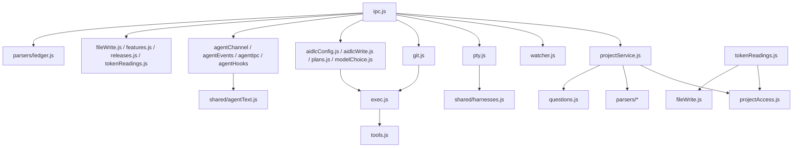

# Dependencies

The external package versions are in `technology-stack.md`; this file covers how the parts depend on each other.

## Internal Dependencies (main process)

Text fallback:
- `ipc.js` depends on the Project Service, the Watcher, the PTY Manager, the Git Reader, the config modules, the agent modules, the writers and the Ledger Parser (`summarizeLedger` in `project:cost`, `modelUsage`, `modelEstimate`).
- `projectService.js` depends on Project Access, the parsers and the Questions Parser; it imports only `agentName` from `ledger.js`.
- `tokenReadings.js` reads through Project Access and writes through `fileWrite.js` (`writeAtomic`).
- The git and config modules run commands through `exec.js`, which takes paths from `tools.js`.

`parsers/agentProgress.js` imports `projectService.js` (for `workingAgents`), so that parser is not Node-free.

## Internal Dependencies (renderer)

- `App.jsx` → `ProjectView`, `AgentDialog`, `LatestMessageStrip`, `SettingsView`, the dialogs.
- `ProjectView` → `useProject`, `IntentList`, `IntentDetail`, `CostPanel`, `TerminalPanel`, `FeaturesView`, `ConfigView`, `PlansView`, `RefreshPanel`, `EditorPanel`.
- `IntentDetail` → `Pipeline`, `Timeline`, `BoltDag`, `ArtifactReader`, `CostTab`, `ResumeButton`, `TokenView`, `TokenDetail`, `Lcars`, `format.js`.
- Cost data path: `useProject` (`getCost`) → `ProjectView` → `CostPanel` (`cost.project`), `IntentList` (`cost.perIntent`), `IntentDetail` (`perIntent[dir]` to `CostTab`, `Pipeline`, `TokenView`, `TokenDetail`).
- `CostPanel` → `CostTab` exports (`CostLabel`, `CostTable`, `ModelTable`), `Lcars` `Readout`, `format.js`.
- `CostTab` and `TokenDetail` import `src/main/parsers/ledger.js` directly (`compareModels`, `agentName`); `TokenView` uses `tokenFlow.js` `tokensOf`.

## External Integrations

| Integration | Direction | Module |
|---|---|---|
| AI-DLC project files (`aidlc/…`) | read; watched | Project Service, Watcher |
| `aidlc` CLI | run with fixed arguments | config modules, Setup Helper, AI-DLC Update Check |
| git | read-only commands, plus `init` in setup | Git Reader, File Editor Service (`ls-files`) |
| GitHub releases API / `gh` | read and download | Updater |
| Agent harness hooks | file channel in userData | Agent Channel, Dialog Hook Script |
| OS notifications, dialogs, shell | Electron APIs | Notifications, IPC Router |

## US-0209 Blast Radius

| File | Change likely | Dependents |
|---|---|---|
| `src/main/parsers/ledger.js` or a new pure parser | numeric rollups from `STAGE_COMPLETED`/`WORKFLOW_COMPLETED`, merged per machine into the `IntentCost` shape | Project Service, IPC `project:cost`, `CostTab`, `TokenDetail`, `ledger.test.js` |
| `src/main/projectService.js` | rollups per intent from `loadAuditEvents`; read `aidlc/.aidlc-clone-id` | IPC, `projectService`/`parsers` tests |
| `src/main/ipc.js` `project:cost` | cost available without a ledger; token readings stay local-only or not | `ipc.test.js` |
| `src/main/watcher.js` | a shard change marks cost as changed (or `useProject` reloads cost on `dirNames`) | `watcher.test.js`, `useProject.js` |
| `src/renderer/CostTab.jsx`, `CostPanel.jsx`, `TokenDetail.jsx`, `IntentList.jsx` | contributing machines, partial mark | renderer tests (no `CostTab` test yet) |
| `src/shared/locales/{sv,en}.json` | `cost.*` texts | `i18nKeys.test.js` |

Impact: medium. Main and renderer change together; the IPC channel stays the same with a richer summary, and nothing writes beyond today's token readings.

## Licences

All runtime dependencies are permissively licensed. `scripts/third-party-licenses.mjs` generates `build/THIRD_PARTY_LICENSES.txt` at build time (git-ignored), which ships as an extra resource and opens from About (US-1101).
