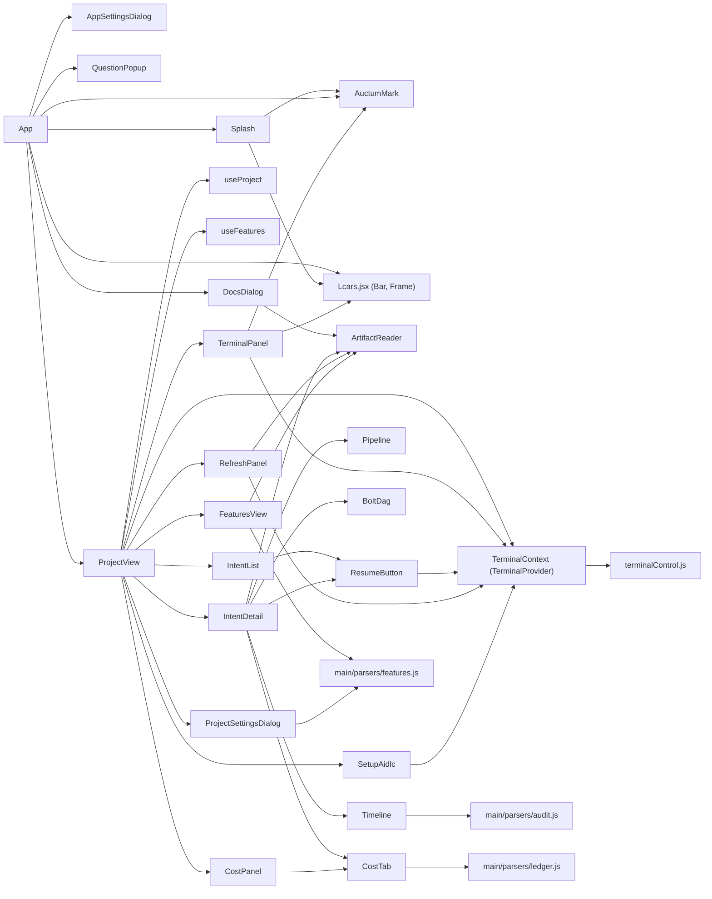

# Beroenden: aidlc-dash

## Externa paket

Versioner finns i `technology-stack.md`. Här listas vem som använder vad.

| Paket | Används i | Anmärkning |
|-------|-----------|------------|
| electron | `src/main/*`, `src/preload/index.js`, `scripts/make-icon.cjs` | `index.js` använder `app, BrowserWindow, shell` (userData, fönster, titel); `menu.js` `app, BrowserWindow, Menu, shell` (meny, About-panel); `ipc.js` `BrowserWindow, dialog, ipcMain, shell`; `notify.js` `Notification` (US-0505); preload `contextBridge, ipcRenderer`; `settings.js` `app` |
| electron-builder | `package.json`-skript, `electron-builder.yml` | läser `appId`, `productName`, `executableName` och `name`/`version` för bundle, installationsfiler och artefaktnamn |
| node-pty | `src/main/pty.js` (dynamisk import) | native; `fix-pty-perms.cjs` sätter körbit på `spawn-helper`; `check-glibc.mjs` kontrollerar Linux-paketet |
| chokidar | `src/main/watcher.js` | v4 missar mappar som saknas vid start; därför bevakas föräldramappar |
| react, react-dom | alla `src/renderer/*.jsx` | – |
| @xterm/xterm, @xterm/addon-fit | `TerminalPanel.jsx` | tema via `tokens.js` (`xtermTheme()`) |
| react-markdown, remark-gfm | `ArtifactReader.jsx` (`FileContent`) | återanvänds av RefreshPanel, FeaturesView och DocsDialog |
| @tanstack/react-virtual | `Timeline.jsx` | styr radplacering med inline `transform` |
| @fontsource/antonio | `main.jsx` | rubrikfonten, även för appnamnet |

## Externa program (körs av main)

- `git` (`src/main/git.js`): endast `rev-parse`, `rev-list`, `diff`, `status`, `show`, `fetch`.
- `aidlc` (`src/main/setup.js`, `models.js`): `--version`, `config --dry-run`, `config project --show --json`, `config models --show --json`.
- `$SHELL` (`pty.js`, `exec.js`): terminalsessioner och PATH-probe.

## Externa tjänster i CI

- GitHub Actions (`actions/checkout`, `setup-node`, `upload-artifact`, `download-artifact`, alla `@v4`) och GitHub CLI `gh release create` (`.github/workflows/release.yml`). Releasetiteln och artefakterna är det enda i CI som bär appens namn.

## Interna beroenden

Text: App använder Splash, AuctumMark, LCARS-primitiverna, AppSettingsDialog, DocsDialog, QuestionPopup och ProjectView. Splash och TerminalPanel använder också AuctumMark och `Bar`. ProjectView sätter ihop alla vyer och äger terminal-contexten per projekt. ResumeButton, RefreshPanel, SetupAidlc och TerminalPanel går via TerminalContext. Timeline, CostTab, FeaturesView och ProjectSettingsDialog importerar rena parsers från main. Kopplingarna under ProjectView är från tidigare skanningar och inte omverifierade, utom TerminalPanel.

Main: `index.js` beror på `ipc.js` (`registerIpc`, `shutdown`), `menu.js` (`applyMenu`) och `settings.js` (`getSettings`, `setSettings`). `ipc.js` beror på `projectService`, `projectAccess`, `watcher`, `pty`, `git`, `setup`, `models`, `features`, `settings`, `menu`, `notify` (`notifyQuestions`) och `parsers/ledger.js` (från förra skanningen plus grep). `projectService.js` beror på `projectAccess` och parsers. `git.js`, `setup.js` och `models.js` går via `exec.js`. Inga cirkulära importer hittades.

## Namnberoenden utan import (US-0406)

Appens namn är inte en delad konstant, så dessa filer hänger ihop bara genom att de måste säga samma sak:

| Källa | Beroende |
|-------|----------|
| `package.json` `productName` ↔ `electron-builder.yml` `productName` | båda måste ändras lika; filen `electron-builder.yml` vinner för electron-builder |
| `package.json` `name` ↔ `package-lock.json` (`name` på rad 2 och 8) | lockfilen måste följa om `name` ändras |
| `productName` → `.dmg`-filnamnet; `name` → `.deb`-paketet och filnamnet | ingen `artifactName` frikopplar dem |
| `src/main/menu.js` `APP_NAME` ↔ `tests/main/menu.test.js:83-84` | testet hävdar etiketterna ordagrant |
| `src/renderer/Splash.jsx` `APP_NAME` ↔ `tests/renderer/Splash.test.jsx:17` | testet hävdar `sr-only`-texten ordagrant |
| `src/renderer/App.jsx:333` "Aidlc control" ↔ `tests/renderer/AppShell.test.jsx:122` | testet hävdar underraden ordagrant |
| `src/renderer/index.html:9` `<title>` ↔ `src/main/index.js:26` `title` | `<title>` skriver över fönstertiteln efter laddning |
| `src/main/index.js:8` userData `aidlc-dash` ↔ `README.md:53` sökvägar | README beskriver mappen; ändras inte så länge låset står kvar |
| `.github/workflows/release.yml:91` `--title` | fristående sträng |
| `AuctumMark` `aria-label="Auctum"` ↔ `Splash.test.jsx:16`, `AppShell.test.jsx:121` | ska stå kvar (märket byts inte) |

## Delade globala klasser (beroende via CSS)

Eftersom stilen är global finns beroenden som inte syns i importer:
- `.lcars-block`, `.lcars-block--<ton>`, `.lcars-block--sm`: vänsterarmen, helskärmsknappen, terminalflikarna och radioknapparna i AppSettingsDialog.
- `.settings-dialog`, `.settings-group`, `.setup-actions`, `.refresh-error`: AppSettingsDialog, ProjectSettingsDialog, DocsDialog och QuestionPopup (`.settings-dialog.question-popup`).
- `.sr-only`: splashens dolda appnamn och de dolda radioknapparna.
- `.intent-row`, `.intent-row-top`, `.intent-slug`, `.intent-row-meta`, `.intent-rows`: IntentList och FeaturesView (från tidigare skanning).
- `.detail-tab`: IntentDetail-flikar (från tidigare skanning).
- `.cost-panel-toggle`: CostPanel och RefreshPanel (från tidigare skanning).
