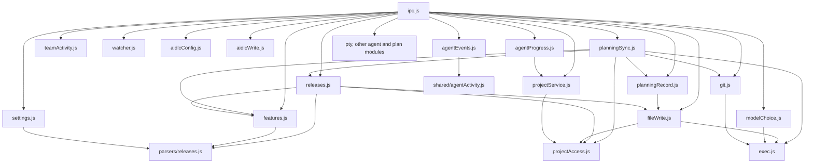

# Dependencies

The external package versions are in `technology-stack.md`. This file covers how the parts depend on each other.

## Internal Dependencies (main process)

Text fallback:
- `ipc.js` depends on every service: the Project Service, the Features Loader, Planning Sync and the Planning Record (the status read), the File Editor Service (`file:read`, `file:write`), the Releases Service (the rule status), the Git Reader, Team Activity, the Watcher, the Settings Store, Model Choice, the AI-DLC config reader and writer, the Agent Progress Loader, the Agent Event Store and the other modules.
- `planningSync.js` uses the Planning Record, the Releases Service, the Features Loader (fingerprints and fresh hashes), the Git Reader (`currentBranch`, `listReleaseTags`, `originUrl`, `pushRef`, `worktreeAdd`, `worktreeRemove`), the Exec Runner (its own git calls), and `openRoot` from Project Access. `gh` comes in through `ctx.gh` (`runGh` in `ipc.js`).
- `planningRecord.js` and `releases.js` write through `fileWrite.js` (`writeAtomic`, `writeFileSafe`). `releases.js` also writes new plan files directly with `fs.writeFile(…, {flag: 'wx'})` and deletes with `fs.unlink`.
- `parsers/releases.js` is pure and is imported by `releases.js`, `features.js`, `settings.js` and the renderer (`FeaturesView.jsx`).
- There is no cycle.

## Internal Dependencies (renderer)

- `App.jsx` → `ProjectView`, `AgentDialog`, `LatestMessageStrip`, `SettingsView`, the dialogs.
- `ProjectView` → `useProject`, `useFeatures`, `IntentList`, `IntentDetail`, `TerminalPanel`, `FeaturesView`, `ConfigView`, `ProjectSettingsView`, `CostRulesSection`, `PlansView`, `CostPanel`, `VelocityView`, `RefreshPanel`, `MachinesView`, `EditorPanel`.
- `FeaturesView` → `parsers/releases.js` (`buildReleases`, `canDelete`, `newReleaseError`, `nextVersions`, `releaseOf`, `releaseOptions`), `StatusBadge`, `Tooltip`, and `window.bridge` directly for the release writes and the planning status.
- `IntentDetail` → `Pipeline`, `Timeline`, `BoltDag`, `ArtifactReader`, `CostTab`, `VelocityView`, `StoryComments`, `ResumeButton`, `TokenView`, `TokenDetail` → `AgentProgress`.
- `Lcars.jsx` → `Tooltip.jsx` → `tooltipPlacement.js`.

## External Integrations

| Integration | Direction | Module |
|---|---|---|
| AI-DLC project files (`aidlc/…`) | read; watched | Project Service, Watcher, Agent Progress Loader |
| AI-DLC memory files | marked-block and Guard Policy writes after a diff | Cost Rules Service, AI-DLC Config Writer |
| Feature docs (`docs/FEATURES.md`, `docs/features/`, `docs/releases/`) | read; watched; marker and plan writes; editor saves | Features Loader, Releases Service, File Editor Service, IPC Router (watch) |
| git (local) | reads; planning commits, worktrees, rebases, fast-forwards | Git Reader, Planning Sync, File Editor Service (`ls-files`) |
| git remote `origin` | fetch; planning push to `main` or the docs branch | Planning Sync |
| GitHub via `gh` | branch protection, pull request create and squash-merge | Planning Sync; Updater (fallback) |
| GitHub, GitLab, Bitbucket | read pull requests and comments | Team Activity, `platforms/` |
| Agent harness hooks | a file channel in userData | Agent Channel, Dialog Hook Script, Agent Adapters, Agent Event Store |
| App data (`userData/`) | `settings.json`, `planning/*.json`, planning worktrees | Settings Store, Planning Record, Planning Sync |

## US-0608 Blast Radius

| File | Likely change | Dependents and tests |
|---|---|---|
| `src/main/planningRecord.js` | new kinds (file content with base hash, or edit kinds); a per-project queue | `planningSync.js`, `ipc.js`; `planningRecord.test.js` |
| `src/main/planningSync.js` | apply and commit the new kinds; story-owned or not; grouping window; keep both versions on conflict | `ipc.js`; `planningSync.test.js` (real git, bare origin) |
| `src/main/ipc.js` | record from `file:write` and the docs watcher; push the status after every cycle; richer status | `ipc.test.js` |
| `src/main/releases.js` | maybe a single-pass write of epic and overview so a conflict leaves nothing half-written | `releases.test.js`, `releasesPlan.test.js` |
| `src/main/fileWrite.js` | likely none | `fileWrite.test.js` |
| `src/renderer/FeaturesView.jsx`, `useFeatures.js` | a visible waiting list; a lock that waits for its own result; ignore stale reloads; lock `ReleasePicker` | `FeaturesView.test.jsx`, `useFeatures.test.jsx` |
| `src/preload/index.js` | a status subscription, if pushed | `preload` tests, if any |
| `src/shared/locales/{sv,en}.json` | new `features.planning.*` keys | `i18nKeys.test.js` |
| `package.json`, `.github/workflows/release.yml` | an end-to-end dev dependency and a `verify` step (build, xvfb) | CI |

Impact: high. Main, renderer, CI and a new kind of test are involved, and planning runs git in the person's checkout.

## US-0030 Blast Radius (kept from `0ebb196`, not re-verified)

`src/shared/agentActivity.js`, `src/main/agentEvents.js`, `src/main/agentAdapters.js`, `src/renderer/AgentProgress.jsx`, both locale files. Impact: medium.

## US-0210 Blast Radius (kept, not re-verified)

`modelChoice.js`, `settings.js`, `ipc.js`, `preload/index.js`, `ProjectSettingsView.jsx` (+ `App.jsx`), a new LCARS dialog, `ConfigView.jsx` and both locale files. Impact: medium.

## Licences

All runtime dependencies are permissively licensed. `scripts/third-party-licenses.mjs` generates `build/THIRD_PARTY_LICENSES.txt` at build time (US-1101).
