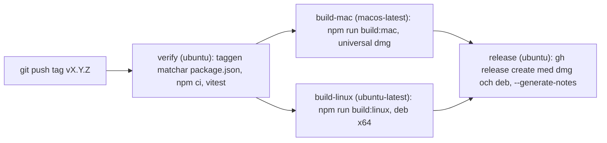

# CD-konfiguration — Auctum AIDLC Control

Underlag: svaren i `deployment-pipeline-questions.md`:
- Q1: GitHub Releases via Actions
- Q2: git-tagg `vX.Y.Z`
- Q3: universal macOS och dessutom Linux
- Q4: bara `.deb`

Det finns ingen CI Pipeline- eller Infrastructure Design-stage i express. Underlaget är därför den verifierade `electron-builder`-konfigurationen och Build and Test-resultaten.

## Filer

| Fil | Innehåll |
|-----|----------|
| `.github/workflows/release.yml` | Release-workflow som startar på taggar `v*.*.*` |
| `electron-builder.yml` | macOS `dmg` (universal) och Linux `deb` (x64), `publish: null`, `identity: null` |
| `package.json` | `author` (Auctum Solutions AB, info@auctum.se, krävs för deb-maintainer), `homepage`, skripten `build:mac` och `build:linux` |
| `.nvmrc` | `22`. Samma Node-version lokalt och i CI. |

## Pipeline


<!-- Text fallback: En tagg startar verify. Därefter körs build-mac och build-linux parallellt, och till sist skapar release-jobbet en GitHub Release med båda filerna. -->

| Jobb | Runner | Kontroller som stoppar releasen |
|------|--------|---------------------------------|
| verify | ubuntu-latest | Taggen måste vara `v` + `package.json`-versionen. `npm ci` måste lyckas, inklusive node-pty-bygget. Alla Vitest-tester måste gå igenom. |
| build-mac | macos-latest | `electron-builder --mac` ska ge en `.dmg`. Saknas den failar `if-no-files-found: error`. |
| build-linux | ubuntu-latest | `electron-builder --linux` ska ge en `.deb`. Saknas den failar `if-no-files-found: error`. |
| release | ubuntu-latest | Körs bara när båda byggena lyckats. Det är det enda jobbet med `contents: write`. |

## Säkerhet

- Arbetsflödet har bara läsrättighet. `contents: write` ges enbart till release-jobbet.
- Det behövs inga hemligheter. Uppladdningen sker med den inbyggda `github.token`, och signeringen är avstängd (`CSC_IDENTITY_AUTO_DISCOVERY=false`, `identity: null`).
- Bara GitHubs egna actions används: `checkout`, `setup-node`, `upload-artifact` och `download-artifact`. Uppladdningen till releasen görs med `gh` CLI på runnern.
- Repot är privat, så releaserna syns bara för dem som har åtkomst till repot.

## Kodändringar för Linux

Linux var tidigare utanför omfånget. För att appen ska fungera där gjordes tre små ändringar i det här steget:

- `src/main/pty.js`: om `$SHELL` saknas används `/bin/bash` på Linux. På macOS är det fortfarande `/bin/zsh`.
- `src/preload/index.js`: `window.bridge.platform` exponeras, som en skrivskyddad sträng.
- `src/renderer/ArtifactReader.jsx`: knappen heter "Visa i Finder" på macOS och "Visa i filhanteraren" på Linux.

Alla 20 Vitest-tester och `electron-vite build` gick igenom efter ändringarna.

## Release (manuellt steg för den som släpper)

```bash
npm version 0.2.0 --no-git-tag-version   # bump package.json
git commit -am "Release v0.2.0"
git tag v0.2.0
git push origin main --tags
```
