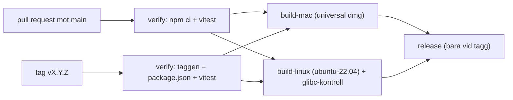

# CD-konfiguration — ändringar i v0.1.1

Underlag: Build and Test-resultaten i `construction/build-and-test/test-results.md` och den befintliga pipelinen från EPIC-01 (`intents/261113-bridge-console-mvp/operation/deployment-pipeline/cd-config.md`).

## `.github/workflows/release.yml`

| Ändring | Före | Efter |
|---------|------|-------|
| Triggers | `push: tags v*.*.*` | `push: tags v*.*.*` och `pull_request: branches [main]` |
| `verify`: taggen ska matcha `package.json` | Alltid | Bara på taggar (`if: startsWith(github.ref, 'refs/tags/')`) |
| `build-linux` runner | `ubuntu-latest` (gav `GLIBC_2.42` i `pty.node`) | `ubuntu-22.04` (glibc 2.35) |
| `build-linux` kontroll | — | `node scripts/check-glibc.mjs dist/linux-unpacked`. Stoppar bygget om en ELF-binär kräver mer än glibc 2.35 eller `GLIBCXX_3.4.30`, eller om node-pty-prebuilds för darwin eller win32 följer med. |
| `release` (publicering) | Efter build-mac och build-linux | Som tidigare, men bara på taggar |

## `electron-builder.yml`

- `icon: build/icon.png` (macOS `.icns` tas fram från den) och `linux.icon: build/icons`, med storlekarna 16–512 px.
- `extraResources: icon.png`, som används som fönsterikon på Linux.
- `linux.files` exkluderar `node_modules/node-pty/prebuilds/darwin-*` och `win32-*`.

## Flöde

<!-- Text fallback: En pull request kör verify och båda byggena utan att publicera. En tagg kör samma jobb och därefter release, som publicerar dmg och deb. -->

## Säkerhet

- Pull request-körningar får bara läsrättighet. `release` med `contents: write` körs aldrig på pull requests.
- Inga hemligheter används. Pull requests från forks kan inte publicera.
