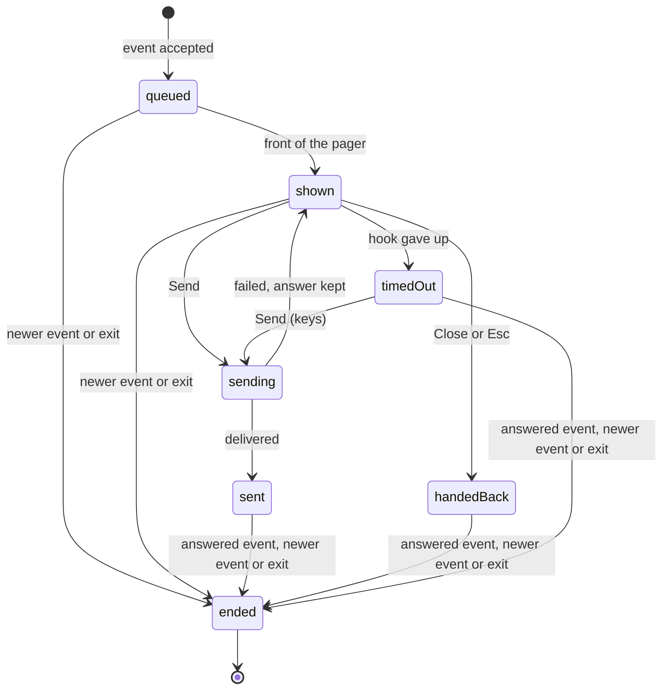
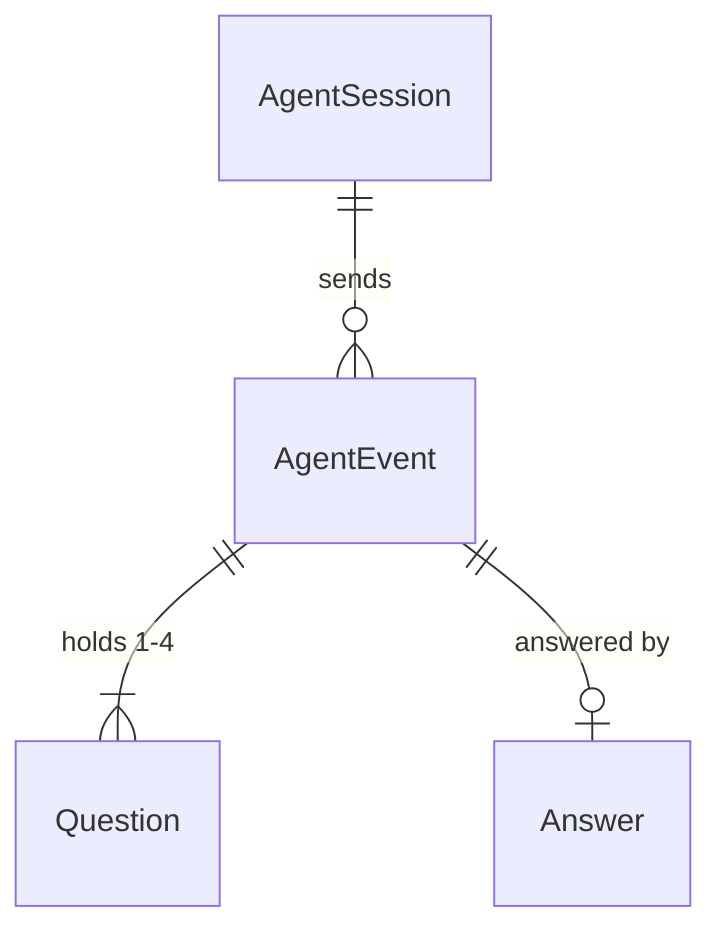

# Functional Specification: u1-questions

## Sources

- Story: US1.1 in `aidlc/spaces/default/intents/261114-agent-dialogs/inception/user-stories/stories.md` (AC1.1.1–AC1.1.11). This Unit implements US1.1.
- Unit: `aidlc/spaces/default/intents/261114-agent-dialogs/inception/units-generation/unit-of-work.md`, `unit-of-work-story-map.md`.
- Requirements: `aidlc/spaces/default/intents/261114-agent-dialogs/inception/requirements-analysis/requirements.md`.
- Components: `aidlc/spaces/default/intents/261114-agent-dialogs/inception/domain-design/components.md`, `decisions.md`.
- Contracts: `aidlc/spaces/default/intents/261114-agent-dialogs/inception/contract-design/contract-summary.md` (C1–C4, C6).
- Mockups: `aidlc/spaces/default/intents/261114-agent-dialogs/inception/refined-mockups/mockups.md` (M1, M2, M6), `interaction-spec.md`.
- This Unit's entities and rules: `entities.md`, `rules.md`.
- Answers: `functional-design-questions.md` `[Q1]`.

## Spike results (requirements Open questions, contract C1/C6 provisional parts)

Checked against the Claude Code hooks reference (code.claude.com/docs/en/hooks) for the installed Claude Code 2.1.325, and the opencode plugin documentation for the installed opencode 2.1.4.

| Question | Claude Code | Effect on this design |
|---|---|---|
| Question tool name | `AskUserQuestion` | Matcher of the question hook entries |
| Its input | `tool_input.questions[]` with `question`, `header`, `options[{label, description}]`, `multiSelect`; optional `answers` | Adapter reads exactly these fields |
| Can a hook answer it? | **Yes.** A `PreToolUse` hook returns `permissionDecision: "allow"` with `updatedInput` holding the questions plus `answers` (question text to chosen label; several labels joined by commas for multi-select). Allow alone is not enough | Questions go `via: hook` while the hook waits; the C1 provisional "allow or deny only" branch does not apply to Claude Code |
| Question finished | `PostToolUse` (and `PostToolUseFailure`) for `AskUserQuestion` | The `answered` hook entry |
| Hook time limit | Per-entry `timeout` in seconds; default 600 for command hooks; no documented maximum; on timeout the output is discarded and Claude Code goes on with its own prompt | Entry timeout 600; `waitSeconds` 595 `[Q1]` |
| Environment | Hook commands inherit the environment `claude` was started with; `CLAUDE_PROJECT_DIR` is set | Session variables reach the hook; the entry uses `$CLAUDE_PROJECT_DIR` |
| Exit codes | Exit 0 with no output means no decision | Every give-up path prints nothing and exits 0 |

### opencode (installed 2.1.4; plugin API V2)

Checked against the opencode plugin documentation (opencode.ai/docs/plugins, /docs/build/plugins/server, /docs/build/plugins/migrate-v1, /docs/tools) and its source.

| Question | opencode | Effect on this design |
|---|---|---|
| Plugin API | V2 only: `Plugin.define({ id, setup(ctx) })`; V1 plugins do not load | The plugin is written against V2 |
| Plugin location | `.opencode/plugins/` (a `.ts`/`.js` file), loaded and reloaded automatically | Plugin file `.opencode/plugins/thadeus-dialog.ts` (fixed in u4) |
| Question tool | Built-in `question` tool; it opens a form and emits `form.created`, then `form.replied` or `form.cancelled` | `form.created` is the question event; `form.replied` / `form.cancelled` is the `answered` closing event |
| Can a plugin answer it? | Not documented for plugins. The server client has `session.form.reply({ sessionID, formID, answer })`, read from source | **Provisional:** the plugin replies through `session.form.reply` with the picked labels; if that call is not available or fails, the answer goes `via: keys` as for a timed-out Claude Code question (C1 provisional block) |
| Waiting | Plugins run inside the opencode server as ordinary async code; no plugin timeout is documented | The plugin waits on the answer file in its own async task and does not block opencode; `waitSeconds` still applies |
| Environment and files | `process.env` is readable; `node:fs` works in the plugin's runtime (inferred) | The plugin checks `THADEUS_SESSION_DIR` and uses the same C1 files |
| Permissions (u2) | `ctx.permission.hook("evaluate")` or `permission.asked` + `ctx.permission.reply({ decision: once \| always \| reject })` | Recorded for u2-permissions |
| Idle (u3) | `session.status` with `type: "idle"` (`session.idle` is deprecated); last message via `ctx.session.context` | Recorded for u3-replies |

The plugin sees the form before the person does, so the question shows in the opencode terminal and in the dialog at once. A reply from either side closes the other through `form.replied` (BR2.3).

## Workflows

### W1 A question from Claude Code, answered in the dialog (AC1.1.1, AC1.1.2, AC1.1.4)

1. Claude Code in an app tab is about to run `AskUserQuestion`. Its `PreToolUse` entry runs `dialog.sh question` with the hook input on stdin.
2. The script checks `THADEUS_SESSION_DIR`; it writes `THADEUS-EVENT v1 question <secret>` and then stdin unchanged to `events/<ms>-<pid>-<rand>.tmp`, renames it to `.evt`, and waits (BR1.2, BR1.3).
3. AgentChannel accepts the file (BR1.1) and emits a raw event. The adapter builds an AgentEvent with its questions, labels and descriptions in the agent's order (BR1.4, BR2.6). The store adds AI-DLC context (BR2.5), queues it (BR2.1, BR2.2) and pushes `agent-events:changed`.
4. AgentDialog shows it (M1 or M2) within 1 second of the hook firing (NFR1).
5. The person picks. The renderer calls `agentEvents.answer(eventId, { picks, own })`. The store checks it (BR3.1), and the adapter builds the hook output: `permissionDecision: "allow"` and `updatedInput` with the questions and `answers` mapped from the picked indexes to the event's own labels (BR3.3). Own text goes in as the answer text for that question.
6. AgentChannel writes the answer file. The script prints it and exits 0. Claude Code takes the answer without showing its picker.
7. The `PostToolUse` entry runs `dialog.sh answered`, which writes an event and exits at once. The store ends the question (BR2.3); the dialog drops it within 1 second.

### W1b A question from opencode (AC1.1.1, AC1.1.2)

1. opencode's `question` tool opens a form; the plugin receives `form.created` with the questions and options.
2. The plugin writes the C1 event file (`kind question`, body: the form payload) and waits on the answer file in its own async task.
3. Steps 3–5 of W1 run unchanged; the adapter builds an opencode answer (`{ q0: "<label>" | ["<label>", ...] }`, own text as the answer text).
4. The plugin calls `session.form.reply` with it. If the call is missing or fails, it writes nothing back, and the store sends the answer `via: keys` (W3 step 2).
5. `form.replied` or `form.cancelled` is forwarded as `answered` and closes the event.

opencode shows its form in the terminal at the same time, so this Unit does not hold the session: an answer typed in the terminal closes the dialog page through `form.replied`. This is the one place opencode differs from FR3.3; the dialog says "Also open in the terminal" for opencode questions.

### W2 The person closes the dialog (AC1.1.6)

1. Close or Esc. The store writes an empty answer file (BR3.5); the script exits 0 with no output; Claude Code shows its own picker.
2. The dialog closes the page and shows "Handed back to the terminal." for 5 s. The person answers in the terminal; `PostToolUse` then closes the event (W1 step 7).

### W3 The hook runs out of time (AC1.1.6)

1. After `waitSeconds` the script exits 0 with no output (BR1.3). The store marks the event timedOut (it sees the event file left unanswered past `waitSeconds`), and the dialog shows the M6 time-out line.
2. If the person still answers in the dialog, the answer goes `via: keys`. The store watches the tab's pty output for the first option label for up to 3 s, then types the picker keys the adapter computed from the event's options (BR3.2). If the picker does not show, nothing is typed and the dialog says so (BR3.4).

### W4 The send fails (AC1.1.8)

The session ended, the answer file could not be written, or the picker did not show. The event goes back to shown (or stays timedOut) with `lastError`, the typed answer stays in the dialog, and Open the terminal is offered (BR3.4). Send can be tried again.

### W5 The tab exits or restarts (AC1.1.7)

PtyManager reports the exit. IpcRouter closes the session; the store ends every event of the session, sends nothing, and shows "The Claude Code session ended. Nothing was sent." for 3 s (BR2.3).

### W6 The app quits or restarts while a hook waits (AC1.1.9)

The alive file stops being refreshed. Within 2 s the script exits 0 with no output (BR1.2) and Claude Code shows its own picker. At the next start, old folders are cleared before any session opens (BR2.4), so no old question shows.

### W7 A refused event or answer (AC1.1.5)

- An event file from an unknown folder, with a wrong secret, an unaccepted version, over 1 MB or half-written, is deleted and nothing is shown (BR1.1). A Claude Code session the app did not start has no session variable, so its hook never writes a file at all.
- An answer for an unknown, ended or other session's event, or one that does not fit, is refused with its named error and reaches no agent (BR3.1).

### W8 Fallback questions (projects without current hooks)

When Claude Code's hooks are not current for the project (until u4, a development switch), its tabs keep today's audit-log questions (BR2.7). They appear in the same dialog with `source: audit`, are answered through today's `TerminalContext.answer()` screen-read path, and `agentEvents.answer` refuses them (BR3.6).

## State machine: AgentEvent

<!-- Text fallback: queued to shown when the event reaches the front of the pager. shown to sending on Send; sending to sent on delivery, or back to shown on failure. shown to handedBack on Close. shown to timedOut when the hook gives up; timedOut to sending when the person still answers (keys). sent, handedBack and timedOut end when the session closes the question, moves on or exits; queued and shown end on a newer event or exit. -->



| From | Event | Guard | To | Action |
|---|---|---|---|---|
| queued | reaches the front | — | shown | focus the first choice |
| shown | Send | BR3.1 passes | sending | deliver (BR3.2) |
| sending | delivered | — | sent | "Sent to <harness>." |
| sending | failed | — | shown | lastError, keep the answer (BR3.4) |
| shown | Close / Esc | — | handedBack | empty answer file (BR3.5) |
| shown | hook gave up | waitSeconds passed | timedOut | M6 time-out line |
| timedOut | Send | BR3.1 passes | sending | keys after the picker shows |
| any open | answered event, newer event, exit | — | ended | remove from the pager (BR2.3) |

`ended` events leave the store. "dismissed" in contract C4's `agentEvents.close` result is the renderer-side outcome for a closed page and is not a stored state.

## Entity relationships (derived from entities.md)

<!-- Text fallback: an AgentSession has many AgentEvents; an AgentEvent has one to four Questions and at most one Answer. -->



## Rules summary (derived from rules.md)

| Rule | In short |
|---|---|
| BR1.1 | Accept only live, secret-matched, complete, versioned, small event files |
| BR1.2 | Hook gives back when the app is gone for 2 s |
| BR1.3 | Hook gives back 5 s before its own limit |
| BR1.4 | Adapter keeps labels, descriptions and order; unreadable payloads are refused |
| BR2.1 | Arrival order; the page being read never jumps |
| BR2.2 | One open question per session |
| BR2.3 | Ends on answered, newer event or exit |
| BR2.4 | Nothing from before the app started |
| BR2.5 | AI-DLC context only, options untouched |
| BR2.6 | 64 KB, every character kept |
| BR2.7 | Hook or fallback source per project and harness |
| BR3.1 | Answer check: open, live, fits, once |
| BR3.2 | Via hook while waiting, else keys after the picker shows |
| BR3.3 | Picked index maps to the event's own option |
| BR3.4 | Failure keeps the answer and allows retry |
| BR3.5 | Close hands back to the terminal |
| BR3.6 | Fallback questions answered the old way |
| BR4.1–BR4.6 | Markdown, descriptions, batches, multi-select and own answer, keyboard, escalation |

## Interfaces used

- C1 channel files and C2 sessions (`openSession`, `bindPty`, `ptyOf`, `closeSession`, `writeAnswer`).
- C3 AgentEvent and Answer shapes, question kind.
- C4 `agentEvents.list`, `agentEvents.changed`, `agentEvents.answer`, `agentEvents.close`.
- C6 hook entries for `PreToolUse` and `PostToolUse` with matcher `AskUserQuestion` and `timeout: 600`, installed by hand until u4.

## Hook entries for development (C6, Claude Code)

```text
PreToolUse  matcher AskUserQuestion  timeout 600  command: [ -n "$THADEUS_SESSION_DIR" ] && [ -f "$CLAUDE_PROJECT_DIR/.thadeus/hooks/dialog.sh" ] && sh "$CLAUDE_PROJECT_DIR/.thadeus/hooks/dialog.sh" question; exit 0
PostToolUse matcher AskUserQuestion  timeout 10   command: ... dialog.sh answered; exit 0
```
