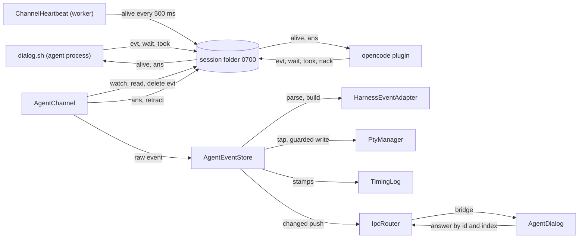

# Logical Components: u1-questions

## Sources

- `aidlc/spaces/default/intents/261114-agent-dialogs/construction/u1-questions/nfr-design/nfr-design-questions.md` (no questions; three settled points)
- `aidlc/spaces/default/intents/261114-agent-dialogs/construction/u1-questions/nfr-requirements/performance-requirements.md`
- `aidlc/spaces/default/intents/261114-agent-dialogs/construction/u1-questions/nfr-requirements/security-requirements.md`
- `aidlc/spaces/default/intents/261114-agent-dialogs/construction/u1-questions/nfr-requirements/scalability-requirements.md`
- `aidlc/spaces/default/intents/261114-agent-dialogs/construction/u1-questions/nfr-requirements/reliability-requirements.md`
- `aidlc/spaces/default/intents/261114-agent-dialogs/construction/u1-questions/nfr-requirements/observability-requirements.md`
- `aidlc/spaces/default/intents/261114-agent-dialogs/construction/u1-questions/nfr-requirements/tech-stack-decisions.md`
- `aidlc/spaces/default/intents/261114-agent-dialogs/construction/u1-questions/nfr-requirements/reviews/review-01.md` (R-01 to R-07)
- `aidlc/spaces/default/intents/261114-agent-dialogs/construction/u1-questions/functional-design/functional-spec.md`
- `aidlc/spaces/default/intents/261114-agent-dialogs/construction/u1-questions/functional-design/rules.md`
- `aidlc/spaces/default/intents/261114-agent-dialogs/inception/contract-design/contract-summary.md` (C1 to C6)
- `aidlc/spaces/default/intents/261114-agent-dialogs/inception/domain-design/components.md`
- Existing code: `src/main/pty.js`, `src/main/ipc.js`, `src/main/notify.js`, `src/main/fileWrite.js`, `src/main/projectAccess.js`, `src/main/settings.js`, `src/main/index.js`, `src/renderer/ArtifactReader.jsx` (`FileContent`)

## Purpose

This file is the component-level view of where the NFR patterns of this Unit apply. u1 is the shared base: u2 (permission prompts), u3 (replies), u4 (installer) and u5 (notifications) add to these components and never replace them. The last section holds the amended wording of contract C1, for Code Generation to apply to `contract-summary.md`.

## Inventory

Every row is one logical component. "Failure domain" says what stops working when it fails; "blast radius" says who notices.

| ID | Component | Runs in | Code (new or changed) | NFR patterns applied here | Failure domain | Blast radius |
|---|---|---|---|---|---|---|
| LC1 | ChannelHeartbeat | a `worker_threads` worker started by AgentChannel | new, inside `src/main/agentChannel.js` | stall-proof liveness (RD1) | `alive` files stop changing | every waiting hook hands back after 2 s; the agents show their own pickers; no answer is lost because the dialog falls back to `via: keys` |
| LC2 | AgentChannel | main process | new `src/main/agentChannel.js` | private folders and secret (SD1, SD2), intake checks (SD3), atomic answer writes and the take protocol (RD2), start-up clear (RD6), one log line per refusal (OD2) | events are not read, answers not written | the dialog shows no hook questions; every agent keeps its own picker (the hook times out or hands back) |
| LC3 | HarnessEventAdapter | main process, pure | new `src/main/agentAdapters.js` | never guess (RD7), 64 KB cut (PD4), index-to-label mapping | one harness's payloads are refused | that harness's questions hand back at once (RD7) |
| LC4 | AgentEventStore | main process | new `src/main/agentEvents.js` | answer check (SD4), delivery path choice (RD3), same-turn push (PD3), arrival order (SCD2), quiet happy path (OD3) | the open events of every project | the dialog; the agents are never blocked because every hook has its own exit rules (RD1, RD4) |
| LC5 | PtyManager | main process | changed `src/main/pty.js` | session variables only for agent tabs (SD2), output tap for picker readiness (PD2) | terminals | unchanged from today |
| LC6 | IpcRouter | main process | changed `src/main/ipc.js` | argument checks (SD4), wiring at spawn and exit (RD5) | the C4 bridge members | the dialog |
| LC7 | TimingLog | main process | new `src/main/agentTiming.js` | development timing log (OD1) | nothing outside the log | none: off by default |
| LC8 | `dialog.sh` | the agent's hook process | new `.thadeus/hooks/dialog.sh` | silent exit (RD4), poll-count liveness and wall-clock deadline (RD1), take by rename (RD2), no interpretation of input (SD5) | one hook call | one question of one agent session; the agent then shows its own picker |
| LC9 | opencode plugin | the opencode server process | new `thadeus-dialog.js` (path fixed by u4, C6) | same files and rules as LC8 (RD1, RD2), caught errors (RD8) | one form | one opencode question; opencode's own form stays usable |
| LC10 | AgentDialog | renderer | new `src/renderer/AgentDialog.jsx` | sanitized Markdown and safe links (SD6), keyboard and text states (PD5), `t()` (PD6), timing stamps (OD1) | the dialog | the person sees no dialog; agents keep their own pickers |

### Isolation strategy

- **Process isolation is the main bulkhead.** The hook script and the plugin run in the agent's processes, not in the app. Each has its own exit rules (wall-clock deadline, liveness, silent exit), so no failure in the app can keep an agent waiting longer than 2.5 s after the app stops updating `alive`, or past 596.1 s in any case (RD1).
- **The heartbeat is isolated from main's event loop** (LC1). A busy main process (a large audit log parse, a slow synchronous call) does not stop `alive` from changing. Only a crash or quit of the app does, and that is exactly the case where the hook must hand back.
- **The trust boundary is LC2.** Everything a hook writes is checked there before any other component sees it. LC3 and LC4 only receive raw events that passed BR1.1.
- **The renderer is not trusted with delivery.** It sends an event id and option indexes only; LC4 owns the check and the write (C4, components.md Option A).

### Shared resources

| Resource | Owner | Shared with | Rule |
|---|---|---|---|
| `<userData>/agent-channel/` | LC2 | LC1 (writes `alive` only), LC8, LC9 | mode `0700`; removed and recreated at app start; one folder per session |
| `<userData>/logs/agent-timing.jsonl` | LC7 | none | created only when `THADEUS_TIMING=1` |
| pty output stream | LC5 | LC4 (tap while waiting for the picker) | the tap is read-only and lives at most 3 s per answer |
| `chokidar` | `src/main/watcher.js` today | LC2 adds one watcher | one watcher on the channel root for the whole app |

## Files on disk (one session)

```text
<userData>/agent-channel/                 0700, cleared at app start (RD6)
  <sessionId>/                            0700, removed by closeSession (RD5)
    alive                                 epoch ms + newline, replaced atomically every 500 ms (RD1)
    events/<epoch-s>-<pid>.tmp            written by the hook, ignored by main
    events/<epoch-s>-<pid>.evt            renamed by the hook; read once and deleted by main
    answers/<epoch-s>-<pid>.wait          created by a waiting hook; removed by the hook on every exit
    answers/<epoch-s>-<pid>.tmp           written by main, then renamed to .ans
    answers/<epoch-s>-<pid>.ans           the answer; empty means hand back
    answers/<epoch-s>-<pid>.took          the hook's atomic take of .ans (rename)
    answers/<epoch-s>-<pid>.nack          plugin only: the harness refused the answer
```

## Reuse by the later Units

| Later Unit | What it adds | Where | What it must not change |
|---|---|---|---|
| u2-permissions | kind `permission` (waits) | the `case` line of `dialog.sh` gains `permission` among the waiting kinds; an adapter `permission` parser and answer builder; C3 `permission` field | the take protocol, the liveness loop, the silent-exit rules |
| u3-replies | kind `reply` (never waits); `via: typed`; `agentEvents.latest` | the `case` line gains `reply` among the non-waiting kinds; LC4 keeps the latest reply; the `typed` path reuses LC5's guarded write | the intake checks |
| u4-install | the HookInstaller (C5, C6); writes `dialog.sh` and the plugin into projects | replaces the development switch with C5's `isCurrent`; uses the script's content as the "current" reference | the script's interface: one argument (the kind), stdin, the three variables |
| u5-notifications | one notification per new event | subscribes to LC4's `added` signal (one call per accepted event, after the push) and reuses `src/main/notify.js`'s once-per-id set and `questionAlerts` setting | LC4's order and lifecycle |

LC4 exposes, inside main only: `list(projectId)`, `answer(eventId, answer)`, `close(eventId)`, `onChanged(fn)`, `onAdded(fn)`. LC2 exposes C2 as written plus `answerState(sessionId, file)` (reads the `.wait`, `.ans` and `.nack` markers) and `retract(sessionId, file)` (unlinks `.ans`, tells whether it was still there). Both additions are internal to main and do not change C2's existing members.

## Component diagram

<!-- Text fallback: dialog.sh and the opencode plugin write event files into the session folder and read answer files from it. ChannelHeartbeat (a worker thread) rewrites alive in every session folder. AgentChannel watches the folders, checks each event and hands raw events to AgentEventStore, which uses HarnessEventAdapter, PtyManager (output tap and guarded write) and TimingLog, and pushes changes through IpcRouter to AgentDialog. AgentEventStore writes answers back through AgentChannel. -->



## C1 amendment

Code Generation applies this to `aidlc/spaces/default/intents/261114-agent-dialogs/inception/contract-design/contract-summary.md`, section "C1 Hook channel (file protocol)", in the first Bolt step that touches the channel. It answers R-02 (both parts) and R-04 of the NFR Requirements review and carries RD1 and RD2. The protocol stays `v1`: no version has shipped yet, so nothing older needs to be accepted.

Replace the `environment`, `folder`, `event_file.name`, `answer_file` and `waiting` keys of the C1 YAML block with:

```yaml
environment:                 # set by PtyManager on the agent child only (C2)
  THADEUS_SESSION_DIR: "absolute path of the session folder (mode 0700, under the app's userData)"
  THADEUS_SESSION_SECRET: "32 random bytes, hex; never written to a committed file"
  THADEUS_WAIT_SECONDS: "the full time a question or permission hook may wait, in whole seconds (595 for Claude Code: the entry timeout 600 minus a 5 s margin that main applies once, when it sets the variable); hooks use it as given and subtract nothing"
folder:
  alive: "holds the app's current epoch ms and a newline; the app replaces it atomically every 500 ms from a worker thread; a hook treats the app as gone after 20 consecutive 100 ms polls that read the same content (at least 2 s without an update)"
  events/: "event files, written by the hook as <name>.tmp then renamed to <name>.evt; the app reads each .evt once and deletes it; .tmp files are never read"
  answers/: "answer files and the hook's wait markers (see answer_file)"
event_file:
  name: "<digits>-<digits>.evt; the script writes <epoch-s>-<pid> (date +%s and its own pid), the opencode plugin <epoch-ms>-<pid> with the ms strictly increasing inside its process; a name only identifies the file, it never orders events"
  order: "arrival order is the event file's mtimeMs, then tabId, then a counter main increments as it accepts each file"
answer_file:
  name: "<same name as the event file, without .evt>.ans"
  content: "the exact text the hook prints on stdout, built by HarnessEventAdapter; empty means hand back"
  wait_marker: "<name>.wait, created by a waiting hook before it renames its event file into place, removed by the hook on every exit"
  take: "the hook takes an answer by renaming <name>.ans to <name>.took, then prints it; a plugin whose harness refuses the answer renames <name>.took to <name>.nack before it removes its wait marker"
  delivered_when: "the app reports an answer as sent via hook only when <name>.ans is gone (taken), <name>.wait is gone (the hook finished) and no <name>.nack exists; when <name>.wait is gone and <name>.ans is still there, the app deletes <name>.ans and the answer was not delivered"
waiting:
  question: "waits for the answer file"
  permission: "waits for the answer file"
  answered: "never waits: writes the event and exits 0"
  reply: "never waits: writes the event and exits 0 (FR3.3)"
  stops_waiting_when: "answer file taken; alive unchanged for 20 polls (the plugin: for 2000 ms by Date.now()); THADEUS_WAIT_SECONDS reached by wall clock (date +%s; the plugin: Date.now())"
  on_stop_without_answer: "print nothing, exit 0, so the agent shows its own prompt (NFR5)"
```

Add one bullet under the C1 block:

- **Delivery is confirmed, not assumed:** an answer file the hook never took is not an answer. The app checks the wait marker before it writes, and after it writes it reports "sent" only once the hook has taken the file. If the hook has already gone, the app deletes the answer file and sends the answer as keys once the agent's own picker shows (C2 "Delivering an answer").

In C2, add `"hook gave up"` to the reasons `writeAnswer` can report ("session ended", "event file no longer waiting" stay). C3 and C4 do not change: `arrivedAt` keeps its ISO type and now comes from the event file's `mtimeMs`.
