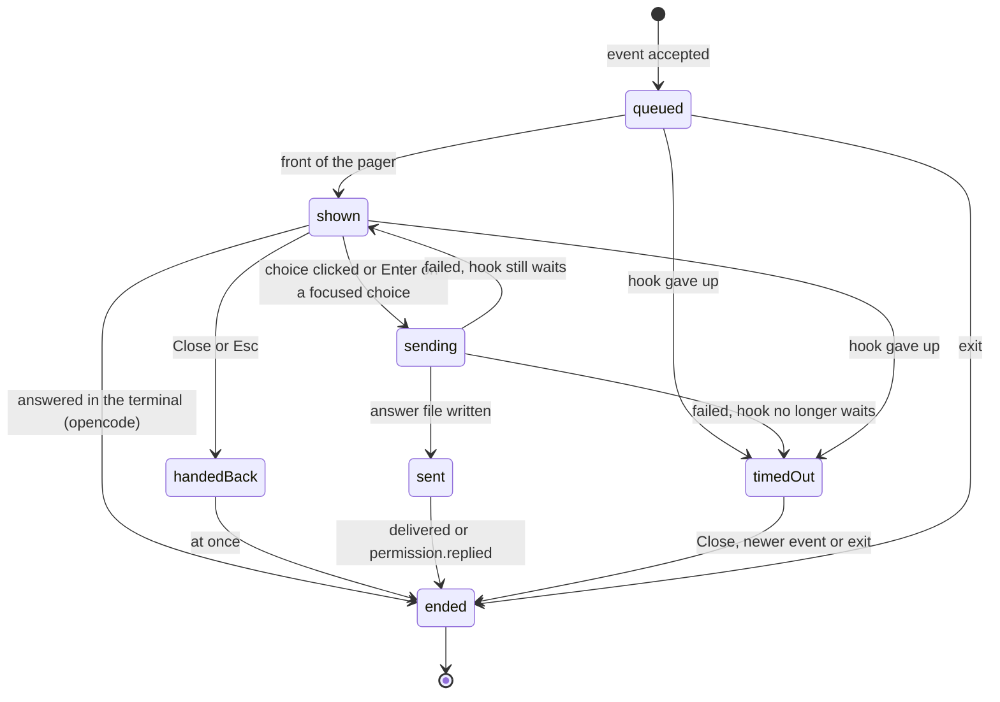
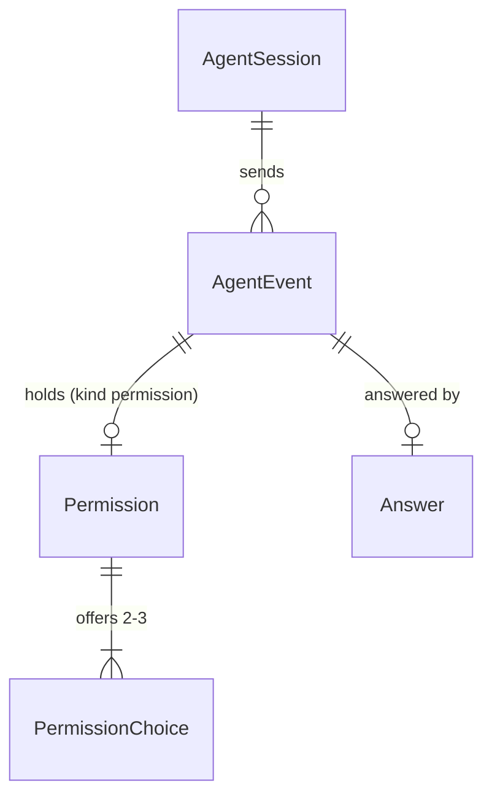

# Functional Specification: u2-permissions

## Sources

- Story: US2.1 in `aidlc/spaces/default/intents/261114-agent-dialogs/inception/user-stories/stories.md` (AC2.1.1–AC2.1.4). This Unit implements US2.1.
- Unit: `aidlc/spaces/default/intents/261114-agent-dialogs/inception/units-generation/unit-of-work.md`, `aidlc/spaces/default/intents/261114-agent-dialogs/inception/units-generation/unit-of-work-story-map.md`.
- Requirements: `aidlc/spaces/default/intents/261114-agent-dialogs/inception/requirements-analysis/requirements.md`.
- Components: `aidlc/spaces/default/intents/261114-agent-dialogs/inception/domain-design/components.md`.
- Contracts: `aidlc/spaces/default/intents/261114-agent-dialogs/inception/contract-design/contract-summary.md` (C1, C3, C4, C6).
- Mockups: `aidlc/spaces/default/intents/261114-agent-dialogs/inception/refined-mockups/mockups.md` (M3, M6).
- Integration point: `aidlc/spaces/default/intents/261114-agent-dialogs/construction/u1-questions/functional-design/functional-spec.md`, `entities.md`, `rules.md` (channel, adapter, store, dialog; state names and BR1–BR4).
- This Unit's entities and rules: `entities.md`, `rules.md`.
- Answers: `functional-design-questions.md` (no questions for this Unit).

## Harness facts used (spike, from the official docs)

| | Claude Code 2.1.325 | opencode 2.1.4 (plugin API V2) |
|---|---|---|
| Source event | `PermissionRequest` hook, fires when a tool call needs a permission decision | `permission.asked` |
| Input | `tool_name`, `tool_input`, `permission_suggestions` (plus `cwd`) | the permission request with its `sessionID` and `requestID` |
| Return the answer | stdout `hookSpecificOutput.decision` with `behavior` `allow` or `deny`, optional `updatedPermissions`, `message`, `interrupt` | `ctx.permission.reply({ sessionID, requestID, decision })`, decision `once`, `always` or `reject` |
| Allow always | `updatedPermissions` holding the `permission_suggestions` Claude Code gave | decision `always` |
| No decision | exit 0 with no output; exit 2 is not honoured; on timeout the output is discarded and Claude Code shows its own prompt | the plugin replies nothing; the prompt stays in the terminal |
| Time limit | per-entry `timeout`, 600 s default | none documented; `waitSeconds` applies |
| Terminal at the same time | no: Claude Code waits for the hook before it shows its prompt | yes: the prompt shows in the terminal too; `permission.replied` reports an answer from either side |

Not used: opencode's `ctx.permission.hook("evaluate")`. It decides the effect in code before anyone is asked, which is the app deciding on its own (FR3.4). Unattended opencode turns ask into deny by itself; the plugin then only sees `permission.replied` and the event ends.

## Workflows

### W1 A Claude Code permission, answered in the dialog (AC2.1.1, AC2.1.2)

1. Claude Code needs a permission decision. Its `PermissionRequest` entry (matcher for every tool, `timeout 600`) runs `dialog.sh permission` with the hook input on stdin.
2. The script writes `THADEUS-EVENT v1 permission <secret>` and the input unchanged as an event file and waits, as for a question (BR1.1, BR1.2, BR1.3).
3. The adapter builds the Permission (BR5.1) and its choices (BR5.3). If it cannot, or the tool is `AskUserQuestion`, or the project uses the fallback, the store hands back at once (BR5.4).
4. The store adds context (BR2.5), places the event in the pager (BR5.12) and pushes `agent-events:changed`. AgentDialog shows the M3 page within 1 second of the hook firing (BR5.13, NFR1). No choice has focus (BR5.6).
5. The person clicks a choice, or focuses one by number key and presses Enter. The renderer calls `agentEvents.answer(eventId, { choice })`. The store checks it (BR5.7).
6. The adapter builds the hook output (BR5.8). AgentChannel writes it as the answer file; the script prints it and exits 0. Claude Code allows the call once, allows it and adds the suggested rule, or denies it and stops the turn, as its own prompt would. State `sent`, then `ended`: the hook's answer file is the end of this request.

The hook output, for illustration (allow always):

```json
{ "hookSpecificOutput": { "hookEventName": "PermissionRequest",
  "decision": { "behavior": "allow", "updatedPermissions": ["<permission_suggestions, unchanged>"] } } }
```

### W1b An opencode permission (AC2.1.1, AC2.1.2)

1. opencode emits `permission.asked`; the plugin writes the C1 event (kind `permission`) and waits on the answer file in its own async task. opencode shows the prompt in its terminal at the same time.
2. Steps 3–5 of W1 run unchanged (BR5.2, BR5.3).
3. The adapter writes `once`, `always` or `reject` as the answer file. The plugin calls `ctx.permission.reply` with it, unless `permission.replied` already came for that request (BR5.11).
4. `permission.replied` is forwarded as `answered` with the `requestID` and ends the event. If the reply came from the terminal, the page closes with "Answered in the terminal." If `permission.reply` fails, the plugin forwards `answered` marked failed; the event becomes `timedOut` with the cause in `lastError`, and the person answers in the terminal (BR5.11).

### W2 Nobody answers (AC2.1.3)

1. After `waitSeconds` (595 s, BR1.3) the script prints nothing and exits 0; Claude Code shows its own prompt. The opencode plugin stops waiting; its terminal prompt was there all along.
2. The store marks the event `timedOut`. The page shows "<harness> stopped waiting for the dialog. Answer in the terminal." with every choice disabled, and Open the terminal and Close (BR5.9).
3. Nothing was allowed or denied by the app (BR5.6). The event ends on Close, the next event from that session, or exit.

Unlike a timed-out question (u1 W3), a timed-out permission is not sent as keys. A wrong key here allows a command the person did not choose, so the terminal is the only place left to answer.

### W3 The person closes the page (AC2.1.3)

Close or Esc writes an empty answer file (BR5.10). Claude Code shows its own prompt; the opencode plugin replies nothing. The event is `handedBack` and ends at once; the toast "Handed back to the terminal. Answer there as usual." shows for 5 s. Esc never denies.

### W4 Order with replies (AC2.1.4)

A reply from tab A waits in the pager; a permission from tab B arrives later. The pager puts the permission first (BR5.12). If the reply page is open, it stays put and the count says "+1 new" (BR2.1); paging from the start, or the next opening of the dialog, shows the permission first. Replies arrive with u3-replies; until then the rule is tested with a reply-kind fixture.

### W5 Several permissions from one session

Parallel tool calls (for example sub-agents) can ask several permissions at once, each with its own waiting hook and answer file. Each gets its own page and ends by its own answer; a newer event does not end an older waiting one (BR5.11).

### W6 Refusals and failures

- Not from a live session, wrong secret, half-written, over 1 MB: deleted by AgentChannel, nothing shown (BR1.1).
- Unreadable payload, the question tool, or a fallback project: handed back at once (BR5.4).
- A permission answer for an unknown, ended, timed-out or other session's event, a choice index outside the list, a disabled choice, or a second send: refused with the named C4 error; nothing reaches an agent (BR5.7).
- The answer file cannot be written: the page keeps the choice, shows the cause in one sentence and offers Open the terminal; it can be tried again while the hook still waits (BR5.8, BR3.4).
- The tab exits: every permission event of the session ends, nothing is sent, "The <harness> session ended. Nothing was sent." (u1 BR2.3).
- The app quits while a hook waits: the hook hands back within 2 s (BR1.2).
- A command over 64 KB: cut, with the allow choices disabled (BR5.5).

## State machine: permission AgentEvent

Uses u1's states. A permission never goes from `timedOut` to `sending`, and `handedBack` ends at once.

<!-- Text fallback: queued to shown at the front of the pager; queued or shown to timedOut when the hook gives up. shown to sending on a choice; sending to sent when the answer file is written, back to shown on a failure while the hook waits, or to timedOut when it no longer waits. shown to handedBack on Close or Esc, then ended. shown to ended when opencode reports the request answered in the terminal. sent ends at once (Claude Code) or on permission.replied (opencode). timedOut ends on Close, a newer event from the session, or exit. Any state ends when the tab exits. -->



| From | Event | Guard | To | Action |
|---|---|---|---|---|
| queued | reaches the front | — | shown | focus the page title, no choice (BR5.6) |
| queued, shown | hook gave up | waitSeconds passed | timedOut | disable choices, M6 line (BR5.9) |
| shown | choice clicked, or Enter on a focused choice | BR5.7 passes | sending | build and write the hook output (BR5.8) |
| sending | answer file written | — | sent | "Sent to <harness>." |
| sending | write failed | hook still waits | shown | lastError, choice kept (BR3.4) |
| sending | write failed | hook no longer waits | timedOut | as BR5.9 |
| shown | Close / Esc | — | handedBack | empty answer file, toast (BR5.10) |
| shown | permission.replied not sent by the app | opencode | ended | "Answered in the terminal." (BR5.11) |
| sent | Claude Code: at once; opencode: permission.replied, or answered marked failed | — | ended, or timedOut on failure | remove from the pager |
| any | tab exits | — | ended | "Nothing was sent." |

## Entity relationships (derived from entities.md)

<!-- Text fallback: an AgentSession has many AgentEvents; a permission AgentEvent holds one Permission with two or three PermissionChoices, and has at most one Answer. -->



## Rules summary (derived from rules.md)

| Rule | In short |
|---|---|
| BR5.1 | Claude Code PermissionRequest read from known fields; suggestions kept as is |
| BR5.2 | opencode permission.asked opens, permission.replied closes |
| BR5.3 | Only the agent's own choices; Allow always only when Claude Code suggests a rule |
| BR5.4 | Refused or unhandled permission events hand back at once |
| BR5.5 | Plain text, 64 KB, no allow on a cut command |
| BR5.6 | Never decided by the app: no preselection, no auto-send |
| BR5.7 | Answer check: waiting, live, fits, once |
| BR5.8 | Via hook only; allow, allow with the agent's rules, or deny; never keys |
| BR5.9 | Time-out hands back; choices disabled |
| BR5.10 | Close hands back without a decision |
| BR5.11 | Several per session; first answer wins in opencode |
| BR5.12 | Questions and permissions before replies |
| BR5.13 | M3 layout, kind in text |

## Interfaces used and added

- C1: the `permission` kind (waits for the answer file) and `answered` for opencode's `permission.replied`; no new kind, no version change.
- C3: `AgentEvent.permission` as in the contract, plus the additive fields `truncated`, `choices[].effect` and `choices[].enabled`; `alwaysRules` stays in main. `Answer.permission { choice }`.
- C4: `agentEvents.answer` and `agentEvents.close` unchanged; no new bridge member.
- C6 (Claude Code, installed by hand until u4): `PermissionRequest` with a matcher for every tool, `timeout 600`, command as u1's with the argument `permission`. opencode: the same plugin file, subscribed to `permission.asked` and `permission.replied`.

## Open points for Code Generation

- Deny uses `interrupt: true` so Claude Code stops the turn as its terminal "No" does; the manual NFR2 scenario 6 run confirms it on the release Mac.
- The opencode `permission.asked` field names for the type and pattern are read from recorded fixtures before the adapter is written (BR5.2).
