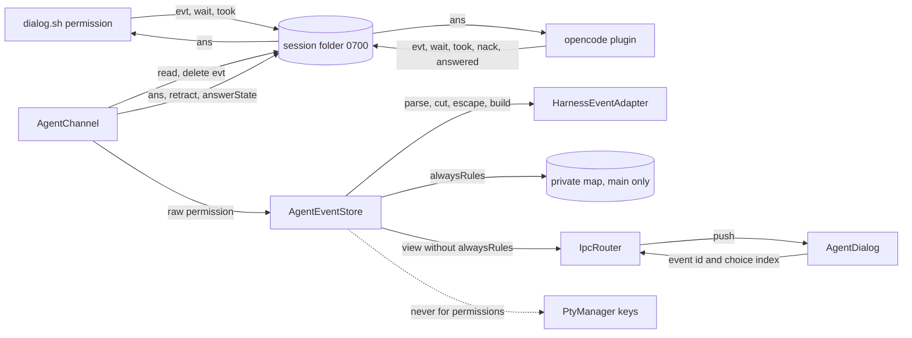

# Logical Components: u2-permissions

## Sources

- `aidlc/spaces/default/intents/261114-agent-dialogs/construction/u2-permissions/nfr-design/nfr-design-questions.md` (Q1: A)
- `aidlc/spaces/default/intents/261114-agent-dialogs/construction/u2-permissions/nfr-requirements/performance-requirements.md`
- `aidlc/spaces/default/intents/261114-agent-dialogs/construction/u2-permissions/nfr-requirements/security-requirements.md`
- `aidlc/spaces/default/intents/261114-agent-dialogs/construction/u2-permissions/nfr-requirements/scalability-requirements.md`
- `aidlc/spaces/default/intents/261114-agent-dialogs/construction/u2-permissions/nfr-requirements/reliability-requirements.md`
- `aidlc/spaces/default/intents/261114-agent-dialogs/construction/u2-permissions/nfr-requirements/observability-requirements.md`
- `aidlc/spaces/default/intents/261114-agent-dialogs/construction/u2-permissions/nfr-requirements/tech-stack-decisions.md`
- `aidlc/spaces/default/intents/261114-agent-dialogs/construction/u2-permissions/nfr-requirements/reviews/review-01.md` (R-01 to R-06)
- `aidlc/spaces/default/intents/261114-agent-dialogs/construction/u2-permissions/functional-design/functional-spec.md`
- `aidlc/spaces/default/intents/261114-agent-dialogs/construction/u2-permissions/functional-design/rules.md` (BR5.3, BR5.11)
- `aidlc/spaces/default/intents/261114-agent-dialogs/construction/u2-permissions/functional-design/entities.md`
- `aidlc/spaces/default/intents/261114-agent-dialogs/inception/contract-design/contract-summary.md` (C1–C4)
- `aidlc/spaces/default/intents/261114-agent-dialogs/construction/u1-questions/nfr-design/logical-components.md` (LC1–LC10, "Reuse by the later Units", C1 amendment)
- `aidlc/spaces/default/intents/261114-agent-dialogs/construction/u1-questions/nfr-design/reviews/review-01.md` (R-01, R-02, R-04)
- Existing code: `src/main/i18n.js`, `src/main/notify.js`, `src/main/index.js`, `src/renderer/QuestionPopup.jsx`

## Purpose

u2 adds no logical component. It adds the `permission` kind to u1's components, as u1's "Reuse by the later Units" table foresaw, and keeps u1's take protocol, liveness loop and silent-exit rules unchanged. This file maps each u2 design element to the component it lives in, and holds the amendments Code Generation applies to the functional design and the contracts.

## Where the u2 patterns apply

| ID (u1) | Component | What u2 adds | Design elements | Failure domain for permissions | Blast radius |
|---|---|---|---|---|---|
| LC2 | AgentChannel | `answerState` gains a `folder` flag (internal member) | RD10 | permission events are not read, answers not written | every permission hands back through its hook's own exit rules; agents ask in the terminal |
| LC3 | HarnessEventAdapter | Claude Code and opencode permission parsers; choice builder; Allow always display lines and their shape check; the hook output builder; `visibleText` (exported, the intent's one escaping function); the field caps; `DENY_MESSAGE` | SD9, SD11, SD12, SCD8, RD11, RD15 | one harness's permissions are refused | that harness's permissions hand back at once (RD11) |
| LC4 | AgentEventStore | the permission answer check; `sendPermission` with no keys branch; `handBack` without a text argument; the private `alwaysRules` map; the by-kind end rule; the kind rank in the sort; `agentConfirmed` stamp | SD8, SD10, SD11, SD13, RD10, RD12, SCD6, SCD9, PD9, OD6, OD7, OD8 | open permissions of every project | the dialog; never an agent, because each hook has its own exit rules |
| LC6 | IpcRouter | shape check of `Answer.permission` | SD10 | the C4 members | the dialog |
| LC7 | TimingLog | accepts `agentConfirmed` from main only | OD5, OD6 | the timing log | none: off by default |
| LC8 | `dialog.sh` | `permission` among the waiting kinds on the `case` line | RD14 | one permission of one session | that permission; Claude Code shows its own prompt |
| LC9 | opencode plugin | `permission.asked` and `permission.replied`; `deliver` with the `replied` set | SD8, RD13 | one opencode permission | none beyond it: opencode's terminal prompt is shown at the same time |
| LC10 | AgentDialog | the M3 permission page: title focus, 500 ms input guard, `detail` as a text node in a monospaced block, labels with `pre-wrap` | PD8, PD10, SD9 | the dialog | the person sees no dialog; agents ask in the terminal |

LC1 (ChannelHeartbeat) and LC5 (PtyManager) are unchanged. LC5's guarded `writeSession` and output tap are deliberately not reachable from any permission path (SD13).

### Isolation strategy

- **u1's process isolation holds** (u1 "Isolation strategy"): each permission hook leaves on its own rules, whatever the app does.
- **A permission decision has one way out of the app:** LC4 `sendPermission` → LC2 `writeAnswer` → the hook's take. The keys sender is a separate path that permission code does not import (SD13). A fault in the keys path cannot touch a permission, and a fault in the permission path cannot type into a terminal.
- **Rule suggestions never cross the IPC boundary.** `alwaysRules` lives in LC4's private map; LC6 sends a view built from an allowlist of fields; LC10 sends back only an index (SD11).
- **The trust boundary for display is LC3:** every agent string the renderer shows has been cut and escaped there. LC10 treats them as plain text and adds no parsing.

### Shared resources

u1's table applies. u2 adds no folder, file kind or watcher; `.nack` is u1's marker, now also written for permissions.

## Component diagram

<!-- Text fallback: dialog.sh (permission argument) and the opencode plugin (permission.asked, permission.replied) write permission and answered events into the session folder and take answers from it. AgentChannel checks each event and hands it to AgentEventStore. The store asks HarnessEventAdapter to parse the permission, cut and escape every agent string and build the choices; it keeps alwaysRules in a private map and pushes a view without them through IpcRouter to AgentDialog. AgentDialog sends back only an event id and a choice index. The store checks the answer, asks the adapter for the hook output and writes it through AgentChannel. The store's path to PtyManager is not used for permissions. -->

## Amendments for Code Generation

Code Generation applies these in the first Bolt step that touches the file named. None changes a contract's shape incompatibly; C1's protocol stays `v1`.

### BR5.3 amendment (rules.md of u2, opencode clause), from Q1 A

Replace "opencode - Allow once (once), Allow always (always), Reject (reject)" with:

> opencode - Allow once (once); Allow always (always) only IF the request carries a non-empty list of always-patterns that fits the caps, its label naming each pattern as `<permission>: <pattern>`; Reject (reject).

And the Claude Code clause "its label naming each rule's text verbatim" becomes "only IF every suggestion is an `addRules` with `behavior: "allow"` or an `addDirectories` with no unknown key, its label naming each rule or folder with its destination; disabled when the lines exceed the caps (security-design.md SD11)". NFR2.7's opencode list reads the same way.

### NFR5.19 failure signal

"A rejected or missing `reply` writes an `answered` event marked failed" is carried by u1's `.nack` marker instead (RD13). The store's outcome (timedOut with `lastError`, nothing thrown into opencode) is unchanged.

### C3 additions (contract-summary.md, `permission` block)

Already in the functional spec, stated here so the contract file gets them: `truncated: boolean`; `choices[].effect: "allowOnce" | "allowAlways" | "deny"`; `choices[].enabled: boolean`. `alwaysRules` is not part of C3: it never leaves main. `Answer.permission` stays `{ choice: integer }`, with no other key accepted.

### C2

No change. `answerState`'s new `folder` flag is internal to main, like u1's `answerState` and `retract`.

### Prerequisites in u1

u1's corrections listed in security-design.md SD14 (the `printf ''` wait marker, the single-instance lock, `sent` only with a live folder) must be in the code before u2's script and store tests can pass.
