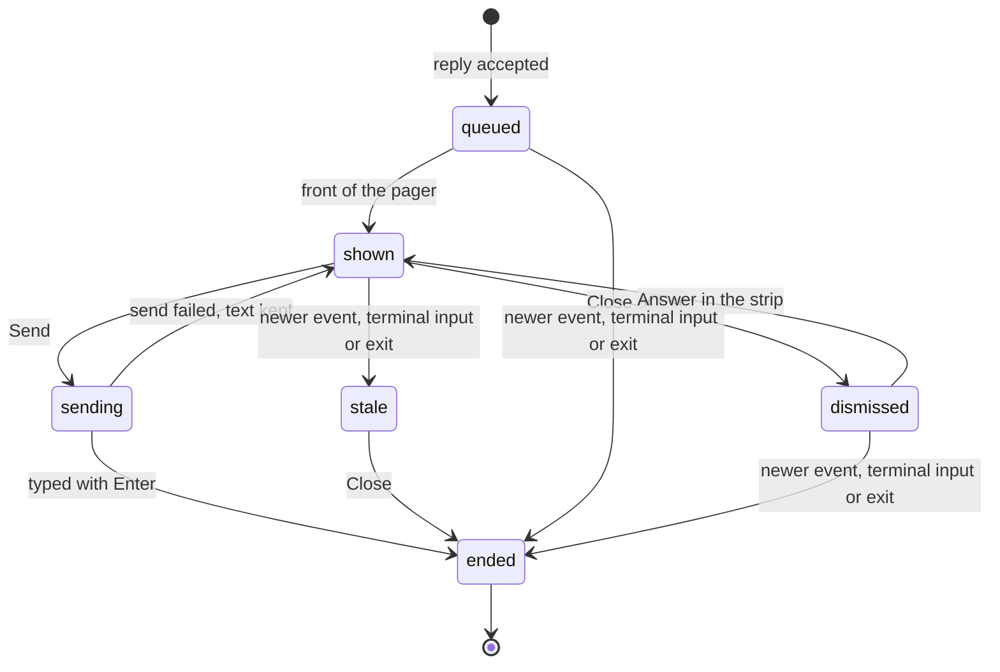
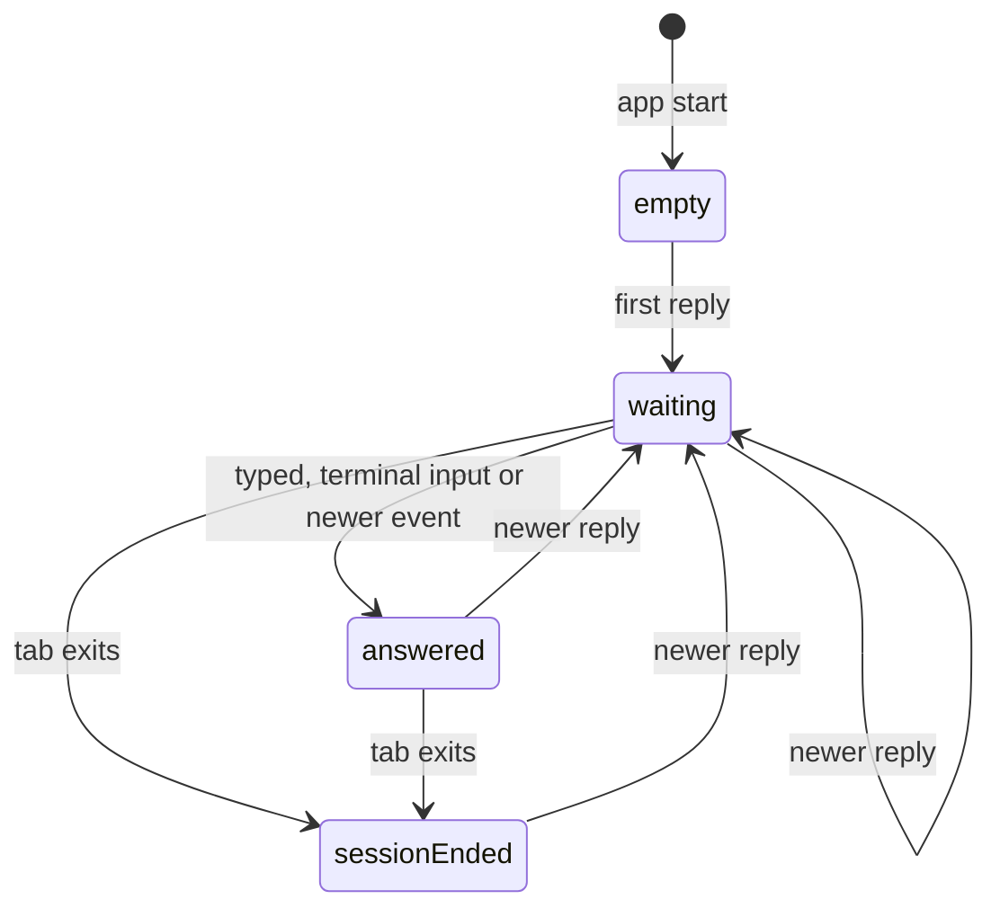
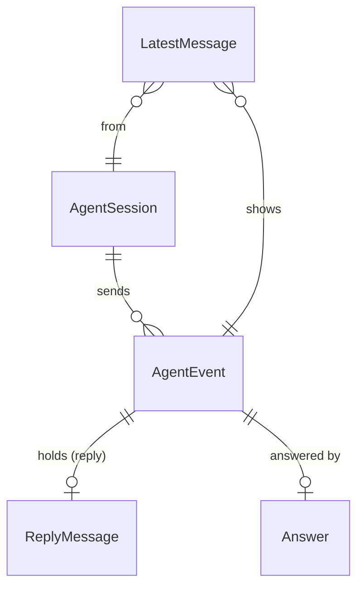

# Functional Specification: u3-replies

## Sources

- Story: US3.1 in `aidlc/spaces/default/intents/261114-agent-dialogs/inception/user-stories/stories.md` (AC3.1.1–AC3.1.5). This Unit implements US3.1.
- Unit: `aidlc/spaces/default/intents/261114-agent-dialogs/inception/units-generation/unit-of-work.md` (U3), `aidlc/spaces/default/intents/261114-agent-dialogs/inception/units-generation/unit-of-work-story-map.md`.
- Requirements: `aidlc/spaces/default/intents/261114-agent-dialogs/inception/requirements-analysis/requirements.md`.
- Components: `aidlc/spaces/default/intents/261114-agent-dialogs/inception/domain-design/components.md`.
- Contracts: `aidlc/spaces/default/intents/261114-agent-dialogs/inception/contract-design/contract-summary.md` (C1–C4, C6).
- Mockups: `aidlc/spaces/default/intents/261114-agent-dialogs/inception/refined-mockups/mockups.md` (M4, M5, M6).
- Integration point: `aidlc/spaces/default/intents/261114-agent-dialogs/construction/u1-questions/functional-design/functional-spec.md`, `entities.md`, `rules.md` (u1's channel, adapter, store, dialog and their rules BR1–BR4).
- This Unit's entities and rules: `entities.md`, `rules.md` (BR6.1–BR6.18).
- Answers: `functional-design-questions.md` Q1 `[Q1]`.

## Harness facts used (from the u1 spike and the official docs)

| Harness | Fact | Effect on this design |
|---|---|---|
| Claude Code 2.1.325 | The `Stop` hook fires when Claude finishes responding; stdin adds `stop_hook_active` and `last_assistant_message`, which the docs say to use rather than reading `transcript_path` | The reply text comes from `last_assistant_message` only (BR6.3) |
| Claude Code | A Stop hook's output, or exit code 2, can make Claude continue | The reply hook prints nothing and exits 0 at once (BR6.1) |
| Claude Code | Hook commands inherit the environment `claude` was started with | The session variables reach the Stop hook as they do the question hook |
| opencode 2.1.4 (plugin API V2, `.opencode/plugins/`) | `session.status` events carry `status.type` `idle`, `busy` or `retry`; `session.idle` is deprecated | The plugin forwards `idle` only (BR6.2) |
| opencode | The last assistant message is read with `ctx.session.context({ sessionID })` | The plugin adds it to the event body (BR6.2) |

## What this Unit adds to u1

| Component | Addition |
|---|---|
| ClaudeCodeHook | `dialog.sh reply`: write the event, exit 0, no output, no wait (BR6.1) |
| OpencodePlugin | `session.status` idle handler (BR6.2) |
| HarnessEventAdapter | Reply parsing for both harnesses (BR6.3) |
| AgentEventStore | `reply` kind, `dismissed` and `stale` states, LatestMessage, the terminal-input signal, typed delivery (BR6.4–BR6.15, BR6.18) |
| IpcRouter | Calls the store's terminal-input signal from the existing `pty:write` handler; adds `agentEvents.latest` and `agentEvents.reopen` |
| AgentDialog | The M4 message layout, the stale state, escalation for replies (BR6.9, BR6.13, BR6.14, BR6.17) |
| LatestMessageStrip | New: M5 (BR6.16) |

## Workflows

### W1 A Claude Code reply answered in the dialog (AC3.1.1)

1. Claude Code in an app tab ends its turn with "Which name should the file have?". Its `Stop` entry runs `dialog.sh reply` with the hook input on stdin.
2. The script writes `THADEUS-EVENT v1 reply <secret>` and stdin unchanged as an event file, renames it to `.evt`, and exits 0 with no output (BR6.1). Claude Code stops and waits for input as usual.
3. AgentChannel accepts the file (BR1.1). The adapter takes the text from `last_assistant_message` (BR6.3). The store checks for a duplicate (BR6.4), moves on any older reply of the session (BR6.5), queues the reply after any open question or permission prompt (BR6.8), sets the project's LatestMessage to it with status `waiting` (BR6.15), and pushes `agent-events:changed`.
4. AgentDialog shows the M4 page: "MESSAGE", "Message from Claude Code", project, tab and time, the message rendered as Markdown, and an empty answer field with focus (BR6.9).
5. Dev types "notes.md" and presses Enter or Send. The renderer calls `agentEvents.answer(eventId, { reply: { text } })`. The store checks it (BR6.10) and cleans it to one line (BR6.11).
6. In one step, the store re-checks that the reply is still shown and writes "notes.md" and Enter to `ptyOf(sessionId)`, that tab's pty only (BR6.12). The event ends, the LatestMessage becomes `answered`, and the dialog says "Sent to Claude Code as typed, followed by Enter."

### W2 An opencode reply (AC3.1.4)

1. The opencode session in an app tab goes idle. The plugin receives `session.status` with `status.type: "idle"`.
2. For a session with no parent session, it reads the last assistant message with `ctx.session.context({ sessionID })` and writes the event file with kind `reply`; the body holds the status event and the context result unchanged (BR6.2). It does this in its own async task and returns to opencode at once.
3. W1 steps 3 to 6 run unchanged; the adapter takes the text parts of the last assistant message (BR6.3). The answer is typed into the opencode tab with Enter.

### W3 Dev closes the reply, then answers from the strip (AC3.1.2, AC3.1.3)

1. On the M4 page, Dev presses Close or Esc. The renderer calls `agentEvents.close(eventId)`. Nothing is typed and no answer file is written; the event becomes `dismissed` and leaves the pager; the call returns `dismissed` (BR6.14). The session keeps waiting in the terminal.
2. The strip above the terminal panel still shows the message: tab, time, the first line, and Answer (BR6.16).
3. With two agent tabs that have both finished a turn, the strip shows the newer of the two replies and names its tab (BR6.15).
4. Dev clicks Answer. The renderer calls `agentEvents.reopen(eventId)`; the reply is shown again in the same dialog with an empty answer field, and its 20 s escalation starts again (BR6.14, BR6.17). From here W1 step 5 applies.

### W4 The tab moves on before Send (M4 stale)

1. While a reply page is shown, either Dev types in that tab's terminal (BR6.6), or the session sends any newer event (BR6.5).
2. The reply becomes `stale`. The answer field and Send are disabled, Dev's typed text stays, and the dialog says "Claude Code is no longer waiting for this message. Your text is kept." with Copy and Open the terminal (BR6.13). Nothing is typed.
3. The LatestMessage becomes `answered` (or, for a newer reply, is replaced by it). The strip shows "(answered)" and Show.
4. A reply that was queued or dismissed when the tab moved on ends at once and never opens.

### W5 The tab exits (M5 session ended)

1. PtyManager reports the exit; IpcRouter closes the session.
2. A shown reply becomes `stale` with "The Claude Code session ended. Nothing was sent."; a queued or dismissed one ends (BR6.7).
3. The LatestMessage of that session becomes `sessionEnded`; the strip adds "(session ended)" after the tab name, and Answer becomes Show (BR6.16).

### W6 The send fails

The pty is gone between the check and the write, or the write throws. Nothing is typed, the dialog shows the one-sentence cause, keeps the text and offers Open the terminal; Send can be tried again while the reply is shown (BR6.12, u1 BR3.4).

### W7 A long reply (AC3.1.5)

1. The adapter cuts a message over 64 KB at 64 KB on a character boundary and sets `truncated` (BR6.3, u1 BR2.6).
2. The dialog ends the text with "Shortened at 64 KB. The full text is in the terminal." (BR6.9). The strip adds "(shortened)" to its line, and Show or Answer opens the full view with the same line (BR6.16).

### W8 No hooks, or a fresh start

- When the harness's hooks or plugin are not current for the project, its tabs send no replies, and the strip shows "No message from the agent yet" (BR6.18). Fallback questions behave as today.
- After an app start the strip is empty until the first reply arrives (BR6.15, u1 BR2.4).

### W9 Show a message the tab no longer waits for (M5)

On an `answered` or `sessionEnded` strip, Show opens the M4 layout read-only from the LatestMessage text: no answer field, Close only (BR6.16). It calls nothing in main beyond `agentEvents.latest`.

## State machine: a reply (AgentEvent with kind reply)

<!-- Text fallback: queued to shown when it reaches the front of the pager. shown to sending on Send; sending to ended when typed (latest message answered), or back to shown when the send fails. shown to dismissed on Close or Esc; dismissed to shown on Answer in the strip. shown to stale when the session sends a newer event, Dev types in the terminal, or the tab exits; stale to ended on Close. queued and dismissed end when the session moves on or the tab exits. -->



| From | Event | Guard | To | Action |
|---|---|---|---|---|
| queued | reaches the front | no open question or permission before it (BR6.8) | shown | focus the answer field; start the 20 s count |
| shown | Send | BR6.10 passes | sending | clean (BR6.11), check and type in one step (BR6.12) |
| sending | typed | — | ended | LatestMessage answered; "Sent to <harness> as typed, followed by Enter." |
| sending | failed | — | shown | lastError, text kept (u1 BR3.4) |
| shown | Close / Esc | — | dismissed | nothing typed (BR6.14) |
| dismissed | Answer in the strip | session live, not moved on | shown | empty answer field; 20 s count restarts |
| shown | newer event, terminal input, exit | — | stale | stale line, field disabled, text kept (BR6.13) |
| stale | Close | — | ended | — |
| queued, dismissed | newer event, terminal input, exit | — | ended | — |

u1's `sent`, `handedBack` and `timedOut` states are never used by a reply: a reply never holds its session, so there is nothing to hand back and no hook time limit.

## State machine: LatestMessage (per project)

<!-- Text fallback: empty until the first reply since the app started; then waiting. waiting to answered when the reply is typed from the dialog, Dev types in the terminal, or the tab sends a newer non-reply event. waiting or answered to sessionEnded when that tab exits. Any state goes back to waiting with the newer reply when a newer reply arrives from any agent tab of the project. -->



`empty` is the absence of a LatestMessage, not a stored status. The strip's four looks map one to one: empty, waiting (Answer), answered (Show), session ended (Show).

## Typed delivery (illustrative)

```text
answerReply(eventId, text):
  event = store.get(eventId)
  refuse unless event.kind == reply and event.state == shown and session live   # BR6.10
  line = clean(text)                                                            # BR6.11
  refuse unless 1 <= length(line) <= 64 KB
  # one synchronous step: no pty:write handler can run between check and write
  pty = channel.ptyOf(event.sessionId); fail "session ended" if null           # BR6.12
  pty.write(line + ENTER)
  event.end(); latest.markAnswered(event)
```

## Interfaces used and added

- **C1:** kind `reply`, never waits, as the contract already says.
- **C2:** `ptyOf(sessionId)`; plus one in-process signal added by this Unit: IpcRouter's existing `pty:write` handler tells the store the pty received the person's input before it writes it (BR6.6). The store's own typed answers do not go through `pty:write`, so they never mark their own reply stale.
- **C3:** `message: { text, truncated }` as the contract defines, plus `empty` (additive); states `dismissed` and `stale` added to `state` (additive).
- **C4:** `agentEvents.answer` with `{ reply: { text } }`, returning `via: "typed"`; `agentEvents.close` returning `dismissed` for a reply; `agentEvents.latest` returning `{ tabId, harness, text, arrivedAt, status }` plus `eventId`, `truncated` and `empty` (additive); new member `agentEvents.reopen: { in: { eventId }, out: { state: "shown" }, errors: ["unknown event", "event not open"] }`. The strip refreshes on the existing `agent-events:changed` push.
- **C6:** one more entry, installed by hand until u4:

```text
Stop  (no matcher)  timeout 10  command: [ -n "$THADEUS_SESSION_DIR" ] && [ -f "$CLAUDE_PROJECT_DIR/.thadeus/hooks/dialog.sh" ] && sh "$CLAUDE_PROJECT_DIR/.thadeus/hooks/dialog.sh" reply; exit 0
```

## Entity relationships (derived from entities.md)

<!-- Text fallback: an AgentSession sends many AgentEvents; a reply AgentEvent holds one ReplyMessage and at most one Answer; a project's LatestMessage names one reply AgentEvent and its AgentSession. -->



## Rules summary (derived from rules.md)

| Rule | In short |
|---|---|
| BR6.1 | Stop hook writes the reply and exits 0 at once, silently |
| BR6.2 | opencode plugin forwards idle top-level sessions with the last message |
| BR6.3 | Message only from the harness's last-message field; 64 KB; empty flagged |
| BR6.4 | The same message twice is one reply |
| BR6.5 | A newer event from the session makes the older reply stale or ends it |
| BR6.6 | Typing in the terminal counts as answering there |
| BR6.7 | Tab exit: a shown reply goes stale with the session-ended line |
| BR6.8 | Replies come after questions and permission prompts |
| BR6.9 | Every reply opens the dialog with the message and an empty field |
| BR6.10 | Answer check: shown, live, fits, once |
| BR6.11 | One clean line: no control characters |
| BR6.12 | Typed with Enter into the asking tab only, checked in the same step |
| BR6.13 | Stale reply: field disabled, text kept, Copy and Open the terminal |
| BR6.14 | Close dismisses; the strip's Answer reopens |
| BR6.15 | One latest message per project, newest of any tab |
| BR6.16 | Strip: empty, waiting, answered and session-ended states |
| BR6.17 | Red after 20 s like a question `[Q1]` |
| BR6.18 | No hooks, no replies; fallback unchanged |

## Known limits

- **Another Stop hook makes Claude continue.** Stop hooks run side by side, so when another project hook blocks the stop, the reply event still arrives while Claude keeps working. The next event from that session makes the reply stale (BR6.5). If Dev sends before that, Claude Code takes the text as input typed during a turn. Detecting this would need a further hook; not added.
- **opencode sub-agent sessions.** BR6.2 relies on the plugin being able to tell a top-level session from a sub-agent one. To be checked against a recorded `session.status` and `ctx.session.context` payload when the plugin is built.
- **US5.1 escalation.** `[Q1]` chose red after 20 s for replies (BR6.17), as mockup M4 shows. AC5.1.1 still limits red to questions and permission prompts; u5-notifications should align its story text with this choice.
