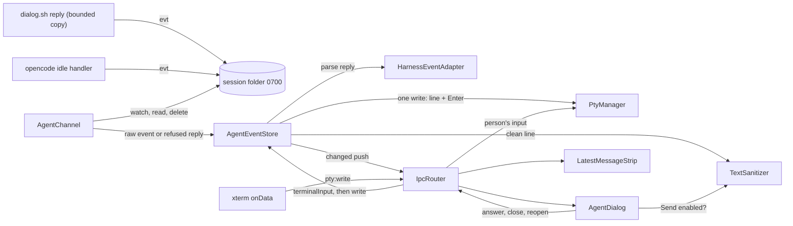

# Logical Components: u3-replies

## Sources

- `aidlc/spaces/default/intents/261114-agent-dialogs/construction/u3-replies/nfr-design/nfr-design-questions.md` (no questions; four settled points)
- `aidlc/spaces/default/intents/261114-agent-dialogs/construction/u3-replies/nfr-requirements/performance-requirements.md`
- `aidlc/spaces/default/intents/261114-agent-dialogs/construction/u3-replies/nfr-requirements/security-requirements.md`
- `aidlc/spaces/default/intents/261114-agent-dialogs/construction/u3-replies/nfr-requirements/scalability-requirements.md`
- `aidlc/spaces/default/intents/261114-agent-dialogs/construction/u3-replies/nfr-requirements/reliability-requirements.md`
- `aidlc/spaces/default/intents/261114-agent-dialogs/construction/u3-replies/nfr-requirements/observability-requirements.md`
- `aidlc/spaces/default/intents/261114-agent-dialogs/construction/u3-replies/nfr-requirements/tech-stack-decisions.md` (D7–D11)
- `aidlc/spaces/default/intents/261114-agent-dialogs/construction/u3-replies/nfr-requirements/reviews/review-01.md` (R-01 to R-04)
- `aidlc/spaces/default/intents/261114-agent-dialogs/construction/u3-replies/functional-design/functional-spec.md` ("What this Unit adds to u1", interfaces)
- `aidlc/spaces/default/intents/261114-agent-dialogs/inception/contract-design/contract-summary.md` (C1–C4, C6)
- `aidlc/spaces/default/intents/261114-agent-dialogs/construction/u1-questions/nfr-design/logical-components.md` (LC1–LC10, "Reuse by the later Units", C1 amendment)
- `aidlc/spaces/default/intents/261114-agent-dialogs/construction/u1-questions/nfr-design/reviews/review-01.md` (R-01, R-02, R-06)
- Existing code: `src/main/pty.js`, `src/main/ipc.js` (`'pty:write'`), `src/renderer/TerminalPanel.jsx` (`term.onData`), `src/renderer/ArtifactReader.jsx` (`FileContent`), `src/shared/`

## Purpose

The component-level view of where this Unit's NFR patterns apply. u3 adds to u1's components (u1 `logical-components.md`, LC1–LC10) and never replaces them, as u1's "Reuse by the later Units" row for u3 says: the `case` line gains `reply` among the non-waiting kinds, LC4 keeps the latest reply, and the typed path reuses LC5's guarded write. Two components are new (LC11, LC12). Element IDs in the last column are this Unit's design files (PD, SD, SCD, RD, OD) unless marked u1.

## Inventory

| ID | Component | Runs in | Code (new or changed) | u3 NFR patterns applied here | Failure domain | Blast radius |
|---|---|---|---|---|---|---|
| LC2 | AgentChannel | main | changed `src/main/agentChannel.js` | header check of an over-limit file through the open descriptor, `onRefusedReply` (RD11) | reply events not read | no reply pages; agents stop as usual and the person answers in the terminal |
| LC3 | HarnessEventAdapter | main, pure | changed `src/main/agentAdapters.js` | reply parse from the last-message field only (SD12), 64 KB cut after join (SCD7), refusal returned to the store (RD11) | one harness's replies refused | that harness's replies show nothing; older replies are moved on (RD11) |
| LC4 | AgentEventStore | main | changed `src/main/agentEvents.js` | answer check and one-step typed write (SD9, RD13), auto-response classifier (SD10), stale triggers and same-turn push (RD12, PD10), one open reply and one LatestMessage (SCD6, SCD8), duplicate drop (RD17), quiet paths (OD8) | every open reply and every LatestMessage | the dialog's reply pages and the strip; no agent is ever held, because a reply hook never waits |
| LC5 | PtyManager | main | unchanged `src/main/pty.js` | `writeSession` is the one write primitive; it is synchronous (RD13) | terminals | unchanged from today |
| LC6 | IpcRouter | main | changed `src/main/ipc.js` | `pty:write` calls `store.terminalInput` before `writeSession` (SD10); `agentEvents.latest` field list (SD12); `agentEvents.reopen`; answer shape check (SD9) | the C4 bridge members | the dialog and the strip |
| LC7 | TimingLog | main | unchanged | reply stamps (OD5) | nothing outside the log | none: off by default |
| LC8 | `dialog.sh` | the agent's hook process | changed `.thadeus/hooks/dialog.sh` | reply branch: bounded copy, publish, exit 0 (RD10, PD7, SCD10) | one Stop hook call | one reply not shown; the agent's stop is unchanged |
| LC9 | opencode plugin | the opencode server process | changed `thadeus-dialog.js` | idle handler not awaited, caught errors (RD15, PD12, OD7) | one idle event | one opencode reply not shown; opencode carries on |
| LC10 | AgentDialog | renderer | changed `src/renderer/AgentDialog.jsx` | M4 page, stale and not-shown lines, focus, keyboard, overdue title (PD11, PD13), sanitized Markdown (SD11), Send disabled through LC12 (SD8) | the dialog | no reply page; the strip and the terminal still work |
| LC11 | LatestMessageStrip | renderer | new `src/renderer/LatestMessageStrip.jsx` | inline sanitized Markdown through `FileContent` (SD11), text states (PD13) | the strip | the strip is empty; reply pages still open |
| LC12 | TextSanitizer | main and renderer | new `src/shared/agentText.js` | one unsafe-character set; `cleanLine`, `stripUnsafe`, `escapeUnsafe`, `utf8Bytes` (SD8) | text cleaning | typed answers refused (fail closed); shared with u2 and u5 |

LC1 (ChannelHeartbeat) is untouched: a reply hook never reads `alive` after its first check.

### Isolation strategy

- **The reply hook is outside the app and never waits.** LC8's only dependency on the app is the session folder. With the app gone, the hook exits at its first check (PD7). With the app present but stdin left open, the 2 s watchdog bounds it (RD10). Nothing the app does can make the agent's stop slower than that.
- **One write path into a pty for a reply.** Only LC4's `answerReply` writes a reply's answer, through LC5's `writeSession`, to the pty that `ptyOf` names, in one synchronous step (RD13). The renderer sends an event id and text only (SD9).
- **The person's input and the store's answer never cross.** The person's input reaches LC5 only through LC6's `pty:write`, which tells LC4 first (SD10). The store's typed answer never goes through `pty:write` (C2), so it never makes its own reply stale.
- **Trust boundary unchanged.** LC2 checks every reply file as any other (u1 SD3). An over-limit file is acted on only after its header passes the same checks (RD11).
- **One sanitizer.** LC12 is the single definition of unsafe characters for u2, u3 and u5, so the three Units cannot drift apart (SD8).

### Shared resources

| Resource | Owner | Shared with | Rule |
|---|---|---|---|
| a tab's pty | LC5 | LC6 (person's input), LC4 (typed answer) | both callers run on main's one thread; LC4's write is one synchronous call, so the two never interleave (RD13) |
| `src/shared/agentText.js` | LC12 (this Unit) | u2 adapter, u5 notifications, LC10 | changes to the unsafe set are made once, for all users; each user keeps its own tests |
| `<userData>/agent-channel/` | LC2 (u1) | LC8, LC9 | u1's rules; the reply branch writes only `events/` |
| the start-up clear | LC2 (u1 RD6) | every Unit | u3 relies on the resolution of u1 NFR Design review R-02 (single-instance lock or per-instance scope) |

## Files on disk (one reply)

```text
<userData>/agent-channel/<sessionId>/
  events/<epoch-s>-<pid>.tmp    written by dialog.sh reply (header, then stdin copied for at most 2 s)
  events/<epoch-s>-<pid>.evt    renamed by the hook, even when the copy was cut (RD10); read once and deleted by main
```

No `answers/` file is ever written for a reply.

## Contract additions (all additive, for Code Generation to apply to `contract-summary.md`)

| Contract | Addition | Why |
|---|---|---|
| C1 | none beyond u1's amendment (`reply: never waits`); the reply branch's 2 s copy bound is internal to the script | RD10 |
| C2 | `onRefusedReply: { subscriber: AgentEventStore, payload: { sessionId, reason } }`, fired only for an over-limit file whose header is authentic; IpcRouter's `pty:write` calls `AgentEventStore.terminalInput(ptyId, data)` before `writeSession` (the in-process signal the functional spec names) | RD11, SD10 |
| C3 | `state` gains `dismissed` and `stale` (as the functional spec says); optional `staleReason: "movedOn" \| "sessionEnded" \| "notShown"`; `message.empty: boolean` | RD11, RD12 |
| C4 | `agentEvents.latest` returns `{ tabId, harness, text, arrivedAt, status, eventId, truncated, empty }`, `status` is `"waiting" \| "answered" \| "sessionEnded" \| "notShown"`; `agentEvents.reopen: { in: { eventId }, out: { state: "shown" }, errors: ["unknown event", "event not open"] }` | RD11, SD12, PD11 |
| C6 | the Stop entry as the functional spec writes it, `timeout 10` | PD7 |

## Component diagram

<!-- Text fallback: Claude Code's Stop hook runs dialog.sh reply, which copies stdin with a 2 s bound into an event file in the session folder; the opencode plugin's idle handler writes the same kind of file. AgentChannel checks the file and passes it, or for an authentic over-limit file the refused-reply signal, to AgentEventStore, which parses it with HarnessEventAdapter. AgentEventStore pushes changes through IpcRouter to AgentDialog and LatestMessageStrip. The person's terminal input goes from the terminal through IpcRouter's pty:write, which tells AgentEventStore before it writes to PtyManager. A Send goes from AgentDialog through IpcRouter to AgentEventStore, which cleans the text with TextSanitizer and writes it with Enter to PtyManager in one step. -->



## Review findings carried

| Finding | Where it is resolved |
|---|---|
| u3 NFR review R-01 | reliability-design RD11, scalability-design SCD9 |
| u3 NFR review R-02 | security-design SD10 |
| u3 NFR review R-03 | security-design SD8 |
| u3 NFR review R-04 | reliability-design RD10 |
| u1 NFR Design review R-01 | reliability-design RD10 (no redirect on `:` or `exec`) |
| u1 NFR Design review R-02 | reliability-design RD16 (relies on its resolution) |
| u1 NFR Design review R-06 | reliability-design RD11 (the over-limit header is read through the `O_NOFOLLOW` descriptor) |
