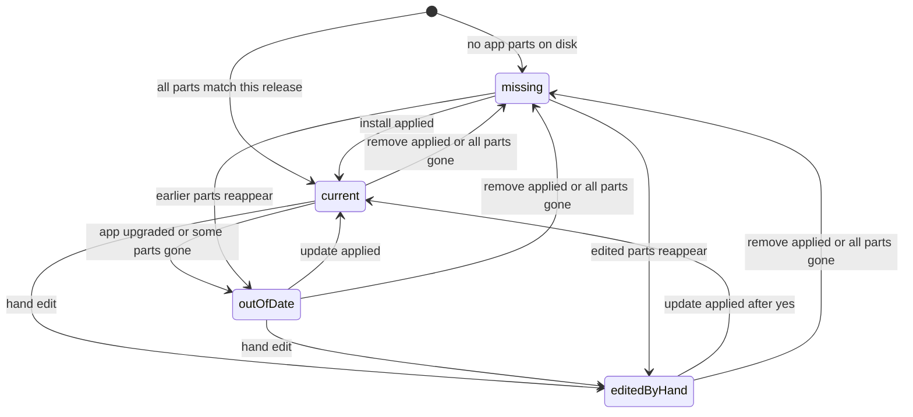
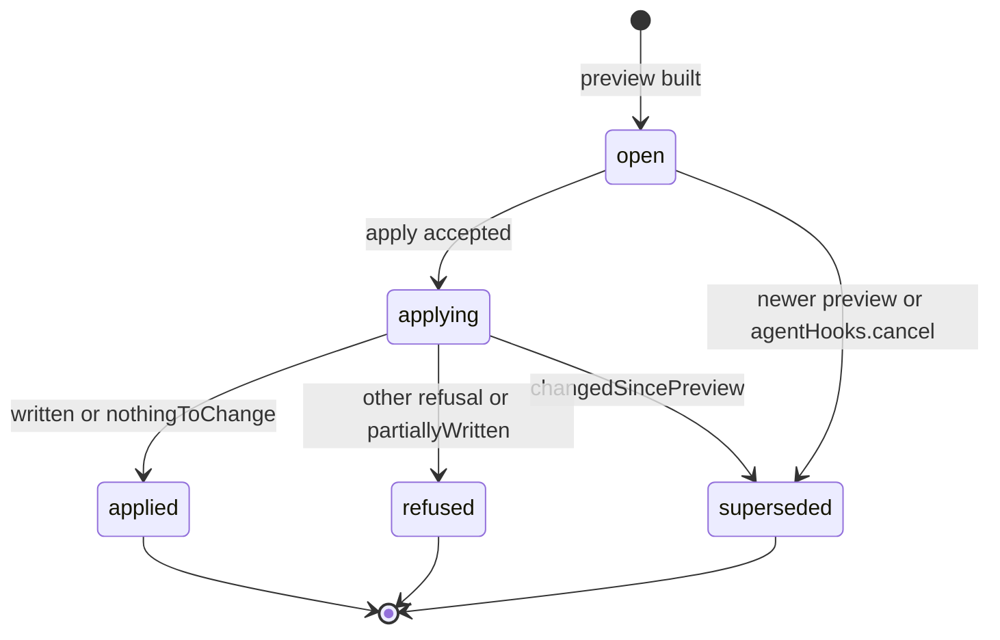
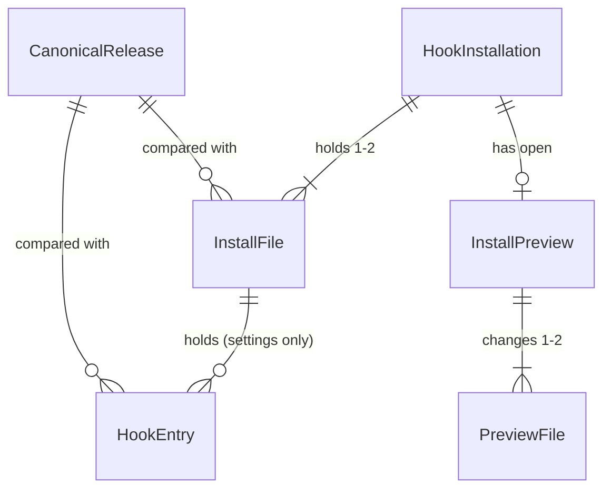

# Functional Specification: u4-install

## Sources

- Story: US4.1 in `aidlc/spaces/default/intents/261114-agent-dialogs/inception/user-stories/stories.md` (AC4.1.1–AC4.1.6). This Unit implements US4.1.
- Unit: `aidlc/spaces/default/intents/261114-agent-dialogs/inception/units-generation/unit-of-work.md` (U4), `aidlc/spaces/default/intents/261114-agent-dialogs/inception/units-generation/unit-of-work-story-map.md`.
- Requirements: `aidlc/spaces/default/intents/261114-agent-dialogs/inception/requirements-analysis/requirements.md` (FR4.1–FR4.7, NFR4).
- Components and decisions: `aidlc/spaces/default/intents/261114-agent-dialogs/inception/domain-design/components.md` (HookInstaller, AgentDialogsSetupUI), `aidlc/spaces/default/intents/261114-agent-dialogs/inception/domain-design/decisions.md` (ADR-004, ADR-005).
- Contracts: `aidlc/spaces/default/intents/261114-agent-dialogs/inception/contract-design/contract-summary.md` (C4 `agentHooks.*`, C5, C6).
- Mockups: `aidlc/spaces/default/intents/261114-agent-dialogs/inception/refined-mockups/mockups.md` (M7, M8).
- Integration points: `aidlc/spaces/default/intents/261114-agent-dialogs/construction/u1-questions/functional-design/functional-spec.md`, `aidlc/spaces/default/intents/261114-agent-dialogs/construction/u2-permissions/functional-design/functional-spec.md`, `aidlc/spaces/default/intents/261114-agent-dialogs/construction/u3-replies/functional-design/functional-spec.md` (the hook entries and plugin events installed here); `aidlc/spaces/default/intents/261114-agent-dialogs/construction/u1-questions/functional-design/rules.md` (BR2.7).
- Existing code: `src/main/fileWrite.js` (temp file and rename, `isEngineOwned`), `src/main/projectAccess.js` (`resolveInRoot`, `readJsonSafe`), `src/main/harness.js` (`detectHarnesses`).
- This Unit's entities and rules: `entities.md`, `rules.md` (BR7.1–BR7.20).
- Answers: `functional-design-questions.md` Q1 `[Q1]` (A: a hand edit is shown and replaced only after the person's yes).

## What this Unit fixes that earlier stages left open

| Open point | Fixed here |
|---|---|
| Script name (C6, FR4.6) | `.thadeus/hooks/dialog.sh`, committed, run through `sh` (BR7.2) |
| opencode plugin path (C6, FR4.7) | `.opencode/plugins/thadeus-dialog.ts`, plugin API V2, loaded from the folder with no config entry (BR7.3). C6's provisional `thadeus-dialog.js` and M8's `.opencode/plugin/` placeholder are replaced by this path |
| How the app's entries are marked (requirements Open questions) | By their command only (ADR-004, BR7.1) |
| What Update does with a hand edit (Refined Mockups review R-05) | Shown as "edited by hand" and replaced only through the preview `[Q1]` (BR7.8) |
| Tabs started before an install (ADR-005 consequence) | Keep the fallback until restarted (BR7.18) |

## The exact entry set per harness

### Claude Code: `.claude/settings.json` plus `.thadeus/hooks/dialog.sh`

| Kind | Hook event | Matcher | Timeout (s) | Waits? | From |
|---|---|---|---|---|---|
| `question` | `PreToolUse` | `AskUserQuestion` | 600 | yes, up to `waitSeconds` 595 | u1 W1 |
| `answered` | `PostToolUse` | `AskUserQuestion` | 10 | no | u1 W1 step 7 |
| `permission` | `PermissionRequest` | `*` (every tool) | 600 | yes, up to 595 | u2 W1 |
| `reply` | `Stop` | none | 10 | no | u3 W1 |

Each kind is its own group under its event, holding one hook of type `command`. The command, with `<kind>` as the only difference:

```text
[ -n "$THADEUS_SESSION_DIR" ] && [ -f "$CLAUDE_PROJECT_DIR/.thadeus/hooks/dialog.sh" ] && sh "$CLAUDE_PROJECT_DIR/.thadeus/hooks/dialog.sh" <kind>; exit 0
```

One entry as written into the file (illustrative):

```json
"PreToolUse": [
  { "matcher": "AskUserQuestion",
    "hooks": [ { "type": "command", "timeout": 600,
      "command": "[ -n \"$THADEUS_SESSION_DIR\" ] && [ -f \"$CLAUDE_PROJECT_DIR/.thadeus/hooks/dialog.sh\" ] && sh \"$CLAUDE_PROJECT_DIR/.thadeus/hooks/dialog.sh\" question; exit 0" } ] }
]
```

`PostToolUseFailure` is not installed: u1's entry set closes a failed question through a newer event or the tab's exit (u1 W1, BR2.3 there).

### opencode: `.opencode/plugins/thadeus-dialog.ts`

| Plugin event | Becomes C1 kind | From |
|---|---|---|
| `form.created` | `question` (waits) | u1 W1b |
| `form.replied`, `form.cancelled` | `answered` | u1 W1b |
| `permission.asked` | `permission` (waits) | u2 W1b |
| `permission.replied` | `answered` | u2 W1b |
| `session.status` with `type: "idle"`, top-level session | `reply` | u3 W2 |

The plugin's setup reads `THADEUS_SESSION_DIR` first; without it, it registers nothing and returns (BR7.3). There is no settings entry for opencode: the folder is the registration.

## Workflows

### W1 Status when a project opens (AC4.1.2, AC4.1.6)

1. The project view opens. HookInstaller reads the three paths through the root-confined reader (BR7.13).
2. It classifies each app entry and each file (BR7.4, BR7.6), derives the settings file's and each harness's status (BR7.5), and marks a harness used from `detectHarnesses` markers or an agent tab of it in this run (BR7.15).
3. AgentEventStore gets `isCurrent` per harness (C5) for its source choice (BR7.18). The renderer gets `agentHooks.status`.
4. For each used harness that is not current, the M7 strip shows with Install (missing) or Update (out of date, edited by hand). Its tabs use today's audit-log questions and screen-read answers, unchanged (u1 BR2.7).
5. Project settings > Agent dialogs lists each file with its status in words (BR7.20).

### W2 Install for Claude Code (AC4.1.1, AC4.1.2, AC4.1.5)

1. Dev clicks Install. The renderer calls `agentHooks.preview(projectId, "claude", "install")`.
2. HookInstaller reads both files, records each `baseDigest`, and builds `nextContent`:
   - `.thadeus/hooks/dialog.sh`: the current release's script; change create (or modify when it differs).
   - `.claude/settings.json`: the old text with the missing canonical groups spliced in (BR7.10), or a new file with only the app's entries when it is absent (BR7.11).
3. It returns `{ previewId, files: [{ path, summary, diff }] }`; `nextContent` stays in main. M8 shows each file, "These files are committed and shared with your team.", "Teammates without the app are not affected." and the diffs (BR7.7). Focus is on Cancel.
4. Cancel closes the dialog; nothing is written, and the preview is dropped.
5. Dev clicks Install. The renderer calls `agentHooks.apply(projectId, previewId)` (BR7.9).
6. HookInstaller reads both files again and compares digests (BR7.14), then writes the script, then the settings file, each atomically (BR7.16).
7. It recomputes the status (BR7.17). The dialog closes with "Agent dialogs installed. Restart running Claude Code tabs to use them." (BR7.18). The M7 strip goes away.

### W3 Install for opencode (AC4.1.1, AC4.1.5)

As W2 with one file: `.opencode/plugins/thadeus-dialog.ts`, created together with its folder when needed. opencode loads it from the folder at its next start; the result line names opencode.

### W4 Update, including a hand edit (AC4.1.2, `[Q1]`)

1. The harness is outOfDate or editedByHand. Dev clicks Update (strip or Project settings); the preview action is `update`.
2. For each app entry: a current one stays untouched; an outOfDate or editedByHand one is replaced in place by the canonical hook, or removed and a canonical group appended when its group's matcher or event is wrong; extra app hooks of a kind are removed (BR7.6); missing kinds are appended. Script and plugin are replaced whole.
3. Every file section that replaces a hand edit says "edited by hand, will be replaced by the app's version" and shows the edited lines as `-` and the app's as `+` (BR7.8).
4. Apply follows W2 steps 5–7. Without Dev's yes, the hand edit stays and the harness stays on the fallback.

### W5 Remove (AC4.1.2)

1. Dev clicks Remove in Project settings; the preview action is `remove`. The title reads "Remove agent dialogs from this project" and the diff holds only `-` lines.
2. Claude Code: every app hook leaves `.claude/settings.json`, with the groups, event arrays and `hooks` object this emptied; `.thadeus/hooks/dialog.sh` is deleted, then the empty folders. opencode: the plugin file is deleted (BR7.19).
3. Apply re-reads and writes as in W2, settings before the script (BR7.16). The harness's tabs go to the fallback at once (BR7.18), and the M7 strip returns for a used harness.

### W6 Changed since the preview (AC4.1.5)

1. While M8 is open, AI-DLC (or a teammate's pull) rewrites `.claude/settings.json`.
2. Dev clicks Install. The re-read digest differs from `baseDigest` (BR7.14). Nothing is written; the preview becomes superseded.
3. The dialog stays open, says ".claude/settings.json changed since this preview. Look at the new preview.", and shows a new preview built from the file as it is now. Dev decides again.

### W7 A file that cannot be used (AC4.1.5)

| Condition | What Dev sees | Written |
|---|---|---|
| `.claude/settings.json` missing | Preview shows it as a new file with only the app's entries (BR7.11) | after yes |
| Not valid JSON | "Nothing was written: .claude/settings.json is not valid JSON." No apply button; status missing with that reason (BR7.12) | nothing |
| `hooks` or an event value has an unexpected type | "Nothing was written: .claude/settings.json has hooks in a shape the app does not change." (BR7.12) | nothing |
| Cannot read or write (permission, read-only, disk full) | "Nothing was written: <file> cannot be written (<cause>)." (BR7.12) | nothing |
| A path resolves outside the project root (symlink) | "Nothing was written: <file> points outside the project." (BR7.13) | nothing |
| A link at any part of the three paths, also inside the root (U4 amendment, SD30) | "Nothing was written: <file> cannot be written (is a link)." No action offered | nothing |
| The script was written, then the settings file failed | "<file> was not written (<cause>). Update to finish." Status outOfDate (BR7.16) | the script only |
| Stale or reused previewId (double click, old dialog) | Refused; the open dialog refreshes its preview (BR7.9) | nothing |

The plugin file follows the same rows that apply to a whole file. In every refused case the fallback stays (FR4.5).

### W8 A checkout without the app, or a session the app did not start (AC4.1.3, AC4.1.4)

1. Tea's checkout carries the entries; Tea has no app, or deleted `.thadeus/`. Or Dev runs `claude` or `opencode` in a terminal outside the app, or CI does.
2. Claude Code fires a hook. `THADEUS_SESSION_DIR` is unset (only the app's agent tabs get it), so the first test fails and `exit 0` runs: no output, no process started, well under 100 ms (BR7.2). With the variable set but the script gone, the second test fails the same way.
3. opencode loads the plugin; without the variable its setup registers nothing (BR7.3).
4. The agent carries on exactly as without the entries: no context added, nothing blocked.

### W9 Source choice follows the status (AC4.1.6)

1. A tab spawns; the store records whether its harness was current for the project then (BR7.18).
2. A status change (W1, W2–W5, or a file changed on disk, BR7.17) is pushed to the store. Tabs whose harness is no longer current move to the fallback at once; tabs started before an install stay on the fallback until restarted.

## State machine: HookInstallation status (per project and harness)

<!-- Text fallback: missing to current when an install is applied. current to outOfDate when the app is upgraded to a release with other canonical content, or some app parts disappear (for example AI-DLC rewrote the settings file without some entries, or the script was deleted). current to editedByHand when someone edits an app part by hand. outOfDate and editedByHand to current when an update is applied. outOfDate to editedByHand on a hand edit. current, outOfDate and editedByHand to missing when a remove is applied or every app part disappears from disk. missing to outOfDate or editedByHand when app parts reappear in an earlier or edited form (for example a pull). Only current gives isCurrent true; every other state keeps the fallback and the M7 strip for a used harness. -->



| From | Event | Guard | To | Action |
|---|---|---|---|---|
| missing | install applied | BR7.9, BR7.14 pass | current | tell store; strip hidden; restart line (BR7.18) |
| current | app upgraded, or a file or entry disappears | detected by BR7.17 | outOfDate | tell store; tabs to fallback; strip with Update |
| current, outOfDate | an app part differs from every release | BR7.4 | editedByHand | as above |
| outOfDate, editedByHand | update applied | BR7.9, BR7.14 pass; for a hand edit, the preview showed it replaced (BR7.8) | current | as install |
| any but missing | remove applied, or every part gone | — | missing | tabs to fallback; strip with Install for a used harness |
| missing | app parts appear from outside | BR7.4 | outOfDate or editedByHand | strip with Update |

Every transition is computed from disk (BR7.17); the app never sets a status directly.

## State machine: InstallPreview

U4 amendment (RD40, SD31): `applying` sits between `open` and the final states, and Cancel calls `agentHooks.cancel`, which ends the preview in main.

<!-- Text fallback: open when built. open to applying when apply is accepted. applying to applied when every file was written or nothing needed changing. applying to superseded when a file changed since the preview; a new open preview is built. applying to refused for any other refusal or a partial write. open to superseded when a newer preview for the same project and harness is built, or Cancel calls agentHooks.cancel. applied, refused and superseded are final; a refused or superseded preview can never be applied. -->



## Apply (illustrative)

```text
apply(projectId, previewId):
  p = previews.get(previewId); refuse previewUnknown unless p.state == open and p.project == projectId   # BR7.9
  lock(projectId)                                                                                        # one apply at a time
  for f in p.files: refuse changedSincePreview(f.path) if digest(read(f.path)) != f.baseDigest           # BR7.14
  for f in writeOrder(p):                                     # script before settings; reversed for remove (BR7.16)
    resolveInRoot(f.path)                                     # BR7.13
    writeAtomic(f) or return partiallyWritten(f.path, cause)  # temp file, rename; old file intact on failure
  p.state = applied; recomputeStatus(projectId)               # BR7.17, tells the store (BR7.18)
```

## Entity relationships (derived from entities.md)

<!-- Text fallback: a HookInstallation holds one or two InstallFiles and has at most one open InstallPreview. A settings InstallFile holds the app's HookEntries. An InstallPreview holds one or two PreviewFiles. A CanonicalRelease defines the expected content each InstallFile and HookEntry is compared with. -->



## Rules summary (derived from rules.md)

| Rule | In short |
|---|---|
| BR7.1 | App entry = command runs `.thadeus/hooks/dialog.sh` with a known kind (U4 amendment) |
| BR7.2 | Claude Code: four guarded entries and the script |
| BR7.3 | opencode: one plugin file, idle outside app sessions |
| BR7.4 | current / outOfDate / editedByHand / missing per entry and file |
| BR7.5 | Settings and harness status derived; isCurrent only when all current |
| BR7.6 | One app entry per kind; extras are hand edits |
| BR7.7 | Preview names every file, committed and shared, with diffs |
| BR7.8 | Hand edits replaced only through the preview `[Q1]` |
| BR7.9 | Nothing written without yes; a preview applies once |
| BR7.10 | Splice only the app's spans; other bytes unchanged |
| BR7.11 | Missing settings file created with only the app's entries |
| BR7.12 | Unreadable, invalid or unwritable: nothing written, one sentence |
| BR7.13 | Three fixed paths inside the root, separate from the editor |
| BR7.14 | Re-read before writing; changed since preview writes nothing |
| BR7.15 | Fallback notice per used harness, Install or Update |
| BR7.16 | Atomic writes; safe order across files |
| BR7.17 | Status from disk on open, after apply, on file change |
| BR7.18 | Hook events only for tabs started while current |
| BR7.19 | Remove takes out only the app's parts |
| BR7.20 | Texts in sv and en; statuses in words |

## Interfaces used and added

- **C4:** `agentHooks.status`, `agentHooks.preview`, `agentHooks.apply` as the contract defines. Additive: `apply` may also refuse with "points outside the project", "has hooks in a shape the app does not change" and "unknown preview", and may return a partial-write sentence; `status` entries may carry `reason`. New push `agent-hooks:changed` with the same payload as `status`, sent on every status change (BR7.17).
- **C5:** `isCurrent(projectRoot, harness)` replaces u1's development switch in AgentEventStore, with the per-tab spawn-time check (BR7.18).
- **C6:** the entry set and files above. The script content and the plugin are built by u1–u3; this Unit installs the release's copies and owns their paths.

## Known limits

- **A command edited so it no longer names `.thadeus/hooks/`** is not the app's (ADR-004). That kind shows as missing and Install adds a second entry beside the edited one; the preview shows it.
- **Teammates on different app releases.** A file written by a newer app release is unknown to an older one and shows as edited by hand; the older app's Update preview shows the newer lines being replaced, so the downgrade is visible before anyone says yes.
- **Two files are not written as one transaction.** The write order (BR7.16) keeps the partial state harmless and visible as out of date; a true two-file transaction is not built.
- **Hook settings are read when a session starts** in both harnesses, so an install reaches running tabs only after they restart (BR7.18).
- **Three cases do not round-trip exactly after Install then Remove** (U4 amendment, RD37): an empty `"hooks": {}` or empty event array is gone with its separator; a settings file the app created stays as `{}` and a line end; an empty `.thadeus/` or `.thadeus/hooks/` that existed before is gone.
- **Duplicate hooks from other settings files:** the deduplication result is recorded by the RD44 manual run, with the Claude Code version, in the release pull request.
- **The plugin path** `.opencode/plugins/thadeus-dialog.ts` in this file reads `.opencode/plugins/thadeus-dialog.js` (tech-stack D4).
