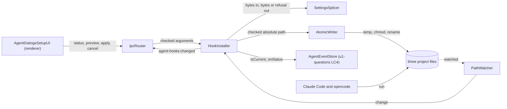

# Logical Components: u4-install

## Sources

- `aidlc/spaces/default/intents/261114-agent-dialogs/construction/u4-install/nfr-design/nfr-design-questions.md` (no questions; the ownership rule and the refuse-on-doubt rule)
- `aidlc/spaces/default/intents/261114-agent-dialogs/construction/u4-install/nfr-requirements/performance-requirements.md`
- `aidlc/spaces/default/intents/261114-agent-dialogs/construction/u4-install/nfr-requirements/security-requirements.md`
- `aidlc/spaces/default/intents/261114-agent-dialogs/construction/u4-install/nfr-requirements/scalability-requirements.md`
- `aidlc/spaces/default/intents/261114-agent-dialogs/construction/u4-install/nfr-requirements/reliability-requirements.md`
- `aidlc/spaces/default/intents/261114-agent-dialogs/construction/u4-install/nfr-requirements/observability-requirements.md`
- `aidlc/spaces/default/intents/261114-agent-dialogs/construction/u4-install/nfr-requirements/tech-stack-decisions.md` (D1–D7)
- `aidlc/spaces/default/intents/261114-agent-dialogs/construction/u4-install/nfr-requirements/reviews/review-01.md` (R-01 to R-08)
- `aidlc/spaces/default/intents/261114-agent-dialogs/construction/u4-install/functional-design/functional-spec.md`
- `aidlc/spaces/default/intents/261114-agent-dialogs/inception/contract-design/contract-summary.md` (C4, C5, C6)
- `aidlc/spaces/default/intents/261114-agent-dialogs/construction/u1-questions/nfr-design/logical-components.md` (LC1–LC10, file layout, reuse table, C1 amendment)
- `aidlc/spaces/default/intents/261114-agent-dialogs/construction/u1-questions/nfr-design/reviews/review-01.md` (R-01, the dash redirect)
- Existing code: `src/main/fileWrite.js`, `src/main/projectAccess.js`, `src/main/ipc.js`, `src/main/watcher.js`, `src/main/harness.js`, `src/shared/harnesses.js`

## Purpose

This file is the component-level view of where this Unit's NFR patterns apply. u4 adds a HookInstaller and its setup screens to the base u1-questions built. It changes two existing modules a little (`fileWrite.js`, `watcher.js`) and wires four IPC members. The last section holds the amendments to C4, C6 and this Unit's own functional design that Code Generation applies.

## Inventory

| ID | Component | Runs in | Code (new or changed) | NFR patterns applied here | Failure domain | Blast radius |
|---|---|---|---|---|---|---|
| LC30 | HookInstaller | main process | new `src/main/agentHooks.js` | `isCurrent` from memory (PD30), path check (SD30), previews and `applying` (SD31), the ownership rule and splice post-check (SD34), fixed content (SD35), write order and compares (RD34, RD35), outcome table and apply chain (RD40), logging (OD30, OD31) | status, preview and apply for every open project | the setup screens; every harness stays on the fallback (u1 BR2.7), so agents work as before |
| LC31 | SettingsSplicer | main process, pure | inside `src/main/agentHooks.js` (scanner, splice, diff, post-check) | duplicate and escaped keys refused, BOM and UTF-8 kept (SD34), diff from splices (SCD30), deterministic appends (RD36), exact removal (RD37) | the Claude Code settings edit | Claude Code only; any doubt is a refusal, never a damaged file |
| LC32 | AtomicWriter | main process | changed `src/main/fileWrite.js`: `writeAtomic` taken out of `writeFileSafe` | temp file, `chmod`, final compare, rename (RD33) | one file write | the one file; the old bytes stay |
| LC33 | PathWatcher | main process | changed `src/main/watcher.js`: `isFile` also accepts `.sh` and `.js` | one watcher per project over the three paths (PD32, SCD31) | status updates after a change on disk | status catches up at the next open or apply |
| LC34 | IpcRouter additions | main process | changed `src/main/ipc.js` and the preload bridge | exact argument lists (SD32), watcher in `closeWatcher` (SCD31), open without waiting (PD31) | the four `agentHooks` members | the setup screens |
| LC35 | AgentDialogsSetupUI | renderer | new M7 strip, M8 preview dialog, Project settings section | keyboard safety (PD34), words not colours (PD35), `t()` keys (PD36), busy state (PD33), no action for an unusable file (RD39) | the setup screens | the person cannot install from the app; nothing else changes |
| LC8, LC9 (u1-questions) | `dialog.sh`, opencode plugin | the agent's processes | unchanged; u4 installs their bundled bytes | bytes equal the tested ones, the `:` redirect tripwire (RD31) | as u1-questions | as u1-questions |
| LC4 (u1-questions) | AgentEventStore | main process | changed: the development switch is replaced by `isCurrent` and `onStatus` (C5) | spawn-time source choice (RD42) | as u1-questions | as u1-questions |

### Isolation strategy

- **The installer writes only through LC32, and only after LC30's path check.** `writeAtomic` is not reachable from IPC (SD36), and the editor's `writeFileSafe` keeps its own engine-owned check in front of the same helper.
- **The settings edit is pure (LC31).** It takes bytes and returns bytes or a refusal. It is fully testable without a disk, and a bug in it can only refuse.
- **Applies of one project are serialised** (RD40). The watcher's recompute waits for them, so a half-finished apply is never published as a status.
- **The agents never depend on the installer.** A harness that is not `current` uses the fallback (u1 BR2.7), and the installed commands are guarded (RD30). A failure anywhere in LC30–LC35 costs the person the dialog's hook path, never a session.

### Shared resources

| Resource | Owner | Shared with | Rule |
|---|---|---|---|
| `.claude/settings.json` | the team and AI-DLC | LC30 writes the app's spans only | splice plus post-check (SD34); final compare before rename (RD35) |
| `.thadeus/hooks/dialog.sh`, `.opencode/plugins/thadeus-dialog.js` | LC30 (the app's own files) | the agents read and run them; teammates commit them | replaced whole, only through a preview; links refused (SD30) |
| `.thadeus/`, `.thadeus/hooks/`, `.opencode/plugins/` | the project | other files a teammate puts there | created only when missing; removed only with a non-recursive `rmdir` (RD37) |
| `writeAtomic` | LC32 | `writeFileSafe` (editor), LC30 | caller checks the path first (SD36) |
| `chokidar` via `watchFiles` | `src/main/watcher.js` | LC33 adds one watcher per project | closed in `closeWatcher` (SCD31) |

## Files on disk (one project, after Install)

```text
<root>/.claude/settings.json                  the team's file; the app's four groups appended (SD34, RD36)
<root>/.claude/.settings.json.<uuid>.tmp      only for the moment of a write; left only by a hard crash (RD33)
<root>/.thadeus/hooks/dialog.sh               0644 when new, LF, no BOM; bytes from the bundle (RD31, RD33)
<root>/.opencode/plugins/thadeus-dialog.js    0644 when new; bytes from the bundle
```

## Component diagram

<!-- Text fallback: AgentDialogsSetupUI calls the four agentHooks members through IpcRouter. IpcRouter checks the arguments and calls HookInstaller. HookInstaller checks paths, reads the three files, uses SettingsSplicer to build and check the settings edit, and writes through AtomicWriter. PathWatcher tells HookInstaller when a watched file changes; HookInstaller then recomputes status, pushes agent-hooks:changed through IpcRouter and tells AgentEventStore through isCurrent and onStatus. The agents run dialog.sh and the plugin that HookInstaller wrote. -->



## Amendments for Code Generation

Code Generation applies these in the first Bolt step that touches each file. They carry SD30, SD31, SD34 and RD37, and resolve review findings R-01, R-04 and R-05.

**Contract C6** (`aidlc/spaces/default/intents/261114-agent-dialogs/inception/contract-design/contract-summary.md`):

- Replace `recognised_as_the_apps` with: `"the command runs exactly .thadeus/hooks/dialog.sh with one of the kinds question, answered, permission, reply (one fixed rule, NFR5.30); any other command, also another script in .thadeus/hooks/, is not the app's"`.
- Set `committed_files` to `.thadeus/hooks/dialog.sh` and `.opencode/plugins/thadeus-dialog.js`, and remove the provisional comments.

**Contract C4** (same file):

- Add `agentHooks.cancel: { in: { projectId: string, previewId: string }, out: "void", unit: U4 }`.
- Add to the `agentHooks.apply` errors: `"unknown preview"`, `"points outside the project"`, `"is a link"`, `"has hooks in a shape the app does not change"`, `"is not plain JSON"` (replacing `"not valid JSON: <file>"`), and the partial-write sentence.
- State next to the YAML: `preview` takes exactly `projectId`, `harness`, `action`; `apply` and `cancel` take exactly `projectId`, `previewId`, and never a harness or action.

**This Unit's functional design** (`aidlc/spaces/default/intents/261114-agent-dialogs/construction/u4-install/functional-design/`):

- BR7.1 and the rules summary: the ownership rule above.
- The InstallPreview state machine: add `applying` (RD40), and Cancel calls `agentHooks.cancel`.
- W7: a link at any part of the three paths refuses ("is a link"), also inside the root (SD30).
- Known limits: the three non-round-trip cases (RD37); the deduplication result from RD44.
- The `.ts` plugin name is already superseded by tech-stack D4.

**This Unit's NFR requirements:** NFR3.25's first clause ("written through") reads "refused as a link", and its test changes to match (SD30). NFR5.30's `unknown` results read "not the app's" (SD34).

**u1-questions:** the `: > "$a.wait"` line in u1 RD4 must be fixed (u1 design review R-01) before this Unit's RD31 tripwire runs.
