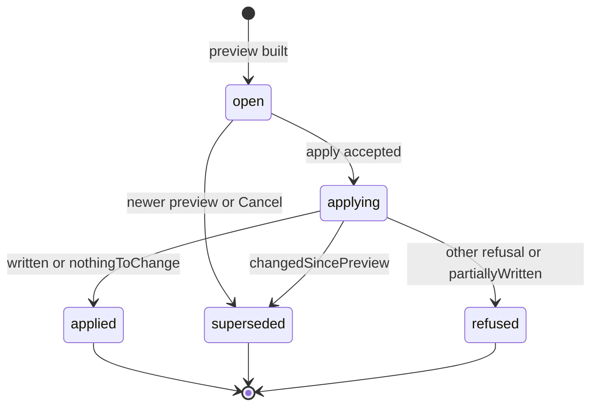

# Reliability Design: u4-install

## Sources

- `aidlc/spaces/default/intents/261114-agent-dialogs/construction/u4-install/nfr-design/nfr-design-questions.md` (no questions; the ownership rule and the refuse-on-doubt rule)
- `aidlc/spaces/default/intents/261114-agent-dialogs/construction/u4-install/nfr-requirements/reliability-requirements.md` (NFR4.9–NFR4.11, NFR5.25–NFR5.35, accepted limits, recovery)
- `aidlc/spaces/default/intents/261114-agent-dialogs/construction/u4-install/nfr-requirements/security-requirements.md` (NFR3.28)
- `aidlc/spaces/default/intents/261114-agent-dialogs/construction/u4-install/nfr-requirements/tech-stack-decisions.md` (D1, D2, D3, D7 with NFR8.8 and NFR8.9)
- `aidlc/spaces/default/intents/261114-agent-dialogs/construction/u4-install/nfr-requirements/reviews/review-01.md` (R-01, R-03, R-05, R-07, R-08)
- `aidlc/spaces/default/intents/261114-agent-dialogs/construction/u4-install/functional-design/functional-spec.md` (entry set, W2–W9, both state machines, apply sketch, Known limits)
- `aidlc/spaces/default/intents/261114-agent-dialogs/inception/contract-design/contract-summary.md` (C4 `agentHooks.apply`, C5, C6)
- `aidlc/spaces/default/intents/261114-agent-dialogs/construction/u1-questions/nfr-design/logical-components.md` (LC8 `dialog.sh`, LC9 plugin, LC4 AgentEventStore, the C1 amendment)
- `aidlc/spaces/default/intents/261114-agent-dialogs/construction/u1-questions/nfr-design/reviews/review-01.md` (R-01: no redirect on `:` in the script, because dash exits on it)
- Existing code: `src/main/fileWrite.js` (`writeFileSafe` temp file and rename), `src/main/watcher.js` (`watchFiles`), `src/main/ipc.js` (`project:open`, `project:close`)

## Approach

Two promises from the requirements: the project is never damaged, and the app's hooks never harm a session. Every file is either exactly as it was or exactly as the preview showed, at every moment a reader can see it. When the app cannot prove that, it writes nothing and says why.

## No harm when the app is absent

### RD30 The guard as written into the file, with every variable missing

- **Satisfies:** NFR4.9; resolves review R-08.
- **Design:** nothing to build beyond SD35 (the C6 strings, filled only with the kind). The test reads the commands back from the file a real Install wrote, so it proves what lands on disk, not the constant.
- **Test:** main test after a real Install into a temporary project. For each of the 4 commands, run `sh -c "$command"` 20 times in each case, and again under `dash` where it is installed (it is on `ubuntu-latest`):
  1. `CLAUDE_PROJECT_DIR` set, `THADEUS_SESSION_DIR` unset;
  2. both set, `.thadeus/hooks/dialog.sh` deleted;
  3. `THADEUS_SESSION_DIR` set, `CLAUDE_PROJECT_DIR` unset;
  4. `THADEUS_SESSION_DIR` set, `CLAUDE_PROJECT_DIR` set to the empty string.
  
  In cases 3 and 4 the path becomes `/.thadeus/hooks/dialog.sh`, and the `-f` test fails. Every run: exit 0, 0 bytes on stdout and stderr, ≤ 100 ms.
- **On purpose:** the trailing `exit 0` also hides a failing script. That is the design: a broken script must never break the agent. u1-questions owns the script's own logging (u1 RD4), and a file at `/.thadeus/hooks/dialog.sh` on the filesystem root is out of scope.

### RD31 Installed bytes are the tested bytes

- **Satisfies:** NFR4.10; carries u1 NFR4.1–NFR4.3 to the installed copies.
- **Design:** D2. `dialog.sh` and `thadeus-dialog.js` are `?raw` imports, the same imports the u1–u3 script and plugin tests load. Their sha256 is taken when the module loads and is the current CanonicalRelease's `scriptDigest` and `pluginDigest`.
- **Script trap from u1-questions' design review (R-01):** a failed redirect on the special builtin `:` makes dash exit before `|| exit 0` runs. u4 installs whatever u1 ships, so u4 adds a tripwire: a source test over the bundled `dialog.sh` fails on any `:` with a redirect (`/(^|[;&|{(]|then|do|else)\s*:\s*[0-9]*>/m`). u1-questions' `reliability-design.md` RD4 still shows `: > "$a.wait"`, so that fix must land before this Unit's Code Generation, or this test fails on purpose.
- **Test:** after Install, the sha256 of the written `dialog.sh` and `thadeus-dialog.js` equal those of the `?raw` imports; the source test above; a test that the current release's digests appear in the CanonicalRelease table (D2).

### RD32 A teammate keeps a working Claude Code

- **Satisfies:** NFR4.11.
- **Design:** carried by SD34 (only the app's spans change, and the result is checked) and RD30 (the guard).
- **Test:** fixture test with a copy of this repository's `.claude/settings.json`, which holds AI-DLC's hooks. After Install the file parses, and `prune(stripApp(...))` deep-equals the original. The manual part runs in RD44.

## Safe writes

### RD33 `writeAtomic`: temp file, kept mode, final compare, rename

- **Satisfies:** NFR5.25, NFR5.34, and the per-file order of NFR5.27; resolves review R-03 and the mode half of R-07.
- **Design:** D1's shared helper in `fileWrite.js`:

```js
// US-0506 BR7.16. ponytail: no fsync before rename (as the editor); add it if a real loss case appears
export async function writeAtomic(abs, bytes, { mode, expect } = {}) {
  const tmp = path.join(path.dirname(abs), `.${path.basename(abs)}.${randomUUID()}.tmp`);
  try {
    await fs.writeFile(tmp, bytes, { flag: 'wx' });
    if (mode !== undefined) await fs.chmod(tmp, mode); // chmod is not masked by the umask
    if (expect) await expect(); // last read and compare; throws when the target changed
    await fs.rename(tmp, abs);
  } catch (err) {
    await fs.rm(tmp, { force: true }).catch((e) => console.error(`[agent-hooks] could not remove ${path.basename(tmp)}:`, e.code));
    throw err;
  }
}
```

  - **Per-file order:** path check (SD30), create missing folders, temp write, `chmod`, last read and compare (`expect`), rename. The compare comes after the slow steps, so only the final read and one turn of the event loop sit between it and the rename.
  - **Modes:** a modified file gets `chmod(tmp, oldMode & 0o7777)`, so `0664`, `0600` and `0755` come back exactly. A new file gets no `mode`, which gives `0o666 & ~umask` (`0644` under umask `022`). Missing folders are created with `fs.mkdir(dir, { recursive: true })`, which creates only the missing ones, with `0o777 & ~umask` (`0755` under `022`). No execute bit is added; `dialog.sh` is run through `sh`.
  - **Failed folder create:** the folders this apply created are removed again with a non-recursive `rmdir`, deepest first, with errors ignored.
  - `writeFileSafe` calls `writeAtomic(abs, next, { mode: stat.mode & 0o7777 })` after its own hash check. The editor therefore also keeps modes exactly, which is a small fix to today's `writeFile(…, { mode })`.
- **Test:** inject `ENOSPC` at the temp write, `EACCES` at the rename and `EROFS` at the folder create. In each case the target's sha256 equals its pre-apply digest (or the file is still absent), no `*.tmp` is left in the folder, and no folder created by this apply is left. A reader loop over 50 applies sees only the old or the new digest. Mode test: files set to `0600`, `0664` and `0755` keep their mode after Update; a new file and new folders have `0o666 & ~u` and `0o777 & ~u`, with `u` read once from `process.umask()`. `dialog.sh` has no `\r` and no BOM.

### RD34 Write order, and a harmless partial state

- **Satisfies:** NFR5.26.
- **Design:** `writeOrder(preview)`:
  - Claude Code install and update: `dialog.sh` (folders first), then `.claude/settings.json`;
  - Claude Code remove: `.claude/settings.json`, then `dialog.sh` deleted, then `rmdir` of `.thadeus/hooks` and `.thadeus` (ENOTEMPTY ignored);
  - opencode: the plugin file only, then `rmdir .opencode/plugins` on remove.
  
  A failure on the first file is a plain refusal: nothing was written. A failure on a later file returns `partiallyWritten` naming that file and its cause in one sentence (PD36). The status is then recomputed: after a failed install it is `outOfDate`, and Update is offered. Entries are never on disk without the script because of the app. A teammate's pull can do it, and the guard covers that (RD30).
- **Test:** inject a settings rename failure on install (the script stays, the result is `partiallyWritten` naming `.claude/settings.json`, the status is `outOfDate`). Inject a script unlink failure on remove (the settings file is already without entries, the result is `partiallyWritten` naming `.thadeus/hooks/dialog.sh`, and Remove is offered again).

### RD35 Nothing written over a change made after the preview

- **Satisfies:** NFR5.27, FR4.7; resolves review R-03.
- **Design:** two compares per file.
  1. **Early exit:** when apply starts, every file of the preview is read once and its digest compared with `baseDigest` (`null` for an absent file). Any difference: nothing is written, and the result is `refused: changedSincePreview` naming the file, with a new preview built from disk (W6, RD40).
  2. **Final compare** inside `writeAtomic`'s `expect` (or just before `unlink` for a delete): read the target again (`lstat` for "still absent"), compare, and return. The rename is the next call.
  
  When the final compare fails on the first file written, the temp file is removed, and the result is the same as step 1. When it fails on a later file, the result is `partiallyWritten` with cause `changedSincePreview`, and a new preview is built.
- **The window:** between the final read and the rename there is no other I/O and no other `await`. The 50 ms of NFR5.27 is a CI tolerance. The test that matters checks the order of calls, not the time.
- **Test:** for each file: change it, create it and delete it between preview and apply; 0 bytes written, the file named, a new preview returned. An order test with an `fs` wrapper shows, per file, `readFile(target)` (or `lstat`) directly followed by `rename` (or `unlink`), with no other `fs` call between them. A timing test on the 1 MB fixture records ≤ 50 ms between those two calls, as a tolerance.

### RD36 Install is idempotent and deterministic

- **Satisfies:** NFR5.28.
- **Design:** the spliced text has no time, id or path in it. Missing groups are appended at the end of their event array. Missing event keys are appended at the end of `hooks` in the fixed order `PreToolUse`, `PostToolUse`, `PermissionRequest`, `Stop`. A missing `hooks` is appended as the last top-level member. A preview whose files all have change `none` shows no apply button (BR7.7), and applying it anyway gives `nothingToChange` and writes nothing.
- **Test:** over the RD43 set: Install, then a new Install preview lists every file as `none`; Install on two identical copies of a fixture gives sha256-equal files; Update over an `outOfDate` fixture gives the same bytes as a fresh Install on the same fixture without the old entries.

### RD37 Remove, and the exact round trip

- **Satisfies:** NFR5.29; resolves review R-01 (the Remove rule) and the round-trip half of R-07.
- **Design:** Remove deletes every hook that `appKind` claims (SD34), then the containers that this removal emptied: the group, the event array, the `hooks` member. Each deletion takes the text from the end of the element before it (or from the opening bracket, for the first element) to the end of the removed element, so it removes exactly what an append inserted, separator included. Commands that `appKind` does not claim stay, also when they live under `.thadeus/hooks/`. The settings file is never deleted. Folders go only through a non-recursive `rmdir`, so a folder holding anything else stays.
- **Exact round trip:** when nobody changed the file between Install and Remove, the file is byte-identical to its pre-install bytes for every fixture except these three known cases:

| Case | What is left after Install, then Remove | Why it is accepted |
|---|---|---|
| The file held `"hooks": {}` or an empty event array | that empty member is gone, with its separator | the app cannot tell an empty container it filled from one it created; removing it changes no hook |
| There was no `.claude/settings.json` | the file holds `{`, the line end, `}` and the line end (4 bytes with LF), and is not deleted | BR7.19 never deletes the settings file; an empty object changes nothing for Claude Code |
| `.thadeus/` or `.thadeus/hooks/` existed and was empty | the empty folder is gone | git does not track empty folders, so no teammate and no `git status` sees a difference |

- **Test:** round trip over the RD43 set, byte for byte, with the three cases asserted as above. After Remove, no command in the file is claimed by `appKind`. The fixture with a teammate's `sh .thadeus/hooks/other.sh question` keeps that entry and the file `other.sh` after Install, Update and Remove. A `.thadeus/` holding another file keeps it.

## Correct status and clear outcomes

### RD38 The kind is read by one rule

- **Satisfies:** NFR5.30, as amended by SD34.
- **Design:** `appKind` (SD34). A command that does not run `dialog.sh` with a known kind is not the app's (previously `unknown`). Status, Update and Remove all use this one function.
- **Test:** one table-driven test: the canonical command for each kind gives that kind; `dialog.sh question` unquoted gives `question`; `dialog.sh" question;exit 0` gives `question`; `dialog.sh" questionx; exit 0`, `dialog.sh"` with no argument, `.thadeus/hooks/other.sh question`, a command without `.thadeus/hooks/` and a non-string all give `null`.

### RD39 A file the app cannot use offers no action

- **Satisfies:** NFR5.31.
- **Design:** a file's status carries `reason` (`invalidJson`, `unexpectedShape`, `cannotRead`, `cannotWrite`, `outsideRoot`) while the harness status stays `missing` (C4 unchanged). The renderer shows the reason sentence and Details only, in M7 and in Project settings. In main, `agentHooks:preview` for a harness with a `reason` returns that refusal without building a preview, so a renderer bug cannot reach apply either. The watcher (PD32) clears the reason once the file is fixed.
- **Test:** renderer tests per reason: 0 Install, Update or Remove buttons, the sentence present, the harness on the fallback. Main test: fix the file on disk, and the status loses `reason` within 1.5 s. A preview call while the reason holds builds no preview.

### RD40 Each apply outcome leaves one preview state, and applies run one at a time

- **Satisfies:** NFR5.32; resolves review R-05 together with SD31.
- **Design:** the InstallPreview state machine gains `applying` between `open` and the final states. Final states are not stored: the preview leaves the map.

| ApplyResult | Preview becomes | In the map |
|---|---|---|
| `written` | applied | deleted |
| `nothingToChange` | applied | deleted |
| `refused: changedSincePreview` | superseded | deleted; a new `open` preview is added and returned (W6) |
| `refused: previewUnknown` | no change (no `open` preview matched) | unchanged |
| `refused` for `invalidJson`, `unexpectedShape`, `cannotRead`, `cannotWrite`, `outsideRoot` | refused | deleted |
| `partiallyWritten` | refused | deleted; the recomputed status offers Update or Remove |

  Applies of one project run one at a time on `p.hooksApply`, a promise chain: `const job = p.hooksApply.then(() => run(pv)); p.hooksApply = job.catch(() => {}); return job;`. `run` deletes the preview in a `finally`, so an unexpected throw can never leave a preview stuck in `applying`. An unexpected error becomes `refused: cannotWrite` with the error's code. The watcher's recompute also waits on this chain (PD32).

<!-- Text fallback: open goes to applying when apply is accepted. applying goes to applied when every file was written or nothing needed changing; to superseded when a file changed since the preview, and a new open preview is built; to refused for any other refusal or a partial write. open goes to superseded when a newer preview of the same harness is built or the person cancels. applied, superseded and refused are final, leave the map and can never be applied. -->



- **Test:** one unit test per table row; a test that no final state can be applied (each gives `previewUnknown`); a test that two applies of different harnesses on one project run one after the other (the second's first `fs` call comes after the first's last); a test where `run` throws and the preview is gone afterwards.

### RD41 The canonical entries match u1–u3

- **Satisfies:** NFR5.33; keeps u1 NFR5.2.
- **Design:** `CANONICAL` in `agentHooks.js` holds the four rows of the functional spec's entry set. The wait value is imported from the same constant main passes as `THADEUS_WAIT_SECONDS`, not copied.
- **Test:** unit test: `question` and `permission` timeout 600 ≥ that constant (595) + 5; `answered` and `reply` timeout 10; matchers `AskUserQuestion`, `AskUserQuestion`, `*` and none; events `PreToolUse`, `PostToolUse`, `PermissionRequest`, `Stop`.

### RD42 Status follows disk, and the source choice follows status

- **Satisfies:** NFR5.35.
- **Design:** status is never set, only computed from disk: on open, after every apply (inside the chain, before `run` returns) and after a watched change (PD32). Each computation updates the map (PD30) and calls `onStatus(root, harness, current)`, which AgentEventStore (u1-questions LC4) subscribes to. The store keeps its spawn-time capture per tab (BR7.18): a tab spawned while not current stays on the fallback until restarted; after Remove, every tab of that harness uses the fallback from its next event.
- **Test:** store tests with a fake installer: a tab spawned before Install stays on the fallback after Install; a tab spawned after Install uses hooks; Remove while a tab runs moves its next event to the fallback. After each apply and each change on disk, `isCurrent` equals the recomputed status.

## Verification

### RD43 The fixture suite

- **Satisfies:** NFR8.8.
- **Design:** the NFR8.8 fixture set runs on real temporary folders under the project's test temp folder. This design adds the fixtures its decisions need: a teammate hook in `.thadeus/hooks/other.sh` with its entry; a `dialog.sh questionx` entry; two top-level `hooks` keys; an escaped `"hooks"` key; an invalid UTF-8 byte in a non-app string; a JSONC file with a comment; a pre-existing empty `.thadeus/`; and the link cases of SD30. Each runs through status, Install, Install again, Update and Remove where they apply, and Install then Remove (RD37).
- **Test:** the suite in CI (`npx vitest run tests/`), green before merge; coverage ≥ 80% of new and changed lines (u1 NFR8.2).

### RD44 The manual run on the release Mac

- **Satisfies:** NFR8.9; carries the deduplication check of the accepted risk (`security-design.md`).
- **Design:** before the release pull request, in a project with AI-DLC installed: Install for Claude Code and for opencode; a new agent tab of each gets its next question through the hook (u1 W1); a plain `claude` in a terminal outside the app shows its own picker at once, and AI-DLC's hooks still write their ledger; `git diff` after Install shows only the app's lines. Then one added step: copy the `question` entry exactly into `.claude/settings.local.json`, ask one question in an app tab, and count one event file (the Claude Code version is recorded). Then Remove, and both harnesses are back on the fallback.
- **Test:** the run, recorded in the pull request with the Claude Code version and the deduplication result.

## Accepted limits

| Limit | Bound or recovery | Recorded where |
|---|---|---|
| Concurrent writer between the final compare and the rename (FD review R-04) | no other I/O in the window (RD35); the watcher recomputes right after, so a lost AI-DLC entry shows on AI-DLC's side and a lost app entry shows as `missing` or `outOfDate` here | RD35 |
| A folder swapped for a link between check and rename, by the same OS user | out of the threat model (u1-questions) | SD30 |
| Duplicate hooks from other Claude settings files | documented deduplication, checked in RD44 | `security-design.md` |
| No `fsync` before the rename | an empty file after a power loss shows as `missing` or with a reason (RD39) | `ponytail:` comment in `writeAtomic` (RD33) |
| A temp file left by a hard crash | named `.<name>.<uuid>.tmp` beside its target, for example `.claude/.settings.json.<uuid>.tmp`, so a person can recognise it; the app never deletes files it did not just write | RD33 |
| Two files are not one transaction | write order keeps the partial state harmless and visible (RD34) | RD34 |
| Three cases that do not round-trip exactly | listed with the bytes left | RD37 |

## Recovery

The recovery table of the reliability requirements holds as written. The design adds one row: when a file is found changed during apply, after another file was already written, the result is `partiallyWritten`, a new preview is shown, and the person decides again (RD35).

## u1 rows this Unit cites

| u1 row | How u4 keeps it |
|---|---|
| NFR4.1 (guard exits fast), NFR4.2 (missing folder or `alive`) | RD30 reruns the guard cases on the written commands; RD31 installs the bytes u1's tests ran |
| NFR4.3 (the plugin registers nothing without the variable) | RD31: the plugin bytes equal the tested ones |
| NFR5.2 (entry timeout above the script's wait) | RD41 imports the same constant |
