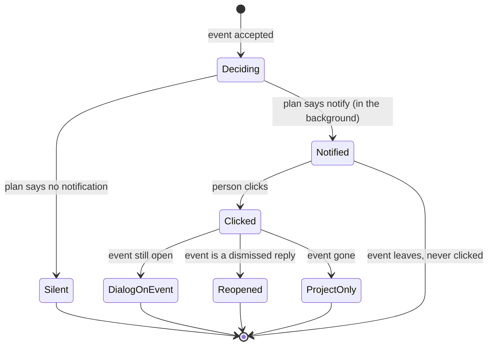
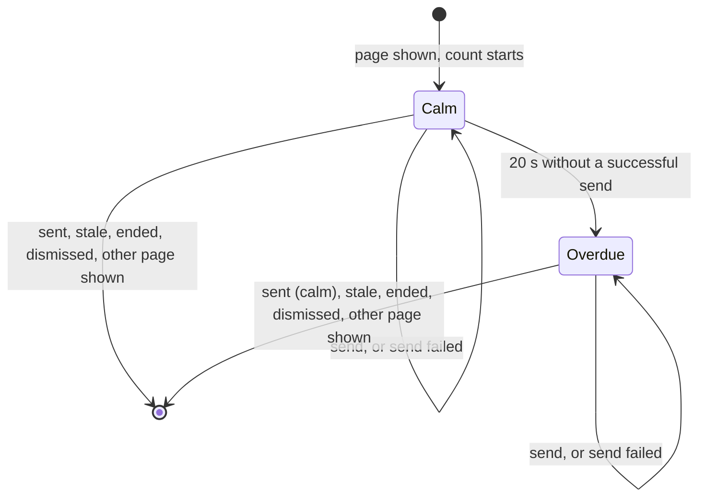

# Functional Specification: u5-notifications (US5.1)

## Sources

- Unit: `aidlc/spaces/default/intents/261114-agent-dialogs/inception/units-generation/unit-of-work.md` (U5) and `aidlc/spaces/default/intents/261114-agent-dialogs/inception/units-generation/unit-of-work-story-map.md` (U5 order, FR6.1 and NFR7 rows).
- Story: `aidlc/spaces/default/intents/261114-agent-dialogs/inception/user-stories/stories.md`, US5.1 with AC5.1.1–AC5.1.4.
- Requirements: `aidlc/spaces/default/intents/261114-agent-dialogs/inception/requirements-analysis/requirements.md` (FR2.7, FR5.1–FR5.3, FR6.1, NFR6, NFR7).
- Components: `aidlc/spaces/default/intents/261114-agent-dialogs/inception/domain-design/components.md` (Notifications, AgentEventStore, AgentDialog).
- Contracts: `aidlc/spaces/default/intents/261114-agent-dialogs/inception/contract-design/contract-summary.md` (C3 AgentEvent, C4 bridge and its ownership rules).
- Mockups: `aidlc/spaces/default/intents/261114-agent-dialogs/inception/refined-mockups/mockups.md` (M4, M9) and `aidlc/spaces/default/intents/261114-agent-dialogs/inception/refined-mockups/interaction-spec.md` (Notifications section, AgentDialog states).
- Integration points: `aidlc/spaces/default/intents/261114-agent-dialogs/construction/u1-questions/functional-design/functional-spec.md` and its `rules.md` (BR2.1, BR2.4, BR4.5, BR4.6); `aidlc/spaces/default/intents/261114-agent-dialogs/construction/u3-replies/functional-design/functional-spec.md` and its `rules.md` (BR6.9, BR6.14–BR6.17).
- Questions: `functional-design-questions.md` (no questions; records the reply escalation decided in u3).
- Existing code: `src/main/notify.js` (once per id, click restores the window, `questionAlerts` and `notificationSound` handling), `src/main/settings.js` (`QUESTION_ALERTS`, sanitising that leaves an invalid key out), `src/renderer/SettingsView.jsx` (Appearance section, `RadioBlocks`), `src/renderer/QuestionPopup.jsx` (`OVERDUE_MS = 20_000`, escalation per shown page).

This Unit implements **US5.1** from `stories.md`. It is a `ui` Unit: this file is self-contained and there is no `entities.md` or `rules.md`. The rules it relies on from other Units are named by their IDs (u1 BR…, u3 BR…); the decisions this Unit adds are numbered D1–D9 below.

## What changes

| Component | Change in this Unit |
|---|---|
| Settings Store (`settings.js`) | New key `replyAlerts`, sanitised like `questionAlerts` (D1) |
| Notifications (`notify.js`) | Notifies any AgentEvent kind once per event id, titled by kind (D3–D6); today's audit-question entry point goes through the same path |
| AgentEventStore | Calls Notifications once per newly accepted event (D5); puts a reply straight into `dismissed` when `replyAlerts` is `line` or `off` (D2) |
| AgentDialog | Calm then red after 20 s for every kind (D7); opens on the event a notification names (D6) |
| SettingsView | The M9 row "Messages from the agent" (see `frontend-components.md`) |
| Locale files | New keys in `sv.json` and `en.json` (D9) |

## D1 The setting and its sanitising

| | |
|---|---|
| Key | `replyAlerts` in the app's settings file (userData), beside `questionAlerts` |
| Values | `dialog-notify` ("Dialog and notification"), `line` ("Line only"), `off` ("Off") |
| Default | `dialog-notify`, applied where the key is read, exactly like `questionAlerts` (`popup-notify`) |
| Sanitising | A set `REPLY_ALERTS` of the three values. On every read and write the key is kept only when its value is in the set; a missing, unknown or wrong-typed value is left out, so the default applies. Never an error, never a crash |
| Saving | Through the existing `setSettings(partial)` queue, so a change never overwrites a concurrent one |
| Scope | App-wide, not per project, like `questionAlerts` |
| Effect | Applies to replies that arrive after the change. An open reply page stays open; nothing already decided is redone |

Questions and permission prompts keep `questionAlerts` (`popup-notify`, `popup`, `off`) and `notificationSound` (boolean, default on) unchanged (FR5.1, AC5.1.2 last clause).

## D2 Decision table per kind and setting

"In front" means the window exists, is focused, and shows the event's project. Anything else (window not focused, minimised, hidden, or showing another project) is "in the background" for FR5.3.

| Kind | Setting | Dialog opens on its own | Latest-message strip | System notification | Sound |
|---|---|---|---|---|---|
| question | `questionAlerts` = `popup-notify` | yes | — | only when in the background | `notificationSound` |
| question | `questionAlerts` = `popup` | yes | — | never | — |
| question | `questionAlerts` = `off` | no (reachable as today) | — | never | — |
| permission | same three rows as question | same | — | same | same |
| reply | `replyAlerts` = `dialog-notify` | yes (u3 BR6.9) | updated (u3 BR6.15) | only when in the background | `notificationSound` |
| reply | `replyAlerts` = `line` | no: the event is `dismissed` at once | updated; Answer reopens it (u3 BR6.14) | only when in the background | `notificationSound` |
| reply | `replyAlerts` = `off` | no: the event is `dismissed` at once | updated; Answer reopens it | never | — |

- `questionAlerts` never affects replies, and `replyAlerts` never affects questions or permission prompts (AC5.1.2).
- "Line only" and "Off" reuse u3's `dismissed` state rather than adding a new one: a dismissed reply is not in the pager, the strip shows it, and Answer calls `agentEvents.reopen` (u3 BR6.14). A newer event from the session or the tab's exit ends it as u3 already defines (BR6.5, BR6.7).
- The pager order is unchanged (u1 BR2.1, u3 BR6.8); this table only decides whether the dialog opens and whether a notification is shown.

The table is one pure function, used by AgentEventStore (state at arrival), Notifications (notify or not) and the renderer (open the dialog or not), so the three can never disagree:

```js
// Illustrative only. kind: 'question' | 'permission' | 'reply'
function alertPlan(kind, s, inFront) {
  const reply = kind === 'reply';
  const mode = reply ? (s.replyAlerts ?? 'dialog-notify') : (s.questionAlerts ?? 'popup-notify');
  const open = reply ? mode === 'dialog-notify' : mode !== 'off';
  const notifies = reply ? mode !== 'off' : mode === 'popup-notify';
  return { open, notify: notifies && !inFront, silent: s.notificationSound === false };
}
```

## D3 Notification text

| Kind | Title (`t()`, ICU) | Body |
|---|---|---|
| question | `app.notification.question`: "{harness} is waiting for you" | `app.notification.body`: "{project} · {text}" |
| permission | `app.notification.permission`: "{harness} asks for permission" | same body |
| reply | `app.notification.reply`: "Message from {harness}" | same body |

- `{harness}` is the harness's display name (Claude Code, opencode). `{project}` is the project's name.
- `{text}` is the first non-empty line, as plain text: for a question, the first question's text (a batch uses its first question); for a permission prompt, `what` and the first line of `detail`; for a reply, the message, or u3's line "<harness> finished its turn without a message." when it is empty (BR6.9). Markdown markers are dropped as in the strip (u3 BR6.16), whitespace runs become one space, and the line is cut at 120 visible characters with "…", never inside a character or emoji.
- Fallback (audit) events are questions with `source: "audit"` and follow the question row. The old title key `app.notification.title` is replaced by the kind keys.
- Texts are built when the notification is shown, in the app's current language (NFR7).

## D4 Once per event id

- Notifications keeps the set of event ids it has decided on for this app run. An id is added when the event arrives, whatever the decision, so it is never reconsidered.
- A reopened reply (u3 BR6.14), a page shown again after paging, escalation to red, a failed send that returns to `shown`, and a settings change are not new events: none of them notifies.
- Only events that arrived after the app started exist (u1 BR2.4), so a restart never re-notifies old events.
- Each event gets its own notification; several at once give several notifications (FR6.1). There is no cap.

## D5 Who calls, and when

AgentEventStore calls Notifications once, right after it accepts a new event (after the duplicate check u3 BR6.4 and the ordering), with the event and the context: the settings as last read, the window, the active project id and the project name. Notifications reads nothing else. A failure inside Notifications (unsupported platform, the system refusing the notification) is logged and never stops the event from being queued or pushed to the renderer.

## D6 Clicking a notification

1. The window is restored if minimised, shown and focused (as today).
2. Main pushes `agent-events:focus` with the event id (a new C4 push member added by this Unit, replacing `questions:focus`).
3. The renderer switches to the event's project.
4. If the event is still open in the pager, AgentDialog opens on that page.
5. If it is a dismissed reply (setting `line`, or closed by the person), the renderer calls `agentEvents.reopen` and the dialog opens on it with an empty answer field (u3 BR6.14).
6. If the event is gone (answered, ended, stale), the project is shown and nothing opens; for a reply, the strip still shows it.

A click after the window was closed does nothing.

## D7 Escalation timing, every kind

- Each shown page starts a count of 20 seconds (`OVERDUE_MS`, as US-0505). When it runs out without a send, the page switches from calm to the overdue style, and the title adds "still waiting" in words, so the state is never shown by colour alone (u1 BR4.5, NFR6).
- This holds for questions and batches (u1 BR4.6), permission prompts, and replies (u3 BR6.17).
- The count starts over when another page is shown (paging, or the page leaves and the next one shows) and when a dismissed reply is reopened. It is a timer from the moment of showing, not a wall-clock time, so a clock change cannot make it negative or skip it.
- A send does not stop the count: the page keeps its colour while `sending`, turns calm once `sent`, and a failed send goes back to `shown` without restarting the count, so an overdue page stays red (as `QuestionPopup` does today).
- A `timedOut` page (u1, hook time limit) keeps its count and colour; the person can still answer as keys.
- `stale`, `ended` and `dismissed` events never escalate. A reply set to "Line only" or "Off" never escalates until it is reopened.
- Escalation sends no second notification and no sound (D4).

**Difference from AC5.1.1.** AC5.1.1 says the dialog turns red for a question or permission prompt. u3-replies' Functional Design (Q1, BR6.17) later chose red after 20 s for replies too, as mockup M4 shows. This Unit follows that decision: every kind escalates. AC5.1.1's wording is superseded for replies; its clause about `questionAlerts` and the sound still applies to questions and permission prompts only. The story text in `stories.md` and the epic file should say "every kind" when the story's feature docs are updated.

## D8 Window state at the moment of arrival

The decision to notify is taken once, when the event arrives (D4). If the person switches away a second later, no notification follows; if they come back, an existing notification is not withdrawn. This keeps "at most one notification per event" simple and matches today's behaviour.

## D9 Texts

Every new text is a key in both `sv.json` and `en.json` through `t()` with ICU placeholders; `tests/main/i18nKeys.test.js` checks the keys match (NFR7, AC5.1.4).

| Key | en | sv |
|---|---|---|
| `settings.repliesLegend` | Messages from the agent | Meddelanden från agenten |
| `settings.replies.dialog-notify` | Dialog and notification | Dialog och notis |
| `settings.replies.line` | Line only | Bara raden |
| `settings.replies.off` | Off | Av |
| `settings.repliesHelp` | When the agent finishes its turn. Questions and permission prompts follow the setting above. | När agenten är klar med sin tur. Frågor och behörighetsfrågor följer inställningen ovan. |
| `settings.alertsLegend` (changed text) | Questions and permission prompts | Frågor och behörighetsfrågor |
| `settings.alertsHelp` (changed text) | A dialog when an agent or AI-DLC waits for your answer, and a system notification when the app is in the background or showing another project. | En dialog när en agent eller AI-DLC väntar på ditt svar, och en systemnotis när appen ligger i bakgrunden eller visar ett annat projekt. |
| `app.notification.question` | {harness} is waiting for you | {harness} väntar på dig |
| `app.notification.permission` | {harness} asks for permission | {harness} ber om lov |
| `app.notification.reply` | Message from {harness} | Meddelande från {harness} |
| `app.notification.body` | {project} · {text} | {project} · {text} |
| `agentDialog.stillWaiting` | Still waiting: {title} | Väntar fortfarande: {title} |

The two changed `alerts` texts keep their keys; they change because the setting now covers the agents' own questions and permission prompts, not only AI-DLC's.

## Workflows

### W1 A question arrives while Dev works in another app

1. A question event for project A is accepted by AgentEventStore (u1).
2. The store calls Notifications with the event and the context (D5). `questionAlerts` is `popup-notify`; the window is not focused, so `alertPlan` says notify (D2).
3. Notifications records the id (D4) and shows "Claude Code is waiting for you", body "aidlc-dash · Which file should I edit?", silent if `notificationSound` is off.
4. The renderer opens AgentDialog on its own (`open` is true). The page is calm; after 20 s without a send it turns red with "Still waiting: …" (D7).
5. Dev clicks the notification. The window comes forward on project A with the dialog on that question (D6).

### W2 A reply with "Dialog and notification", app in front on another project

1. A reply for project B arrives while Dev looks at project A in the focused window: "in the background" for B (D2).
2. The store queues the reply (u3) and calls Notifications: "Message from opencode", body "B · Done. All 353 tests pass."
3. The dialog opens on its own on the reply page (u3 BR6.9); 20 s later it turns red if not answered or closed.
4. Clicking the notification switches to project B with the dialog on that reply.

### W3 A reply with "Line only"

1. A reply arrives. `alertPlan` says `open: false`, so the store accepts it straight as `dismissed`, and the project's strip shows it with Answer (u3 BR6.15, BR6.16).
2. If the window is in the background, one notification "Message from Claude Code" is shown.
3. Dev clicks Answer in the strip, or the notification: `agentEvents.reopen` shows the reply in the dialog with an empty answer field; its 20 s count starts now (D6, D7).

### W4 A reply with "Off"

1. As W3 step 1: dismissed at once, the strip updates.
2. No notification, no sound, no dialog. Answer in the strip still opens it.

### W5 A permission prompt with "Popup only"

1. The dialog opens on the amber page; no notification, whatever the window state (D2).
2. 20 s later the page turns red (D7).

### W6 Dev changes the reply setting

1. In Settings > Appearance, Dev picks "Line only" in "Messages from the agent".
2. SettingsView saves `{ replyAlerts: 'line' }` through the existing settings call; on a failed save it shows "Could not save" as the other rows do, and the radio stays on the saved value.
3. Main uses the new value for the next reply. An open reply page stays open.

## State machines

### Alert of one event (Notifications, decided once)

<!-- Text fallback: an event arrives and its alert is decided once. If the plan says notify, it becomes Notified, otherwise Silent. A notified event can be clicked: if the event is still open the dialog opens on it, if it is a dismissed reply it is reopened, otherwise only the project is shown. Silent and unclicked notifications end with the event. -->



| From | Trigger | To | Effect |
|---|---|---|---|
| — | event accepted | Deciding | id recorded once (D4) |
| Deciding | `alertPlan.notify` false | Silent | nothing shown |
| Deciding | `alertPlan.notify` true | Notified | one system notification, silent per `notificationSound` |
| Notified | click | Clicked | window restored, shown, focused; `agent-events:focus` pushed |
| Clicked | event open | DialogOnEvent | project shown, dialog on that page |
| Clicked | dismissed reply | Reopened | `agentEvents.reopen`, dialog on it |
| Clicked | event gone | ProjectOnly | project shown, nothing opens |

### Escalation of one shown page (AgentDialog)

<!-- Text fallback: a page shown starts Calm and its 20 s count. After 20 s without a successful send it becomes Overdue. Sending and a failed send keep the colour the page has. A sent answer makes it Calm and ends it. Stale, ended, dismissed or showing another page ends it from either state; showing a page or reopening a reply starts Calm again. -->



| From | Trigger | To | What Dev sees |
|---|---|---|---|
| — | page shown or reply reopened | Calm | kind-coloured header (steel, amber, steel-deep) |
| Calm | 20 s, no successful send | Overdue | red header and edges, title "Still waiting: …" |
| Calm, Overdue | Send, or send failed | same | colour kept; "Sending to <harness>…" or the cause line (u1) |
| Calm, Overdue | sent | end | calm, "Sent to <harness>." |
| either | stale, ended, dismissed, another page | end | the next page starts its own count |

## Corners swept (corner checklist)

Deployment shape: single-user desktop app, local settings file, one window.

| Condition | Settled as |
|---|---|
| Settings file missing, unreadable, or without the new key (first run, upgrade from v0.2.x) | Defaults apply: `dialog-notify`, `popup-notify`, sound on (D1) |
| Invalid or hand-edited value | Left out by sanitising; default applies (D1) |
| Notifications unsupported or refused by the system | Skipped and logged; the dialog and strip still work (D5) |
| Same event delivered twice | One event (u3 BR6.4) and one notification (D4) |
| Reopen, paging, red, failed send | No second notification (D4) |
| App restart | Old events do not exist (u1 BR2.4); nothing re-notified |
| Many events at once | One notification each, no cap (D4); `ponytail:` comment at the code if a cap is ever needed |
| Very long text, emoji, combining marks | Cut at 120 visible characters with "…" (D3) |
| Markup or control characters in the agent's text | Shown as plain text in the notification; Markdown markers dropped (D3) |
| Empty reply | u3's "finished its turn without a message" line (D3) |
| Click after the event left | Project shown, nothing opens (D6) |
| Click after the window closed | Nothing (D6) |
| Language changed between arrival and display | Text built at show time (D3) |
| Clock changes during the 20 s | Timer from showing, not wall clock (D7) |
| Setting changed while a reply is open | Next reply only (D1) |
| Status by colour alone | "Still waiting" in the title (D7) |
| Agent text visible on a locked screen | Follows the operating system's notification preview setting; the app adds nothing. Assumption: acceptable for a single-user local tool |

## Rules from other Units this Unit relies on

| ID | Unit | Used for |
|---|---|---|
| BR2.1 | u1 | pager order unchanged |
| BR2.4 | u1 | only events after app start |
| BR4.5 | u1 | state named in words, keyboard |
| BR4.6 | u1 | calm then red for questions, `questionAlerts` and sound as US-0505 |
| BR6.4 | u3 | duplicate reply check before notifying |
| BR6.9 | u3 | a reply opens the dialog (the default row) |
| BR6.14 | u3 | dismissed and reopen, used by "Line only", "Off" and the notification click |
| BR6.15, BR6.16 | u3 | the strip updates for every reply setting |
| BR6.17 | u3 | replies turn red after 20 s |

## Contract additions

- **C4:** one push member `agentEvents.focus` (`agent-events:focus`, payload `{ eventId }`), added under C4's additive rule. It replaces the old `questions:focus` channel, whose only sender was `notify.js`.
- **C3:** unchanged. Notifications reads `eventId`, `kind`, `harness`, `projectId`, `questions`, `permission`, `message`.

## Story acceptance criteria

| AC | Where |
|---|---|
| AC5.1.1 | D7 (every kind, the recorded difference), D2 question and permission rows |
| AC5.1.2 | D1, D2 reply rows, W3, W4 |
| AC5.1.3 | D2 "in the background", D4, D6, W1, W2 |
| AC5.1.4 | D9 |
