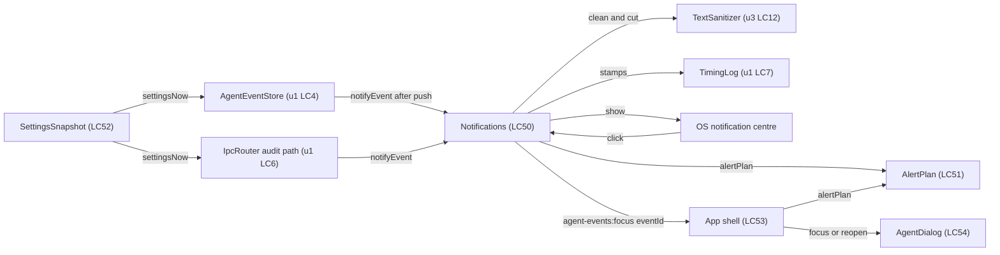

# Logical Components: u5-notifications

## Sources

- `aidlc/spaces/default/intents/261114-agent-dialogs/construction/u5-notifications/nfr-design/nfr-design-questions.md` (Q1 B, Q2 A)
- `aidlc/spaces/default/intents/261114-agent-dialogs/construction/u5-notifications/nfr-requirements/performance-requirements.md`
- `aidlc/spaces/default/intents/261114-agent-dialogs/construction/u5-notifications/nfr-requirements/security-requirements.md`
- `aidlc/spaces/default/intents/261114-agent-dialogs/construction/u5-notifications/nfr-requirements/tech-stack-decisions.md` (D50–D54)
- `aidlc/spaces/default/intents/261114-agent-dialogs/construction/u5-notifications/nfr-requirements/reviews/review-01.md` (R-01–R-07)
- `aidlc/spaces/default/intents/261114-agent-dialogs/construction/u5-notifications/functional-design/functional-spec.md` (D1–D9, W2)
- `aidlc/spaces/default/intents/261114-agent-dialogs/construction/u5-notifications/functional-design/frontend-components.md`
- `aidlc/spaces/default/intents/261114-agent-dialogs/inception/contract-design/contract-summary.md` (C3, C4 and the ownership rules)
- `aidlc/spaces/default/intents/261114-agent-dialogs/construction/u1-questions/nfr-design/logical-components.md` (LC1–LC10, "Reuse by the later Units")
- `aidlc/spaces/default/intents/261114-agent-dialogs/construction/u1-questions/nfr-design/observability-design.md` (OD1 stamps)
- `aidlc/spaces/default/intents/261114-agent-dialogs/construction/u2-permissions/nfr-design/security-design.md` (SD9 `visibleText`) and `logical-components.md` (LC3 row)
- `aidlc/spaces/default/intents/261114-agent-dialogs/construction/u3-replies/nfr-design/security-design.md` (SD8) and `logical-components.md` (LC12)
- Existing code: `src/main/notify.js`, `src/main/ipc.js`, `src/main/settings.js`, `src/preload/index.js`, `src/renderer/App.jsx`, `src/shared/` (`harnesses.js`, `i18n.js`)

## Purpose

The component-level view of where this Unit's NFR patterns apply. u5 adds to u1's components and never replaces them (u1 "Reuse by the later Units", u5 row). Element IDs in the last columns are this Unit's `performance-design.md` (PD) and `security-design.md` (SD) unless marked with another Unit.

## Inventory

| ID | Component | Runs in | Code (new or changed) | NFR patterns applied here | Failure domain | Blast radius |
|---|---|---|---|---|---|---|
| LC50 | Notifications | main | changed `src/main/notify.js`: `notifyEvent(event, ctx)`, `notificationText`, the decided set, the click handler | same-turn decision and failure isolation (PD50), bounded decided set and audit path (PD51), bounded text (PD52), stamps (PD53), field allowlist (SD52), focus push (SD53), no actions (SD54), Linux escaping (SD56) | system notifications | no notification is shown; the event is still queued, pushed and shown in the dialog (NFR5.50) |
| LC51 | AlertPlan | main and renderer, pure | new `src/shared/alertPlan.js` (D54) | one decision table for the store, Notifications and the shell (PD50, PD61) | alert decisions | all three consumers read the same answer, so a fault shows in all of them and in one test table |
| LC52 | SettingsSnapshot | main | changed `src/main/settings.js`: `settingsNow()` and the copy it returns; `REPLY_ALERTS` | synchronous settings for notifying (PD50, PD51), sanitising (SD55) | the copy main notifies with | until the first read the defaults apply, as on a missing file |
| u3 LC12 | TextSanitizer | main and renderer, pure | new `src/shared/agentText.js` (settled below) | one unsafe-character class and the text functions (SD50, SD51) | text cleaning | every Unit that shows agent text; each keeps its own tests |
| LC53 | App shell focus and marker | renderer | changed `src/renderer/App.jsx` | payload check (SD53), click routing (PD55), arrival rule (PD56), reachable marker (PD57) | opening from a click or the marker | clicks open nothing; the dialog, the strip and the terminal still work |
| LC54 | AgentDialog escalation | renderer | changed `src/renderer/AgentDialog.jsx` (u1 LC10) | one relative timer for every kind (PD54), overdue for every reader (PD58), drafts per `eventId` (PD55) | the overdue style | a page stays calm; it is still answerable |
| LC55 | SettingsView M9 row | renderer | changed `src/renderer/SettingsView.jsx` | keyboard and saved-value radios (PD59) | the reply setting row | the setting keeps its saved value |

### Isolation strategy

- **Notifications is a leaf.** u1 LC4 calls it after the event is queued and pushed, and the call is wrapped (PD50). Nothing in LC4 reads a result from it, so a fault in LC50 cannot change the event's state, order or delivery.
- **The renderer gets one id.** The click carries only `{ eventId }`; LC53 acts only on events it already holds (SD53).
- **No new process, file or listener.** LC50 runs in main's turn; the timing stamps reuse u1 LC7, which is off by default.

### Shared resources

| Resource | Owner | Shared with | Rule |
|---|---|---|---|
| `src/shared/agentText.js` | u3 LC12 (defined); this file settles the exports | u1 LC10, u2 LC3, u3, u5 LC50 | one module, no copy anywhere; changes to the class are made once, for all users |
| `src/shared/alertPlan.js` | LC51 | u1 LC4, LC50, LC53 | pure, no imports |
| main's settings copy | LC52 | LC50, the audit path in `src/main/ipc.js` | replaced by every `getSettings` read and every `setSettings` resolve |
| u1 LC7 TimingLog | u1 | LC50 adds `notificationShown`, `notificationClicked` | main-side stamps only; no renderer member |

## The one shared sanitizer

This settles u3 SD8 / LC12, u2 SD9 and u3 review R-01 and R-07 for the whole intent: **one module, `src/shared/agentText.js`**, imported by main and renderer. No other file in the intent holds its own pattern for unsafe characters.

| Export | What it does | ZWJ (U+200D) | Used by |
|---|---|---|---|
| `UNSAFE` | non-global pattern for `.test()`: the class below, except ZWJ | not matched | callers that only need to know |
| `cleanLine(s)` | CR, LF, TAB, U+2028, U+2029 become a space; every other class character is removed | kept | u3 typed answers; u1 own answers typed as keys |
| `stripUnsafe(s)` | `cleanLine`, then whitespace runs become one space, trimmed | kept | u5 notification text and project name |
| `visibleText(s, { multiline })` | every class character is shown as `\uXXXX` (or `\u{…}`); with `multiline: true`, LF and TAB stay | escaped | u2 permission fields and log excerpts; u1 question header and option labels; replaces u3's `escapeUnsafe`, which is `visibleText(s, { multiline: true })` |
| `plainLine(s)` | Markdown markers dropped as the strip does (u3 BR6.16), link to its label | unchanged | u5 notification text; u3 strip `title` attribute |
| `firstLine(s)` | the first line that is neither empty nor only a code fence | unchanged | u5, u3 strip |
| `cutGraphemes(s, n)` | at most `n` grapheme clusters plus "…", one module-level `Intl.Segmenter` | inside its grapheme | u5 `{text}` (120) and `{project}` (40) |
| `utf8Bytes(s)` | UTF-8 length | — | u3 64 KB answer bound |

**The class:** `\p{Cc}` (C0, DEL, C1), `\p{Cf}` (bidi embeddings, overrides, isolates and marks including LRM U+200E, RLM U+200F and U+061C; zero-width U+200B, U+200C, U+200D, U+2060–U+2064; BOM U+FEFF; soft hyphen U+00AD), `\p{Cs}` (a lone surrogate), U+2028 and U+2029, and the tag block U+E0000–U+E007F.

```js
// src/shared/agentText.js (illustrative): no exported pattern carries the g flag
const SET = String.raw`\p{Cc}\p{Cf}\p{Cs}

\u{E0000}-\u{E007F}`;
const ZWJ = '‍';
export const UNSAFE = new RegExp(`(?!${ZWJ})[${SET}]`, 'u');
const every = () => new RegExp(`[${SET}]`, 'gu'); // fresh per call, used only inside replace
export const cleanLine = (s) => s.replace(/[\r\n\t

]/gu, ' ').replace(every(), (c) => (c === ZWJ ? c : ''));
export const stripUnsafe = (s) => cleanLine(s).replace(/\s+/gu, ' ').trim();
```

`visibleText` keeps the escape form of u2 SD9 and uses `every()`. The **known cost** stays as u3 SD8 records it: emoji tag-sequence flags lose their tags (`ponytail:` comment in the module).

**Tested by:** one test file for the module: per range (U+0000, U+001B, U+007F, U+0085, U+009F, U+00AD, U+061C, U+200B, U+200C, U+200D, U+200E, U+200F, U+202A, U+202E, U+2028, U+2029, U+2060, U+2066, U+2069, U+FEFF, U+E0001, U+E0041, U+E007F, lone U+D800), the result of each function; `UNSAFE.test` called twice in a row on the same string gives the same answer (no `lastIndex` carry-over); `UNSAFE.flags` has no `g`; 👩‍💻 and `åäö` unchanged by `cleanLine` and `stripUnsafe`. Each user keeps its own tests of how it uses the module.

## Amendments for Code Generation

Applied by whichever Unit's Code Generation reaches the file first; each later Unit checks it is done.

1. **C4 row first (u5 step 1).** In `aidlc/spaces/default/intents/261114-agent-dialogs/inception/contract-design/contract-summary.md`, add to the C4 YAML block `agentEvents.focus: { push: "agent-events:focus", payload: { eventId: string }, unit: U5 }`, and in the Contracts table change C4's Owner to "U1; U3, U4 and U5 add members". Only after this step are `questions:focus` (in `src/main/notify.js`) and `onQuestionFocus` (in `src/preload/index.js` and `src/renderer/App.jsx`) removed (SD53).
2. **One sanitizer module.** `src/shared/agentText.js` is created with the exports above. In u2, `visibleText` is imported from it and is not defined in `src/main/agentAdapters.js`. In u3, `escapeUnsafe` is not created; its callers use `visibleText(s, { multiline: true })`. No exported pattern has the `g` flag.
3. **u1 header and option labels.** u1 LC10 shows a question's `header` and each option `label` and `description` through `visibleText` (one line). u1's Markdown body keeps u1 SD6.
4. **Timing stamps.** u1 OD1's stamp list gains `notificationShown` and `notificationClicked`, written by main only (PD53).
5. **Settings snapshot.** `src/main/settings.js` gains `settingsNow()`; `refreshQuestions` in `src/main/ipc.js` uses it in place of `await getSettings()` and calls `notifyEvent` per fresh audit question (PD51).
6. **Event id length.** One store test that every id u1 LC4 mints, hook and audit, is at most 64 characters (SD53).
7. **NFR3.53 superseded.** The person answered Q1 with B: a permission notification shows `what` and the first line of `detail` (D3 as approved). Code Generation builds SD52, not the `what`-only body of NFR3.53. D3, the D9 keys and `stories.md` need no change for this.
8. **W2 wording.** Functional Design W2 step 3: "The dialog opens on its own over project A, on the reply page, which names project B; 20 s later it turns red if not answered or closed." (PD56).
9. **Feature docs (R-06 of Functional Design, unchanged).** `stories.md` US5.1 and `docs/features/epic-05-workflow-control.md` say "every kind" for the red escalation, updated in Deployment Execution.

## Component diagram

<!-- Text fallback: AgentEventStore (u1 LC4) queues and pushes an event, then calls Notifications with the settings copy from SettingsSnapshot. Notifications asks AlertPlan whether to notify, cleans text through TextSanitizer, shows a system notification and stamps TimingLog. A click sends agent-events:focus to the App shell, which opens AgentDialog on the page or calls reopen. The audit path in IpcRouter also calls Notifications with the settings copy. -->


