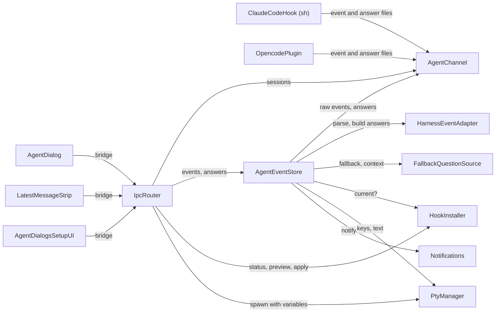

# Components: agent dialogs (EPIC-05 US-0506)

## Sources

- Requirements: `aidlc/spaces/default/intents/261114-agent-dialogs/inception/requirements-analysis/requirements.md` (FR1–FR6, NFR1–NFR8, Constraints).
- User stories: `aidlc/spaces/default/intents/261114-agent-dialogs/inception/user-stories/stories.md` (US1.1–US5.1).
- Refined mockups: `aidlc/spaces/default/intents/261114-agent-dialogs/inception/refined-mockups/mockups.md`, `interaction-spec.md`.
- Code knowledge base: `aidlc/spaces/default/codekb/aidlc-dash/architecture.md`, `aidlc/spaces/default/codekb/aidlc-dash/component-inventory.md`.
- Team practices: `aidlc/spaces/default/intents/261114-agent-dialogs/inception/practices-discovery/team-practices.md`.
- Answers: `domain-design-questions.md` Q1–Q5 `[Q1]`…`[Q5]`.
- Decisions: `decisions.md` (ADR-001–ADR-006).

Brownfield: the app stays one Electron desktop app. New components are marked **new**; existing ones from the component inventory are marked **changed** and keep their current paths. Deployment grouping is left to Units Generation.

## Catalogue

```yaml
components:
  - name: ClaudeCodeHook
    summary: "new: the committed sh script Claude Code runs for its question, permission and stop hooks"
    behaviour: >
      Lives in .thadeus/hooks/ at the project root (ADR-004). The hook entry's command first checks
      the app's session variables and exits 0 with no output when they are absent, before the script
      is looked for (FR4.6). With them present, it copies the hook's raw stdin JSON unchanged into one
      event file in the session's channel folder, tagged with the session secret, then waits for the
      answer file, checking every 100 ms and checking the app's liveness file; when the app is gone
      for 2 s or the hook's own time limit is near, it prints nothing and exits 0 so Claude Code shows
      its own prompt (FR6.3, NFR5). When an answer file arrives it prints it as the hook's output.
      Uses only POSIX sh and tools present by default on macOS and Linux; it never parses JSON.
    responsibilities:
      - Hand each hook input to the app unchanged and wait for the answer
      - Return at once, adding nothing, for sessions the app did not start (FR4.4)
      - Hand back to the terminal when the app is gone or the time limit is near
    depends_on:
      - component: AgentChannel
        interaction: writes event files and reads answer files in the session's folder
        style: async
    dependents: []
    external_dependencies:
      - name: Claude Code hooks
        kind: third-party-api
        purpose: the hook input on stdin and the hook output on stdout
    entities: []

  - name: OpencodePlugin
    summary: "new: the committed opencode plugin that forwards question, permission and idle events"
    behaviour: >
      Lives in the project's opencode plugin folder (path fixed in Functional Design, FR4.7). Does
      nothing unless the app's session variables are set (FR4.4). Writes each event's payload
      unchanged as an event file in the session's channel folder and, for questions and permissions,
      waits for the answer file with the same time limit and liveness rule as ClaudeCodeHook, then
      returns the answer through opencode's plugin API.
    responsibilities:
      - Forward opencode's question, permission and session-idle events to the app
      - Return the person's answer through opencode's plugin API
      - Do nothing for sessions the app did not start
    depends_on:
      - component: AgentChannel
        interaction: writes event files and reads answer files in the session's folder
        style: async
    dependents: []
    external_dependencies:
      - name: opencode plugin and event API
        kind: third-party-api
        purpose: question, permission and idle events, and returning answers
    entities: []

  - name: AgentChannel
    summary: "new (main): private per-tab channel folders and secrets between the agent's hook and the app"
    behaviour: >
      For each agent tab the app spawns, creates a folder under the app's userData with mode 0700,
      a random per-session secret and a session id, and gives the PTY spawn the variables that point
      to them (ADR-001). Keeps a liveness file fresh every 500 ms while the app runs and removes the
      folders at shutdown and on the next start. Watches each folder for new event files, accepts a
      file only when it carries that folder's secret and is complete (written then renamed), and emits
      it as a raw event with its session id. Writes answer files atomically (write then rename).
      Refuses files from unknown folders, with a wrong secret, over 1 MB, or half-written. Never reads
      or writes outside its folders.
    responsibilities:
      - Open and close one channel per agent session
      - Authenticate and deliver raw hook events to the app
      - Deliver answer files back to the waiting hook
      - Publish the app's liveness for hooks
    depends_on: []
    dependents:
      - component: ClaudeCodeHook
        interaction: event and answer files
      - component: OpencodePlugin
        interaction: event and answer files
      - component: AgentEventStore
        interaction: subscribes to raw events, writes answers
      - component: IpcRouter
        interaction: opens a session at pty spawn and closes it at exit
    external_dependencies:
      - name: Local file system (app userData)
        kind: other
        purpose: channel folders, event, answer and liveness files
    entities:
      - name: AgentSession
        identifier: sessionId
        attributes: [sessionId, projectId, tabId, harness, channelDir, secret, startedAt, endedAt]

  - name: HarnessEventAdapter
    summary: "new (main, pure): translates each harness's raw payloads into the app's event shape and back"
    behaviour: >
      One adapter per selectable harness (Claude Code, opencode), behind one interface (ADR-003).
      Parses a raw hook or plugin payload into an AgentEvent draft: kind (question, permission, reply),
      questions with header, text, options (label and description, in the agent's order), multi-select
      and own-answer allowed, or the permission's tool and command, or the reply's last message.
      Unknown fields are ignored, a payload it cannot read becomes a rejected event with a reason,
      never a guess. Builds the answer in the harness's own form: the hook output that returns the
      answer where the harness allows it, otherwise the picker key sequence computed from the exact
      options the payload carried, never from the audit log (FR3.2). Text over 64 KB is cut with a
      flag (FR6.2). Pure: no I/O.
    responsibilities:
      - Parse raw harness payloads into AgentEvent drafts
      - Build hook answers or picker key sequences from the reported options
      - Keep harness-specific knowledge in one place
    depends_on: []
    dependents:
      - component: AgentEventStore
        interaction: parse events, build answers
    external_dependencies: []
    entities: []

  - name: AgentEventStore
    summary: "new (main): the open events of every project, their lifecycle, the answer check and delivery"
    behaviour: >
      Holds every open AgentEvent in arrival order, per project, with questions and permission prompts
      ordered before replies (FR6.1). Picks the source per project and harness: hook events when that
      harness's hooks or plugin are current for the project, otherwise the fallback audit-log questions
      (ADR-005). Moves each event through Queued, Shown, Sending, Sent, HandedBack, TimedOut and Ended
      (interaction-spec.md). Removes an event when its session reports it answered, sends a newer event,
      ends its turn, or exits (FR1.5, FR6.4); only events that arrived after the app started are kept
      (FR6.3). Accepts an answer only for an open event of a live session it holds, and only once
      (FR3.1). Delivers it through AgentChannel when the hook waits, otherwise as keys or typed text
      through PtyManager into that session's pty only; never answers a permission prompt by itself
      (FR3.4). A reply's answer is typed only while that tab is still waiting for input. Keeps the
      latest reply per project (FR2.8). Adds AI-DLC context (intent, stage) from the fallback source
      without changing any option (FR1.4). Calls Notifications once per new event (FR5.3).
    responsibilities:
      - Own the open events, their order and lifecycle
      - Choose hook or fallback source per project and harness
      - Check and deliver answers to the asking session only
      - Keep each project's latest message
    depends_on:
      - component: AgentChannel
        interaction: raw events in, answer files out
        style: event
      - component: HarnessEventAdapter
        interaction: parse payloads, build answers
        style: sync
      - component: FallbackQuestionSource
        interaction: audit-log questions and AI-DLC context
        style: sync
      - component: HookInstaller
        interaction: whether a harness's hooks or plugin are current for a project
        style: sync
      - component: PtyManager
        interaction: write keys or typed text into the asking session's pty
        style: sync
      - component: Notifications
        interaction: one system notification per new event
        style: sync
    dependents:
      - component: IpcRouter
        interaction: lists events, sends answers, closes events, pushes changes to the renderer
    external_dependencies: []
    entities:
      - name: AgentEvent
        identifier: eventId
        attributes: [eventId, sessionId, projectId, source, kind, questions, permission, message, context, arrivedAt, state, truncated]
        references:
          - entity: AgentSession
            owned_by: AgentChannel
            relationship: "each hook event comes from one agent session; fallback events have none"
      - name: Answer
        identifier: eventId
        attributes: [eventId, picks, ownText, via, sentAt, outcome]
      - name: LatestMessage
        identifier: projectId
        attributes: [projectId, tabId, eventId, text, arrivedAt, status]

  - name: FallbackQuestionSource
    summary: "changed (main): today's audit-log questions (projectService + questions.js) turned into the event shape"
    behaviour: >
      Wraps the existing loadPendingQuestions and pendingQuestions unchanged (FR4.5) and maps each
      pending AI-DLC question to an AgentEvent draft with source "audit". Also answers which AI-DLC
      intent and stage a project's open gate belongs to, for context beside hook questions (FR1.4).
      Pure mapping over the existing parsers; no new reads.
    responsibilities:
      - Provide today's audit-log questions as events for the fallback
      - Provide AI-DLC context for hook events
    depends_on: []
    dependents:
      - component: AgentEventStore
        interaction: fallback events and context
    external_dependencies:
      - name: AI-DLC audit shards
        kind: other
        purpose: pending questions and open gates, read-only
    entities: []

  - name: HookInstaller
    summary: "new (main): preview, install, update and remove the app's hook entries, script and plugin"
    behaviour: >
      For a project and harness, reports each file's status: present and current, out of date,
      missing, or edited by hand (ADR-004). Builds a preview that names every file, says it is
      committed and shared, and shows the change as a diff (FR4.2). Writes only after the person's
      yes, re-reads each file just before writing and writes nothing if it changed since the preview
      (FR4.7). In .claude/settings.json it adds, updates or removes only entries whose command runs
      a script in .thadeus/hooks/ and leaves every other entry byte for byte (FR4.3); a missing file
      is created with only the app's entries; a file that is not valid JSON or cannot be written is
      left untouched and the reason is returned in one sentence. Writes are atomic. This is the one
      write path into a harness folder, separate from the editor's engine-owned rule (Constraints).
    responsibilities:
      - Know whether each harness's hooks or plugin are current per project
      - Preview and apply install, update and remove safely
    depends_on: []
    dependents:
      - component: AgentEventStore
        interaction: current or not, per project and harness
      - component: IpcRouter
        interaction: status, preview, apply
    external_dependencies:
      - name: Project files (.claude/settings.json, .thadeus/hooks/, opencode plugin folder)
        kind: other
        purpose: the committed entries, script and plugin
    entities:
      - name: HookInstallation
        identifier: installationKey
        attributes: [installationKey, projectRoot, harness, files, status, previewDigest]

  - name: PtyManager
    summary: "changed (main, src/main/pty.js): spawns agent tabs with the channel variables and writes answers into a named session"
    behaviour: >
      Unchanged spawn, data, resize and kill. At agent spawn it adds the session variables from
      AgentChannel to the child environment (never to a shell tab). Gains a write that names the
      session and takes only text built by the event store; its exit event lets the store end that
      session's events.
    responsibilities:
      - Start agent tabs with the session variables
      - Write keys or text into one named session
    depends_on: []
    dependents:
      - component: AgentEventStore
        interaction: write answers into a session
      - component: IpcRouter
        interaction: spawn and exit
    external_dependencies:
      - name: node-pty
        kind: other
        purpose: the agent and shell terminals
    entities: []

  - name: Notifications
    summary: "changed (main, src/main/notify.js): one system notification per new event, by kind and setting"
    behaviour: >
      Shows one notification per event id when the window is in the background or on another
      project (FR5.3), titled by kind. Questions and permission prompts follow questionAlerts and
      notificationSound; replies follow the new reply setting (dialog and notification, line only,
      off) kept in the existing Settings Store (FR5.2). A click restores the window on that event.
    responsibilities:
      - Notify once per new event by kind and setting
    depends_on: []
    dependents:
      - component: AgentEventStore
        interaction: notify new events
    external_dependencies:
      - name: Electron Notification
        kind: other
        purpose: system notifications
    entities: []

  - name: IpcRouter
    summary: "changed (main, src/main/ipc.js): new handlers for events, answers and installation, and the wiring at pty spawn and exit"
    behaviour: >
      Opens an AgentChannel session before an agent pty spawns and closes it at exit. Exposes named
      handlers only, through new window.bridge members: list events, answer an event by id, close an
      event, latest message, installation status, preview and apply. Pushes event changes to the
      renderer. Validates every argument by type and id; the renderer never names a pty, a path or
      raw key bytes for this feature (Constraints).
    responsibilities:
      - Wire channel sessions to agent tabs
      - Expose the event, answer and install operations to the renderer
    depends_on:
      - component: AgentChannel
        interaction: open and close sessions
        style: sync
      - component: AgentEventStore
        interaction: events, answers, changes
        style: sync
      - component: HookInstaller
        interaction: status, preview, apply
        style: sync
      - component: PtyManager
        interaction: spawn agent tabs with session variables
        style: sync
    dependents:
      - component: AgentDialog
        interaction: events and answers
      - component: LatestMessageStrip
        interaction: latest message per project
      - component: AgentDialogsSetupUI
        interaction: status, preview, apply
    external_dependencies: []
    entities: []

  - name: AgentDialog
    summary: "new (renderer): the one dialog for questions, batches, permission prompts and replies; replaces QuestionPopup"
    behaviour: >
      Shows the open events from main in pager order with the M1–M4 layouts (ADR-006): sanitized
      Markdown through the existing FileContent (no HTML, http/https links on click only), options
      with descriptions in the agent's order, stacked batches that collapse once answered, multi-select,
      own answer where allowed, the amber permission header with no preselected choice, and the reply's
      answer field. Calm then red after 20 s. Sends answers by event id only. Fully usable by keyboard
      (NFR6); every app text through t() (NFR7). Fallback events render in the same dialog.
    responsibilities:
      - Show every open event and collect the person's answer
      - Show hand-back, time-out, failure and session-ended states
    depends_on:
      - component: IpcRouter
        interaction: events and answers through window.bridge
        style: sync
    dependents: []
    external_dependencies: []
    entities: []

  - name: LatestMessageStrip
    summary: "new (renderer): the one-line latest message above the agent terminal panel"
    behaviour: >
      Shows the project's newest reply with tab, time and first line, and Answer or Show that opens
      AgentDialog on it; empty, answered and session-ended states as in M5 (FR2.8).
    responsibilities:
      - Show each project's latest message and open it
    depends_on:
      - component: IpcRouter
        interaction: latest message per project
        style: sync
    dependents: []
    external_dependencies: []
    entities: []

  - name: AgentDialogsSetupUI
    summary: "new (renderer): fallback notice, install preview and the Project settings section"
    behaviour: >
      Shows the fallback notice strip when a harness's hooks or plugin are missing or out of date,
      the diff preview dialog with Install, Update or Remove, and the per-file status in Project
      settings (M7, M8). Applies only after the person's yes; shows refusals in one sentence.
    responsibilities:
      - Offer install, update and remove with a preview
    depends_on:
      - component: IpcRouter
        interaction: status, preview, apply through window.bridge
        style: sync
    dependents: []
    external_dependencies: []
    entities: []
```

## Component Diagram

<!-- Text fallback: ClaudeCodeHook and OpencodePlugin write to AgentChannel. AgentEventStore subscribes to AgentChannel and uses HarnessEventAdapter, FallbackQuestionSource, HookInstaller, PtyManager and Notifications. IpcRouter uses AgentChannel, AgentEventStore, HookInstaller and PtyManager. AgentDialog, LatestMessageStrip and AgentDialogsSetupUI call IpcRouter through window.bridge. -->



## Component Summary

| Component | Purpose | Depends On | Dependents | Entities Owned |
|---|---|---|---|---|
| ClaudeCodeHook (new) | sh hook script for Claude Code | AgentChannel | — | — |
| OpencodePlugin (new) | opencode plugin | AgentChannel | — | — |
| AgentChannel (new) | per-tab channel folders, secrets, liveness | — | ClaudeCodeHook, OpencodePlugin, AgentEventStore, IpcRouter | AgentSession |
| HarnessEventAdapter (new) | harness payloads to events and back | — | AgentEventStore | — |
| AgentEventStore (new) | open events, lifecycle, answer check and delivery | AgentChannel, HarnessEventAdapter, FallbackQuestionSource, HookInstaller, PtyManager, Notifications | IpcRouter | AgentEvent, Answer, LatestMessage |
| FallbackQuestionSource (changed) | audit-log questions as events, AI-DLC context | — | AgentEventStore | — |
| HookInstaller (new) | preview and apply hook entries, script, plugin | — | AgentEventStore, IpcRouter | HookInstallation |
| PtyManager (changed) | spawn with variables, write into a named session | — | AgentEventStore, IpcRouter | — |
| Notifications (changed) | one notification per event by kind and setting | — | AgentEventStore | — |
| IpcRouter (changed) | wiring and renderer operations | AgentChannel, AgentEventStore, HookInstaller, PtyManager | AgentDialog, LatestMessageStrip, AgentDialogsSetupUI | — |
| AgentDialog (new) | the one dialog, replaces QuestionPopup | IpcRouter | — | — |
| LatestMessageStrip (new) | latest message above the terminal | IpcRouter | — | — |
| AgentDialogsSetupUI (new) | fallback notice, install preview, settings section | IpcRouter | — | — |

## Entity Ownership

| Entity | Owning Component | Identifier | Attributes | References |
|---|---|---|---|---|
| AgentSession | AgentChannel | sessionId | sessionId, projectId, tabId, harness, channelDir, secret, startedAt, endedAt | — |
| AgentEvent | AgentEventStore | eventId | eventId, sessionId, projectId, source, kind, questions, permission, message, context, arrivedAt, state, truncated | AgentSession (AgentChannel): each hook event comes from one session |
| Answer | AgentEventStore | eventId | eventId, picks, ownText, via, sentAt, outcome | — |
| LatestMessage | AgentEventStore | projectId | projectId, tabId, eventId, text, arrivedAt, status | — |
| HookInstallation | HookInstaller | installationKey | installationKey, projectRoot, harness, files, status, previewDigest | — |

## External Dependencies

| Component | Dependency | Kind | Purpose |
|---|---|---|---|
| ClaudeCodeHook | Claude Code hooks | third-party-api | hook input and output |
| OpencodePlugin | opencode plugin and event API | third-party-api | events and answers |
| AgentChannel | local file system (userData) | other | channel folders and files |
| FallbackQuestionSource | AI-DLC audit shards | other | pending questions, read-only |
| HookInstaller | project files | other | settings entries, script, plugin |
| PtyManager | node-pty | other | terminals |
| Notifications | Electron Notification | other | system notifications |

## Rationale

| Component | Why it is its own building block |
|---|---|
| ClaudeCodeHook | Runs in the agent's process, not the app's; committed to the repository; must work with nothing installed |
| OpencodePlugin | Different runtime and API from Claude Code's hooks |
| AgentChannel | The trust boundary: authenticates every event and owns the only files the hooks touch (NFR3) |
| HarnessEventAdapter | Harness formats change at their own rate; isolating them keeps the store harness-neutral (ADR-003) |
| AgentEventStore | One owner for event order, lifecycle and the answer check, so the renderer cannot answer the wrong session (FR3.1) |
| FallbackQuestionSource | Today's behaviour must stay unchanged for projects without the hooks (FR4.5) |
| HookInstaller | The only writer into a harness folder, with its own preview and safety rules (FR4.2–FR4.7) |
| AgentDialog, LatestMessageStrip, AgentDialogsSetupUI | Three separate places in the UI with their own states (mockups M1–M9) |

### Decomposition options considered

- **Option A — store and delivery in one component (chosen):** AgentEventStore owns both the answer check and delivery. Pros: the check and the write cannot drift apart. Cons: a larger component. Reversible: delivery can be split out later.
- **Option B — separate AnswerRouter:** Pros: smaller pieces. Cons: the session check would sit in one component and the write in another, and every answer would need both. Rejected for the safety boundary.

Alternatives for the channel, the script folder, the source rule and the dialog are recorded in `decisions.md`.
