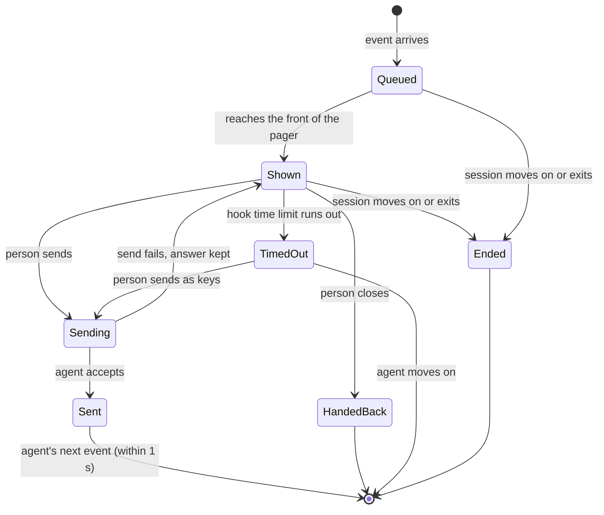

# Interaction Specification: agent dialogs (EPIC-05 US-0506)

## Sources

- Mockups: `mockups.md` (M1–M9).
- User stories: `aidlc/spaces/default/intents/261114-agent-dialogs/inception/user-stories/stories.md`.
- Requirements: `aidlc/spaces/default/intents/261114-agent-dialogs/inception/requirements-analysis/requirements.md`.
- Team practices: `aidlc/spaces/default/intents/261114-agent-dialogs/inception/practices-discovery/team-practices.md`.
- Answers: `refined-mockups-questions.md` `[Q1]`…`[Q5]`.

Component names are working names for Functional Design; `data-testid` values follow the team's `<component>-<role>` rule.

## Life of an event in the dialog

<!-- Text fallback: an event arrives and is queued. It is shown when it reaches the front. From shown it can be answered (sending, then sent and removed on the agent's next event, or failed back to shown with the answer kept), closed by the person (handed back and removed), handed back by the hook's time limit (stays shown, answers go as keys), or ended because the session moved on or exited (removed with a line). -->

| From | Event | To | What the person sees |
|---|---|---|---|
| Queued | reaches the front | Shown | Dialog page for it; focus on the first choice (or the answer field for a reply) |
| Shown | Send | Sending | Choices and Send disabled; "Sending to <harness>…" |
| Sending | accepted | Sent | "Sent to <harness>." Page leaves on the agent's next event |
| Sending | failed | Shown | One-sentence cause, typed answer kept, Open the terminal (FR3.5) |
| Shown | Close (question, permission) | HandedBack | Dialog closes; toast "Handed back to the terminal." (FR3.3) |
| Shown | Close (reply) | removed from dialog | Nothing typed; message stays in the strip (FR2.7) |
| Shown | hook limit runs out | TimedOut | Line from M6; send now presses the picker's keys (FR3.6) |
| Shown, Queued | session moved on or exited | Ended | Line "…session ended. Nothing was sent." for 3 s, then the page leaves (FR1.5, FR6.4) |

Order in the pager (FR6.1): questions and permission prompts before replies; within a group, by arrival time, then by tab name. The page the person is looking at never jumps when a new event arrives: the pager count grows and the header bar shows "+1 new".

## AgentDialog

| Field | Value |
|---|---|
| Component | AgentDialog (replaces QuestionPopup) |
| Description | One modal dialog for every kind: question, batch, permission prompt, reply |
| Category | feedback |

### States

| State | Description | Trigger |
|---|---|---|
| calm | Kind-coloured header bar (steel question, amber permission, steel-deep message) | page shown |
| overdue | Red header bar and edges, "still waiting" title | 20 s on a page without an answer (FR5.1) |
| sending | Choices and Send disabled, status line | Send |
| failed | Status line in coral-soft with "!" and the cause | send failed |
| timed-out | Line from M6, choices stay enabled | hook limit ran out |
| ended | Choices disabled, line "session ended" | session moved on or exited |
| empty | Dialog closes; never shown with no events | last event leaves |

### Props / Inputs

| Prop | Type | Required | Default | Description |
|---|---|---|---|---|
| events | object[] | yes | — | Open events in pager order (id, kind, project, tab, harness, text, questions, arrivedAt, context) |
| index | number | yes | 0 | The page shown |
| onAnswer | function | yes | — | `(eventId, answer)`; main checks the session (FR3.1) |
| onClose | function | yes | — | `(eventId)`; hands back or dismisses |
| onOpenTerminal | function | yes | — | Shows the event's tab |

### Responsive Behaviour

Desktop window, not a web page. The dialog is `min(640px, 92vw)` wide and at most 85 % of the window height; the body scrolls, header, where line and footer do not. Below 520 px window width, the footer wraps: pager on its own line above the actions.

### Accessibility

| Requirement | Implementation |
|---|---|
| ARIA role | native `<dialog>` opened with `showModal()`, `aria-labelledby` the title, `aria-describedby` the where line |
| Keyboard interaction | number keys pick (1–9), Space ticks in multi-select, Enter sends, Esc closes (hands back), Tab cycles inside the dialog |
| Label / aria-label | title names kind and harness in text ("Permission: Claude Code asks for permission") |
| Contrast ratio | WCAG AA; header text black on steel, amber and red, `--steel-light` on steel-deep |
| Screen reader | the title and where line on open; status lines through `role="status"`; "+1 new" through a polite live region |
| Focus management | on open, first choice (question, permission) or answer field (reply); after a batch question collapses, the next unanswered one; on close, back to what had focus before |

## OptionList

| Field | Value |
|---|---|
| Component | OptionList |
| Description | The agent's options for one question, in its order, with descriptions |
| Category | input |

### States

| State | Description | Trigger |
|---|---|---|
| default | Each option a button: number key, label, description beneath | shown |
| focus | 2 px amber outline | Tab, arrow keys |
| picked | Single-select: sends at once for a single question; inside a batch, collapses it | click, number key |
| ticked | Multi-select: checkbox square filled and "selected" in the accessible name | Space, click |
| disabled | Sending, ended | state |

### Props / Inputs

| Prop | Type | Required | Default | Description |
|---|---|---|---|---|
| options | {label, description?}[] | yes | — | Exactly as the hook reported |
| multiSelect | boolean | no | false | Checkboxes and a Done button |
| allowOwn | boolean | no | false | Shows OwnAnswer under the list (FR2.6) |
| ownLabel | string | no | — | The agent's own word for it ("Type something", "Other") |

### Accessibility

| Requirement | Implementation |
|---|---|
| ARIA role | single-select: `role="radiogroup"` of buttons with `aria-describedby` their description; multi-select: a group of native checkboxes |
| Keyboard interaction | arrow keys move, number keys pick, Space ticks, Enter confirms |
| Screen reader | "1 of 2, Complete workflow, Continue to Refined Mockups" |

## BatchList `[Q1]`

| Field | Value |
|---|---|
| Component | BatchList |
| Description | Up to four questions stacked, each collapsing to one line once answered |
| Category | input |

### States

| State | Description | Trigger |
|---|---|---|
| open | The first unanswered question, with its OptionList | shown, previous answered |
| collapsed-answered | One line: header, chosen label(s), Change | answered |
| collapsed-waiting | One line: header, "not answered yet" | not reached |
| complete | "Send all answers" enabled | every question answered |

Change reopens that question and keeps its answer selected. Send all answers sends one answer for the batch (FR2.4). The counter "<n> of <total> answered" sits beside the button and is in a polite live region.

## OwnAnswer

| Field | Value |
|---|---|
| Component | OwnAnswer |
| Description | Free-text answer for a question that allows it, and the answer field of a reply |
| Category | input |

States: empty (Send disabled), typing, sending, failed (text kept), stale (reply no longer waited for: disabled, text kept, Copy). Enter sends; Shift+Enter adds a new line in a reply's answer. The text is sent exactly as typed (FR3.2, FR2.7).

## LatestMessageStrip `[Q4]`

| Field | Value |
|---|---|
| Component | LatestMessageStrip |
| Description | One line above the agent terminal panel with the newest reply of the project |
| Category | display |

| State | Description | Trigger |
|---|---|---|
| empty | "No message from the agent yet", muted, no buttons | no reply since app start |
| waiting | Tab, time, first line, Answer, Show | newest reply, tab waiting |
| answered | Same, without Answer | the tab started a new turn |
| ended | "(session ended)" after the tab name, Show only | tab exited |

Answer opens AgentDialog on that reply; Show opens it read-only. The first line is plain text (Markdown markers dropped), cut with an ellipsis; the full message is in the dialog (FR2.8).

## FallbackNotice and InstallPreview `[Q5]`

**FallbackNotice** (project view strip): states missing, out-of-date, edited-by-hand, hidden-for-this-run. Actions Install or Update, Details (opens Project settings at Agent dialogs). `role="status"`, "!" mark plus text.

**InstallPreview** (dialog): one section per file with path, summary and diff. States preview, writing, changed-since-preview (diff refreshed, Install again), failed (one sentence, nothing written), done ("Installed. New agent tabs use the dialog."). Install is the only primary button; Cancel and Esc write nothing (FR4.2).

The same status per file (present and current / out of date / missing / edited by hand) and the Install, Update and Remove actions appear in Project settings > Agent dialogs, for `.claude/settings.json` and for the opencode plugin alike.

## Notifications (US5.1)

- A system notification per new event when the app is in the background or showing another project, once per event id (FR5.3): title "<harness> is waiting for you" (question), "<harness> asks for permission" (permission), "Message from <harness>" (reply); body: project name and the first line.
- Clicking it brings the window forward, switches to the project, and opens AgentDialog on that event.
- Replies follow the "Messages from the agent" setting (M9); questions and permission prompts follow `questionAlerts` and `notificationSound` (FR5.1, FR5.2). With "Line only", a reply updates LatestMessageStrip and does not open AgentDialog.

## User flows

**F1 Answer the agent's question (US1.1)**
1. Agent tab shows its picker -> hook event -> AgentDialog opens on M1 within 1 s.
2. Person presses 1 -> Sending -> Sent -> page leaves on the agent's next event.
Error paths: send fails -> M6 line, answer kept; person presses Esc -> handed back toast; hook limit -> M6 timed-out line.

**F2 Allow a command (US2.1)**
1. Agent asks permission -> AgentDialog on M3 with amber bar.
2. Person reads the command, presses 1 (Allow once) -> Sent.
Error path: nobody answers -> hook limit -> handed back to the terminal, nothing allowed.

**F3 Answer a plain-chat question (US3.1)**
1. Agent ends its turn -> M4 opens (setting "Dialog and notification") and M5 updates.
2. Person types "notes.md", Enter -> text and Enter typed into that tab only.
Error path: the tab started a new turn before Send -> stale line, text kept, nothing typed.

**F4 Install the hooks (US4.1)**
1. Project view shows M7 -> person clicks Install -> M8 with diffs.
2. Person clicks Install -> files re-read -> written -> "Installed."
Error paths: file changed since preview -> new preview; not valid JSON -> one sentence, nothing written.
