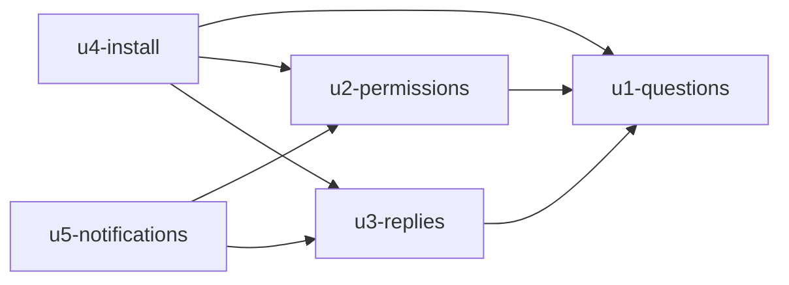

# Unit Dependencies: agent dialogs (EPIC-05 US-0506)

## Sources

- Units: `unit-of-work.md` (U1–U5).
- Components: `aidlc/spaces/default/intents/261114-agent-dialogs/inception/domain-design/components.md`.
- Requirements: `aidlc/spaces/default/intents/261114-agent-dialogs/inception/requirements-analysis/requirements.md`.
- User stories: `aidlc/spaces/default/intents/261114-agent-dialogs/inception/user-stories/stories.md`.

This file describes which Unit needs which. The order of work is chosen in Delivery Planning.

## Dependency graph

<!-- Text fallback: u2-permissions, u3-replies and u4-install depend on u1-questions. u4-install also depends on u2-permissions and u3-replies. u5-notifications depends on u2-permissions and u3-replies. -->



| Unit | Depends on | Why |
|---|---|---|
| u1-questions | — | Creates the channel, scripts, adapters, store and dialog |
| u2-permissions | u1-questions | Adds the permission kind to U1's scripts, adapters, store and dialog |
| u3-replies | u1-questions | Adds the reply kind to the same components |
| u4-install | u1-questions, u2-permissions, u3-replies | Installs the hook entries and script for every kind; tests check the entries U1–U3 need |
| u5-notifications | u2-permissions, u3-replies | Titles and settings per kind need all three kinds; escalation applies to permission and reply pages |

```yaml
units:
  - name: u1-questions
    kind: service
    depends_on: []
  - name: u2-permissions
    kind: service
    depends_on: [u1-questions]
  - name: u3-replies
    kind: service
    depends_on: [u1-questions]
  - name: u4-install
    kind: service
    depends_on: [u1-questions, u2-permissions, u3-replies]
  - name: u5-notifications
    kind: ui
    depends_on: [u2-permissions, u3-replies]
```

## Integration points

| Between | What crosses | Mechanism |
|---|---|---|
| Hook scripts and AgentChannel (U1, extended in U2, U3) | event files with the raw hook input, answer files, the liveness file | files in the per-session folder (ADR-001) |
| AgentChannel and AgentEventStore (U1) | raw events with session id; answers to deliver | in-process events and calls in main |
| AgentEventStore and HarnessEventAdapter (U1, U2, U3) | AgentEvent drafts; hook answers or key sequences | pure function calls |
| AgentEventStore and HookInstaller (U4) | whether a harness's part is current per project | call in main |
| AgentEventStore and Notifications (U5) | one new event at a time | call in main |
| IpcRouter and renderer (U1, U3, U4) | events, answers by event id, latest message, install status, preview, apply | named `window.bridge` members |

## Parallel work

- u2-permissions and u3-replies have no edge between them and can be built side by side once u1-questions is done.
- Both edit the same files (the hook script, the plugin, the adapters, the event store and the dialog). Built in separate copies, each passes on its own, and the second to merge must reconcile the shared files, mostly additions per kind.
- u4-install and u5-notifications both wait for u2 and u3; they have no edge between them and can be built side by side.
