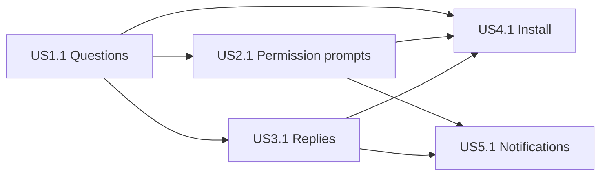

# User Stories: agent dialogs (EPIC-05 US-0506)

## Sources

- Requirements: `aidlc/spaces/default/intents/261114-agent-dialogs/inception/requirements-analysis/requirements.md` (FR1–FR6, NFR1–NFR8), approved.
- Personas: `personas.md` (P1 Dev, P2 Tea).
- Code knowledge base: `aidlc/spaces/default/codekb/aidlc-dash/business-overview.md`, `aidlc/spaces/default/codekb/aidlc-dash/component-inventory.md`.
- Team practices: `aidlc/spaces/default/intents/261114-agent-dialogs/inception/practices-discovery/team-practices.md`.
- Answers: `user-stories-questions.md` Q1–Q5 `[Q1]`…`[Q5]`.

## How the work is cut

- **Feature docs:** US-0506 stays one story in `docs/features/epic-05-workflow-control.md`. The five stories below are its internal breakdown and ship together in one pull request, `feat/US-0506` (`[Q1]`).
- **Cut:** five large vertical slices, one kind of event per slice, each end to end for Claude Code and opencode (`[Q2]`, `[Q3]`, `[Q5]`). Corner conditions (FR6) sit inside the slice they belong to.
- **Order:** US1.1 → US2.1 → US3.1 → US4.1 → US5.1 (`[Q2]`). The release in which US-0506 ships is settled in Delivery Planning.
- **Priority:** all five are Must Have: Requirements Analysis put everything in US-0506 into this release (`requirements-analysis-questions.md` Q1).

### Story map

| Step in the person's day | Must Have |
|---|---|
| The agent asks a question | US1.1 |
| The agent asks for permission | US2.1 |
| The agent finishes its turn and waits | US3.1 |
| The project gets the hooks and the plugin | US4.1 |
| The person is told, and chooses how | US5.1 |

## Proof for every story

Each acceptance criterion below is checked twice (`[Q4]`):

1. **Automated tests** that replay real event payloads recorded from Claude Code and from opencode (hook input, plugin events), kept as fixtures under `tests/`. Every criterion that names "an agent" runs once with a Claude Code payload and once with an opencode payload.
2. **A manual run** of the correctness scenarios (NFR2) on the release Mac against real Claude Code and opencode sessions, with the timing log (NFR1), before the release tag. Jsdom tests do not run the built app, so this run is part of the release check.

Definition of done for every story (NFR8, team practices): the behaviour is built test first; line coverage of the touched code is at least 80%, checked in CI; ESLint and Prettier pass in CI; every new text is in `sv.json` and `en.json` through `t()` (NFR7); the full `npx vitest run tests/` suite is green.

---

## US1.1 Answer the agent's own questions from the dialog (Must Have)

**As** Dev (P1), **I want** every question the agent in an app tab asks with its picker to show in the dialog exactly as the agent shows it, and my answer to reach that agent, **so that** I can answer from the dialog the first time, without "Could not send" and without going to the terminal.

**Covers:** FR1.1 (questions), FR1.2, FR1.3, FR1.4, FR1.5, FR2.1 (question kind), FR2.2–FR2.6, FR3.1–FR3.3, FR3.5, FR3.6, FR6.1–FR6.4, NFR1, NFR2 (scenarios 1–5), NFR3, NFR5, NFR6, NFR7.

**Scope:** the local channel between hook scripts and the app with its per-session secret; the Claude Code hook script and the opencode plugin for questions; the main-side question store and the answer IPC that checks the session; the dialog for questions. Until US4.1, a developer installs the hook entries by hand to build and test.

### Acceptance criteria

- **AC1.1.1** (the 2026-11-14 case, FR1.1, FR1.4, FR2.3, FR3.2, NFR2 scenario 1)
  Given an app tab where the agent's picker shows "Complete workflow" and "Request Changes", each with a description, and AI-DLC's audit log holds "Approve / Request changes" for the same gate,
  When the question event arrives,
  Then the dialog shows "Complete workflow" and "Request Changes", each with its description beneath it, within 1 second of the hook firing;
  And when Dev picks the first option, then "Complete workflow" is chosen in that agent, once.
- **AC1.1.2** (FR2.4, FR2.5, FR2.6, NFR2 scenarios 2–5)
  Given an agent asks a batch of four questions at once, one of them multi-select, with options in a different order than AI-DLC logged them,
  When Dev picks one option in each single-select question, ticks two options in the multi-select one, writes an own answer in the last, and sends,
  Then the agent receives exactly those picks, those two ticks and that text, in one answer, and each question was shown with its header.
- **AC1.1.3** (FR2.2, NFR3)
  Given a question whose text holds a heading, a list, inline code, a code block, a link, and a `<script>` tag,
  When the dialog shows it,
  Then the Markdown is rendered, the `<script>` tag is shown as text and never runs, and the link opens in the system browser only when Dev clicks it, and only for `http` or `https`.
- **AC1.1.4** (FR1.4)
  Given the session's active AI-DLC intent has an open gate,
  When the agent's question for that gate arrives,
  Then the dialog shows the project, intent and stage beside the question, and its options are exactly the agent's.
- **AC1.1.5** (FR1.3, FR3.1, NFR3)
  Given a question event from a session the app did not start, or without that session's secret,
  When it reaches the app, then it is ignored and nothing is shown;
  And given an answer for an unknown, finished or other session's question, when the renderer sends it, then main refuses it and nothing reaches any agent.
- **AC1.1.6** (FR3.3, FR3.6, NFR5)
  Given the dialog shows a question,
  When Dev closes it, then the question is handed back to the terminal and the dialog says so in one line;
  And when the hook's time limit runs out before Dev answers, then the question is handed back to the agent's own picker in the terminal, the dialog says so, and an answer Dev then gives in the dialog is sent as the picker's own keys, computed from the options the hook reported.
- **AC1.1.7** (FR1.5, FR6.4)
  Given an open question,
  When Dev answers it in the dialog and the agent continues, then the question is gone from the dialog within 1 second of the agent's next event;
  And when the agent tab exits or is restarted, then its questions are removed, nothing is sent, and the dialog says in one line that the session ended.
- **AC1.1.8** (FR3.5)
  Given Dev has written an own answer,
  When sending fails because the session ended, the hook timed out or the agent refused the answer,
  Then the dialog says what happened in one sentence, keeps the typed answer, and offers Open the terminal.
- **AC1.1.9** (FR6.3, NFR5)
  Given a hook waits for the app's answer,
  When the app quits or restarts, then the hook hands the question back to the terminal within 2 seconds and the session is not blocked;
  And after the restart, the dialog shows no question from before it started.
- **AC1.1.10** (FR6.1, FR6.2)
  Given questions from two tabs in two projects arrive one after the other, one of them 70 KB long and holding emoji, quotes and newlines,
  When the dialog shows them,
  Then each has its own page in arrival order, every character arrives unchanged, and the long one is cut at 64 KB with a line saying it was cut and the full text is in the terminal.
- **AC1.1.11** (NFR6, NFR7)
  Given the dialog opens on a question,
  When Dev uses only the keyboard,
  Then focus is in the dialog, number keys pick, Space ticks in a multi-select question, Enter sends and Esc closes; the kind and state are named in text, not by colour alone; every app text comes from `sv.json` or `en.json`, and the agent's own text is shown as sent.

### INVEST notes

- **Independent:** the first slice; it needs nothing from the other stories.
- **Small:** larger than one sprint by the person's choice of large slices (`[Q3]`, `[Q5]`); Units Generation may split it into Units (channel, dialog, harness scripts).
- **Testable:** every criterion is replayable from recorded payloads.

---

## US2.1 Allow or deny the agent's permission prompts from the dialog (Must Have)

**As** Dev (P1), **I want** the agent's permission prompts ("Allow this command?") in the same dialog with the agent's own choices, **so that** a waiting command is approved or denied by my click, without me watching the terminal.

**Covers:** FR1.1 (permission prompts), FR1.2, FR2.1 (permission kind), FR3.2, FR3.4, FR6.1 (order), NFR1, NFR2 (scenario 6).

**Depends on:** US1.1 (channel, session check, dialog).

### Acceptance criteria

- **AC2.1.1** (FR1.1, FR1.2, FR2.1, NFR1)
  Given an agent in an app tab asks permission to run a command,
  When the permission event arrives,
  Then within 1 second the dialog shows its project, tab and the kind "Permission", what the agent wants to do, and the agent's own choices (for example allow once, allow always for this, deny).
- **AC2.1.2** (FR3.2, NFR2 scenario 6)
  Given a permission prompt in the dialog,
  When Dev picks allow once, allow always, or deny,
  Then the agent receives exactly that choice, once, and carries on as if Dev had answered in the terminal.
- **AC2.1.3** (FR3.4, FR3.6)
  Given a permission prompt that nobody answers,
  When the hook's time limit runs out,
  Then nothing is allowed by the app, the prompt is handed back to the agent's own prompt in the terminal, and the dialog says so.
- **AC2.1.4** (FR6.1)
  Given a reply from one tab is waiting in the dialog and a permission prompt arrives later from another tab,
  When the dialog pages through them,
  Then the permission prompt is shown first.

### INVEST notes

- **Independent:** builds on US1.1's channel; testable on its own with recorded permission payloads.
- **Negotiable:** the exact choices are the agent's own and are confirmed in the Functional Design spike.

---

## US3.1 Read and answer the agent's latest message (Must Have)

**As** Dev (P1), **I want** to see what the agent said when it finished its turn, and to answer it from the app, **so that** a question asked in plain chat text, with no picker, still reaches the agent from the app, and I can see each project's last word at a glance.

**Covers:** FR1.1 (replies), FR1.2, FR2.1 (reply kind), FR2.2, FR2.7, FR2.8, FR3.3 (a reply holds nothing), FR6.2, NFR2 (scenario 7).

**Depends on:** US1.1 (channel, dialog, Markdown rendering).

### Acceptance criteria

- **AC3.1.1** (FR2.7, NFR2 scenario 7)
  Given an app tab where the agent ends its turn with "Which name should the file have?",
  When the reply event arrives,
  Then the dialog opens with that message rendered and an empty answer field;
  And when Dev types "notes.md" and sends, then "notes.md" and Enter are typed into that tab only.
- **AC3.1.2** (FR2.7, FR3.3)
  Given an app tab where the agent ends its turn with "Done. All 353 tests pass.",
  When the reply event arrives and Dev closes the dialog,
  Then nothing is typed, the session keeps waiting in the terminal, and the message stays in the latest-message line.
- **AC3.1.3** (FR2.8, FR2.2)
  Given a project with two agent tabs that have each finished a turn,
  When Dev looks at the project view,
  Then the latest-message line shows the newest reply rendered as Markdown, with the time it arrived, its tab, and an Answer button that opens the same dialog.
- **AC3.1.4** (FR1.2)
  Given an opencode session in an app tab goes idle after its last message,
  When the plugin's idle event arrives,
  Then it is shown as a reply exactly as for Claude Code.
- **AC3.1.5** (FR6.2)
  Given a reply longer than 64 KB,
  When it is shown in the dialog or the line,
  Then it is cut at 64 KB with a line saying it was cut and that the full text is in the terminal.

### INVEST notes

- **Independent:** builds on US1.1's channel and rendering; testable on its own with recorded reply payloads.
- **Valuable:** closes the gap the old popup could never cover: a plain-chat question.

---

## US4.1 Install, update and remove the app's hooks and plugin safely (Must Have)

**As** Dev (P1), **I want** the app to add its Claude Code hooks and opencode plugin to the project after showing me exactly what it writes, **so that** the dialog works for every app user of this repository, while Tea (P2), whose checkout carries the same committed files, sees no effect at all.

**Covers:** FR4.1–FR4.7, NFR4.

**Depends on:** US1.1 (the hook script and plugin it installs); US2.1 and US3.1 add their events to the same entries.

### Acceptance criteria

- **AC4.1.1** (FR4.1, FR4.2)
  Given a project without the app's hooks,
  When Dev chooses Install,
  Then the app shows the entries it will add, the file (`.claude/settings.json`, and the opencode plugin location), and that the file is committed and shared with the team; and nothing is written until Dev says yes.
- **AC4.1.2** (FR4.3)
  Given `.claude/settings.json` already holds AI-DLC's hooks and other entries,
  When Dev installs, updates or removes the app's entries after the preview,
  Then only the app's own, marked entries change; every other entry is byte for byte as before; and the project shows whether the app's entries are present and current.
- **AC4.1.3** (FR4.6, FR4.4, NFR4)
  Given Tea's checkout with the hook entry in `.claude/settings.json`, no app installed and the app's script folder deleted,
  When Claude Code fires the hook,
  Then the hook exits 0 with no output within 100 ms and Claude Code carries on exactly as without the entry.
- **AC4.1.4** (FR4.4, NFR4)
  Given a Claude Code or opencode session the app did not start (Tea's own terminal, CI, or Dev's own terminal),
  When the hook or plugin runs,
  Then it returns at once, adds nothing to the agent's context, blocks nothing, and adds no more than 100 ms to the agent's step.
- **AC4.1.5** (FR4.7)
  Given `.claude/settings.json` is missing, then Install creates it with only the app's entries;
  Given it is not valid JSON or cannot be written, then nothing is written and the app names the file and the reason in one sentence;
  Given it changed after the preview (for example AI-DLC rewrote it), then nothing is written and Dev is asked to look at the new preview. The opencode plugin follows the same three rules.
- **AC4.1.6** (FR4.5)
  Given the hooks or the plugin are missing or out of date,
  When Dev opens the project,
  Then it shows that the dialog falls back to today's behaviour (questions from the audit log, answers by reading the screen), with an Install or Update action, and that fallback behaves exactly as today.

### INVEST notes

- **Independent:** testable on its own against fixture settings files and a stub hook environment.
- **Valuable:** without it, only a developer who edits settings by hand gets US1.1–US3.1.

---

## US5.1 Be told when the agent needs me, the way I choose (Must Have)

**As** Dev (P1), **I want** questions, permission prompts and replies to reach me by popup and notification as I set them, with replies set apart from questions, **so that** I notice what blocks an agent while working in another project or another app, without being interrupted by every finished turn.

**Covers:** FR5.1, FR5.2, FR5.3, FR2.7 (line only), FR6.1 (one notification per event), NFR7.

**Depends on:** US1.1 (questions), US2.1 (permission prompts), US3.1 (replies and the line).

### Acceptance criteria

- **AC5.1.1** (FR5.1)
  Given a question or permission prompt is open in the dialog,
  When 20 seconds pass without an answer,
  Then the dialog turns from calm to red; and the `questionAlerts` setting (popup and notification, popup only, off) and the sound setting apply as in US-0505.
- **AC5.1.2** (FR5.2, FR2.7)
  Given the new reply setting,
  When it is "dialog and notification" (the default), then a reply opens the dialog and notifies;
  When it is "line only", then a reply updates the latest-message line and does not open the dialog, and the line's Answer button opens the same dialog;
  When it is "off", then a reply updates the line only, with no notification;
  And questions and permission prompts follow `questionAlerts`, whatever the reply setting.
- **AC5.1.3** (FR5.3, FR6.1)
  Given the app is in the background or showing another project,
  When a new question, permission prompt or reply arrives (allowed by the settings),
  Then one system notification is shown for that event, and clicking it brings the app forward with that event's dialog open.
- **AC5.1.4** (NFR7)
  Given the app language is Swedish or English,
  When the new setting and notifications are shown,
  Then every text comes from `sv.json` or `en.json` with the same keys.

### INVEST notes

- **Independent:** testable on its own with the existing notification test setup and recorded events.

---

## Dependencies

<!-- Text fallback: US1.1 comes first. US2.1 and US3.1 build on US1.1. US4.1 builds on US1.1 and installs what US2.1 and US3.1 add. US5.1 builds on US1.1, US2.1 and US3.1. -->

## Correctness scenarios (NFR2) by story

| Scenario | Story |
|---|---|
| 1. Labels that differ from AI-DLC's logged labels | US1.1 (AC1.1.1) |
| 2. Options in a different order than logged | US1.1 (AC1.1.2) |
| 3. A batch of four questions | US1.1 (AC1.1.2) |
| 4. A multi-select question with two picks | US1.1 (AC1.1.2) |
| 5. An own answer instead of an option | US1.1 (AC1.1.2) |
| 6. A permission prompt allowed once, allowed always and denied | US2.1 (AC2.1.2) |
| 7. A plain-text question answered from a reply | US3.1 (AC3.1.1) |
