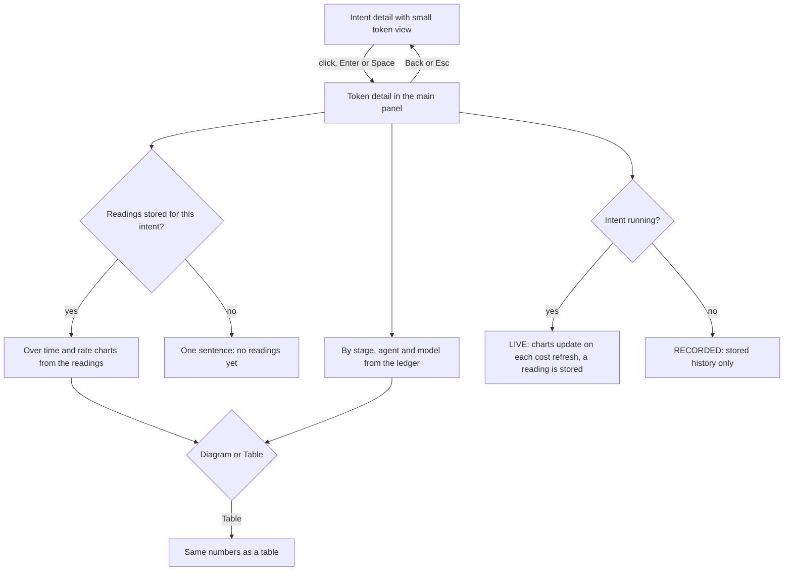

# User Flow: US-0208, detailed token view

Text fallback:

1. In the intent detail, the person clicks the small token view, or presses Enter or Space on it.
2. The token detail replaces the main panel. Back or Esc returns, and focus goes back to the small view.
3. Over time and rate come from the stored readings; with none, each says so in one sentence.
4. Stage, agent and model splits come from the ledger totals.
5. Each frame switches between Diagram and Table.
6. While the intent runs, the view is LIVE and each cost refresh stores a reading. A finished intent shows its RECORDED history.
