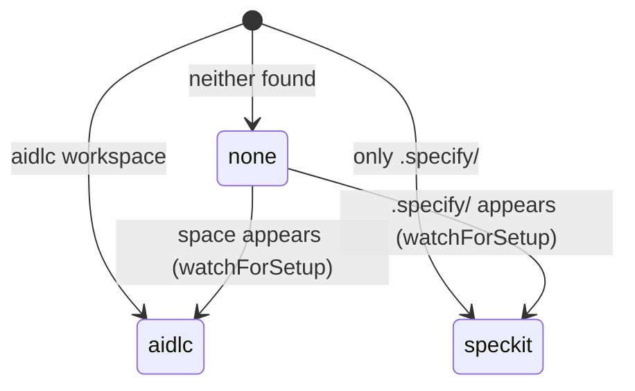

# Functional Spec: U1 u1-framework-views (US1.1 / US-1401)

Implements US1.1 from `stories.md` (AC1.1.1–AC1.1.6), FR1, NFR6 and contract C1. This is a UI Unit, so this file is self-contained. The code facts below come from `src/main/projectService.js` (`detectProject`), `src/main/ipc.js` (open, `watchForSetup`, `project:detected`), `src/main/menu.js`, `src/renderer/App.jsx` and `src/renderer/ProjectView.jsx`. U1 has no questions for the person: every point was settled upstream.

## Rules

| ID | Rule | Source |
|---|---|---|
| BR1.1 | A project with `aidlc/spaces/` holding at least one space is AI-DLC (`framework: 'aidlc'`), whether or not `.specify/` also exists, as long as no saved choice says otherwise. Active-space resolution is unchanged. | FR1.3, AC1.1.1, AC1.1.3 |
| BR1.2 | A project with `.specify/` and no `aidlc/spaces/` is Spec Kit (`framework: 'speckit'`, `source: 'detected'`). | FR1.5, AC1.1.3 |
| BR1.3 | A project with both `.specify/` and a valid AI-DLC workspace, and no usable saved choice, gets `framework: null`, `source: 'ask'`. The person chooses (U4). Until U4 ships, BR1.1 applies, so v0.2.12 behaviour is kept. U4 switches this rule on. | AC1.1.4 (R-02), FR1.3 |
| BR1.4 | A project with neither, or with an empty `aidlc/spaces/`, gets `framework: null`, `source: 'detected'`, with today's reason (`errors.notAidlc` or `errors.noSpace`). The existing setup offer is unchanged. | FR1.3 |
| BR1.5 | The views come from one shared table keyed by framework (`src/shared/frameworkViews.js`). `App.jsx` and `ProjectView.jsx` read only that table and stop building their own `offered` maps. | FR1.1, FR1.2, AC1.1.5 |
| BR1.6 | The views per framework: `aidlc` keeps exactly today's set: features, config, plans, cost, velocity, github, editor and the AI-DLC sections. `speckit` gets features, config, editor and a `specs` view, which is an empty Spec Kit shell U6 fills. `null` gets features, config and editor. | FR1.4, AC1.1.2 |
| BR1.7 | `isAidlc` is kept on the detection object as `framework === 'aidlc'` for one release, so that untouched code and tests keep working. New code reads `framework`. | C1 |
| BR1.8 | The menu state carries `framework` instead of `isAidlc`. The menu items AI-DLC offers today are shown only for `aidlc`. | FR1.1 |
| BR1.9 | Watchers: `watchSpace` runs only for `aidlc`. `watchForSetup` runs for `null`, and now also fires on `.specify/` appearing. The `project:detected` push and the `project:open` return both carry the same Detection object (C1, R-02 of the contract review). | FR1.5, C1 |
| BR1.10 | In a Spec Kit project, opencode counts as installed when `.opencode/` exists, not only when AI-DLC's opencode markers exist. Claude's marker `.claude/` is unchanged. | NFR6, AC1.1.6 |
| BR1.11 | The shared shell does not depend on `framework`: the terminal, dialogs and hooks, editor, git, Features and project settings, other than AI-DLC sections. | FR1.6 |
| BR1.12 | Every new label goes through `t()` in sv and en. The `specs` shell uses the LCARS arm styles that already exist. | NFR1, NFR2 |

## Settled after the design review (R-01 to R-05)

- **Detection shape (C1).** Written once in code, as `{ framework, source, found: { aidlc, speckit }, reason, views, defaultView, isAidlc, activeSpace, spaces }`. `activeSpace` and `spaces` are set only for aidlc.
- **Inputs to `detectProject`.** The signature is `detectProject(root, { saved = null, askWhenBoth = false } = {})`.
  - U2 passes `saved`, the framework read from `.thadeus/project.json`.
  - U4 passes `askWhenBoth: true`. That is the single point where BR1.3 switches on, so U4 doesn't edit U1's logic.
  - A `saved` value wins over BR1.1–BR1.4 when its framework is still found on disk.
- **Default and fallback view (R-01).** Each framework's table entry has a `defaultView`: `intents` for aidlc, `specs` for speckit, and `setup` for null. `App.jsx` and `ProjectView.jsx` fall back to `defaultView`, not to the literal `'intents'`. `features` still depends on `showFeatures` for every framework.
- **Harness detection (R-02).** `.opencode/` becomes an extra opencode marker in `src/shared/harnesses.js` (`dirs: ['.aidlc', '.opencode']`). This covers BR1.10 with no framework input. The cached result is not refreshed when the framework changes, because markers don't depend on it.
- **Watchers (R-04).** In `watchForSetup` (`ipc.js` around line 344), the `!detection.isAidlc` guard becomes "the framework changed". `watchForAidlc` also fires when `.specify/` appears. A Spec Kit project that later gets `aidlc/spaces/` is only seen on reopen; U2 and U4 handle switching deliberately.
- **Menu (R-05).** The `menu.js` `STATE_KEYS` whitelist and default state take `framework` in place of `isAidlc`. The gated items stay the two that use it today, Kostnad (cost) and Github. The foot label for null stays `'Auctum'` as today.

## Workflow: opening a project

1. `project:open(dir)` calls `detectProject(root)`. It finds `aidlc` (at least one space) and `speckit` (`.specify/` is a directory), then applies BR1.1–BR1.4 to set `framework`, `source` and `reason`.
2. It adds `views` from BR1.6 and `isAidlc` from BR1.7.
3. It returns the Detection object, then starts `watchSpace` (aidlc) or `watchForSetup` (null). Spec Kit has no watcher in U1; U6 adds it.
4. The renderer stores the Detection. The arm renders `detection.views`. The menu state is sent with `framework`.
5. On the setup watcher firing, it detects again. If `framework` changed, it pushes `project:detected` with the new Detection and swaps the watchers.

## State: detection framework

Text fallback: a project starts as none, aidlc or speckit. A project in `none` moves to aidlc or speckit when the setup watcher sees the folder appear. Moves out of `aidlc` or `speckit` come only from U2, U4 and U8.

## Tests (written first)

- `detectProject` returns the right framework for each fixture:
  - AI-DLC only, Spec Kit only, both, neither, and an empty `aidlc/spaces/`;
  - for both, `aidlc` until U4 switches BR1.3 on.
- The shared views table: aidlc equals today's `offered` set exactly, and speckit has no AI-DLC view.
- `App` and `ProjectView` in renderer tests, for an AI-DLC project (no change) and a Spec Kit project (the `specs` arm and no Intents).
- The menu shows AI-DLC items only for aidlc. The opencode marker applies in a Spec Kit fixture.
- The existing suite stays green (AC1.1.1).
