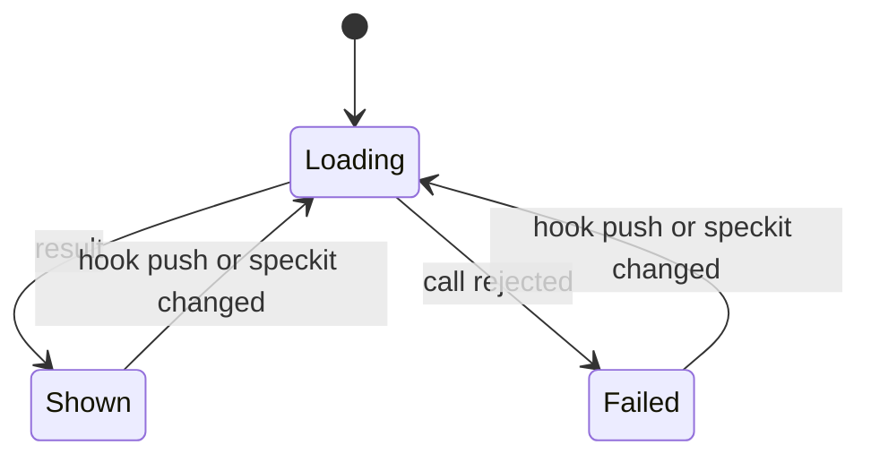

# Functional Spec: U10 u10-speckit-agent-status (US5.2 / US-1410)

This spec implements US5.2 in `stories.md` (AC5.2.1–AC5.2.3), assigned to U10 in `unit-of-work-story-map.md` and described in `unit-of-work.md`. It covers FR10 in `requirements.md` and provides contract C9 (`agents:progress`) in `contract-summary.md`, reading the active feature through U6's C5. The rules are in `rules.md` (BR10.1–BR10.8). Domain Design was skipped, so the boundaries follow the code.

## What the code already settles

- The popup (`AgentDialog`) already shows hook questions and permissions for any open project, a Spec Kit one included. Only the source note is new (BR10.6).
- `agents:progress(projectId, dirName)` today reads an AI-DLC intent's audit; it throws when the project has no AI-DLC space. That per-intent form stays for AI-DLC.

## Contract C9 (as in `contract-summary.md`)

```yaml
agents:progress(projectId) -> { source: hooks | tasks | none,
  waiting: { question: string, agent: string } | null,
  feature: { name: string, done: int, total: int } | null }
```

## Workflow: show the readout

1. The Specs view mounts `SpeckitProgress` above the features list (Q1 = A). It calls `agents:progress(projectId)`.
2. Main sees a Spec Kit project (or no dir name) and builds C9 (BR10.1): the waiting question from the hook event store (BR10.2), the active feature from `loadSpeckitFeatures` (BR10.3), and `source` (BR10.4). A failing part is `null`; the call still resolves.
3. The readout shows each part with its source, or the one "nothing to show yet" line (BR10.5).
4. A hook event push for the project, or `speckit:changed`, makes it call step 1 again (BR10.7).

Screen states:



Text fallback: the readout loads, then shows the result or a failure note; a hook push or a Spec Kit file change loads it again.

## Main-side modules

- `src/main/agentProgress.js`: `loadSpeckitProgress(root, events)` gives C9, with the pure `waitingFrom(events)` for BR10.2 so most tests need no files.
- `ipc.js`: `agents:progress` branches on the project's framework or a missing dir name; the preload call keeps its name.

## Assumptions

- "Oldest open" follows the popup's own pager order (questions and permissions before replies).
- In an AI-DLC project nothing changes: the token detail keeps calling `agents:progress(projectId, dirName)`.

## Tests (written first)

- **Waiting:** no events; one question; a question and a permission (the oldest wins); a settled or ended event left out; a reply left out; header missing (the body's first line); agent name missing (the harness label).
- **Progress:** an active feature with tasks; no active feature; the features reader failing (`feature: null`, no throw); `source` for each case.
- **IPC:** a Spec Kit project with no AI-DLC space resolves C9; an AI-DLC call with a dir name returns today's rows; no write under `.specify/` or `specs/`.
- **Renderer:** the readout shows the waiting question with its agent and source, the feature with done/total and source, both, and the empty line; a refresh on a hook push and on `speckit:changed`; listeners removed on unmount; the popup's hook page shows its source note.
